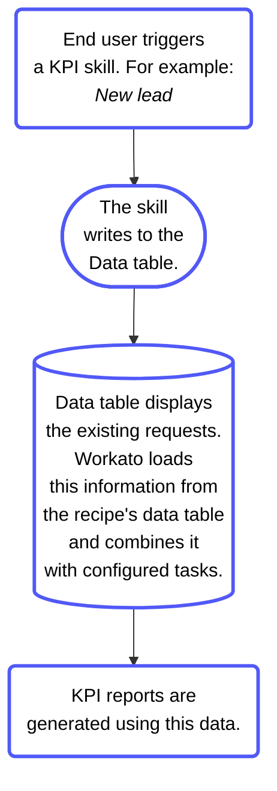

<!-- source: https://docs.workato.com/en/agentic/agent-studio/action-board | lastmod: 2026-07-10 -->
> Build an Action Board dashboard in Workato GO to visualize Agent Studio KPI metrics and track genie performance against company goals.

# Action Board in Workato GO

You can visualize your Agent Studio KPI metrics in Workato GO with Action Board. This enables you to build a dashboard of Key Performance Indicators (KPIs).

Watch a quick video guide: Create an Action board in Agent Studio

[Video](https://www.youtube.com/embed/mbLvR3PmBCQ?rel=0&si=snpFV5Kag_08SRC-)

A KPI is a quantifiable measurement of progress toward company goals. KPIs can help highlight areas of success and areas that require improvement with your genies. You can view KPIs on your genie's **Overview** page by clicking the **KPI** tab.

> **KPI TAB IS ONLY AVAILABLE FOR GENIES WITH THE WORKATO GO CHAT INTERFACE**
> 
> The KPI tab is only visible on the **Overview** page of genies that use the Workato GO chat interface.

KPIs use [Data tables](/en/data-tables) to store frequently used data and efficiently reference this data in KPI skills. KPIs are added to the data table you specify when you create a KPI skill.

## KPI design principles

Use clear, outcome-driven definitions when designing KPIs. Each KPI must state what the genie achieves and how you measure that outcome.

The following examples show how to apply this pattern in practice:

- **Weekly ticket deflection rate**: Monitor this rate to determine if it fall below the target, and notify the IT team to review recent conversations and identify knowledge base gaps if improvements are needed.
  
- **Leave requests submitted successfully**: Monitor the submission success rate to determine if the rate drops, and notify the HR team to review the submission flow and fix issues if improvements are needed.
  
- **Open approval requests**: Monitor the number of pending approvals, and notify the approver if requests accumulate.
  
- **Monthly escalation rate**: Monitor escalation trends over time to determine if the rate increases, and notify the genie owner to review escalated conversations and identify improvement areas if needed.
  

Complete the following steps to design a KPI thumbnail:

1. Define what data is needed to calculate the KPI. Consider the following:
   
   - Where does this data come from?
   - What formula produces the metric value from the raw data?
2. Create a Data table with the appropriate fields for your KPI to pull data from. Consider the following:
   
   - Which fields are used in the calculation?
   - Are these fields logged by your skills?
3. Determine the time aggregation for your KPI. Select an aggregation type, such as daily, weekly, running total, or point-in-time. Ensure the aggregation aligns with your Data table schema and KPI configuration.
   
4. Set baseline and target metrics. Baseline and target metrics provide your KPI with context to help you determine whether the current value is good, bad, or improving.
   

## Prerequisites

Verify you have the following configuration items before you create an Action Board:

- Your genie chat interface uses Workato GO.
  
- Your genie AI model uses an Anthropic Claude model. Action Board isn't available with OpenAI GPT models or bring your own LLM models.
  
- Skills that generate KPI data log outcome data to a [Data table](/en/data-tables). Action Board pulls data from Data tables. KPI metrics remain empty or inaccurate if your recipes don't log outcome data.
  

## Create a KPI

You must create a KPI for your Agent Studio genie before you can create an action board to display in Workato GO.

Complete the following steps to create a KPI:

1. Sign in to your Workato account.
   
2. Go to **AI Hub > Agent Studio**. A list of your existing genies displays.
   
3. Select the genie where you plan to add a KPI.
   
4. Click the **KPI** tab.
   
5. Click **\+ Add**.
   
   _**KPI** section_
   
6. Enter a name for your KPI in the **KPI name** field. For example: `High intent leads`.
   
   _**Add KPI** modal_
   
7. Use the **Data table** drop-down menu to select the data table you plan to use.
   
8. Optional. Provide a description of your KPI in the **About this KPI** field.
   
9. Click **Add KPI**.
   

## Display KPIs in Workato GO with Action Board

You can choose how your KPIs are displayed in your Workato GO action board.

The following thumbnails are available:

- **Default**: This thumbnail displays information in card format and is available to all user groups.
- **Metric & chart**: This thumbnail displays top and bottom metrics that you configure in chart format. You can select which user groups can view this thumbnail within Workato GO.
- **Stacked metrics**: This thumbnail displays three metrics that you configure in a stacked format. You can select which user groups can view this thumbnail within Workato GO.
- **Detailed table**: This thumbnail displays detailed information in a table format that you configure. You can select which user groups can view this thumbnail within Workato GO.

> **LIMITED TO FIVE THUMBNAILS**
> 
> Each action board is limited to five thumbnails.

Action Board displays a genie widget in addition to thumbnails. The genie widget is a conversational interface embedded directly in the Action Board. This lets you interact with the genie without leaving the dashboard view.

The genie widget uses your genie's Job description, skills, and knowledge bases. It surfaces the same genie used in the Workato GO chat interface directly within the dashboard.

The genie widget is configured automatically when your deploy your genie to Workato GO. No additional configuration is needed.

### Create an action board thumbnail

Complete the following steps to create a thumbnail for your action board:

1. Sign in to your Workato account.
   
2. Go to **AI Hub > Agent Studio**. A list of your existing genies displays.
   
3. Select the genie where you plan to add an Action Board thumbnail.
   
4. Click the **End user settings** tab.
   
5. Click **Display in Workato GO**.
   
   _Display in Workato GO_
   
6. Go to **Genie tags** and add tags to help users identify which department the genie supports. For example: `Sales`.
   
7. Provide a description in the **Describe what your genie does** field.
   
8. Go to the **Genie thumbnail** section and select the **Default** thumbnail or click **New thumbnail** to select one of the following thumbnails:
   
   - **Metric & chart**
   - **Stacked metrics**
   - **Detailed table**
   
   _**New thumbnail**_
   
9. Configure your thumbnail:
   
   **Default**
   
   This thumbnail doesn't require configuration.
   
   _**Default** thumbnail_
   
   **Metric & chart**
   
   1. Enter a name for your thumbnail in the **Name** field.
      
   2. Use the **User group access** drop-down menu to select the user groups that can view this thumbnail.
      
   3. Go to **Top metric** and click **\+ Configure metric**.
      
   4. Go to the **Data query** section and use the **Data source** drop-down menu to select the KPI you plan to use.
      
      _**Data query** section_
      
   5. Use the data configuration options to configure your thumbnail metrics using the information in the data table you created for your KPI. The following data configuration options are available:
      
      - Filter
      - Summarize
      - Join
      - Sort
      - Row limit
      - Calculated column
   6. Click **Save changes**.
      
   7. Go to **Bottom chart** and click **\+ Configure chart**.
      
   8. Go to the **Data query** section and use the **Data source** drop-down menu to select the KPI you plan to use.
      
   9. Use the data configuration options to configure your thumbnail metrics using the information in the data table you created for your KPI. The following data configuration options are available:
      
      - Filter
      - Summarize
      - Join
      - Sort
      - Row limit
      - Calculated column
   10. Go to **Chart settings** and use the **Type** drop-down menu to select **Bar** or **Line** as the chart type.
       
       _Chart settings_
       
   11. Go to **X-AXIS** and use the **Data column** drop-down menu to select the data column you plan to use for the x-axis.
       
   12. Optional. Click **Add breakdown** to break down the information using metrics from a data column you specify.
       
   13. Optional. Enter a label in the **Label** field.
       
   14. Go to **Y-AXIS** and use the **Data column** drop-down menu to select the data column you plan to use for the y-axis.
       
   15. Optional. Enter a label in the **Label** field.
       
   16. Click **Save changes**.
       
   
   **Stacked metrics**
   
   1. Enter a name for your thumbnail in the **Name** field.
      
   2. Use the **User group access** drop-down menu to select the user groups that can view this thumbnail.
      
   3. Go to **1st metric** and click **\+ Configure metric**.
      
   4. Go to the **Data query** section and use the **Data source** drop-down menu to select the KPI you plan to use.
      
      _**Data query** section_
      
   5. Use the data configuration options to configure your thumbnail metrics using the information in the data table you created for your KPI. The following data configuration options are available:
      
      - Filter
      - Summarize
      - Join
      - Sort
      - Row limit
      - Calculated column
   6. Click **Save changes**.
      
   7. Go to **2nd metric** and click **\+ Configure chart**.
      
   8. Go to the **Data query** section and use the **Data source** drop-down menu to select the KPI you plan to use.
      
   9. Use the data configuration options to configure your thumbnail metrics using the information in the data table you created for your KPI. The following data configuration options are available:
      
      - Filter
      - Summarize
      - Join
      - Sort
      - Row limit
      - Calculated column
   10. Click **Save changes**.
       
   11. Go to **3rd metric** and click **\+ Configure chart**.
       
   12. Go to the **Data query** section and use the **Data source** drop-down menu to select the KPI you plan to use.
       
   13. Use the data configuration options to configure your thumbnail metrics using the information in the data table you created for your KPI. The following data configuration options are available:
       
       - Filter
       - Summarize
       - Join
       - Sort
       - Row limit
       - Calculated column
   14. Click **Save changes**.
       
   
   **Detailed table**
   
   1. Enter a name for your thumbnail in the **Name** field.
      
   2. Use the **User group access** drop-down menu to select the user groups that can view this thumbnail.
      
   3. Go to **Table** and click **\+ Configure table**.
      
      _Table configuration_
      
   4. Use the data configuration options to configure your thumbnail table. The following data configuration options are available:
      
      - Filter
      - Summarize
      - Join
      - Sort
      - Row limit
      - Calculated column
   5. Go to **Chart settings** and enter a title for your table in the **Title** field.
      
      _Table chart settings_
      
   6. Go to **Displayed columns** and click the checkboxes to include or exclude columns from your table.
      
   7. Click **Save changes**.
      
   
10. Optional. Go to Workato GO to view your action board.
    
    _Action Board in Workato GO_

---
