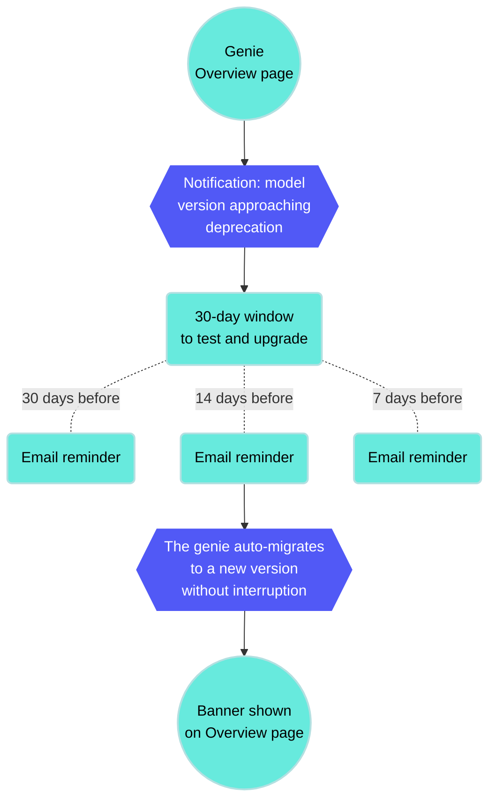

<!-- source: https://docs.workato.com/en/agentic/agent-studio/ai-model/ai-model-versions | lastmod: 2026-08-10 -->
> Reference for Claude and OpenAI model versions supported in Agent Studio, including deprecated versions, scheduled end-of-life dates, and Workato's automatic migration behavior.

# AI model versions

Workato supports multiple AI model versions across Anthropic and OpenAI providers. Supported models receive full platform support and automatic migration when a version is deprecated. Deprecated models have a scheduled end-of-life date and a recommended alternative.

## Supported AI models

The following AI models are supported:

| Provider | Model | Description | Tags |
| --- | --- | --- | --- |
| Anthropic | Claude Sonnet 4.6 | Advanced model for coding and enterprise workflows | Image, Latest |
| OpenAI | GPT-5.1 | Balanced model with adaptive reasoning | Latest, Thinking |
| OpenAI | GPT-5.2 | Advanced model for complex tasks | Thinking |
| OpenAI | GPT-5.4 | Most capable GPT model | Latest, Thinking |

## Deprecated AI models

The following AI models are deprecated:

| Provider | Model | Description | Deprecation date | Recommended alternative |
| --- | --- | --- | --- | --- |
| Anthropic | Claude Sonnet 3.7 |  | 2026-04-28 | Claude Sonnet 4.6 |
| Anthropic | Claude Sonnet 4.5 | Balance of intelligence, speed, and cost | 2026-09-29 | Claude Sonnet 4.6 |
| OpenAI | GPT-4.1 | Legacy model for non-reasoning tasks | 2026-10-14 | GPT-5.1 |

## Model lifecycle management

Model availability and lifecycles depend on each provider. Providers periodically sunset older models and release newer versions. Each new model may affect the performance and behavior of your genies.

Workato performs checks before making a new model available for selection:

- **Capacity checks**: Ensures the model can be supported without risk of service interruptions.
- **Evaluation checks**: Tracks model performance, reliability, and quality of outcomes.

This process minimizes the risk of unexpected changes to your genie's performance or outputs.

### AI model version migration

Your genie displays a notification on the **Overview** page to let you know when the AI model version for your LLM provider is approaching deprecation. You have 30 days to voluntarily test and upgrade your model version. Workato sends email reminders at 30, 14, and 7 days before auto-migration.

Workato automatically migrates your AI model to the updated model version 14 days before the deprecation date without interrupting your genie. This 14-day buffer ensures a smooth upgrade ahead of actual deprecation to prevent service disruption. Automatically migrated genies display a banner notification on the **Overview** page.

_AI model version migration notification_

You can stop your genie and [edit the LLM provider](/en/agentic/agent-studio/create-a-genie#connect-to-your-own-llm) if you plan to switch to a different LLM and AI model.

> **AUTOMATIC MIGRATION IS LIMITED TO PLATFORM AI MODELS**
> 
> Only Claude Sonnet and OpenAI GPT are migrated to updated model versions automatically.

---
