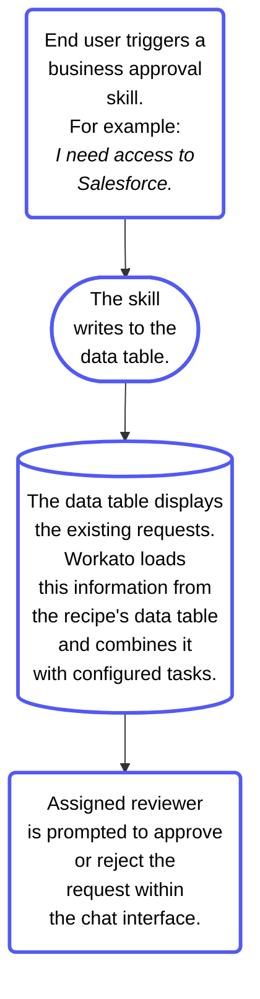

<!-- source: https://docs.workato.com/en/agentic/agent-studio/business-approvals | lastmod: 2026-07-13 -->
> Build Agent Studio skills with approval workflows so a designated reviewer approves or rejects genie operations in the chat interface before execution.

# Business approvals

Business approvals in Agent Studio let you build skills with approval workflows. [Skills](/en/agentic/agent-studio/create-a-genie#create-skills) equip your genie with a comprehensive toolset to take action and respond to end users. Skills with business approvals ensure that operations, such as provisioning access to an application, are reviewed by a designated approver before execution. The user you assign as an approver receives a notification to review requests.

> **BETA FEATURE**
> 
> This feature is in beta. Beta features are available in production, however, Workato may update feature functionality without notice.

Business approvals rely on the following actions:

- **Create approval request**
- **Assign task to user**

The **Create approval request** action and **Assign task to user** action use [data tables](/en/data-tables) to store data and efficiently reference this data in business approval skills. Business approvals are added to the data table you specify when you create a business approval skill.

Reviewers must be signed in to the [chat interface](/en/agentic/agent-studio/create-a-genie#add-a-chat-interface) you configured for your skill to receive requests. Reviewers are prompted to approve or reject requests within the chat interface.

_Business approval prompt in chat interface_

## Create a data table

The approval data table is the record system for all approval requests processed by your skill. You must create your data table before you create your skill.

Your data table must contain the following information at minimum:

- Unique record identifier
- Request ID generated by **Create Approval Request** action
- Conversation ID from the **Start workflow** trigger
  - The Conversation ID stored in the data table enables the recipe to send the approver's decision back to the user through the genie.
- Requester's identity, such as an email address or user ID from the authenticated skill context
- Request details, such as key parameters
- Current status, such as pending, approved, rejected, or expired
- Approver's identity
- Decision timestamp
- Creation timestamp

Your data table provides:

- **Persistence**: This prevents duplicate approval requests. Skills write a pending row to the data table at **Create approval request** time so the approval is on record before the notification is sent. This enables the recipe to check the data table on-retry if the skill call fails due to an error, such as transient Jira API error, after the approver has already approved the request. The recipe locates the approved record in the data table and proceeds to the system write action without re-requesting approval from the manager.
  
- **Audit trail**: The data table records all approval requests made through the skill. This audit trail is available for compliance review, for debugging unexpected behavior, and for reporting on approval patterns over time.
  

## Create approval request action

Use this action to create a new approval request in a data table you specify. The information from this request is shared with the user assigned to the approval task. Refer to the [Create approval request](/en/agentic/agent-studio/connectors/workato-genie-connector/actions/create-approval-request) action reference for a field-level description of inputs and outputs.

Complete the following steps to configure the **Create approval request** action:

1. Go to the skill where you plan to add an approval request.
   
2. Click the **Select an app and action** step in the recipe.
   
3. Search for and select `Workato Genie`.
   
4. Select the **Create approval request** action.
   
   _**Create approval request** action_
   
5. Use the **Request data table** drop-down menu to select the data table you plan to use.
   
6. Provide the **User ID** of the request in the **Created by** field.
   
7. Click **Save**.
   

## Assign task to user action

Use this action to assign a task to a user. The assignee receives a prompt within the chat interface you configured to approve or reject the request. The skill waits until the task is completed or expires. Refer to the [Assign task to user](/en/agentic/agent-studio/connectors/workato-genie-connector/actions/assign-task-to-user) action reference for a field-level description of inputs and outputs.

> **TASK ASSIGNMENT PREREQUISITE**
> 
> Users must be added to [Workato Identity](/en/workato-identity) before you can assign tasks to them.

Complete the following steps to configure the **Assign task to user** action:

1. Go to the skill where you plan to assign a task to a user.
   
2. Click the **Select an app and action** step in the recipe.
   
3. Search for and select `Workato Genie`.
   
4. Select the **Assign task to user** action.
   
   _**Assign task to user** action_
   
5. Use the **Genie** drop-down menu to select the genie you plan to use.
   
6. Use the **Request data table** drop-down menu to select the data table you plan to use.
   
7. Provide the request ID in the **Request ID** field. This is the same value as the **User ID** you provided in the **Create approval request** action **Created by** field.
   
8. Provide a name for the task in the **Task name** field.
   
9. Provide the email address of the user assigned to this task in the **Assignee** field.
   
10. Use the **Time to complete** drop-down menu to select the length of time the task is valid. Tasks expire if they aren't completed within the specified timeframe. The maximum value is `30` days.
    
11. Enter the `call_id` from the **Start genie** trigger in the **Call ID** field.
    
12. Enter the `conversation_id` from the **Start genie** trigger in the **Requester conversation ID** field.
    
13. Enter the **User ID** of the request in the **Created by** field.
    
14. Click **Save**.
    

## Use conditional logic

You must include conditional outcome logic in your Business approval. Add a conditional block after the **Assign task to user** action with three branches:

- **Approved branch**: Execute the system write operation, such as a Jira update, the Salesforce change, or an HR submission. Return a success response to the genie confirming the action was completed.
- **Rejected branch**: Don't execute the system write operation. Return a rejection response to the genie.
- **Expired branch**: Don't execute the system write operation. Return an expiry response to the genie to let the user know that no decision was made within the timeout window. Optionally, log the expiry to the data table for an audit.

## Business approval example use case

An employee asks the genie for access to an app, for example `I need access to Salesforce`. This request triggers a **Give access to application** skill, which has a business approval workflow to ensure that the request is reviewed before a change is made.

The skill creates an approval request and records details, such as the requester’s name, the application, and the justification, within the data table specified in the recipe. The genie assigns the request as a task to a designated approver. The approver is notified directly within the chat interface and can review the request details without leaving the conversation.

**Workflow outline**

- **Data table**: The data table acts as a record system for approval status, timestamps, approver identity, and outcome. Create your data table before your skill.
  
- **Trigger**: User starts the **Give access to application** skill in a chat.
  
- **Create approval request**: The recipe writes a new approval record to the data table.
  
- **Assign task to user**: The approver is assigned a task and notified within the chat interface to review the request.
  
- **Decision (modeled in the recipe)**
  
  - **If Approved**: The recipe provisions access. For example, **Add user to Salesforce** that grants the app role and **returns** a confirmation to the genie.
  - **If Rejected**: The recipe returns a rejection message with the approver’s note.
  - **If Expired**: The recipe returns an expiration message and logs the outcome.
- **Decision message**: The genie returns the decision to the user.
  

### Multi-level approval chain use case

Use cases requiring approvals from multiple stakeholders, such as a discount that requires both manager approval and finance approval, can be processed by configuring multiple **Assign task to user** action steps in sequence within the Approved branch of each preceding step. Each **Assign task to user** action uses the same Request ID from the original **Create approval request**.

**Workflow outline**

- **Create Approval Request**
- **Assign task to user**: Manager
  - **Approved**: Assign task to user: Finance > Approved/Rejected/Expired > Execute action or return outcome
  - **Rejected or expired**: Return rejection or outcome to the genie

### Approval routing with data tables use case

Organizations with defined approval routing rules that require different approvers based on request type, value, or requester's team may need to store the routing configuration in a data table. This enables the skill to dynamically look up the appropriate approver based on the request parameters before calling the **Assign task to user** action.

For example:

| Request type | Value threshold | Approver role | Approver email |
| --- | --- | --- | --- |
| Discount | < 20% | Manager | \[lookup from identity system\] |
| Discount | 20-30% | Sales Director | `sales.director@acme.com` |
| Discount | \> 30% | VP Sales | `vp.sales@acme.com` |
| Access | Standard | IT Manager | `it.manager@acme.com` |
| Access | Elevated | CISO | `ciso@acme.com` |

## Limitations

- **Business Approvals aren't compatible with Workato GO**: You can use Business Approvals with Slack and Microsoft Teams.
  
- **Business Approvals aren't compatible with Assign task to genie**: Approval notifications require human interaction while the **Assign task to genie** action runs without human interaction.

---
