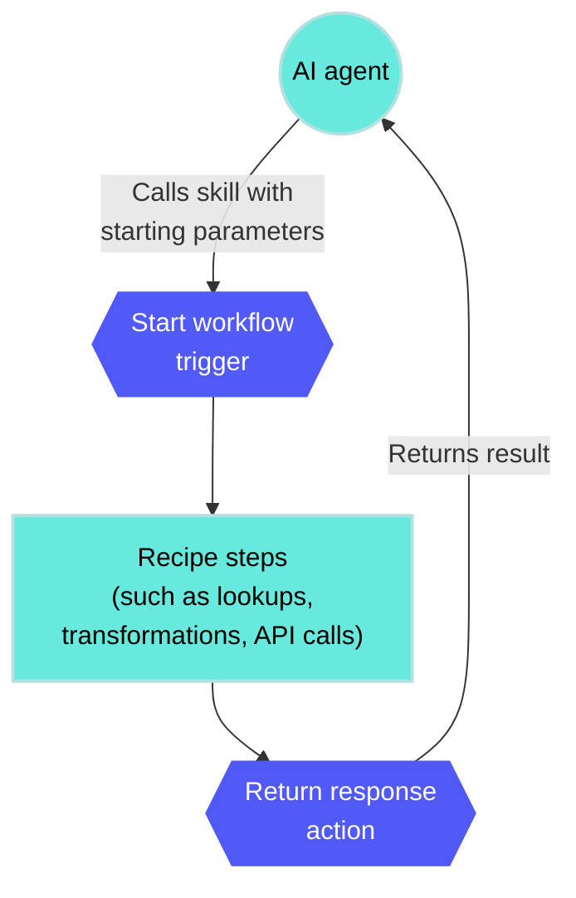

<!-- source: https://docs.workato.com/en/agentic/agent-studio/connectors/workato-skill-connector/workato-skill-connector | lastmod: 2026-10-16 -->
> Build skills that AI agents call as tools, using a built-in connector available with MCP and Agent Studio plans.

# Workato Skill connector

The Workato Skill connector lets you build skills that genies, MCP clients, and other AI systems can call as tools. The connector provides the skill functionality of the [Workato Genie connector](/en/agentic/agent-studio/connectors/workato-genie-connector/workato-genie-connector) without requiring access to genies.

Existing Workato Genie connector skills continue to function. Refer to [Transition from the Workato Genie connector](/en/agentic/agent-studio/connectors/workato-skill-connector/transition-from-genie-connector) for more information.

> **CONNECTOR ACCESS**
> 
> The Workato Skill connector is available to customers on Business MCP, Enterprise MCP, and plans with Workato Agent Studio enabled. Users with either the **Workato Genies** privilege or the **MCP servers** privilege can view and manage skills.

## Connection setup

The Workato Skill connector is a built-in connector. It doesn't require authentication or connection setup.

## Skill assignment

Assign a skill to one or more MCP servers or genies to make it available to them:

- [MCP server](/en/mcp/mcp-servers): The skill becomes available as an MCP tool to any external MCP client connected to the server, such as Claude, Microsoft Copilot Studio, or Glean.
- [Genie](/en/agentic/workato-genies): The skill becomes available to the genie's underlying agent.

## Recipe structure

When you create a skill, the recipe editor opens with a [Start workflow](/en/agentic/agent-studio/connectors/workato-skill-connector/start-workflow) trigger that receives parameters from the calling AI system and a [Return response](/en/agentic/agent-studio/connectors/workato-skill-connector/return-response) action that sends the result back.

After you configure the **Start workflow** trigger, you can optionally replace it with a different trigger to run the recipe from an external event instead of an agent invocation. The recipe editor prompts you for confirmation before it makes the change.

Replacing the trigger permanently removes the skill from any assigned genies and MCP servers, and you can't undo this action. The fields defined in the original trigger's result schema remain available in the **Return response** action.

Refer to the [Start workflow](/en/agentic/agent-studio/connectors/workato-skill-connector/start-workflow) and [Return response](/en/agentic/agent-studio/connectors/workato-skill-connector/return-response) pages for details about each step.

## Test a skill

You can test a skill in the recipe editor similar to how you [test a recipe](/en/recipes/testing). Select **Test** to run the skill with sample input, then review the input and output of each step in the job. You don't need to assign the skill to a genie or MCP server first.

Testing confirms that the skill's logic runs and returns the expected response. It doesn't test how an agent calls the skill. Refer to [Test your genie](/en/agentic/agent-studio/test-genie) to check how a genie selects the skill and maps inputs to it.

## Limitations

The Workato Skill connector has the following limitations:

- The **Return response** action has a maximum response size of 250 KB. You can pass larger responses as streamable datapills to work around this limitation. Refer to [Stream large results](/en/agentic/agent-studio/connectors/workato-skill-connector/return-response#streaming) for more information.
- Result fields don't support binary file content. Pass the binary content as a reference to a file storage location your agent can access. Refer to [Binary content](/en/agentic/agent-studio/connectors/workato-skill-connector/return-response#binary) for more information.

---
