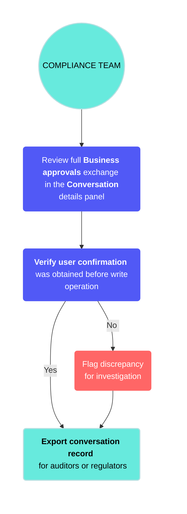

<!-- source: https://docs.workato.com/en/agentic/agent-studio/conversations | lastmod: 2026-09-24 -->
> View and analyze your genie's conversation history, debug errors, and improve genie performance using the Conversations page.

# Conversations

The **Conversations** page provides a complete view of your genie's interaction history, including a table of past conversation threads with key details such as:

- Conversation topic
- Participants
- Source
- Errors
- User feedback
- Started at
- Last message at
- Conversation ID

You can click a conversation to open the **Conversation details** panel. This lets you view the full exchange between the user and the genie. Each genie response in the thread is interactive. You can click a thread to open a **Response details** panel on the right, showing a breakdown of the genie’s reasoning and all the actions it took to produce that response.

You can also access conversation data programmatically through the [Developer API](/en/workato-api/agent-studio#conversations) or real-time [Audit log streaming](/en/features/activity-audit-log-streaming).

Watch a quick video guide: Conversation history in Agent Studio

[Video](https://www.youtube.com/embed/kyj4SICe9vM?rel=0&si=8FEMvDm5KbS7pI_E)

The **Response details** panel includes a detailed list of actions, such as LLM calls, skills, knowledge base lookups, recipes, and app calls. Each action can be expanded to display more information. You can switch between the **Input** and **Output** tabs to view additional information.

The **Conversation details** panel provides you with comprehensive observability over genie behavior and actions. This enables you to:

- Debug errors by tracing potential root causes
- Improve genie performance by identifying patterns behind errors or poor performance
- Iterate on genie use cases by observing user behavior and trends as well as genie and skill usage

## Retention and deletion

Workato will soon enforce a fixed 90-day retention policy for genie conversation data. The retention period won't be configurable. Refer to [Conversation data retention](/en/agentic/agent-studio/data#conversation-data-retention) for how the retention clock works, what's purged versus retained, and how to keep records beyond 90 days.

### Data subject rights

Conversation records are subject to data subject rights under GDPR and similar privacy frameworks, including the rights to access, correct, and delete personal data. We recommend having a process in place to retrieve conversation history for a specific user in response to a data subject access request.

On-demand deletion of a specific user's conversation data before the 90-day retention period ends isn't available. Plan your response to erasure requests around the 90-day retention schedule, accounting for the exception where source messages in [Slack and Microsoft Teams](/en/agentic/agent-studio/data#accessing-a-purged-conversation) can't be deleted.

To retrieve a specific user's conversation records for a data subject access request, filter by `identity_user_id` using the [Agent Studio Developer API](/en/workato-api/agent-studio#list-conversations), or locate them in your own store if you've set up [audit log streaming](/en/features/activity-audit-log-streaming#setting-up-audit-log-streaming).

## Permissions and access governance

Conversation history contains personal data, including the authenticated identity of each user and the content of their requests. You should scope access to conversation history to the minimum access needed for a legitimate purpose, such as debugging a specific problem, conducting a compliance audit, or reviewing genie behavior for governance purposes.

You can configure [conversation history permissions](/en/privileges#genies) on a per genie basis. Only workspace owners can access conversation history unless permissions are explicitly granted to additional roles.

Grant access based on the following guidance:

- **Builders and Genie owners**: Grant conversation history access for the genies they maintain, scoped to their specific genies.
- **Compliance and audit teams**: Grant read-only access for genies handling regulated use cases.
- **Security teams**: Grant access for incident investigation. Consider whether permanent access or request-based access is more appropriate for your organization's security model.
- **End users**: Don't grant access to other users' conversation history through the Agent Studio interface. Users can view their own conversation history through the Chat interface.
- **Managers and team leads**: Base this decision on your organization's policies on employee monitoring and AI system governance. Grant managers with a legitimate quality assurance purpose read-only access with appropriate disclosure to the team members whose conversations may be reviewed.

> **POTENTIAL SENSITIVE DATA EXPOSURE**
> 
> Admins should consider disabling Job history for certain users to prevent access to raw inputs and outputs that may contain sensitive data when using genies. Genies ingest knowledge and context through knowledge bases and skills. The raw inputs and outputs for knowledge bases and skills can be accessed through recipe Job history.

## View conversation details

You can access genie conversation details by clicking the **Conversations** tab in the genie **Overview** page.

Complete the following steps to access the **Conversations** page:

1. Sign in to Workato.
   
2. Go to **AI Hub > Agent Studio**. A list of your existing genies displays.
   
3. Select the genie where you plan to view conversations. The **Overview** page automatically displays.
   
4. Click the **Conversations** tab.
   
   _**Conversations** page_
   
5. Click a conversation to open the **Conversation details** panel. The panel opens to the **Activity** tab by default. You can switch to the **Run details** tab or **User feedback** for more information.
   
6. Optional. Click a genie response to view the genie **Thought process** panel. You can click each thought process to view additional information and switch between **Input** and **Output**.
   
   _Genie thought process_
   
7. Click the **User feedback** tab to review user feedback for the conversation. User feedback is received through Slack, Microsoft Teams, or custom chat interfaces with Headless API.
   
   _**User feedback** tab_
   

## Best practices

Workato recommends the following best practices to ensure that genie conversations are tuned to meet your goals:

### Perform quality assurance testing for updated Job descriptions

Sample real conversations after you change a Job description and confirm the intended behavior change occurred and no regressions were introduced. For example, pull a sample of conversations 48-72 hours after adding a new use case, and review each conversation to confirm the genie is classifying requests correctly and invoking the right skills.

**Review conversations workflow outline**

- **Job description change**: Update the Job description and publish the changes.
- **Sample conversations**: Go to the **Conversations** page and filter for conversations from the 48-72 hours after the change.
- **Review classifications**: Confirm that each conversation was classified into the correct use case category and that the right skill was invoked.
- **Identify regressions**: Flag conversations where classification or skill invocation is incorrect as regressions and compare results to the previous Job description version.
- **Resolve regressions**: Update the Job description to address the regression findings and repeat the review.

### Identify gaps in knowledge base and skill performance

Workato recommends that you use the **Conversations** page to identify gaps in knowledge base and skill performance. Reviewing conversations at volume can reveal systematic gaps in genie capabilities that aren't visible from aggregate metrics. For example, you notice that response quality is declining on the **Overview** page but can't identify the cause. You can go to the **Conversations** page and filter for long conversations and escalations, and identify a category of questions the genie is consistently failing to answer correctly.

**Identify gaps workflow outline**

- **Filter by outcome**: Go to the **Conversations** page and filter the results to show conversations that ended in escalation or without the user achieving their goal.
- **Filter by conversation length**: Apply an additional filter for conversations with a high turn count to identify where friction is occurring.
- **Identify patterns**: Review the filtered conversations to identify question types and phrasings the genie handles inconsistently.
- **Check Knowledge Base coverage**: Check whether the relevant content exists in the Knowledge base or is missing.
- **Update Skill or Knowledge base**: Update the affected skill's **When to Use** section or add the missing content to the Knowledge base to address the gap.

## Use case examples

Refer to the following example use cases to determine how the **Conversations** page can be applied to your workflows:

### Compliance auditing

The **Conversations** page provides the primary audit evidence for organizations where AI-assisted actions require an audit trail. For example, a compliance team must verify that a genie obtained user confirmation before executing a write operation. The team opens the **Conversations** page, locates the relevant conversation, and reviews the full exchange to check that confirmation was obtained and the correct approval workflow was followed.

**Workflow outline**

- **Identify conversation**: The compliance team opens the **Conversations** page and locates the conversation associated with the action under review.
- **Review exchange**: The team opens the **Conversation details** panel and reviews the full exchange between the user and the genie.
- **Verify confirmation**: The team confirms that the genie requested and received user confirmation before executing the write operation.
- **Check approval workflow**: The team verifies that [Business approvals](/en/agentic/agent-studio/business-approvals) were requested and followed for consequential operations.
- **Export evidence**: The team exports and submits the conversation record to auditors or regulators as evidence of AI system activity.

---
