<!-- source: https://docs.workato.com/en/agentic/agent-studio/design-workflows-with-multiple-steps | lastmod: 2026-10-28 -->
> Learn how to design genie workflows with multiple steps using a recipe-orchestrated architecture of specialized genies for accurate, reliable results.

# Design genie workflows with multiple steps

Workflows with multiple steps require multiple genies for accurate processing and results. Complex workflows must be broken down into a recipe-orchestrated architecture that uses multiple specialized genies. This enables your recipe to handle deterministic data retrieval and sequencing, while individual genies focus on specific inference tasks.

Workato recommends that you avoid using a single genie to handle an entire end-to-end business process. A genie asked to perform 20 to 30 steps in a single run loops repeatedly, misses steps, or produces inconsistent results. For example, a team building an expense report review automation creates a genie with seven stated steps but approximately 20-30 sub-steps. The genie is expected to complete the following tasks:

- Retrieve expense report details from Coupa
- Get travel dates for the expense report
- Refer to the Knowledge base to retrieve policies
- Log any policy violations on the overall expense report
- Extract receipt data and validate against the policy for each expense line
- Log violations on individual expense lines
- Summarize findings and route for approval

This workflow design forces the genie to run for an extended time when processing multiple expense lines, which increases chances for hallucination, overblown context, and skipped steps.

You can create a streamlined version of this workflow with multiple genies:

```mermaid
flowchart TD
    a(Recipe triggers: <br/> New expense report in<br>Coupa)
    b(Recipe retrieves <br/> expense report details <br/> from Coupa API)
    c(Recipe retrieves <br/> travel dates from <br/> Calendar API)
    d(<strong>Assign task to Genie 1</strong> <br/> <em>Validate this expense report <br/> against company policies</em>)
    e[(Genie 1: Policy Validator <br/> Reviews report against <br/> Knowledge base policies)]
    f(Genie 1 returns <br/> policy violations and <br/> validation results)
    g(Recipe loops through <br/> each expense line item)
    h(<strong>Assign task to Genie 2</strong> <br/> <em>Validate this expense<br>line against policy<br>requirements</em>)
    i[(Genie 2: Line Item Validator <br/> Checks receipt data <br/> against policy rules)]
    j(Genie 2 returns <br/> line item validation <br/> results)
    k(Recipe aggregates <br/> all validation results)
    l(Recipe routes <br/> for approval)
    a --> b
    b --> c
    c --> d
    d --> e
    e --> f
    f --> g
    g --> h
    h --> i
    i --> j
    j --> k
    k --> l
    classDef WorkatoBlue fill:#5159f6,stroke:#5159f6,stroke-width:2px,color:#fff;
    classDef WorkatoBlue2 fill:#fff,stroke:#5159f6,stroke-width:2px,color:#000;
    classDef WorkatoTeal fill:#67eadd,stroke:#67eadd,stroke-width:2px;
    class d,h,f,j WorkatoBlue;
    class e,i WorkatoBlue2;
    class a,b,c,g,k,l WorkatoTeal
```

## Create a workflow with multiple genies

Use the following guidelines to create a recipe architecture that supports multiple genies in a single workflow:

- **Recipe as orchestrator**: Create a Workato recipe to manage the overall workflow, such as calling external systems and coordinating genies in a sequence.
- **Deterministic steps in the recipe**: Use deterministic recipe steps to retrieve data, call APIs, and perform predictable transformations in recipe actions rather than through skill calls.
- **Specialized genies for inference**: Use a single genie to handle one focused task that requires judgment, such as `validate this expense report against policy` or `check this individual expense line`.
- **Assign task action for genie invocation**: Use the **[Assign task to genie](/en/agentic/agent-studio/agent-orchestration#assign-task-action)** action to invoke each specialized genie with required context.

## When to use multiple genie orchestration architecture

Use multiple genie orchestration architecture in the following scenarios:

- Expense report review and approval workflows
- Document processing pipelines with validation steps
- Workflows with 10 or more steps that require both inference and deterministic actions
- Processes that iterate over multiple items, such as line items, records, and documents
- Workflows that require different types of expertise at different stages
- Long-running processes that include human approval steps

## Multiple step workflow best practices

Use the following guidelines to build robust workflows with multiple steps:

- **Avoid diluted prompting**: Don't use large job descriptions that include multiple steps for your genie to process. This creates unreliable and inconsistent results.
- **Debug and troubleshoot**: Use individual genies for tasks to enable streamlined debugging and troubleshooting if a genie fails to perform a task properly.
- **Deterministic versus agentic separation**: Add recipe steps that execute the same way, such as expense report retrieval or travel dates retrieval. Save genie invocations for steps that require judgment or inference.
- **Specialized prompting per genie**: Create a focused job description for each genie in a workflow with multiple steps. A genie that validates overall expense reports requires different instructions than a genie checking individual line items.
- **Parallel processing for line items**: Use concurrent genie runs rather than using one genie to loop through line items sequentially when processing items, such as 50 to 100 expense lines. You can use a [Repeat for each loop](/en/recipes/repeat-for-each) to handle parallelism.
- **Consider batching**: Rather than one genie call per line item, evaluate whether a genie can process 5 to 10 items at once. Test for reliability and efficiency.
- **Keep the front-end genie separate**: Use a recipe as an orchestrator for complex processing if users interact with a conversational agent. You can use [Business approvals](/en/agentic/agent-studio/business-approvals) to receive results and notify users.

---
