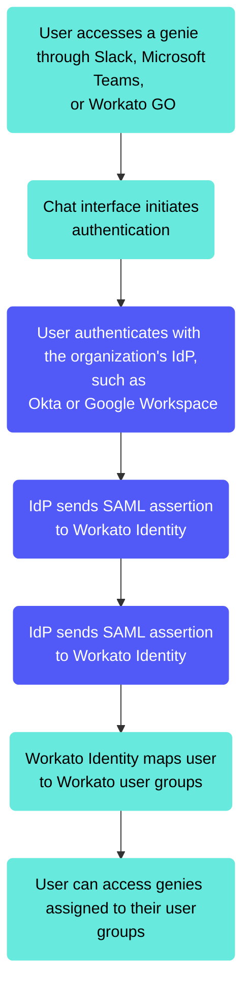

<!-- source: https://docs.workato.com/en/agentic/agent-studio/manage-users-and-access | lastmod: 2026-10-28 -->
> Manage users and access in Agent Studio, using Workato Identity and end-user groups to control which genies each user can access.

# Manage users and access

You can provide end users with access to specific genies. You must create an [end-user group](#user-groups) before you can add users and provide them with access to genies.

## Agent Studio and Workato Identity

[Workato Identity](/en/workato-identity) manages identity and access for Agent Studio. It allows you to manage authentication for end users who interact with genies through Slack, Microsoft Teams, or [Workato GO](/en/agentic/workato-go). It also manages access for workspace collaborators who build and maintain genies.

Workato Identity is used for end-user authentication for genie deployments. End users authenticate through your organization's existing identity provider through [SAML SSO](/en/workato-identity/saml-sso). Workato Identity receives the authenticated identity assertion from your IdP and maps it to the appropriate Workato user groups. These groups determine which genies each user can access. Refer to [Configure SAML-based authentication](/en/workato-identity/saml-sso#configure-saml-based-authentication) for more information.

This flow means that genie access is governed by your organization's existing identity system. A user who is offboarded from Okta loses genie access automatically without a separate deprovisioning step in Workato. A new employee added to the correct Okta group gains genie access automatically without manual provisioning in Workato.

## End-user groups

Use Workato Identity [user groups](/en/workato-identity/user-groups) to manage your end-user groups.

End-user groups control which employees can access specific genies. Each group maps to one or more IdP groups from your identity provider and is assigned to one or more genies in the genie end-user access configuration.

End-user groups operate independently from project structure. This means that a user group can be assigned to genies in different projects. The project structure governs where builder assets live. The user group structure governs who can use the genies those builders create. Workato recommends that you don't align user groups with project structure.

Design user groups based on the genie's audience and required access level.

- **Single-tier access**: Most genies serve a single population of users with uniform access that allows all employees to use the IT genie, or the sales team to use the Sales genie. One user group per genie is sufficient for this setup.
  
- **Multi-tier access**: Some genies serve different user populations with different capabilities, such as employees who can ask the HR genie questions and submit requests, and HR managers can additionally review and approve requests. Create separate user groups for each access tier and assign the Skills and Knowledge Bases available to each tier accordingly.
  
- **Cross-genie groups**: Some user populations span multiple genies, such as when the IT support team needs access to both the IT helpdesk genie and the IT incident management genie. Create a single user group for the IT support team and assign it to both genies rather than creating separate groups for each genie.
  

### Map IdP groups to Agent Studio user groups

Users must belong to a user group with genie access to use a genie. Map IdP groups to Workato user groups before you configure SSO. Consider the following questions to guide your mapping:

- **Which IdP groups correspond to genie user populations?**: An IT helpdesk genie should be accessible to all employees. Map the `all-employees` IdP group to the IT genie user group. A Sales genie should be accessible only to the sales team. Map the sales-team IdP group to the Sales genie user group.
  
- **Are there genies that require multiple access tiers?**: A genie with different capability levels for different user types, such as employees asking questions or managers approving requests. This requires separate user groups for each access tier, with each user group mapped to a different IdP group.
  
- **How are access changes managed?**: The IdP group change must propagate automatically to the Workato user group when a user moves from one team to another and their access requirements change. Test this workflow by removing a user from an IdP group and verifying that they lose genie access within the expected propagation time.
  

### End-user group genie access

You can provide access to specific genies after you create an end-user group with [Workato Identity](/en/workato-identity/user-groups).

Complete the following steps to grant an end-user group access to a genie:

1. Sign in to your Workato account.
   
2. Go to **AI Hub > Agent Studio** and select the genie where you plan to add end users to an end-user group.
   
3. Click the **End user access** tab.
   
4. Click **Add user groups**. The **Add user groups** modal displays.
   
5. Use the **End-user groups** drop-down menu to select the end-user groups you plan to provide with genie access.
   
6. Click **Add**.
   

## Agent Studio user group syncing

Group syncing automatically updates user group memberships in Workato based on group information from your identity provider. This ensures access permissions remain synchronized with your organization's directory.

Users must log in at least once to create a user record in Workato Identity. Workato doesn't create a user record if a user belongs to the correct IdP group but has not logged in. This affects [App Events](/en/agentic/agent-studio/app-events) directed to these users. For example, an App Event sent to a user who hasn't logged in fails because the user doesn't exist in Workato.

You can implement a pre-provisioning step if your genie sends App Events before a user logs in. This triggers a login or creates the user record before sending App Events. For example, when a new hire onboarding genie sends messages to employees on their first day.

### Slack and Microsoft Teams sync behavior

Genies deployed to Slack or Microsoft Teams have additional sync considerations. Users must message the genie through the chat interface to link their Slack or Microsoft Teams identity to their Workato Identity account.

A user who authenticates with Workato GO but hasn't interacted with the genie through Slack hasn't linked their Slack identity to their Workato Identity. App Events directed to their email address reach the correct Workato Identity account, but the notification doesn't surface in Slack until the Slack-to-Workato Identity link is established.

Slack-deployed genies should prompt target users to message the genie bot in Slack once before sending the user an App Event. This serves both as a discovery mechanism and as a trigger for the identity link that App Events require.

### Test your identity configuration before genie deployment

Test IdP and Workato Identity configurations with real user accounts, not builder accounts, before you deploy the genie. Use the following guidelines for your tests:

- **Test the happy path**: A user in the correct IdP group logs in to the chat interface and successfully interacts with the genie. Confirm that skills execute correctly and that user-context datapills return the correct authenticated identity.
  
- **Test the access denied path**: A user who isn't assigned to a genie user group attempts to interact with the genie. Confirm that the user receives an appropriate access denied message and can't proceed.
  
- **Test the group change path**: Remove a user from the IdP group. Confirm that on their next login they no longer have genie access. Re-add the user to the group. Confirm access is restored on next login.
  
- **Test with a user in multiple groups**: Confirm that all expected Workato user group assignments are present and that the multiple Okta groups issue don't affect the deployment.
  
- **Test App Events with real user accounts**: Send a test App Event to a user's email address. Confirm the notification displays in the chat interface for the user. This test specifically validates that the Slack or Microsoft Teams identity link is established correctly.
  

Refer to the Workato Identity [User group syncing](/en/workato-identity/user-group-syncing) documentation for more information.

---
