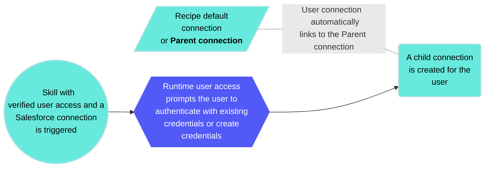

<!-- source: https://docs.workato.com/en/agentic/agent-studio/verified-user-access | lastmod: 2026-09-14 -->
> Verified user access authenticates actions at runtime to create user connections that link to the parent connection, environment, and user ID in Workato Identity.

# Verified user access

Verified user access works through [runtime user connections](/en/features/runtime-user-connections) and allows each end user to authenticate with their own credentials when a skill runs. This ensures that the skill performs actions using the identity and permissions of the individual user.

Verified user access establishes the authentication identity for the external system. It doesn't establish the user's identity within the genie conversation for access control purposes. User identity is established by [Workato Identity](/en/workato-identity) and the end-user groups configured for the genie.

Workato Identity determines who can access the genie. Users must be in the end-user groups assigned to the genie before they can initiate a conversation.

Verified user access determines what users can do through skills. This is determined by their permissions in the target system, and enforced at the moment the skill executes.

This two-layer model means a user who has been granted access to a genie but has limited permissions in Salesforce can use the genie but can't take actions in Salesforce that exceed their Salesforce permissions. The genie is the front end and verified user access enforces the back-end permissions that already exist.

## Parent connections

Parent connections act as templates that runtime user connections inherit. The system checks for an existing runtime connection linked to the parent when a user triggers a skill. Users are prompted to authenticate if no runtime connections are found.

User connections link to the parent connection, environment, and user ID in Workato Identity when you use verified user access to create connections at runtime. The genie calls a skill that uses the parent connection when an end-user talks to a genie and triggers a recipe. The genie responds in one of the following ways:

- **Connection prompt**: The chat interface prompts the user to click **Connect** if they've already created a runtime user connection. The skill executes using this child connection.
- **Create a runtime connection prompt**: The chat interface prompts the user to create a runtime user connection if they haven't already created a runtime user connection. The skill executes using this child connection.

_Connect prompt in the chat interface_

For example, when you run a skill with a Salesforce connection that requires verified user access, it creates a child connection for the user. This new connection links to the skill's default Salesforce connection as its parent.

## Keyword management in genie chat

You can manage your runtime user connections through the Slack and Microsoft Teams chat interfaces by typing the `! list_connections` keyword directly into the chat.

> **KEYWORD FORMAT**
> 
> You must include a space between `!` and `list_connections` to correctly use the keyword.

The `! list_connections` keyword allows you to:

- View a list of your current runtime connections
- Disconnect an active connection
- Delete a saved connection

> **WORKATO GO KEYWORD MANAGEMENT NOT SUPPORTED**
> 
> Workato GO doesn't support keyword management. You can manage Workato GO runtime user connections by going to **[Data sources](/en/agentic/workato-go/data-sources) > Genie Data Sources > Check Connection**.

Complete the following steps to use keyword management:

1. Go to the genie where you plan to manage your connections.
   
2. Enter `! list_connections` in the Slack or Microsoft Teams chat. The genie responds with a list of your current connections.
   
   _Keyword management_
   
3. Use the option drop-down menu to disconnect or delete a connection.
   

## When to use verified user access

Use verified user access in skills where one or more of the following is true:

- **The action should be taken as the user, not as a service account**: Any write operation where the `created by` identity matters for audit, compliance, or downstream workflow purposes. For example, creating records, updating records, or submitting requests.
  
- **The data returned should be scoped to the user**: Any read operation where the data visible to the user in the native application should also be the data visible in the genie. For example, leave balances, assigned tickets, or owned opportunities.
  
- **The target system's own permission model should be enforced**: If a user shouldn't be able to access a specific Jira project, a specific Salesforce record, or a specific HR system function through the native application, they should not be able to access it through the genie either. Verified user access ensures the target system's access controls apply.
  
- **The use case is in a regulated industry or requires audit trail compliance**: Any context where regulations require that actions be attributable to specific individuals rather than service accounts, such as healthcare, financial services, or government agencies.
  

## Add verified user access to skills

You can add verified user access to your skills during the recipe building process.

> **VERIFIED USER ACCESS AUTHENTICATION REQUIREMENTS**
> 
> Verified user access requires OAuth 2.0 authorization code grant. Other OAuth 2.0 grant types, such as client credentials, password grant, and refresh token grant, are not currently supported.

Complete the following steps to add verified user access to a skill:

1. Go to the skill where you plan to add verified user access.
   
2. Click **Select an app and action** step in the recipe.
   
3. Search for and select the app you plan to use. A list of available actions for the app displays.
   
4. Select the action you plan to use.
   
5. Select the connection type you plan to use for the skill.
   
   - **End user's connection**: Skills perform actions based on the identity and permissions of the user who connects to the application. Users authenticate with their own credentials to execute the skill.
   - **This recipe's connection**: This option uses the connection established by the recipe builder and follows the same principles as normal app connections.
   
   _Select **End user's connection** to enable verified user access_
   

Refer to the [Add skills](/en/agentic/agent-studio/create-a-genie#add-skills) section of the Agent Studio documentation for more information.

## Limitations

Verified user access may not be available, or if available, shouldn't be applied in the following cases:

- **The target system doesn't support OAuth 2.0**: Verified user access requires the target system to support OAuth 2.0 authentication. Systems that only support API key, basic authentication, or other non-OAuth mechanisms can't use verified user access. A shared service account is the only option for these systems.
  
- **Some users don't have direct access to the target system**: Verified user access can't be used if some, but not all users who interact with the genie have accounts in the target system. In this case, check whether the target system's API supports taking action on behalf of a user without requiring that user to authenticate directly. Some APIs, such as Jira, support a reporter field that records the user on whose behalf the action was taken, allowing the service account to create tickets attributed to a specific user without requiring that user to authenticate.
  
- **The skill is called through Assign Task to Genie**: A recipe that invokes a genie using the **Assign Task to Genie** action uses a headless invocation in which there is no user present in the conversation. Verified user access doesn't work without a user to authenticate. Any skill that uses verified user access and is called in an **Assign Task to Genie** action fails.
  
- **The genie is exposed as an MCP server**: Genies exposed as MCP servers use invocations through the **Assign Task to Genie** action. Authentication at the MCP layer establishes who can call the genie and doesn't allow verified user access within skill executions.
  

## Quotas

Your workspace has a combined runtime user connection (RUC) and verified user access (VUA) quota of 100,000 per workspace. The parent connection quota is 500 per workspace.

## Troubleshooting

This section provides common issues and solutions when working with verified user access.

- **Connection prompt doesn't appear**: The user triggers a skill using verified user access, but isn't prompted to authenticate. This usually means the skill's verified user access toggle is enabled, but the parent connection isn't configured correctly. Verify that the parent connection uses OAuth 2.0 authorization code grant authentication and that the connection is active in the workspace.
  
- **Skill fails after the user authenticates**: The user completes the OAuth flow but the skill returns an error. Common causes for this include:
  
  - The user doesn't have the required permissions in the target system. This is correct behavior and means that verified user access is working as intended.
  - The child connection was created successfully but the recipe isn't using the user context datapill correctly. Verify that the recipe is referencing the **Start workflow** trigger's user context output where needed.
- **User is prompted to authenticate every time**: The child connection should persist after the first authentication. The child connection may be expiring or being revoked if the user is being prompted repeatedly. Check the OAuth token lifetime configured in the parent connection and whether the target system is revoking tokens after a period of inactivity.
  
- **Verified user access works in Slack but not in Workato GO, or vice versa**: Verified user access behavior can differ slightly across Chat Interfaces due to how each interface handles the OAuth redirect flow. Test verified user access on each Chat Interface you deploy to. Don't assume that behavior on one interface replicates exactly on another.

---
