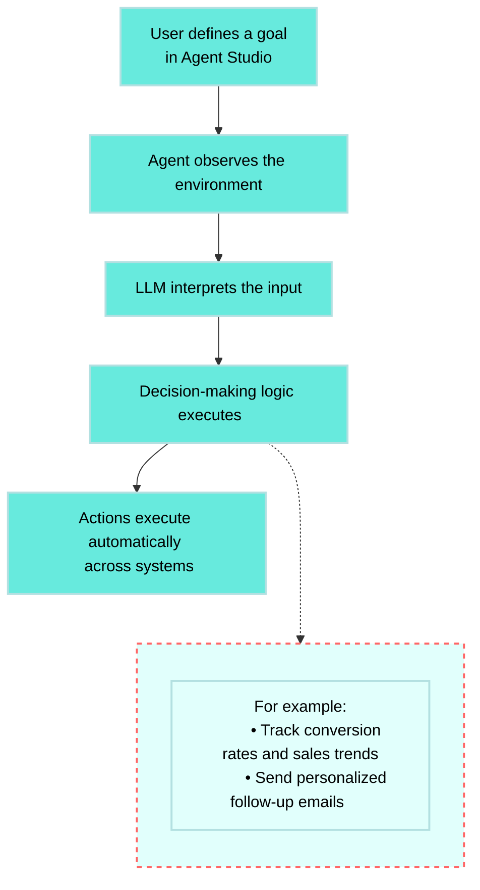
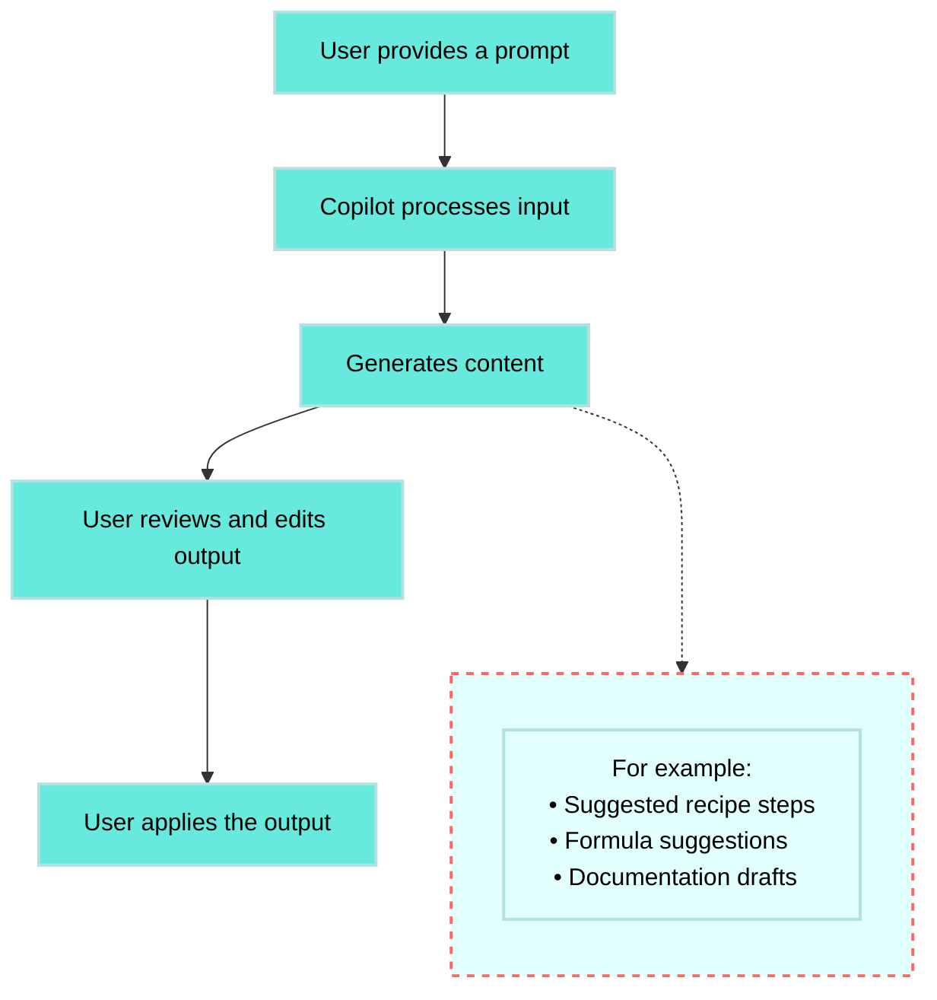

<!-- source: https://docs.workato.com/en/agentic/agentic-and-generative-ai | lastmod: 2026-06-30 -->
> Learn the key differences between agentic AI and generative AI, how each uses LLMs, and when to use the Workato Agentic platform or Copilots.

# Agentic AI and generative AI key differences

Agentic AI and generative AI both use large language models (LLMs), but provide different core functions. This page provides an overview of key differences between agentic AI, sometimes referred to as AI agents or simply as agentic, and generative AI.

## Agentic AI

Agentic AI initiates workflows without a prompt, dynamically processes new information, learns from its environment, and makes decisions to reach goals you define. Agentic AI takes initiative to adjust its behavior in real time, and executes multi-step plans with minimal human input.

Agentic AI is built to process complex tasks, meet long-term goals by executing multi-step workflows, make decisions in real time, and adapt to new information as conditions change.

### Workato Agentic platform

Workato’s Agentic platform provides agentic AI functionality. You can use [Agent Studio](/en/agentic/agent-studio#agent-studio) to build intelligent agents called genies. Genies pursue goals you define, adapt to context, and act across apps and data systems. Genies function beyond prompts to observe, reason, take action, and learn from outcomes. For example, if multiple employees report a software outage, an IT genie can detect the pattern, notify your team, update users, and log the event without input or instruction from you.

### When to use Agentic

Use Agentic when you plan to:

- Automate complex or dynamic workflows
- Build agents that respond in real time
- Create systems that adapt and learn from user interactions
- Automatically manage escalation, updates, and coordination with teams

## Generative AI

Generative AI works within specific boundaries that you specify in a prompt to produce content when asked. It doesn’t interact dynamically with external resources to obtain new information or adapt in real time. Generative AI systems excel at responding to prompts, but don’t set their own objectives or act without instruction.

Generative AI isn't designed to process complex tasks. Generative AI is built to process well-defined, short-term objectives. It’s primary purpose is to create content, such as writing a paragraph, suggesting a formula, summarizing an article, or filling in a field.

### Workato Copilots

Workato’s Copilots are generative AI in action. Copilots help you build faster by suggesting steps, writing documentation, recommending data mappings, and generating formulas. Copilots assist you by generating content, but they don’t execute or monitor workflows.

### When to use Copilots

Use Copilots when you plan to:

- Generate or refine a recipe
- Document automation steps
- Suggest field mappings and formulas
- Speed up connector development

## Agentic and Copilot comparison

| Use case | Use Copilot (generative AI) | Use Agent Studio (agentic AI) |
| --- | --- | --- |
| **Generate documentation or content** | ✅ |  |
| **Automate a multi-step workflow** |  | ✅ |
| **Suggest recipe steps or formulas** | ✅ |  |
| **Respond to dynamic business inputs** |  | ✅ |
| **Collaborate across tools and teams** |  | ✅ |
| **Speed up recipe or connector setup** | ✅ |  |

## Use Agentic and generative AI together

You can use [Agentic](/en/agentic/agentic) with generative AI technologies to build an AI agent that uses a generative AI component, such as OpenAI, to create natural-language updates, write status messages, or draft responses tailored to each user. The agent manages the logic and workflow while the generative layer provides flexible, human-like communication.

---
