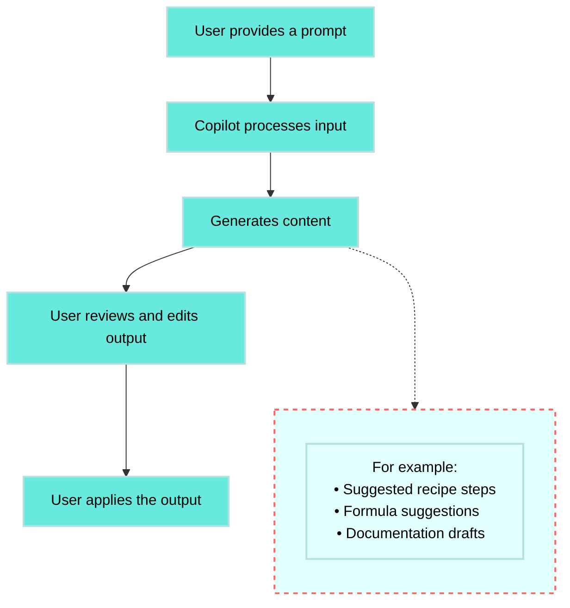

<!-- source: https://docs.workato.com/en/ai-features/copilot | lastmod: 2026-10-28 -->
> Workato Copilots use AI to help you build, document, and optimize recipes, formulas, mappings, and custom connectors faster.

# Copilots

Workato's Copilots leverage AI to enhance various aspects of your automation processes, making building, managing, and documenting your recipes easier and faster.

> **FEATURE AVAILABILITY**
> 
> Copilot is available for all direct customers in the US, EU, AU, JP, SG, IL, KR, and UK data centers. All data is sent to OpenAI's servers in the US. Copilot isn't available to workspaces in the CN data center. This reflects local regulatory requirements and Workato's commitment to data sovereignty and applies to our multi-tenant and [Virtual Private Workato (VPW)](/en/cloud-hosting-editions/hosting-editions#virtual-private-workato) offerings.
> 
> You can opt in to this feature by agreeing to our [AI feature addendum](https://www.workato.com/legal/ai-feature-addendum). Contact your Customer Success representative to learn more.

  

Copilots include several specialized tools, each designed to assist with specific tasks:

### [Recipe Copilot](/en/recipes/recipe-copilot#get-started-with-recipe-copilot)

Build and manage recipes efficiently with Recipe Copilot. It generates recipes, adds steps, and refines automation logic to streamline your workflow.

### [Docs Copilot](/en/recipes/recipe-description)

Document your recipes quickly with Docs Copilot. It generates initial descriptions and overviews, using your recipe information to create comprehensive and consistent documentation.

### [Mapper Copilot](/en/recipes/copilot-in-text-mode)

Generate text inputs for fields within your recipes using Mapper Copilot. It leverages AI to suggest relevant data mappings and text inputs based on your data structures, ensuring accurate data handling.

### [Formula Copilot](/en/recipes/copilot-in-formula-mode)

Create and refine complex formulas with Formula Copilot. It assists in generating precise data transformations and manipulations, using AI to build and improve formulas for your recipes.

### [Connector Copilot](/en/developing-connectors/sdk/copilot)

Streamline custom connector development with Connector Copilot. It helps you create authentication logic, define actions, and manage API interactions, enhancing your connector building process from start to finish.

### [Performance Copilot](/en/recipes/performance-copilot)

Optimize your recipes with Performance Copilot. It provides AI-powered evaluations and actionable suggestions across several dimensions, including cost, performance, security, and quality

> **AI BEST PRACTICES**
> 
> Consider the following best practices to maximize the benefits of Workato's AI features:
> 
> - Ensure your workspace meets the requirements and follow the steps to enable AI features correctly.
>   
> - Review each AI-generated suggestion to ensure it aligns with your automation goals and requirements.
>   
> - Test AI-generated suggestions thoroughly in a development or test environment to avoid issues in your production environment.
>   
> - We recommend ensuring your data is clean and well-structured for AI analysis and processing.
>   
> - Continuously monitor AI-driven processes and make adjustments as needed to maintain optimal performance.
>   

Learn how to [set up and use Copilots](#set-up-copilots) in your workspace to get started with any of the Copilot features.

## Agentic and Copilot comparison

| Use case | Use Copilot (generative AI) | Use Agent Studio (agentic AI) |
| --- | --- | --- |
| **Generate documentation or content** | ✅ |  |
| **Automate a multi-step workflow** |  | ✅ |
| **Suggest recipe steps or formulas** | ✅ |  |
| **Respond to dynamic business inputs** |  | ✅ |
| **Collaborate across tools and teams** |  | ✅ |
| **Speed up recipe or connector setup** | ✅ |  |

## Set up Copilots

You must meet the following requirements to set up Copilots in your workspace:

- Your company has signed and agreed to Workato's AI feature addendum through DocuSign.
- You are assigned the [Environment admin](/en/user-accounts-and-teams/role-based-access/new-model/system-environment-roles#environment-admin) role or the legacy [Admin](/en/roles#role-admin) system role.

> **PERMISSIONS**
> 
> Copilots do not have granular permission settings. When you enable it in your workspace, all collaborators within your workspace can access it, regardless of their role.

### Standard workspaces

Complete the following steps to set up Copilots in a standard workspace:

1. Sign in to your Workato account.
   
2. Go to **Workspace admin > Settings > Workato AI**.
   
3. Ensure that Copilot's terms of service comply with your company's policies.
   
4. Click **Enable Copilot**.
   
   _Enable Copilot_
   
   > **IMPACT ON WORKSPACE ENVIRONMENTS**
   > 
   > Enabling Copilots affects all environments within your workspace. Ensure you consider this impact before activation.
   

You can disable Copilots at any time by navigating to the same settings and clicking **Disable Copilot**.

_Disable Copilots_

### AHQ workspaces

Complete the following steps to set up Copilots in an AHQ workspace:

1. Sign in to your Workato account.
   
2. Click **Workspace admin > Settings > Workato AI**.
   
3. Ensure that Copilot's terms of service comply with your company's policies.
   
4. Click **Enable Copilot**.
   
   _Enable Copilot_
   
   > **IMPACT ON AHQ WORKSPACE**
   > 
   > Enabling Copilots in the parent AHQ workspace will automatically grant access to it across all associated child workspaces. Copilot usage can then be enabled or disabled independently in each workspace. It is disabled by default.
   > 
   > Enabling Copilots affects all environments in that workspace (and associated workspaces if enabled in parent workspace) such as Development, Test, and Production. Ensure you consider this impact before activation.
   

You can disable Copilots at any time by navigating to the same settings and clicking **Disable Copilot**.

_Disable Copilots_

## Data usage

Refer to [data usage](/en/recipes/copilot-data-usage) for information on how data is used by each Copilot feature.

---
