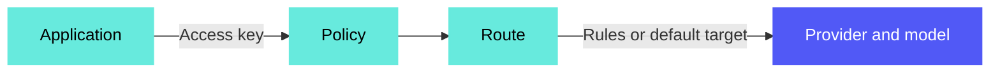

<!-- source: https://docs.workato.com/en/ai-gateway | lastmod: 2026-11-04 -->
> Model Gateway gives you OpenAI-compatible and Anthropic-compatible APIs to authenticate LLM providers, route requests, and enforce policies across your applications.

# Model Gateway

Model Gateway is a single point of control between your applications and LLM providers. Applications connect through an OpenAI-compatible or Anthropic-compatible API, and the gateway handles provider authentication, routing, and policy enforcement so your applications don't have to.

> **FEATURE AVAILABILITY**
> 
> Model Gateway is available to select customers. Contact your Customer Success Representative to confirm whether it is available in your workspace.

The following diagram shows the path a request takes through Model Gateway:

You can use Model Gateway to perform the following:

- **Issue scoped access keys to teams**: Generate access keys for each team, project, or application instead of sharing provider credentials. Revoke or rotate a key without touching downstream applications, and keep provider keys out of environment variables, configuration files, and CI pipelines.
- **Swap providers without rewriting applications**: Route Workato recipes, genies, copilots, and external applications through a single gateway that accepts OpenAI-compatible and Anthropic-compatible requests. Both APIs work with any provider, such as OpenAI, Anthropic, Azure OpenAI, or AWS Bedrock, so you can switch models and providers without code changes in the calling applications.
- **Apply usage limits**: Define rate limits and token limits in a policy, then assign the policy to the access keys a team or application uses to cap how much they can consume.
- **Restrict access by IP address**: Allow or block requests from specific IP addresses or ranges in a policy.

## Key components

Model Gateway includes the following components:

- **[Providers](/en/ai-gateway/providers)**: Connections to LLM services, such as Anthropic, OpenAI, Azure OpenAI, AWS Bedrock, Fireworks, and Gemini, along with the credentials Model Gateway uses to authenticate. Providers are stored in a project and can be reused in genies.
- **[Routes](/en/ai-gateway/routes)**: The targets that serve requests. A route resolves to a provider and model, either directly or through rules that match on tags, keys, parameters, or request complexity. Applications reference a route by its route ID.
- **[Access keys](/en/ai-gateway/access-keys)**: Credentials that applications present to Model Gateway. Each access key grants access to one or more routes and attributes usage to a team or application.
- **[Policies](/en/ai-gateway/policies)**: Reusable rate limits, token limits, and IP access restrictions that you assign to routes and access keys.
- **[Dashboard](/en/ai-gateway/monitor)**: Workspace-level visibility into request volume, token usage, and success and failure rates.

Refer to [Configure Model Gateway](/en/ai-gateway/configure) for the order to set up these components. After you create an access key, [test a route](/en/ai-gateway/test-route) and [connect your clients](/en/ai-gateway/connect-clients).

## How Model Gateway works

Applications send a request to Model Gateway and authenticate with an access key. The access key determines which routes the application can use, and the route it names determines the provider and model that serves the request. When a policy applies, Model Gateway enforces its rate limits, token limits, and IP access restrictions before the request reaches the provider.

## Supported applications

Model Gateway exposes two APIs that clients, such as genies, Workato recipes, or external applications, can route through without code changes:

- **OpenAI-compatible API**: Any client that's compatible with the OpenAI SDK, including Workato recipes, [genies](/en/agentic/agent-studio), copilots, and external applications.
- **Anthropic-compatible API**: Clients that use the Anthropic Messages API, such as Claude Desktop, Claude Code, and applications built with the Anthropic SDK. Set the client's base URL to `<model-gateway-host>/anthropic`, for example `https://ai.workato.com/anthropic`. This API supports the `/anthropic/v1/messages` and `/anthropic/v1/messages/count_tokens` endpoints. Refer to [Connect Anthropic-compatible clients](/en/ai-gateway/connect-clients#connect-anthropic-compatible-clients) to configure Claude Desktop, Claude Code, and the Anthropic SDKs.

Both APIs work with every route, regardless of the provider behind it. For example, an application built with the Anthropic SDK can send requests through the Anthropic-compatible API to a route backed by OpenAI or AWS Bedrock. You aren't locked into a provider by the API format your clients use.

Model Gateway supports Server-Sent Events (SSE) end to end on both APIs to allow streaming responses to render incrementally rather than waiting for the full payload.

---
