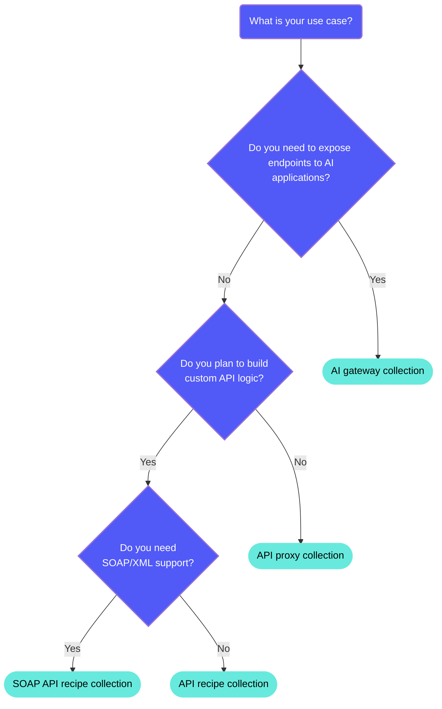

<!-- source: https://docs.workato.com/en/api-mgmt/api-collections | lastmod: 2026-09-08 -->
> Group API endpoints with a common access pattern into Workato API collections, covering proxy, recipe, and AI gateway collection types.

# API collections

An API collection consists of [API endpoints](/en/api-mgmt/api-endpoints) with a common access pattern, so that they can be managed together. For example, a set of Salesforce endpoints that are called by recipes used by the sales team should be grouped together into an API collection.

Go to **Platform > API platform > API collections** to access the API collections page. The API collections page displays all API collections within a workspace.

A collection can include either API proxy endpoints, API recipe endpoints, SOAP API recipe endpoints, or AI gateway endpoints.

> **SUMMARY**
> 
> - API collections in Workato are groups of endpoints with a common access pattern.
> - Workato offers machine-readable documentation (OpenAPI v3.0) for endpoints in an API collection. The documentation can then be synced to Postman.

_API collections page_

## Collection types

There are four types of API collections:

- [API proxy collection](#api-proxy-collection): Forwards incoming requests to an existing API backend. Optimized for high-volume, low-cost jobs with minimal latency.
- [API recipe collection](#api-recipe-collection): Builds custom endpoints from API recipes. Optimized for high-value jobs with full flexibility to fetch and process data.
- [AI gateway collection](#ai-gateway-collection): Exposes endpoints to LLMs, GPTs, or other AI applications to take actions on your behalf.
- [SOAP API recipe collection](#soap-api-recipe-collection): Exposes Web Services Description Language (WSDL) based SOAP 1.1 or 1.2 service endpoints. Generates one recipe per WSDL operation automatically.

The type of collection you choose depends on your use case. Use the following decision tree to determine the collection type that fits your requirements:

### API proxy collection

Choose an **API proxy collection** when you plan to **bring** your own backend. When a proxy endpoint receives an incoming request, Workato forwards the request to your existing API backend.

API proxy collections are ideal in this scenario for the following reasons:

- API proxy collections are optimized for high-volume, low-cost jobs.
- Proxy jobs are executed with minimal latency.
- Proxy requests are not subject to concurrency quotas.
- With API proxy collections, customization options are limited because the main function is to forward requests.

Refer to the [API proxy collection](/en/api-mgmt/api-collections/proxy-collection) guide for more information.

An API proxy collection can also be configured to accept unauthenticated requests, so callers can reach its endpoints without credentials. Refer to [Unauthenticated API collections](/en/api-mgmt/unauthenticated-collections) for more information.

### API recipe collection

Choose an **API recipe collection** when you plan to **build** your own backend. Each endpoint in the collection maps to an [API recipe](/en/api-mgmt/api-recipes/) that contains the logic to fetch and process data from other sources. For example, a recipe could use the Salesforce API to search for opportunities that match a particular name, and create the opportunity if the search returns no matches.

API recipe collections are ideal in this scenario for the following reasons:

- API recipe collections are optimized for high-value jobs.
- API recipe jobs are subject to a concurrency quota.
- API recipe collections provide the flexibility to highly customize how you fetch and process data.

Refer to the [API recipe collection](/en/api-mgmt/api-collections/recipe-collection) guide for more information.

### SOAP API recipe collection

Choose a **SOAP API recipe collection** when you plan to expose WSDL-based SOAP 1.1 or 1.2 services. Workato generates one recipe per operation based on the uploaded WSDL and validates XML requests automatically. SOAP API recipe collections are ideal in the following scenarios:

- You must support legacy enterprise systems that require XML/SOAP protocols.
- You plan to auto-generate and manage SOAP endpoints from a WSDL.
- You require schema enforcement, resource control, and WSDL export.

Refer to the [SOAP API recipe collection](/en/api-mgmt/api-collections/soap-api-recipe-collection) guide for more information.

### AI gateway collection

Choose an **AI gateway collection** if you plan to expose endpoints to LLMs, GPTs, or other AI applications. This exposure enables AI applications to take actions on your behalf.

AI gateway collections are ideal in this scenario for the following reasons:

- AI gateway collections allow you to specify an authorization mechanism between Workato and the AI agent to keep your requests secure.
- AI gateway collections allow you to upload your OpenAPI Specification (OAS) from Workato to prevent additional processing for your AI agents.

Refer to the [AI gateway collection](/en/api-mgmt/api-collections/gateway-collection) guide for more information.

## Sync to Postman

You can make your API collection available beyond the original client after your API collection is successfully deployed and live. Sync your API collection to your [Postman](https://www.postman.com/) workspace to increase visibility and drive adoption through Postman's internal and external portals.

Refer to [Sync to Postman](/en/api-mgmt/api-collections/sync-postman) for more information.

---
