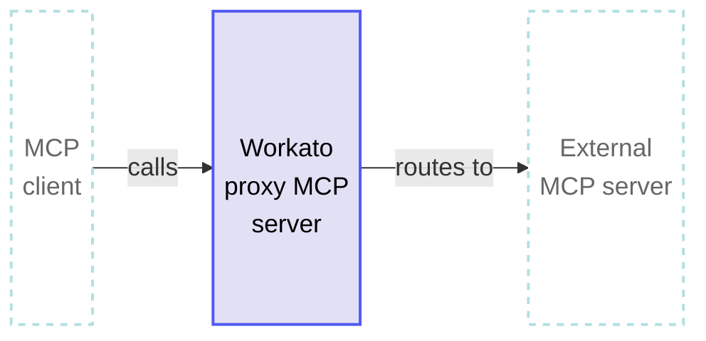
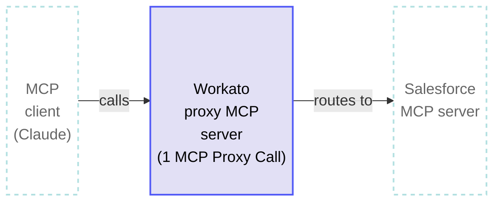

<!-- source: https://docs.workato.com/en/billing-and-usage/usage-metrics/mcp-proxy | lastmod: 2026-09-16 -->
> Learn how Workato measures MCP proxy usage in MCP Proxy Calls, counted per request routed from an MCP client to an external MCP server.

# MCP proxy usage

Workato measures MCP proxy usage in MCP Proxy Calls. Each successful proxied request counts as 1 MCP Proxy Call.

## How MCP Proxy Calls are measured

A [proxy MCP server](/en/mcp/mcp-gateway#proxy-to-third-party-mcp-servers) is a Workato-hosted MCP server that fronts an external third-party MCP server. An MCP client, such as Claude, Cursor, or Windsurf, connects to the proxy MCP server, which authenticates the request and routes it to the external MCP server. Each request that completes end-to-end counts as 1 MCP Proxy Call.

Total usage: 1 MCP Proxy Call

## MCP proxy calculation rules

MCP proxy usage calculations follow the general [usage calculation rules](/en/pricing/usage-metrics#rules). In addition:

- Each successful proxied request counts as 1 MCP Proxy Call, regardless of how long the external MCP server takes to respond.
- Failed requests don't contribute to usage. Customer-handled `4xx`/`5xx` responses that reach a terminal state count as successful.

## MCP proxy usage examples

The following example demonstrates how Workato calculates MCP proxy usage when an MCP client invokes a tool exposed by a Workato proxy MCP server.

### MCP client calls a proxied tool

**Overview**

Total usage: 1 MCP Proxy Call

**Explanation**

An MCP client, such as Claude, invokes a Salesforce record-lookup tool exposed by a Workato proxy MCP server. The proxy authenticates the request and routes it to Salesforce's MCP server. The proxied request counts as 1 MCP Proxy Call. Additional tools invoked in the same session each count as their own MCP Proxy Call.

#### Usage totals

- **MCP Proxy Calls**: 1
- **Total usage per proxied request**: 1 MCP Proxy Call

---
