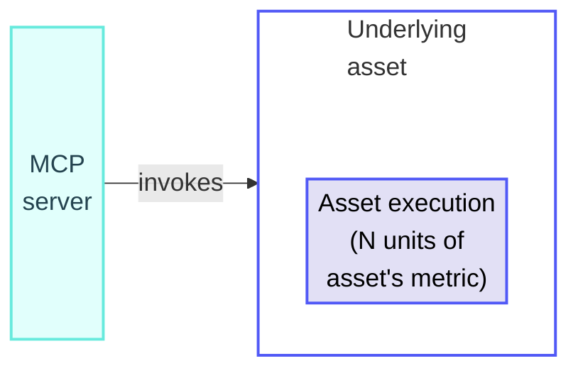
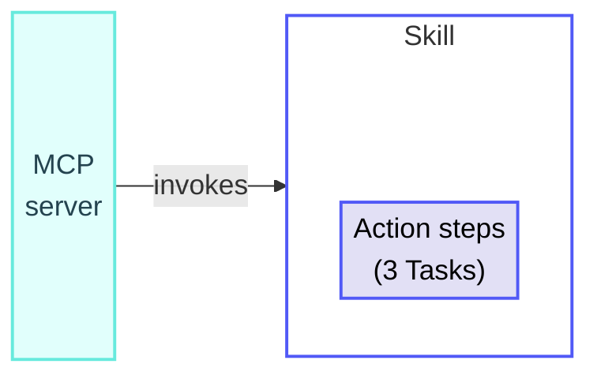
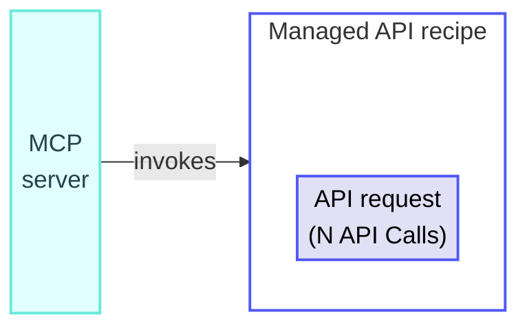
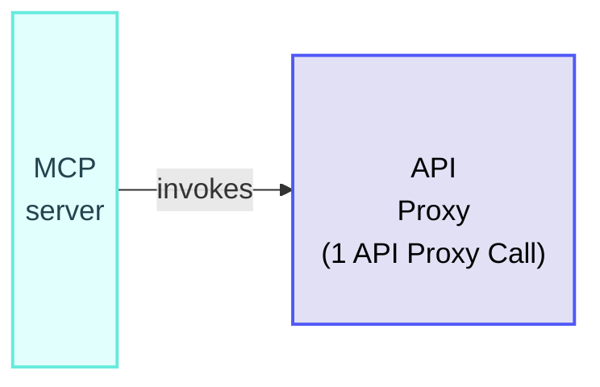
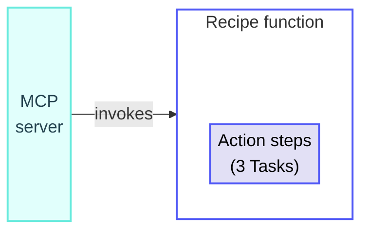

<!-- source: https://docs.workato.com/en/billing-and-usage/usage-metrics/mcp | lastmod: 2026-09-16 -->
> Learn how Workato measures MCP usage based on the underlying asset invoked by the MCP server, with a breakdown by asset type.

# MCP usage

Workato measures MCP usage based on the underlying asset the MCP server invokes.

> Some plans measure MCP usage in [MCP calls](/en/pricing/usage-metrics/mcp) rather than by the underlying asset's metric. Refer to your contract or contact your Customer Success Representative for more information.

## How MCP usage is measured

Workato measures usage based on what the server invokes when an external agent or client calls a Workato MCP server. Refer to the metric page for the underlying asset to see how its usage is calculated.

Total usage: N units of the asset's usage metric

## MCP calculation rules

MCP usage calculations follow the general [usage calculation rules](/en/pricing/usage-metrics#rules). In addition:

- Workato attributes usage to the underlying asset, not the MCP server.
- Skills invoked over MCP are billed as Tasks.
- Recipe functions exposed directly as an MCP tool run as independent workflows and are measured in Tasks. Recipe functions called synchronously from another MCP-exposed asset (such as a workflow or API recipe) inherit the calling asset's usage metric. Refer to [Tasks](/en/recipes/tasks) for more information.
- IDP (Pages) and Event streams (Events) are counted in addition to the invoked asset's usage metric when applicable.

## MCP usage examples

The following examples demonstrate how Workato calculates MCP usage for common underlying assets. Refer to [Skills](/en/billing-and-usage/usage-metrics/skills), [Managed API](/en/pricing/usage-metrics/api-platform), [API Proxy](/en/pricing/usage-metrics/api-proxy), or [Tasks](/en/recipes/tasks) for the underlying calculation rules.

### Skill invoked over MCP

**Overview**

Total usage: 3 Tasks

**Explanation**

An MCP client invokes a Skill over MCP. The Skill's action steps are counted as Tasks, following the [Skill calculation rules](/en/billing-and-usage/usage-metrics/skills#usage-calculation-rules). In this example, the Skill executes 3 action steps.

#### Usage totals

- **Tasks**: 3
- **Total usage per invocation**: 3 Tasks

### Managed API invoked over MCP

**Overview**

Total usage: N API Calls

**Explanation**

An MCP client invokes a Managed API recipe over MCP. The request is counted as API Calls, following the [Managed API calculation rules](/en/pricing/usage-metrics/api-platform#usage-calculation-rules). Response time affects the count.

#### Usage totals

- **API Calls**: N
- **Total usage per invocation**: N API Calls

### API Proxy invoked over MCP

**Overview**

Total usage: 1 API Proxy Call

**Explanation**

An MCP client invokes an API Proxy over MCP. Each request counts as 1 API Proxy Call, following the [API Proxy calculation rules](/en/pricing/usage-metrics/api-proxy#usage-calculation-rules). Response time doesn't affect the count.

#### Usage totals

- **API Proxy Calls**: 1
- **Total usage per invocation**: 1 API Proxy Call

### Recipe function invoked over MCP

**Overview**

Total usage: 3 Tasks

**Explanation**

An MCP client invokes a recipe function exposed directly as an MCP tool. The recipe function runs as an independent workflow and its action steps are counted as Tasks. In this example, the recipe function executes 3 action steps.

#### Usage totals

- **Tasks**: 3
- **Total usage per invocation**: 3 Tasks

---
