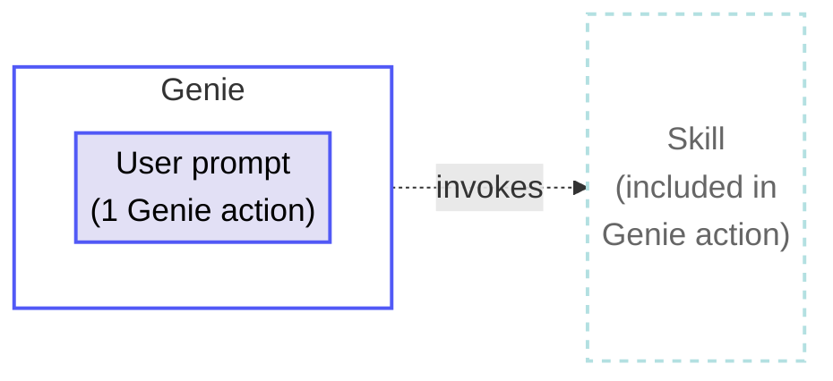
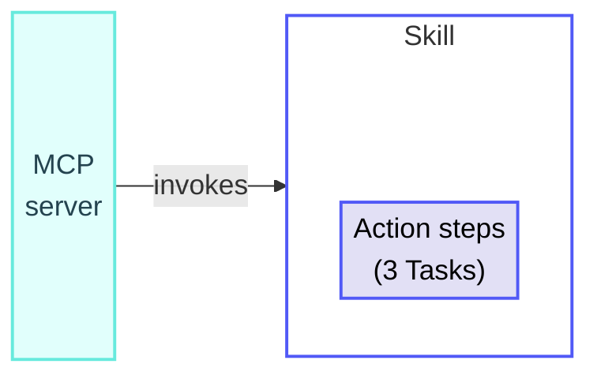
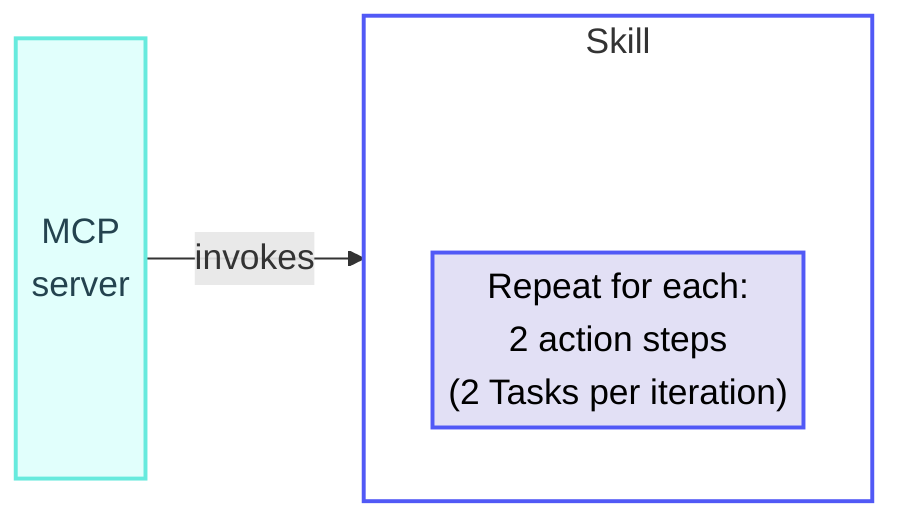
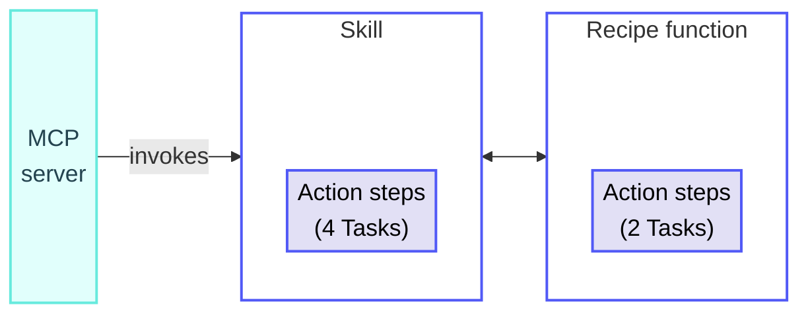

<!-- source: https://docs.workato.com/en/billing-and-usage/usage-metrics/skills | lastmod: 2026-09-16 -->
> Learn how Workato measures skills usage in Tasks, including when skills are included in Genie actions and how they're counted when invoked over MCP.

# Skills usage

Workato measures skill usage in Tasks. A Task is a single action step that a skill executes. Every action step counts as a Task, regardless of which app is used. Triggers and control flow steps don't count as Tasks.

Skill usage is calculated based on how the skill is invoked:

- **Billed as Tasks when invoked over MCP**: A skill's action steps count as Tasks.
- **Included in the Genie action when invoked by a Genie**: A skill's steps are included in the Genie action and don't contribute to Tasks. IDP, Event streams, and recipe functions inside the skill still count separately:
  - **IDP**: Contributes to Pages.
  - **Event streams**: Contributes to Events.
  - **Recipe functions**: Recipe functions called from a skill are billed as Tasks.

> Some plans measure skill usage differently. Refer to your contract or contact your Customer Success Representative for more information.

## Skill calculation rules

The following rules apply when a skill is invoked over MCP or MCP proxy and billed as Tasks:

- Triggers don't count as Tasks, regardless of the connector that provides them.
- Action steps count as 1 Task each. This applies to all connectors, including platform, community, and SDK custom connectors, as well as Workato utility connectors.
- Control flow steps don't count as Tasks. This includes `IF` conditions, `Repeat for each` and `Repeat while` loops, `Stop job`, and `Handle errors` steps. Steps nested inside them are counted per execution and skipped branches don't count. Looped steps contribute one Task per iteration.
- Steps that fail due to platform errors don't count. Steps that reach a terminal state with customer-handled `4xx` or `5xx` responses do count.
- Successfully executed steps still count even when a job fails partway through.
- IDP and Event streams steps don't count as Tasks. They're measured in [Pages](/en/pricing/usage-metrics/idp) and [Events](/en/pricing/usage-metrics/event-streams) on top of the skill's Tasks.
- A bulk or batch action counts as 1 Task, regardless of how many records the action processes.
- AI by Workato action steps count as more than one Task each. Refer to your contract for more information.
- Recipe function calls inherit the skill's usage metric. Both the call itself and the recipe function's action steps count as Tasks.

The following table summarizes how skill step types are counted when invoked over MCP or MCP proxy:

| Step | Count |
| --- | --- |
| Trigger | Not counted |
| Action in an app | 1 Task per step |
| Action inside a `Repeat for each` or `Repeat while` loop | 1 Task per iteration |
| Control flow (`IF`, error handlers, `Stop job`) | Not counted |
| Bulk or batch action | 1 Task per action |
| Failed action that succeeds on retry | 1 Task (only the successful attempt counts) |
| Call to a recipe function from a skill | 1 Task per call. The recipe function's own action steps also count as Tasks. |

## Skill usage examples

The following examples demonstrate how Workato counts Tasks in different skill scenarios.

### Skill invoked by a Genie

**Overview**

Total usage: 1 Genie action

**Skill**

_Skill invoked by a Genie_

**Explanation**

A Genie invokes a skill that performs three app action steps to look up a customer record. The skill's steps are included in the Genie action.

#### Usage totals

- **Skill Tasks**: 0 (included in the Genie action)
- **Total usage**: 1 Genie action

### Skill invoked over MCP

**Overview**

Total usage: 3 Tasks

**Skill**

_Skill invoked over MCP_

**Explanation**

An external MCP client invokes a skill that performs three app action steps to look up a customer record. The skill's action steps count as Tasks when invoked over MCP.

#### Usage totals

- **Total Tasks per job**: 3

### Skill with a loop, invoked over MCP

**Overview**

Total usage: 2 × N Tasks

**Skill**

_Skill with a loop, invoked over MCP_

**Explanation**

An MCP client invokes a skill that receives a list of records, then loops through them with a `Repeat for each` step containing two action steps. The `Repeat for each` step doesn't count as a Task. The two action steps inside the loop each count once per iteration.

#### Usage totals

- **Total Tasks per job**: 2 × N, where N is the number of iterations

### Skill that calls a recipe function, invoked over MCP

**Overview**

Total usage: 6 Tasks

**Skill**

_Skill that calls a recipe function_

**Recipe function**

_Recipe function called from the skill_

**Explanation**

An MCP client invokes a skill that performs 4 action steps, one of which calls a recipe function. The recipe function performs 2 action steps of its own. The skill's 4 action steps count as Tasks (the call to the recipe function is one of them). The recipe function's action steps also count, because they inherit from the calling skill.

#### Usage totals

- **Skill Tasks**: 4
- **Recipe function Tasks**: 2
- **Total Tasks per job**: 6

---
