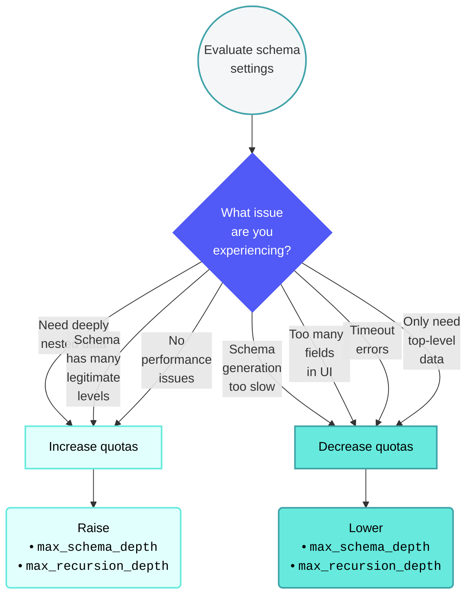

<!-- source: https://docs.workato.com/en/connectors/graphql | lastmod: 2026-09-16 -->
> The GraphQL connector enables you to query and mutate data from any application with a GraphQL API, building operations from its schema without code.

# GraphQL

[GraphQL](https://graphql.org/) is a data query and manipulation language for APIs. The GraphQL connector enables you to query and mutate records from any application that supports a GraphQL API.

The GraphQL connector dynamically introspects the application schema to determine which resources and operations are available. It automatically generates input and output fields. This allows you to build GraphQL queries and mutations through the Workato UI without writing code.

If you already have custom GraphQL queries or documents, you can use a [custom action](/en/connectors/graphql/custom-action). The GraphQL connector parses your query, validates fields against the schema, and auto-generates corresponding input and output fields.

Watch the GraphQL video

[Video](https://www.youtube.com/embed/YHWKj569y-Y)

* * *

## When to use the GraphQL connector

Use the GraphQL connector when:

- The application you plan to integrate with provides a GraphQL endpoint
- No native Workato connector is available for the application
- You want to query or mutate data flexibly without using REST endpoints

> **KNOWN LIMITATIONS**
> 
> The GraphQL connector has the following limitations:
> 
> - No support for uploading binary files or attachments
> - No support for the GraphQL **subscription** operation type

* * *

## Prerequisites

Complete the following prerequisites before you connect to GraphQL:

- Ensure you have [privileges](/en/user-accounts-and-teams/role-based-access/new-model/privileges-reference) to install community connectors and create connections in Workato
- [Download the GraphQL connector from the Community library](#community-download)
- [Obtain required credentials](#obtain-credentials)
- Locate the application’s GraphQL endpoint URL (for example, `https://api.example.com/graphql`)

### Download the GraphQL connector from the Community library

Complete the following steps to install the connector from the [community library](https://www.workato.com/browse/connectors):

1. Open the recipe editor and search for a connector. Alternatively, you can search for a connector in the [community library](https://www.workato.com/browse/connectors).
   
   _Search for community connectors in the recipe editor_
   
2. Select the community connector you plan to install.
   
3. Click **Install** to install the connector from the community library.
   
   _Click **Install**_
   
4. Select **Release connector**. Alternatively, select **Review code** to review and modify the connector code before releasing it to the workspace.
   
   _Release the connector_
   
5. Summarize any changes you made to the connector, then click **Release** to allow workspace collaborators to use the connector in recipes.
   
   _The **Confirm release** dialog_
   

### Obtain required credentials

Each GraphQL API defines its own authentication requirements. Review your application's API documentation to determine which authentication method it supports and how to obtain the required credentials. Common options include:

| Authentication method | When to use | Required credentials |
| --- | --- | --- |
| **None** | Applicable if the API is public and doesn't require authentication | None |
| **Basic** | Use when the API requires a username and password. Workato encodes these credentials in the HTTP Authorization header | Username, Password |
| **Header** | Use when the API requires a key or token in a custom header | Header authorization, for example `Authorization: Bearer <token>` |
| **Query params** | Use when authentication depends on URL-based tokens or keys | Query param authorization, for example `?api_key=12345` |
| **OAuth 2.0 (client credentials)** | Use for server-to-server authentication. Workato requests an access token using your client credentials | OAuth 2.0 token URL, Client ID, Client secret, OAuth 2.0 scopes |
| **OAuth 2.0 (authorization code grant)** | Use when end-user authorization is required through a login redirect. Workato manages the redirect and token exchange | OAuth 2.0 authorization URL, OAuth 2.0 token URL, Client ID, Client secret, OAuth 2.0 scopes |
| **OAuth 2.0 (resource owner password)** | Use when the API issues tokens directly from a username and password | OAuth 2.0 token URL, Client ID, Client secret, Username, Password, OAuth 2.0 scopes |

#### Register Workato as an OAuth client

OAuth 2.0 connections require you to register Workato as an OAuth client.

Complete the following steps to register Workato as an OAuth client:

1. Go to your application’s **Developer** or **API settings** page.
   
2. Create a new **OAuth client** or **application**.
   
3. Set the **Redirect URI** to: `https://www.workato.com/oauth/callback`
   
4. Copy the **Client ID**, **Client secret**, **Authorization URL**, and **Token URL** from your application.
   

#### Verify your credentials

Test your credentials using a tool such as `curl` or Postman before establishing your connection to confirm your credentials are valid.

You should be able to:

- Call the `/graphql` endpoint successfully
- Receive a valid JSON response
- Retrieve an access token (for OAuth connections)

* * *

## Connection setup

Complete the following steps to create a GraphQL connection in Workato:

1. Click **Create > Connection** or press C twice.
   
2. Search for and select the **GraphQL** connector.
   
3. Enter a **Connection name**.
   
4. Use the **Location** drop-down menu to select an existing [project](/en/projects) or create a new one.
   
5. Select a **Connection type**:
   
   - **Cloud** for direct connections.
   - **On-prem group** for on-prem connections.
6. Enter the **GraphQL endpoint URL**, for example, `https://api.example.com/graphql`. `/graphql` is used by default if no path is provided.
   
7. Use the **Authentication method** drop-down menu to select an authentication type and provide the required credentials for your selection:
   
   **Basic**
   
   - **Username**
   - **Password**
   
   **Header**
   
   - **Header authorization**: This should include the header name and value, for example, `Authorization: Bearer <token>`.
   
   **Query parameters**
   
   - **Query param authorization**: Add query parameters as key-value pairs, for example, `api_key=12345`.
   
   **OAuth 2.0 (client credentials)**
   
   - **Client ID**
   - **Client secret**
   - **OAuth 2.0 token URL**
   - **How does the API require credentials to be sent to request a token?**: Specify whether the API requires credentials to be sent in the body or header of the request.
   - **OAuth 2.0 scopes**
   - **Authorization header name** (optional): Enter the HTTP header used to send the access token. Defaults to `Authorization`. Change this only if the API expects a non-standard header. For example, `X-Shopify-Access-Token`.
   - **Token type prefix** (optional): The prefix added before the access token in the header value. Defaults to `Bearer`. Leave this blank to send the raw token without a prefix.
   
   **OAuth 2.0 (authorization code grant)**
   
   - **OAuth 2.0 authorization URL**
   - **Client ID**
   - **Client secret**
   - **OAuth 2.0 token URL**
   - **How does the API require credentials to be sent to request a token?**: Specify whether the API requires credentials to be sent in the body or header of the request.
   - **OAuth 2.0 scopes**
   - **Authorization header name** (optional): Enter the HTTP header used to send the access token. Defaults to `Authorization`. Change this only if the API expects a non-standard header. For example, `X-Shopify-Access-Token`.
   - **Token type prefix** (optional): The prefix added before the access token in the header value. Defaults to `Bearer`. Leave this blank to send the raw token without a prefix.
   
   **OAuth 2.0 (resource owner password)**
   
   - **Client ID**
   - **Client secret**
   - **OAuth 2.0 token URL**
   - **Username**
   - **Password**
   - **OAuth 2.0 scopes**
   - **Authorization header name** (optional): Enter the HTTP header used to send the access token. Defaults to `Authorization`. Change this only if the API expects a non-standard header. For example, `X-Shopify-Access-Token`.
   - **Token type prefix** (optional): The prefix added before the access token in the header value. Defaults to `Bearer`. Leave this blank to send the raw token without a prefix.
   
8. Optional. Expand **Advanced settings** to configure schema quotas:
   
   - **Schema depth quota (`max_schema_depth`)** controls the maximum nesting level of fields and limits how many levels deep the connector expands object fields.
   - **Schema recursion quota (`max_recursion_depth`)** controls how many times the same type can appear in a path and prevents infinite loops when types reference themselves (circular references).
   
   Leave these values at their defaults unless your schema is unusually large or highly nested. Refer to the [Advanced settings](#advanced-settings) section for more information.
   
9. Optional. Expand and configure **Optional headers** if required by your application.
   
10. Click **Connect** to validate your credentials and save the connection.
    
    _Set up a GraphQL connection_
    

Workato displays a confirmation message if the connection succeeds. Review your endpoint URL, authentication details, and permissions if the connection fails.

* * *

## Advanced settings

The GraphQL connector offers two advanced options that control how deeply nested fields are expanded in the schema:

- **Schema depth quota (`max_schema_depth`)**: Controls the maximum nesting level of fields in the schema. The default is five.
- **Schema recursion quota (`max_recursion_depth`)**: Limits how many times the same type can appear in a path to prevent infinite loops. The default is five.

* * *

### Adjust schema settings

Workato recommends beginning with default settings before making adjustments as the default settings are suitable for most use cases. We recommend following these practices when adjusting schema settings:

- Increase quotas incrementally, as higher values can cause exponential field growth
- Test these settings with your specific API, as different schemas behave differently

You can adjust schema settings in the following situations:

**Increase quotas when**:

- You require deeply nested data structures
- Your schema has many legitimate levels of nesting
- You're not experiencing performance issues
- You need access to fields beyond the default depth

**Decrease quotas when**:

- Schema generation is too slow
- Too many fields are displayed in the UI, making it difficult to navigate
- Timeout errors occur
- You only need top-level or shallow data structures



### Example schemas

The following examples demonstrate how depth and recursion quotas control schema expansion.

#### Depth quota example

The depth quota controls how many levels of nesting the connector expands. Each nested object adds one level of depth.

**Example schema:**

```graphql
type User {
  id: Int
  name: String
  profile: Profile
}

type Profile {
  bio: String
  settings: Settings
}

type Settings {
  theme: String
  preferences: Preferences
}

type Preferences {
  language: String
  advanced: Advanced
}

type Advanced {
  debug: Boolean
}
```

**With `max_schema_depth = 2`:**

```
User (depth 0)
├─ id: Int                    ✓ Included
├─ name: String               ✓ Included
└─ profile: Profile (depth 1)
   ├─ bio: String             ✓ Included
   └─ settings: Settings (depth 2)
      ├─ theme: String        ✓ Included
      └─ preferences (depth 3) ✗ STOPPED - Exceeds depth quota
```

**Result:** Only fields up to two levels deep are displayed.

* * *

#### Recursion quota example

The recursion quota controls how many times the same type can appear in a single path. This prevents infinite loops when types reference themselves or create circular dependencies.

**Example schema with circular reference:**

```graphql
type User {
  id: Int
  name: String
  friends: [User]  # Self-reference
  posts: [Post]
}

type Post {
  title: String
  author: User     # References back to User
}
```

**With `max_recursion_depth = 2`:**

```
User (count: 0)
├─ id: Int
├─ name: String
├─ friends: [User] (count: 1)
│  ├─ id: Int
│  ├─ name: String
│  ├─ friends: [User] (count: 2) ✗ STOPPED - User seen 2 times
│  └─ posts: [Post]
│     ├─ title: String
│     └─ author: User (count: 2) ✗ STOPPED - User seen 2 times
└─ posts: [Post]
   ├─ title: String
   └─ author: User (count: 1)
      ├─ id: Int
      ├─ name: String
      └─ friends: [User] (count: 2) ✗ STOPPED - User seen 2 times
```

**Result:** The User type can appear up to two times in any path before expansion stops.

* * *

#### Combined quotas example

When both quotas are active, the connector stops expanding when either quota is reached.

**With `max_schema_depth = 3` and `max_recursion_depth = 1`:**

```
Invoice (depth: 0, count: 0)
├─ id: Int                              ✓ Included
├─ number: String                       ✓ Included
├─ customer: Business (depth: 1, count: 0)
│  ├─ name: String                      ✓ Included
│  └─ invoices: [Invoice] (depth: 2, count: 1)
│     ├─ id: Int                        ✓ Included
│     ├─ number: String                 ✓ Included
│     └─ customer: Business (depth: 3, count: 1) ✗ STOPPED - Both limits hit
└─ items: [LineItem] (depth: 1)
   ├─ description: String               ✓ Included
   ├─ price: Decimal                    ✓ Included
   └─ product: Product (depth: 2)
      └─ name: String                   ✓ Included
```

**Result:** Expansion stops when Invoice depth reaches three and Business is seen twice in the same path.

---
