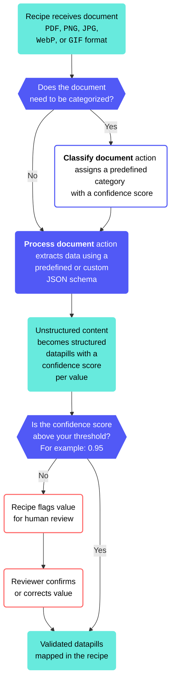

<!-- source: https://docs.workato.com/en/connectors/idp-by-workato | lastmod: 2026-11-06 -->
> IDP by Workato is a utility connector that extracts data from images and PDFs, turning unstructured documents into structured output for your systems.

# IDP by Workato

Intelligent Document Processing (IDP) by Workato extracts data from images and PDFs and converts unstructured content into structured output. It returns the extracted data as datapills that you can map into ERP, CRM, and financial systems.

## When to use IDP by Workato

Use IDP by Workato to process structured documents, such as invoices, receipts, and purchase orders, or define free-form schemas for unstructured and semi-structured documents, such as resumes. Common use cases include:

- **Order to cash**: Extract purchase order data so sales teams can map it to NetSuite without manual entry.
- **Accounts payable**: Automate invoice data extraction to reduce manual entry before sending the data to Coupa.
- **Procure to pay**: Extract data from invoices and delivery orders, cross-reference it against the system of record, and flag discrepancies for review.
- **Expense management**: Extract receipt and invoice data to simplify employee expense reporting and reimbursement.

## How to use IDP by Workato

You can add IDP by Workato to a recipe like any other connector, and it doesn’t require you to set up a connection. This connector provides two actions:

- The [Process document action](/en/connectors/idp-by-workato/process-document-action) extracts structured data from uploaded files and returns the results as datapills.
- The [Classify document action](/en/connectors/idp-by-workato/classify-document-action) analyzes document content and assigns the document to a predefined category with a confidence score.

## Formats and limitations

IDP by Workato supports multiple document formats and languages:

- **File types**: IDP by Workato accepts files in `PDF`, `PNG`, `JPG`, `WebP`, and `GIF` formats. Documents must be clear and legible.
- **Languages**: IDP by Workato supports invoices and receipts in English, Chinese, Japanese, and Korean.

Consider the following limitations when you evaluate IDP by Workato for your use case:

- **Document size limitation**: IDP by Workato processes PDFs up to **50 pages** and recognizes up to **100 line items** per document.
- **JSON schema constraints**: IDP by Workato supports up to **100 fields** with a maximum of **5 nested levels**. The total schema length must not exceed **15,000 characters**.

## Confidence scores and validation

IDP by Workato assigns each extracted value a confidence score from 0 to 1. Higher scores indicate greater confidence that the value matches the expected data.

Confidence thresholds vary by use case. A threshold of around 0.95 is a common starting value. Review values with scores at or below 0.95 to catch unexpected results. Further testing with representative document types and languages may help you set a more reliable threshold. Small text, non-Latin characters, complex tables, and long line items can reduce extraction accuracy. Use legible documents and well-structured JSON schemas to improve extraction quality, and add validation checks to identify potential issues.

> **CONFIDENCE SCORE AVAILABILITY VARIES BY MODEL VERSION**
> 
> Confidence scores aren't available in every IDP model version. Refer to [IDP model versions](/en/connectors/idp-by-workato/idp-versions) for version-specific behavior.

## Feature availability

IDP by Workato is available for customers on specific pricing plans, in the US, EU, AU, JP, SG, IL, KR, and UK data centers. IDP by Workato models are hosted in the US, EU, and APAC data centers and respect data residency requirements where possible. IDP by Workato isn't available to workspaces in the CN data center. This reflects local regulatory requirements and Workato's commitment to data sovereignty and applies to our multi-tenant and [Virtual Private Workato (VPW)](/en/cloud-hosting-editions/hosting-editions#virtual-private-workato) offerings.

### Enable IDP by Workato in your workspace

You must have the [Environment admin](/en/user-accounts-and-teams/role-based-access/new-model/system-environment-roles#environment-admin) role or the legacy [Admin](/en/roles#role-admin) system role to enable IDP by Workato in your workspace.

> **PERMISSIONS**
> 
> IDP by Workato doesn't include granular permission settings. All collaborators in the workspace can access IDP by Workato after you enable it.

Complete the following steps to enable IDP by Workato in your workspace:

1. Sign in to Workato.
   
2. Go to **Workspace admin > Settings > Workato AI**.
   
3. Verify that the terms of service align with your company's policies.
   
4. Click **Enable IDP by Workato**.
   
   _Enable IDP by Workato_
   
   > **IMPACT ON AHQ WORKSPACES**
   > 
   > Enabling IDP by Workato in the parent AHQ workspace enables it in all associated child workspaces by default. You can disable IDP by Workato in each workspace independently. You can adjust access through [app access settings](/en/ahq-managed-workspace#settings).
   > 
   > Enabling IDP by Workato affects all environments in the workspace and associated workspaces if enabled in a parent workspace. This includes your Development, Test, and Production environments. Evaluate this impact before you enable IDP by Workato.

---
