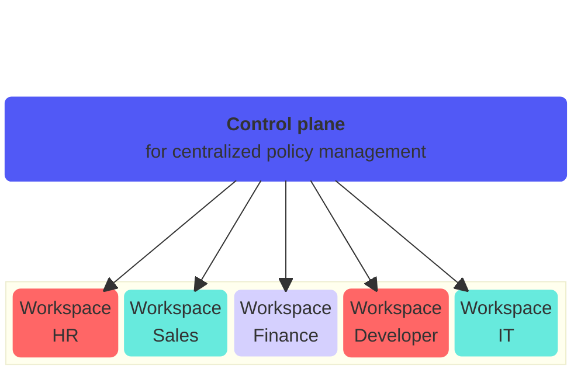

<!-- source: https://docs.workato.com/en/control-plane | lastmod: 2026-11-06 -->
> Use Control plane to scale a workspace-level identity across an organization with multiple workspaces.

# Control plane

Control plane provides a centralized identity for governance for multiple workspaces. Control plane runs its own SAML SSO and SCIM provisioning independent of any workspace. This allows an enterprise organization to authenticate and auto-provision Control plane users directly against its own identity provider (IdP).

> **CONTROL PLANE ISN'T A WORKSPACE**
> 
> Control plane isn't a workspace. Control plane doesn't provide the configuration or tools for teams to collaborate, build recipes, and deploy recipes for a department, level of business, or organization unit.

> **FEATURE AVAILABILITY**
> 
> Control plane is available to select customers. Contact your Customer Success Representative to confirm whether it is available in your workspace.

## What Control plane does

Use Control plane to link multiple workspaces to a single identity for centralized policy management. The Control plane governs identity, roles, linked workspaces, policies, and audit trails. It doesn't govern assets, including recipes, connections, agents, or runtime configurations.

## AI registry

Control plane includes a centralized AI registry that provides a catalog of your AI assets, including [agents](/en/agentic/agent-studio/genies-configuration), [MCP servers](/en/mcp/mcp-servers), and AI model [routes](/en/ai-gateway/routes#create-a-route).

Control plane AI registry also provides access control through a User portal and Registry MCP endpoint.

Refer to [Control plane AI registry](/en/control-plane/ai-registry) for more information.

## Subdomain

You must configure a subdomain to provide end users with access to the Control plane. Refer to [Configure subdomain](/en/control-plane/configure-subdomain) for more information.

## Link workspaces

You must link workspaces to your Control plane to enable centralized identity governance. Refer to [Link workspaces to Control plane](/en/control-plane/manage-workspaces) for more information.

## Collaborators and end users

Control plane has two types of users that administrators must manage: collaborators and end users.

Collaborators help govern workspaces within Control plane. Administrators invite collaborators, assign each collaborator a role, and manage privileges in **Control plane settings > Collaborators**. Control plane collaborators are separate from workspace collaborators, so linking a workspace to Control plane doesn't add its collaborators to Control plane. Refer to [Collaborators](/en/control-plane/collaborators) for more information.

End users access Control plane through your organization's subdomain to use available AI assets. Administrators add and manage end users in **End user access**. Administrators also define end-user environment access for `Development`, `Test`, and `Production` and assign end users to environment-specific end-user groups. Refer to [Add an end user](/en/control-plane/add-end-users) and [End-user group management](/en/control-plane/user-groups) for more information.

---
