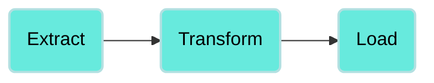
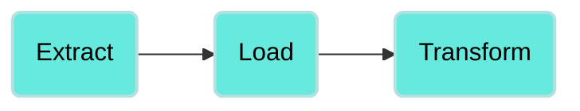

<!-- source: https://docs.workato.com/en/data-orchestration/concepts | lastmod: 2026-06-30 -->
> Learn the core data orchestration concepts behind Workato pipelines, including data lakes, warehouses, ETL and ELT, sources, staging, and targets.

# Concepts

## Data lake

Data lakes provide unstructured data support and more flexibility for thorough data analysis, while also enabling you to build data pipelines iteratively. Data lakes, cloud storage, and modern data warehouses analytics provide simpler architecture to build pipelines. These frameworks remove extra management as it scales automatically based on the workload. This approach lowers total upfront cost, provides fast extraction and loading, more flexibility, and lower maintenance costs.

## Data warehouse

A data warehouse is an optimized storage, transformation, and analytics engine. There are multiple iterations of cleaning, integrating, and restructuring intermediate tables before a final version with wide table or star schema model is applied.

The majority of data warehouses are built on highly scalable columnar databases which can run transformations on large data sets in a cost effective manner by using its internal efficient I/O, data compression, and multi node processing.

## ETL/ELT

Extract, Transform, and Load (ETL) and Extract, Load, and Transform (ELT) are processes used in [data orchestration](https://www.workato.com/platform/data-orchestration?utm_source=docs&utm_medium=referral&utm_campaign=data-orchestration) and data warehousing to extract, transform, and load data from various sources into a target destination, such as a data warehouse or a data lake.

### Extract, Transform, and Load (ETL)

ETL begins with the extraction phase, where data is sourced from multiple heterogeneous sources, including databases, files, APIs, and web services. This raw data is then subjected to a transformation phase, such as cleaning or filtering before it is loaded into a target system, typically a data warehouse.

### Extract, Load, and Transform (ELT)

Similar to ETL, ELT starts with the extraction phase, where data is extracted from various sources. ELT focuses on loading the extracted data into a target system such as a data lake or distributed storage. Transformations occur within the target system after the data is loaded.

## Pipeline

A pipeline is a framework designed to extract data from the source to a target destination using scheduling and bulk batch processing capabilities. Source, staging, and target connectors provide the underlying actions and triggers for creating, maintaining, extracting, staging, and loading data in a pipeline. The connectors you use can vary. You can use bulk and streaming actions coupled with cost effective cloud storage and modern cloud data warehouses to increase pipeline efficiency. Pipelines can have one or multiple jobs depending on their frequency.

## Source

Workato's wide range of SAAS and on-prem agent (OPA) connectors provide various options on how to extract data from source applications using APIs, recipes, or SQL or OS file transfer commands. Typically, sources are transactional SaaS, on-prem databases, file systems (CSV and JSON formats), and web logs.

## Staging

Staging is a cost effective storage solution that involves dumping data without structure or query optimization in a data lake. Staging is the intermediate step between loading raw data in the data warehouse with some minor transformation. Staging tables are either ephemeral or persistent and can be used at different stages of a pipeline. You may archive persistent tables into cold storage if necessary.

## Target

Target tables are intermediate to final destinations in a subset of a pipeline where a more refined version of the source tables are inserted, updated, or merged. Use these tables as a cleansed, restructured, and integrated version of tables originating from the source. Apply business rules to transform, structure, and optimize data for further analysis and transformations.

---
