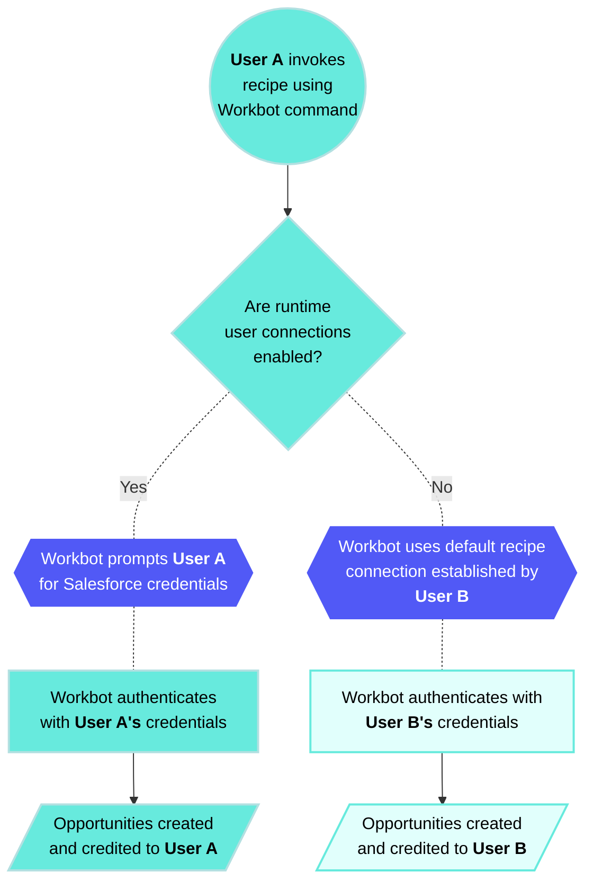
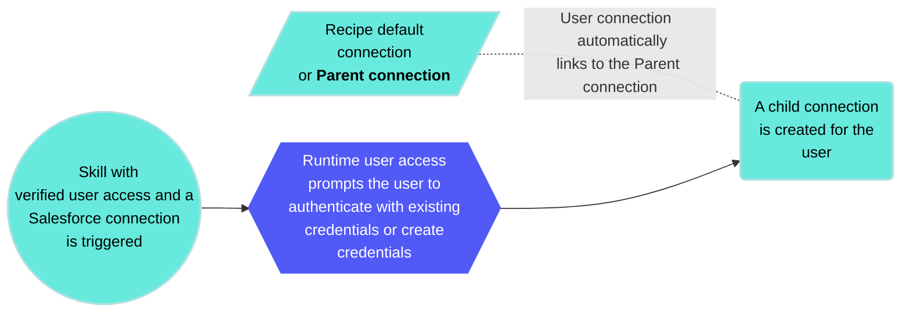

<!-- source: https://docs.workato.com/en/features/runtime-user-connections | lastmod: 2026-09-14 -->
> Learn how runtime user connections let recipe users authenticate with their own credentials at runtime instead of the default connection.

# Runtime user connections

Recipes perform actions based on the identity and permissions of the user who connects the application by default. Using **Runtime user connections**, users can use their own credentials when running a recipe, even if they didn't create the original application connection.

> **FEATURE AVAILABILITY**
> 
> The runtime user connections feature is included in specific pricing plans. Refer to your pricing plan and contract to learn more.

## How do runtime user connections work?

The **Runtime user connections** feature allows users to authenticate themselves when a recipe runs, allowing the recipe to execute actions using their own credentials.

For example: We have a recipe that uses Workbot to create opportunities in Salesforce. Here's what the execution looks like with and without runtime user connections:

Connections persist after you create them. This means that users don't have to provide their credentials every time they run a recipe. Additionally, these connections can't be used in other recipes like normal connections.

## What are parent connections?

Connections created at runtime link to a parent connection.

For example, when you run a recipe with a Salesforce connection and authenticate to Salesforce, it creates Connection B. This new connection links to the recipe's default Salesforce connection, Connection A, as its parent.

> **PARENT CONNECTIONS LIMITATION**
> 
> Parent connections are not supported for recipe functions toggled with runtime user connections. You must create separate runtime user connections for these recipes. If you try to use a parent connection, it fails and may cause unexpected behavior. We recommend creating a specific runtime user connection.

## Who can use runtime user connections?

This feature is available to all plans and account types, including Embedded. However, users need the following privileges to [enable or disable](#enabling-and-disabling-runtime-user-connections) the setting for recipes:

- **Edit recipes**
- **View Runtime user connections**
- **Edit Runtime user connections**

## Where can I use runtime user connections?

The **Runtime user connections** feature is available in:

- [Recipe functions](/en/connectors/recipe-functions)
- [Workbot recipes with a **New command** trigger](/en/workbot/overview)
- [Skills](/en/agentic/agent-studio/verified-user-access#add-verified-user-access-to-skill-recipes)
- [Eligible Workflow apps recipes](/en/workflow-apps/component-actions/run-recipe)

* * *

## Enable and disable runtime user connections

When you add an action to an [eligible recipe](#where-can-i-use-runtime-user-connections), Workato prompts you to choose how connections are handled:

- **For Workbot, skill, and eligible Workflow apps recipes**: When adding actions like a Salesforce **Create record** action, you can choose whether the action uses:
  - The end user's credentials (runtime user connection)—your Workbot or genie prompts the user to authenticate
  - The default connection specified in the recipe

> **CONFIGURATION LOCATION CHANGE**
> 
> Runtime user connections are now configured directly in the recipe editor when selecting app connections, not in the recipe's **Settings** tab.

_Configure runtime user connections in Workbot recipes_

- **For recipe functions**: When adding actions, you can choose whether to use:
  - The connection specified in the recipe function itself
  - The connection from the recipe that calls the function

_Configure runtime user connections in recipe functions_

Refer to the following guides for more information:

- [Use runtime user connections in recipe functions](/en/features/runtime-user-connections/using-runtime-user-connections-in-recipe-functions)
- [Use runtime user connections in Workbot recipes](/en/features/runtime-user-connections/using-runtime-user-connections-in-workbot-recipes)
- [Add verified user access to skills](/en/agentic/agent-studio/verified-user-access#add-verified-user-access-to-skill-recipes)
- [Add verified user access to Workflow apps recipes](/en/workflow-apps/verified-user-access#add-verified-user-access-to-workflow-apps-recipes)

* * *

## Manage runtime user connections

Manage runtime user connections in:

- [Apps](#managing-all-runtime-user-connections-in-app)
- [Workbot in Slack](#managing-runtime-user-connections-with-workbot-in-slack)
- [Workbot in Microsoft Teams](#managing-runtime-user-connections-with-workbot-in-microsoft-teams)
- [Skills](/en/agentic/agent-studio/verified-user-access#add-verified-user-access-to-skill-recipes)
- [Workflow app recipes](/en/workflow-apps/verified-user-access#manage-run-time-user-connections)

### Manage all runtime user connections in-app

Manage runtime user connections by going to **Tools > Runtime user connections**. This page lists all connections created at runtime.

> **WHO CAN VIEW THIS PAGE?**
> 
> Users must have the **View Verified user access at runtime** privilege to access this page.

#### Delete a connection

Review the following information before you delete a connection:

- **Deleting a parent connection** causes recipes using the connection to stop. Child connections created at runtime aren't deleted.
  
- **Deleting a child connection** requires the user to re-authenticate themselves the next time the recipe runs. Successful re-authentication must occur before actions can be performed on their behalf.
  

Click the **Delete** link next to the connection to delete it.

> **WHO CAN DELETE CONNECTIONS?**
> 
> You must have the **Delete connections** privilege to delete connections.

### Manage runtime user connections with Workbot in Slack

You can perform the following actions in Slack Workbot:

- [View your own runtime user connections](#viewing-your-runtime-user-connections)
- [Disconnect your runtime user connections](#disconnecting-your-runtime-user-connections)

#### View your runtime user connections

Workbot enables you to view your own runtime user connections in [a DM (direct message)](#in-a-dm) or in [channels where Workbot is a member](#in-a-channel).

##### In a DM

Complete the following steps to view your own runtime user connections:

1. Open a DM with Workbot.
   
2. Enter `connections`.
   
3. Send `help` and then click the **Personal accounts** button.
   
   _View runtime user connections in a Workbot DM_
   

##### In a channel

Complete the following steps view your runtime connections in a channel:

1. Go to a channel where Workbot is a member.
   
2. Enter `@Workbot connections` or `@Workbot help` to view your runtime user connections.
   

#### Disconnect your runtime user connections

You can disconnect your runtime user connections by [going to your list of connections](#viewing-your-runtime-user-connections) and clicking **Disconnect**:

_Disconnect a runtime user connection_

### Manage runtime user connections with Workbot in Microsoft Teams

Workbot in Microsoft Teams enables you to:

- [View personal connections](#view-personal-connections)
- [Disconnect personal connections](#disconnect-personal-connections)

#### View personal connections

View your personal connections by sending `personal_connections` in a DM to Workbot. Workbot lists your connections and their connection status.

_View your personal connections_

#### Disconnect personal connections

Disconnect or delete your personal connections by selecting the connection in the picklist and clicking **Disconnect** or **Delete**.

### Manage runtime user connections in the Workflow apps portal

Workflow apps users can manage their personal connections in the Workflow apps portal:

- [View personal connections](#apps-personal-connections-view)
- [Delete personal connections](#apps-personal-connections-delete)

#### View personal connections

Complete the following steps to view personal connections in the Workflow apps portal:

1. Sign in to the Workflow apps portal.
   
2. Click your profile icon and select **Manage your account**.
   
3. Click **Connections**.
   
4. View active and disconnected personal connections.
   
   _View personal connections_
   

#### Delete personal connections

Complete the following steps to delete personal connections in the Workflow apps portal:

1. Sign in to the Workflow apps portal.
   
2. Click your profile icon and select **Manage your account**.
   
3. Click **Connections**.
   
4. Click the **...** (ellipses) next to the connection you plan to delete.
   
5. Click **Delete**.
   
   _Delete a personal connection_
   

## Quotas

Your workspace has a combined runtime user connection (RUC) and verified user access (VUA) quota of 100,000 per workspace. The parent connection quota is 500 per workspace.

---
