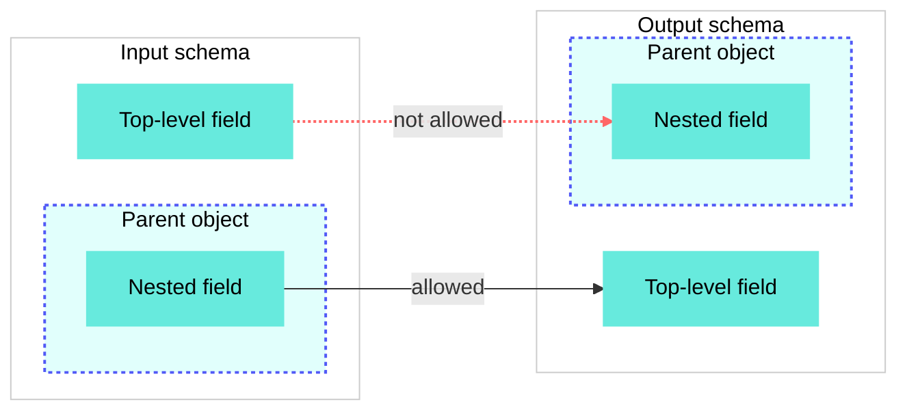

<!-- source: https://docs.workato.com/en/features/transformation-maps | lastmod: 2026-10-28 -->
> Use transformation maps to visually map input fields to an output schema and transform values with formulas.

# Transformation maps

Transformation maps are project assets that centralize the logic for shaping and mapping data between systems, work otherwise split across recipe steps, formula mode, and custom code. You can test the mapping end-to-end directly in the editor before you save it, and reuse the same logic across multiple recipes.

Use Workato Expression Language (WEL) [formula nodes](#formula-transformations) to transform data or map inputs directly to an output to pass values without transformation.

Open the **Projects** view and select **Create > Transformation map** to create a new transformation map. Select an existing transformation map to view its location, creation and modification times, asset tags, description, dependent recipes, and recent activity.

_Transformation map overview_

> **FEATURE AVAILABILITY**
> 
> Transformation maps are currently available to select customers. Contact your Customer Success Representative to confirm whether they are available in your workspace.

## Define the input and output schemas

Select one of the following methods in the editor to define the input and output schemas for a transformation map:

**Use JSON**

1. Use one of the following methods to open the JSON editor:
   
   - Click **Use JSON** if the schema is empty.
   - Click **...** (ellipsis), then **Add schema** to extend the schema without changing the existing inputs.
   - Click **...** (ellipsis), then **Edit schema** to modify the existing schema.
   
   _Click **...** to view the input schema menu_
   
2. Enter a JSON or XML sample to define the schema. Workato converts the sample to a Workato schema representation, then generates the schema from it. Transformation maps support the following data types:
   
   - `String`
   - `Number`
   - `Integer`
   - `Date`
   - `Time`
   - `Boolean`
   - `List`
   - `Object`
   
   Workato removes unsupported fields from imported schemas.
   
   You can't declare an array at the root of a schema. Nest every array under an object key.
   
3. Review the sample JSON tree if you selected **Add schema** or **Use JSON**.
   
   _Provide a JSON sample to generate a schema_
   
4. Click **Generate schema** or **Update** to apply the changes.
   

**Add fields manually**

1. Click **add fields manually**.
   
2. Enter a **Name** for the field.
   
   _Add a field manually_
   
3. Optional. Enter a **Label** for the field.
   
4. Use the **Data type** drop-down menu to select the data type. Options include the following data types:
   
   - `String`
   - `Number`
   - `Integer`
   - `Date`
   - `Time`
   - `Boolean`
   - `List`
   - `Object`
5. Use the **Optional** drop-down menu to select whether the field is optional.
   
6. Optional. Use the **Nest under** drop-down menu to select whether the field is nested within another field.
   
7. Optional. Enter a description of the field or expected input in the **Hint** field.
   
8. Click **Add field**.
   

## Map and transform fields

You can map schema values in the transformation map editor in the following ways:

- Connect an input field directly to an output field to pass the value without transformation.
- Click **Add formula** on a connection or an input field to transform a field's value using a formula. Formula transformation nodes are stored in the transformation area between the input and output schemas. Refer to [Formula transformations](#formula-transformations) for configuration steps.
- Click **Set value** on an output field to configure its value using a static expression that isn't dependent on other fields. Refer to [Set a static value](#set-a-static-value) for configuration steps.

_Map fields_

### Mapping patterns

Most maps combine the following patterns:

- **One-to-one**: Connect a single input field directly to a single output field when the value requires no change.
- **Many-to-one**: Combine several input fields into one output field. Click **Add formula** and reference each input in the formula. For example, concatenate `first_name` and `last_name` into a single `full_name` field, or sum line items into a total. The formula's result feeds the output field. Refer to [Reshape a list](#reshape-a-list) for an example.
- **One-to-many**: Connect a single input field or formula output to more than one output field. For example, use the same `full_name` result to populate both a `full_name` and a `display_name` field.

### Delete nodes and connections

Hover over a formula node or connection to open their toolbar.

- **Connection toolbar**: Includes **Add formula** and an option to delete the connection. Each connection in a [chain](#chain-formulas) must be deleted individually.
- **Node toolbar**: Includes **Edit formula** (pencil icon) and an option to delete node.

_The connection toolbar_

### Formula transformations

Complete the following steps to add a formula node that transforms a field's value using WEL:

1. Click **Add formula** on a connection or an input field. The **Apply formula** modal opens.
   
   _The **Apply formula** modal_
   
2. Enter a unique **Formula name**. Downstream nodes reference this node's output using a normalized form of the name. Refer to [Formula name and reference rules](#formula-name-and-reference-rules) for how references are built.
   
3. Enter a formula in the **Formula editor**.
   
   You can click **Copy** on a field in the **Available inputs** section to copy its reference. Formulas refer to fields by their reference rather than their display name. For example, the reference for `first_name` is `_.first_name`.
   
   > **REFERENCE NESTED VALUES**
   > 
   > **Copy** is only available on top-level elements, which are the scalars, objects, and arrays you connect to the node. These are the only values the editor references directly. Nested elements, such as the keys inside an object or array, still appear in **Available inputs** so you can review the structure, but must be accessed through their parent.
   
   _Copy input paths_
   
4. Optional. Use the **Output schema** section to define output fields for the formula node. Refer to [Define the input and output schemas](#define-the-input-and-output-schemas) for configuration steps, and [When to define an output schema](#when-to-define-an-output-schema) to determine whether this formula requires an output definition.
   
   A formula with a defined output schema must return a hash with keys that exactly match the output field names. A formula that produces a list must return that list under a named key rather than as a bare array, because a schema can't declare an array at its root.
   
5. Click **Apply** to complete the setup.
   

> **CONNECT BEFORE YOU REFERENCE**
> 
> Formulas can only access the inputs connected to them, which are listed in the node's **Available inputs** section. You must connect input fields to the node before you can reference them in a formula.

### Chain formulas

Formula nodes don't have to connect directly to an input or output field. Connect multiple nodes to break complex logic into readable stages instead of a single large expression. The upstream node's [output schema](#when-to-define-an-output-schema) appears in the downstream node's **Available inputs** list, prefixed with the upstream node's formula name so references don't clash. Click **Copy** to insert the exact reference. Refer to [Chain a transformation with filter and sort](#chain-a-transformation-with-filter-and-sort) for an example of chained formulas or refer to [Formula name and reference rules](#formula-name-and-reference-rules) for more information about references.

### Formula name and reference rules

Formulas refer to a value in one of two ways, depending on where the value comes from:

- **Values from a connection**: Every input field and upstream node output connected to the node appears in **Available inputs** as a single flat name, regardless of how deeply it sits in the schema. Reference an input field as `_.` followed by the field name.
  
- **Values from the formula**: Once a value is bound to a name, such as a lambda parameter or a `let` binding, traverse into it with dots. Dot notation navigates a structure you already have. It doesn't cross a connection.
  

Workato prefixes references from an upstream node's output with that node's formula name so references from different nodes don't clash, even when two nodes use the same output field name. What Workato appends after the formula name depends on whether the node has a declared output schema:

- **Node with a defined output schema**: Workato appends each output field name to the formula name, so a node with several output fields produces several references.
  
- **Node with no output schema**: Workato appends `value` to the formula name instead, since a scalar formula has no output field names.
  

Workato normalizes the formula name, but not the field name. References take the formula name, replace each space with an underscore (`_`), remove every other special character, and convert the result to lowercase. No part of the name is truncated. Output field names are used exactly as you defined them, including their capitalization.

| Source | Reference |
| --- | --- |
| An input field named `lines` | `_.lines` |
| Node `line totals`, with an output field named `lines` | `_.line_totals_lines` |
| Node `total`, with no output schema | `_.total_value` |
| Node `net-total`, with no output schema | `_.nettotal_value` |
| Node `Summarize By Category`, with an output field named `totalAmount` | `_.summarize_by_category_totalAmount` |
| Node `a@@@b!!@@@sasD@@!`, with no output schema | `_.absasd_value` |
| A field on the lambda parameter `l` | `l.sku` |

A node output reference concatenates the formula name and field name, so long names on both sides produce long references. Keep formula names short to keep references readable.

Click **Copy** in the **Available inputs** section to insert the exact reference rather than typing it, which avoids mistakes in the normalized form.

### When to define an output schema

Whether a formula needs an output schema depends on what it returns.

You don't need to define an output schema if a formula returns a single scalar value, such as a `String`, `Number`, `Integer`, `Date`, `Time`, or `Boolean`. Workato references a scalar result as the formula name followed by `_value`, which you can connect straight to a scalar output field. Refer to [Formula name and reference rules](#formula-name-and-reference-rules) for how references are built. Define an output schema when a formula returns a complex object or an array, or when it returns more than one named value. A declared schema lets Workato verify the structure the formula produces and expose typed fields to downstream formulas and nodes. Without it, Workato can't validate or pass on a non-scalar result.

A formula's output can feed one or more downstream targets, including other formulas. Maps don't support circular connections.

### Set a static value

Click **Set value** on an output field to set its value without connecting it to any input. Use one of the following approaches:

- Hardcode a value. For example, set a constant `source` of `signup_form`.
- Enter a WEL expression that doesn't depend on input fields. For example, generate a timestamp at runtime.

An output field holds either a static value or an incoming connection, not both. Drawing a connection to a field that already has a static value clears the static value.

### Ports and validation

Fields and nodes expose connection points called ports. The canvas highlights valid ports when you start a connection and blocks connections that aren't valid, including circular connections and connections between incompatible nesting levels or data types.

**Incompatible data types**: A formula with no declared output schema returns a single scalar value, so it can't connect to an object or array target. Refer to [When to define an output schema](#when-to-define-an-output-schema) for more information.

**Incompatible nesting levels**: Access for non-scalar fields such as objects and arrays starts at the top level and works inward, so a connection can only run from nested to top-level, not the reverse. Flatten the structure in a formula first to use values from an array nested inside another array. Refer to [Iterate over an inner array](#iterate-over-an-inner-array) for how to flatten it.



You can save a transformation map with incomplete or invalid states, such as hanging, disconnected, or missing formula nodes, or an output schema that doesn't match what a formula returns. Workato flags these states with a warning instead of blocking the save, which enables you to save work in progress and return to it later. [Delete hanging or disconnected nodes](#delete-nodes-and-connections) and ensure each node's output matches its defined schema to keep a map valid.

Runtime errors surface in the recipe's job history rather than at save time.

### Arrays

A connection that carries a list appears as a double line to show it's operating in array context. For example, the following connection between **Lines** lists is in array context:

_The connection between **Lines** lists is in array context_

#### Iterate over an inner array

An inner array is an array nested inside another array, such as a `units` list on each element of a `lines` list. Access [starts at the top level and works inward](#ports-and-validation), so you can't connect or reference an inner array directly, and you can't connect an outer array to an inner one.

Connect the outer array to a node, then flatten from the root down to the inner elements within a formula. The node receives the outer array, walks each element, walks that element's inner array, and flattens the result into a single list. Read any values you need from the outer element while you process the inner one, because a flattened list retains nothing about its parent otherwise. Refer to [Flatten a nested array](#flatten-a-nested-array) for an example.

Flattening produces one row for each inner element, which changes the shape of the data.

## Test the map

The **Test** tab provides a live preview. Enter sample input and Workato displays the output immediately, without requiring you to leave the editor or save the map first. This enables you to verify the mapping as you build.

Complete the following steps to test the transformation map:

1. Click the **Test** tab.
   
2. Enter sample input JSON.
   
   _Test tab_
   
3. Review the results in the **Output** panel. The panel displays the output values or an error message if the mapping fails.
   

Click **Save input** to add the test case to the History tab. You can rerun or delete saved test cases from the **History** tab.

_The **History** tab_

## Use a transformation map in a recipe

Use the [Mapper by Workato](/en/connectors/mapper) connector to apply a saved transformation map in a recipe. Select one of the following options in the connector's **Map using** input field to determine where the schema comes from:

- **Common data model > Object schema**: Select a [common data model](/en/features/common-data-model) object schema. This is the only option if the **Map using** field isn't visible in your workspace.
- **Transformation map > Transformation map**: Select a saved [transformation map](/en/features/transformation-maps).

Workato generates additional input fields based on your selected schema. Use these fields to populate the schema with data.

## Examples

The following examples show complete transformation maps for common integration patterns. Add null handling to these examples for production data that may contain missing fields.

### Reshape a list

Use this pattern when an inbound system sends a list of items in one shape and the target system requires each item in a different shape, such as different field names plus a value you must compute for each item.

In this example, an e-commerce order webhook sends order lines with `sku`, `qty`, and `unit_price`. The ERP requires items with `product_code`, `quantity`, and a per-line `amount`.

_Reshape a list_

**Input schema**

This example uses the following JSON sample to generate an input schema:

```json
{
  "order_id": "SO-1001",
  "lines": [
    { "sku": "A-100", "qty": 2, "unit_price": 9.5 },
    { "sku": "B-220", "qty": 1, "unit_price": 40 }
  ]
}
```

**Output schema**

This example uses the following JSON sample to generate an output schema:

```json
{
  "order_number": "SO-1001",
  "items": [
    { "product_code": "A-100", "quantity": 2, "amount": 19.0 },
    { "product_code": "B-220", "quantity": 1, "amount": 40.0 }
  ]
}
```

**total**

The `total` node uses the following formula:

```text
_.unit_price * _.qty
```

This reshape doesn't require a formula for the whole list. `order_id`, `sku`, and `qty` are renames that pass through unchanged, so only the computed `amount` field needs a formula.

The `total` node multiplies the quantity by the unit price to produce the per-line total. It returns a single scalar value, so the node doesn't require an output schema. An `Integer` multiplied by a `Number` returns a `Number`.

### Aggregate with group-by

Use this pattern when you require a summary rather than a row-for-row copy, such as grouping a list by a key and computing a count or total for each group.

In this example, the same order lines carry a `category`. The target requires one row for each category with the number of lines and the summed amount.

_Aggregate with group-by_

**Input schema**

This example uses the following JSON sample to generate an input schema:

```json
{
  "order_id": "SO-1001",
  "lines": [
    { "sku": "A-100", "category": "hardware", "qty": 2, "unit_price": 9.5 },
    { "sku": "B-220", "category": "hardware", "qty": 1, "unit_price": 40 },
    { "sku": "C-050", "category": "service", "qty": 3, "unit_price": 15 }
  ]
}
```

**Output schema**

This example uses the following JSON sample to generate an output schema:

```json
{
  "order_number": "SO-1001",
  "totals_by_category": [
    { "category": "hardware", "line_count": 2, "total_amount": 59.0 },
    { "category": "service", "line_count": 1, "total_amount": 45.0 }
  ]
}
```

**summarize by category**

The `summarize by category` node uses the following formula:

```text
{
  totals_by_category: _.lines
    >> group_by(line ~> line.category)
    >> entries
    >> map_by(g ~> {
         category: g.key,
         line_count: count(g.value),
         total_amount: g.value >> map_by(l ~> l.qty * l.unit_price) >> sum
       })
}
```

`order_id` connects directly to `order_number` unchanged, the same as a one-to-one rename. Only `lines` feeds the `summarize by category` node, since it's the only field the aggregation needs.

The `summarize by category` node does the aggregation in three stages. `group_by` collects the lines into one bucket for each category, which produces a map rather than a list. `entries` restates that map as a list of key and value pairs so you can iterate over it. `map_by` then returns one object for each pair, containing the category name, the number of lines in the group, and the sum of the line totals.

The node returns a list of objects, so it requires an output schema. Refer to [When to define an output schema](#when-to-define-an-output-schema).

### Chain a transformation with filter and sort

Use this pattern when a transformation runs in stages. Chaining keeps each stage in its own node, so you can read the transformation from the canvas and test each stage on its own.

In this example, order lines carry a `sku`, `qty`, and `unit_price`. The map computes a per-line total, filters out lines below a threshold, and sorts what remains by total, each stage in its own node.

_Chain a transformation with filter and sort_

**Input schema**

This example uses the following JSON sample to generate an input schema:

```json
{
  "order_id": "SO-1001",
  "lines": [
    { "sku": "A-100", "qty": 2, "unit_price": 9.5 },
    { "sku": "B-220", "qty": 1, "unit_price": 40 },
    { "sku": "C-050", "qty": 3, "unit_price": 15 },
    { "sku": "D-410", "qty": 2, "unit_price": 60 }
  ]
}
```

**Output schema**

This example uses the following JSON sample to generate an output schema:

```json
{
  "high_value_lines": [
    { "sku": "D-410", "amount": 120.0 },
    { "sku": "C-050", "amount": 45.0 },
    { "sku": "B-220", "amount": 40.0 }
  ]
}
```

**line totals**

The `line_totals` node uses the following formula:

```text
{
  lines: _.lines
  >> map_by(l ~> {
   sku: l.sku,
   amount: l.qty * l.unit_price
  })
}
```

**filter**

The `filter` node uses the following formula:

```text
{
  filtered: _.line_totals_lines >> filter_by(t ~> t.amount >= 20)
}
```

**sort**

The `sort` node uses the following formula:

```text
{
  high_value_lines: _.filter_filtered >> sort_by(f ~> 0 - f.amount)
}
```

The map uses three nodes, each handling one stage:

- `line_totals` computes a per-line total by multiplying `qty` by `unit_price`.
- `filter` keeps only lines with a total of 20 or more.
- `sort` orders the remaining lines from highest to lowest total.

Each node references the previous node's output by the upstream formula name, such as `_.line_totals_lines` and `_.filter_filtered`. Every node in the chain returns a list, so each one requires its own output schema. Refer to [When to define an output schema](#when-to-define-an-output-schema).

Four lines produce four totals, the filter drops `A-100` at 19, and the sort puts `D-410` at 120 ahead of `C-050` at 45 and `B-220` at 40.

You can write all three stages as a single formula in one node, which produces the same result and requires only one output schema. Chain the stages instead when you want to test each one on its own, or when a single formula becomes difficult to read.

### Flatten a nested array

Use this pattern when the values you need are in an array nested inside another array. Inner arrays aren't directly accessible, so the transformation starts at the top-level array and flattens down to the inner elements. Refer to [Arrays](#arrays) for more information.

In this example, `lines` is a list of objects, and each line carries its own `units` list of objects. The target requires one row for each unit, with the `sku` of the line it came from.

_Flatten a nested array_

**Input schema**

This example uses the following JSON sample to generate an input schema:

```json
{
  "order_id": "SO-1001",
  "lines": [
    {
      "sku": "A-100",
      "units": [
        { "serial_number": "SN-1", "condition": "new" },
        { "serial_number": "SN-2", "condition": "refurbished" }
      ]
    },
    {
      "sku": "B-220",
      "units": [
        { "serial_number": "SN-3", "condition": "new" }
      ]
    }
  ]
}
```

**Output schema**

This example uses the following JSON sample to generate an output schema:

```json
{
  "units": [
    { "sku": "A-100", "serial_number": "SN-1", "condition": "new" },
    { "sku": "A-100", "serial_number": "SN-2", "condition": "refurbished" },
    { "sku": "B-220", "serial_number": "SN-3", "condition": "new" }
  ]
}
```

**flatten units**

The `flatten units` node uses the following formula:

```text
{
  units: _.lines
    >> map_by(l ~> l.units >> map_by(u ~> {
         sku: l.sku,
         serial_number: u.serial_number,
         condition: u.condition
       }))
    >> flatten
}
```

The `flatten units` node walks each line, then walks that line's `units` list, and flattens the result into a single list. Two lines containing three units in total produce three rows.

The formula reads `sku` from the parent line while it processes each unit, which is how every row keeps a value from the line it came from. Without this, the node still flattens, but the result contains only the unit fields, with no indication of which line each unit came from.

The node returns a list of objects, so it requires an output schema. Refer to [When to define an output schema](#when-to-define-an-output-schema).

### Join two arrays

Use this pattern when the payload contains two lists that you must correlate on a shared key, such as order lines and a product catalog.

In this example, `lines` carries a `sku` and a quantity, and `products` carries the name and price for each `sku`. The target requires one enriched item for each line.

_Join two arrays_

**Input schema**

This example uses the following JSON sample to generate an input schema:

```json
{
  "lines": [
    { "sku": "A-100", "qty": 2 },
    { "sku": "B-220", "qty": 1 }
  ],
  "products": [
    { "sku": "A-100", "name": "Widget", "unit_price": 9.5 },
    { "sku": "B-220", "name": "Gadget", "unit_price": 40 }
  ]
}
```

**Output schema**

This example uses the following JSON sample to generate an output schema:

```json
{
  "items": [
    { "sku": "A-100", "name": "Widget", "qty": 2, "amount": 19.0 },
    { "sku": "B-220", "name": "Gadget", "qty": 1, "amount": 40.0 }
  ]
}
```

**join products**

The `join products` node uses the following formula:

```text
let catalog = _.products >> map_by(p ~> [p.sku, p]) >> from_pairs do

{
  items: _.lines >> map_by(l ~>
    let p = catalog[l.sku] do
      {
        sku: l.sku,
        name: p.name,
        qty: l.qty,
        amount: l.qty * p.unit_price
      })
}
```

The `join products` node builds a lookup from `products` once, keyed by `sku`, before it processes any lines. Each line then reads its product directly from that lookup, rather than searching the product list again for every line. The node returns one item for each line, combining the quantity from the line with the name of the matched product and an amount computed from its price.

The node returns a list of objects, so it requires an output schema. Refer to [When to define an output schema](#when-to-define-an-output-schema).

This transformation requires every `sku` in `lines` to exist in `products`. Looking up a key that isn't in the lookup fails the mapping with a `Cannot access field` error rather than returning an empty value, so add a fallback if the source data can contain unmatched keys. If `products` can contain the same `sku` more than once, the lookup keeps the last entry for that key and discards the earlier ones.

## Limitations

Transformation maps currently have the following limitations:

- Formula positions don't save. Workato places formulas automatically each time you open the map.
- The formula editor doesn't support autocomplete or datapills.
- Job history errors don't link to the specific transformation map version that produced them.

Transformation maps also enforce the following quotas per map:

| Description | Quota |
| --- | --- |
| Maximum number of input schema fields | 500 |
| Maximum number of output schema fields | 500 |
| Maximum number of formula node outputs | 200 |

---
