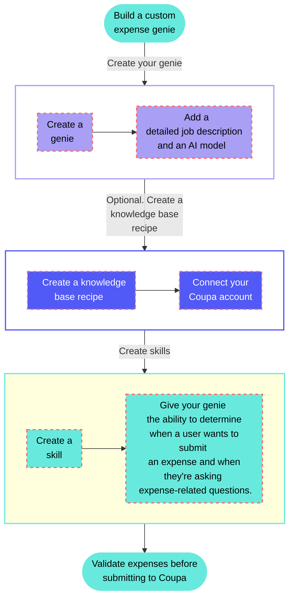

<!-- source: https://docs.workato.com/en/getting-started/use-cases/agent-studio/genies/expense-genie-coupa-use-case | lastmod: 2026-08-26 -->
> Build an expense genie that connects to Coupa and validates employee expenses by extracting data from receipt uploads as the source of truth.

# Validate Coupa expenses with an expense genie

This use case connects your Coupa account to a genie configured with specialized skill and knowledge base recipes that turn your genie into a customized expense validator. The skill triggers when a user uploads a receipt image, such as a `jpg`, `png`, or `PDF`.

The genie automates your expense workflow by extracting relevant expenses from employee receipt uploads. This ensures that the receipt is the source of truth and removes the need for manual entry.

## What does this genie do?

This genie enables you to connect your knowledge base to your Coupa account to empower your genie with company-specific knowledge. It uses a custom skill to teach your genie how to validate and process expense receipts."



## Create your knowledge base recipe

Complete the following steps to create a custom expense genie that enables you to upload and verify files and images, such as itemized recipes, before you submit expenses to Coupa:

> **USE CASES ARE INTENDED AS EXAMPLES ONLY**
> 
> Use cases are intended to serve as examples. Genie modifications, such as triggers or custom actions, may require adjustments for your specific setup.

1. Sign in to Workato.
   
2. Create a Coupa connection.
   
   ### Create a Coupa connection
   
   This step creates a connection between Workato and your Coupa account.
   
   1. Sign in to your Coupa instance, for example `https://[your-instance-name].coupacloud.com/oauth2/clients`.
      
   2. Click **Create** to create a new OAuth client.
      
   3. Use the **Grant type** drop-down menu to select **Authorization Code** or **Client Credentials**. You must select the same option in Workato for the **Authentication type**.
      
   4. Provide a name in the **Name** field. For example: `Workato Coupa OAuth connection`.
      
   5. Enter the redirect URIs you plan to use in the **Redirect URIs** field. Add the link `https://www.workato.com/oauth/callback` if you plan to use **Authorization code**.
      
   6. Select the scopes you plan to provide to Workato. Include all objects and features you plan to automate with the Coupa connector. The scopes you select must match the scopes you configure in Workato. You must include the `core.common.read` and `offline_access` scopes at a minimum to establish a connection.
      
      _Create a new client_
      
   7. Click **Save**.
      
   8. Copy and store the **Identifier** and the **Secret** for use in Workato.
      
   9. Return to your Workato account and go to the project where you plan to add your connection.
      
   10. Click **Create > Connection** or press C twice.
       
   11. Search for and select `Coupa` as your connection on the **New connection** page.
       
   12. Provide a unique name for the connection in the **Connection name** field.
       
   13. Use the **Location** drop-down menu to select the project where you plan to store the connection.
       
   14. Use the **Authentication** drop-down to select the **Grant type** provided in Coupa.
       
   15. Enter the **Client ID** and **Client secret**.
       
   16. Enter the Coupa URL for your instance in the **Host** field. For example, enter `acme` if your URL is `http://acme.coupacloud.com`.
       
   17. Use the **Scopes** drop-down menu to select the same scopes you configured in Coupa. Include the required scopes `core.common.read` and `offline_access` to connect successfully.
       
   18. Click **Connect**.
       
   
3. Create a genie.
   
   ### Create a genie
   
   This step creates a genie where you can store your knowledge base and skills.
   
   1. Sign in to Workato.
      
   2. Go to **AI Hub > Agent Studio** and click **\+ Create genie**. Alternatively, go to the **Projects** page and click **Create > Genie** or press C+G.
      
   3. Select **New genie** to create a blank genie.
      
   4. Use the **Location** drop-down menu to select a location for your genie.
      
   5. Enter a request or goal for your genie in the **What would you like your genie to help with?** field.
      
      _Create a genie_
      
   6. Click **Start building**. The genie **Build** page displays.
      
      > **JOB DESCRIPTIONS ARE AUTOMATICALLY GENERATED**
      > 
      > The **Job description** is automatically generated based on the input you provide to the **What would you like your genie to help with?** field during genie setup and can be edited to suit your requirements.
      
      _Genie build page_
      
   
4. Optional. Create a knowledge base.
   
   ### Create a knowledge base
   
   This step creates a knowledge base where you can store your knowledge base recipes. This use case doesn't require a knowledge base. Adding a knowledge base enables you to enhance the genie's capabilities with policy documents or other information sources.
   
   1. Go to the genie **Build** page.
      
   2. Go to the **Knowledge base** section and click **\+ Add > New knowledge base**.
      
   3. Provide a name for your knowledge base in the **Knowledge base name** field.
      
      _Create a knowledge base_
      
   4. Use the **Location** drop-down menu to select a location for your knowledge base.
      
   5. Optional. Enter a description for your knowledge base in the **Description** field. Genies use descriptions to understand the context and purpose of the knowledge base to determine when to use it.
      
   6. Go to the **How will you add data** section and select **Uploads and recipes**.
      
   7. Click **Create knowledge base**.
      
   
5. Optional. Create a knowledge base recipe.
   
   ### Create a knowledge base recipe
   
   Knowledge base recipes function like other Workato recipes, but must contain the **Store document in a knowledge base** action. This use case doesn't require a knowledge recipe. However, adding a knowledge base and recipe can enhance your genie with company policies, spending rules, and other internal information.
   
   1. Go to the **Knowledge bases** section and select the knowledge base you created in the preceding steps.
      
   2. Click **\+ Add knowledge**.
      
   3. Select **New knowledge recipe**.
      
   4. Enter a name for your knowledge recipe in the **Recipe name** field.
      
   5. Use the **Location** drop-down menu to select a location for your knowledge recipe.
      
      _Set up your knowledge recipe_
      
   6. Click **Start building**. The recipe editor opens with the **Store knowledge in a knowledge base** action automatically selected.
      
      _Knowledge recipe with **Store knowledge in a knowledge base** action automatically selected_
      
   
6. Create a skill.
   
   ### Create a skill
   
   This step creates a custom skill that enables your genie to process uploaded images.
   
   1. Go to the genie **Build** page.
      
   2. Go to the **Enterprise skills** section and click **\+ Add > Skill**.
      
   3. Select **New skill** and click **Create new skill**.
      
      _Select **New skill**_
      
      Alternatively, you can create a skill from the **Projects** page by clicking **Create > Skill** or pressing C+S.
      
   4. Provide a name for your skill in the **Skill name** field. For example: `Scan images/files into Coupa`
      
   5. Use the **Location** drop-down menu to select a location for your skill.
      
   6. Click **Start building**. The recipe editor opens with the **Start workflow** trigger and **Return response** action automatically selected.
      
   7. Select the **Start workflow** trigger.
      
   8. Enter the following description for your skill workflow in the **When should your genie run this skill?** field. This description helps the genie recognize when to process an expense versus when a user asks a general question.
      
      ```plaintext
      Run this skill when:
      - A user uploads a receipt image (jpg, png, PDF)
      - The user asks to process an expense, submit an expense, or create an expense report
      - Keywords: "receipt", "expense", "reimbursement", "submit receipt"
      
      Do not run this skill for:
      - General questions about expense policies
      - Questions about past expenses without uploading a receipt
      - Requests to view or search existing expense reports
      ```
      
   9. Go to the **What inputs will your genie require to run this skill?** section and click **Use JSON** to provide a description of the schema recipe parameters.
      
   10. Click **Use JSON**.
       
   11. Paste the following JSON schema into the **JSON sample** field and then click **Next**.
       
       ```json
       {
         "expense_fields_schema": {
           "transaction_date": {
             "type": "date",
             "description": "When the transaction happened",
             "format": "YYYY-MM-DD"
           },
           "amount": {
             "type": "string",
             "description": "Total amount of the receipt or invoice"
           },
           "expense_name": {
             "type": "string",
             "description": "Specific name of the expense"
           },
           "description": {
             "type": "string",
             "description": "Item description"
           },
           "currency": {
             "type": "string",
             "description": "Currency that the expense report is in"
           },
           "expense_category": {
             "type": "string",
             "description": "Specify the predefined categories that is accepted in your expense management system"
           }
         }
       }
       ```
       
   12. Review the sample JSON tree and then click **Generate schema**.
       
   13. Go to the **What should be returned to the genie after this skill is run?** section and click **Use JSON**. The **What should be returned to the genie after this skill is run?** section defines the `RETURN` response for the genie step at the end of your recipe.
       
   14. Paste the following JSON schema into the **JSON sample** field and then click **Next**.
       
       ```json
       {
         "output_fields": {
           "summary_response": {
             "type": "string",
             "description": "Defining this output allows the Genie to return a defined response after the recipe has completed the execution"
           }
         }
       }
       ```
       
   15. Review the sample JSON tree and then click **Generate schema**.
       
   
7. Click **\+ Add step** and select **Handle errors**.
   
   _Click **\+ Add step > Handle errors**_
   
   How does the Handle errors control statement work?
   
   The [Handle errors control statement](/en/recipes/steps#handle-errors-step) allows you to monitor your recipe for errors in actions, similar to the try/catch concept in programming languages. You have the opportunity to perform the following actions if an error occurs:
   
   - Retry the sequence of actions again, in case it was a temporary error such as network issues.
     
   - Take remedial actions, such as notifying users of the error through email or error messages in the app, or to carry out a rollback. For example, you can reverse the job by deleting any created or half-created records.
     
   
   This control statement consists of two blocks: the **Monitor** block and the **Error** block. Place the actions that you plan to monitor for errors within the **Monitor** block. If all actions are successful, Workato ignores the **Error** block. However, if any action in the **Monitor** block results in an error, the actions within the **Error** block are executed.
   
   ```mermaid
   graph TD
       A(Monitor action for errors) ---> B((Error found?))
       B --> C{Yes}
       B --> D{No}
       C --> E(Define how to <br/> handle the error)
       D --> F(Continue processing <br/> the recipe)
      classDef default fill:#67eadd,stroke:#67eadd,stroke-width:2px,color:#000;
   ```
   
8. Set up your Coupa Create Object action.
   
   This step creates an expense line in Coupa. Note that this step is nested within the Monitor block.
   
   1. Search for and select Coupa as the app to monitor.
      
   2. Select the **Create object** action.
      
   3. Use the **Object** drop-down menu to select **Expense line**.
      
      _Set up your **Expense line** action_
      
   4. Ensure that **Return type** is set to default.
      
   5. Map the Description (Step 1) datapill to the **Description** field.
      
   6. Map the Transaction date (Step 1) datapill to the **Expense date** and **Start date** fields.
      
   7. Click **Save**.
      
   
9. Configure your ERROR FOUND? block.
   
   This step defines how the recipe responds if the **Expense line** action returns an error.
   
   Complete the following steps to configure your **ERROR FOUND?** block:
   
   1. Go to the **ERROR FOUND?** block and confirm that the **Yes** branch shows **DO NOT RETRY**. This option is typically set by default.
      
      _**ERROR FOUND?** block_
      
   2. Go to the **Yes** branch and click **Select and app and action**.
      
   3. Search for and select `Workato Skill` as your app.
      
   4. Select the **Return response** action.
      
   5. Map the Error type (Step 4) datapill to the **Type** field.
      
   6. Map the Error message (Step 4) datapill to the **Description** field.
      
      _Map the error information_
      
   7. Click **Save**.
      
   8. Go to the **No** branch. The **Return response** action should already be present.
      
   9. Click the **Return response** action to open it.
      
   10. Map the Type (Step 1) datapill to the **Type** field.
       
   11. Map the Description (Step 1) datapill to the **Description** field.
       
       _Map the response information_
       
   12. Click **Save**.
       
   

Example genie recipe configuration

_Configured genie recipe example_

---
