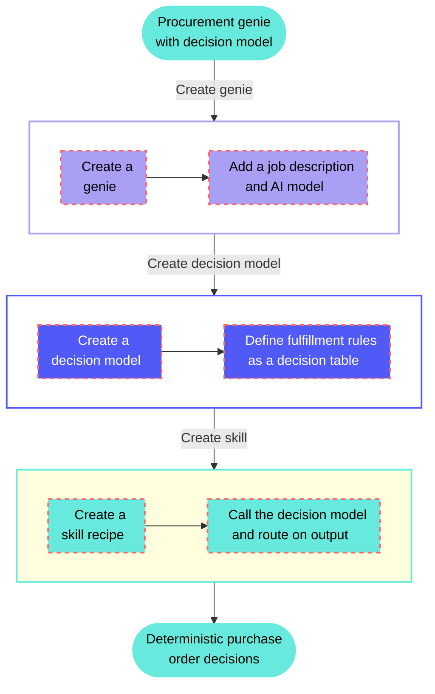

<!-- source: https://docs.workato.com/en/getting-started/use-cases/agent-studio/genies/procurement-genie-decision-model | lastmod: 2026-07-09 -->
> Build a procurement genie that uses a decision model to evaluate purchase order requests and decide whether to accept, reject, or back-order them.

# Process purchase orders with a procurement genie

This use case configures a procurement genie with a skill that calls a [decision model](/en/recipes/decision-models) to evaluate purchase order requests. Rather than encoding business rules in prompts, the decision model applies your organization's fulfillment logic, such as holiday freezes, price deviation thresholds, and inventory checks, and returns a deterministic decision that the skill uses to route the order.

## What does this genie do?

This genie processes purchase order requests from users and uses a decision model in a skill to determine whether to accept, reject, or back-order the purchase.



## Create your procurement genie

Complete the following steps to build a procurement genie that uses a decision model to process purchase orders:

> **USE CASES ARE INTENDED AS EXAMPLES ONLY**
> 
> Use cases are intended to serve as examples. Genie modifications, such as triggers or custom actions, may require adjustments for your specific setup.

1. Sign in to Workato.
   
2. Select the project where you plan to create your genie and skill.
   
3. Go to **AI Hub > Agent Studio**.
   
4. Create a genie.
   
   ### Create a genie
   
   This step creates the procurement genie that users will interact with to submit and check purchase orders.
   
   1. Sign in to Workato.
      
   2. Go to **AI Hub > Agent Studio** and click **\+ Create genie**. Alternatively, go to the **Projects** page and click **Create > Genie** or press C+G.
      
   3. Select **New genie** to create a blank genie.
      
   4. Use the **Location** drop-down menu to select a location for your genie.
      
   5. Enter a request or goal for your genie in the **What would you like your genie to help with?** field.
      
      _Create a genie_
      
   6. Click **Start building**. The genie **Build** page displays.
      
      > **JOB DESCRIPTIONS ARE AUTOMATICALLY GENERATED**
      > 
      > The **Job description** is automatically generated based on the input you provide to the **What would you like your genie to help with?** field during genie setup and can be edited to suit your requirements.
      
      _Genie build page_
      
   
5. Create the decision model.
   
   ### Create the decision model
   
   This step defines the fulfillment rules your skill will use to evaluate purchase orders. The decision model is the single source of truth for your business logic. Rules can be updated here independently of the genie or skill.
   
   1. Go to **Projects** and click **Create > Decision model**.
      
   2. Enter a name for your decision model in the **Decision model name** field. For example: `Purchase order fulfillment`.
      
   3. Click **Start building**.
      
   4. Define your input schema in the **Model Inputs** node. These are the fields your skill will supply when calling the model. For example:
      
      - `supplier_score` (Number): The supplier's risk or performance score
      - `risk_level` (String): The supplier's risk classification, such as `Low`, `Medium`, or `High`
      - `request_type` (String): The type of purchase request, such as `Standard` or `Emergency`
      - `order_value` (Number): The total value of the purchase order
      - `lead_time_days` (Number): The supplier's current lead time in days
      - `current_stock` (Number): Current inventory level for the ordered item
      
      _Add fields to the **Model Inputs** node_
      
   5. Go to the **Fields** sidebar and create a `decision` field (String). This field carries the model's output, such as `Approved`, `Rejected`, `Escalate`, or `Review`, back to the skill.
      
   6. Configure the **Model Outputs** node to return `decision`.
      
   7. Open the **Decision table** node and add your fulfillment rules as rows. Rules are evaluated top to bottom: the first row that matches all conditions determines the output. You can also set a **Default output** that applies when no rule matches. For example:
      
      | Rule name | Supplier score | Risk level | Request type | Order value | Lead time days | Current stock | Decision |
      | --- | --- | --- | --- | --- | --- | --- | --- |
      | No stock | Any | Any | Any | Any | Any | < 0 | `Rejected` |
      | Emergency reorder | Any | Any | `Emergency` | Any | Any | \> 100 | `Approved` |
      | High risk supplier | < 50 | `High` | `Standard` | Any | Any | Any | `Rejected` |
      | Large order escalate | Any | Any | `Standard` | \> 100000 | Any | Any | `Escalate` |
      | Trusted supplier | ≥ 80 | `Low` | Any | ≤ 50000 | Any | Any | `Approve` |
      | Long lead time review | Any | `Medium` | `Standard` | Any | \> 14 | < 500 | `Review` |
      | Standard approval | ≥ 60 | `Low` | `Standard` | ≤ 25000 | ≤ 7 | Any | `Approve` |
      | **Default output** | — | — | — | — | — | — | `Review` |
      
      _Add fulfillment rules as rows in the decision table_
      
   8. Click **Save**.
      
   
6. Create a skill.
   
   ### Create a skill
   
   This step adds a new skill to your genie where you can build the purchase order processing recipe.
   
   1. Go to the genie **Build** page.
      
   2. Go to the **Enterprise skills** section and click **\+ Add**.
      
   3. Select **Skill**.
      
   4. Select **New skill**.
      
   5. Click **Create new skill**.
      
      Alternatively, you can create a skill from the **Projects** page by clicking **Create > Skill** or pressing C+S.
      
   6. Enter a name for your skill in the **Skill name** field. For example: `Process purchase order`.
      
   7. Use the **Location** drop-down menu to select a location for your skill.
      
   8. Click **Start building**. The recipe editor opens with the **Start workflow** trigger and **Return response** action automatically selected.
      
   
7. Set up your skill trigger.
   
   ### Set up your skill trigger
   
   This step tells the genie when to invoke this skill and what information to extract from the user's message.
   
   1. Select the **Start workflow** trigger.
      
   2. Enter a description in the **When should your genie run this skill?** field. For example:
      
      ```plaintext
      Run this skill when a user submits a purchase order or asks whether a purchase order will be fulfilled. Extract the product ID, order value, and request type from the user's message.
      
      Do not run this skill for:
      - General questions about procurement policy
      - Requests to look up order history
      ```
      
   3. Go to the **What inputs will your genie require to run this skill?** section and add the fields the genie will extract from the user's message and pass to the recipe. For example:
      
      - `product_id` (String): The product being ordered
      - `order_value` (Number): The total value of the purchase order
      - `request_type` (String): The type of purchase request, such as `Standard` or `Emergency`
   4. Go to the **What should be returned to the genie after this skill is run?** section and add a `decision_result` (String) output field. The skill uses this to return the fulfillment outcome to the genie.
      
   5. Click **Save**.
      
   
8. Set up the Decision Models action.
   
   ### Set up the Decision Models action
   
   This step adds the **Decision Models by Workato** connector to the skill and maps the purchase order data to the decision model's inputs.
   
   1. Add any steps needed to fetch data the decision model requires before making a decision. For example, use the **Search** action in a connector such as NetSuite to look up supplier risk scores and current inventory levels for the submitted `product_id`.
      
   2. Click **\+ Add step** in the recipe editor.
      
   3. Search for and select **Decision Models by Workato**.
      
   4. Select the **Make a decision** action.
      
   5. Use the **Model name** drop-down to select your `Purchase order fulfillment` model.
      
   6. Map the input datapills to the model's input fields. For example:
      
      - `order_value` → Order value (Step 1) from the skill trigger
      - `request_type` → Request type (Step 1) from the skill trigger
      - `supplier_score` → Supplier score from your supplier lookup step
      - `risk_level` → Risk level from your supplier lookup step
      - `lead_time_days` → Lead time days from your supplier lookup step
      - `current_stock` → Current stock from your supplier lookup step
      
      _Map datapills from earlier recipe steps to the decision model's input fields_
      
   7. Click **Save**.
      
   
9. Configure the Return Response to Genie block.
   
   ### Configure the Return Response to Genie block
   
   This step returns the decision model's output to the genie so it can relay the fulfillment outcome to the user.
   
   1. Select **Return Response to Genie** in the recipe editor.
      
   2. Map the Decision output datapill from the **Make a decision** step to the `decision_result` output field. The genie uses this value to inform the user of the fulfillment outcome.
      
   3. Click **Save**.
      
   
10. Test your skill.
    
    ### Test your skill
    
    This step verifies that your genie correctly invokes the skill and that the decision model returns the expected fulfillment decision.
    
    1. Return to the genie **Build** page and click **Test**.
       
    2. Enter a purchase order request in the chat. For example:
       
       ```plaintext
       I'd like to submit a purchase order for product SKU-1234, order date today, at $450. Can you process this?
       ```
       
    3. Verify that the genie invokes the skill, the decision model evaluates the order against your rules, and the genie returns the fulfillment decision. Edit your decision table or skill and test again if the results aren't correct.

---
