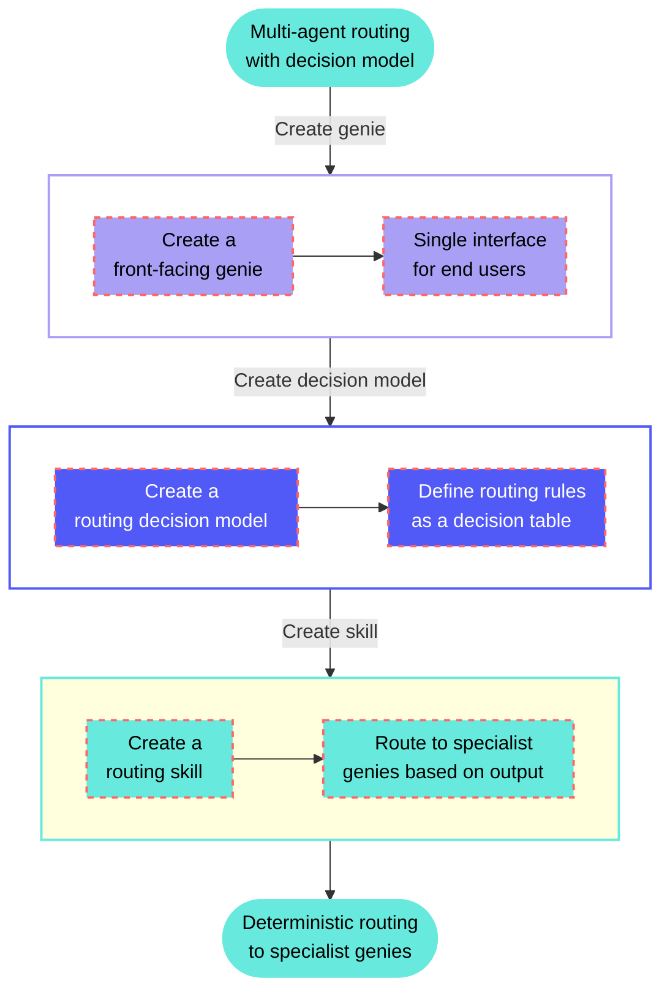

<!-- source: https://docs.workato.com/en/getting-started/use-cases/agent-studio/genies/route-requests-across-agents-decision-model | lastmod: 2026-07-09 -->
> Build a front-facing genie that uses a decision model to route each user request to the right specialist genie based on its category.

# Route requests across agents with a decision model

This use case configures a front-facing genie that uses a [decision model](/en/recipes/decision-models) to route user requests to the correct specialist genie. Rather than relying on prompts to determine which agent should handle a request, the decision model applies predefined routing rules deterministically, giving you full control, auditability, and testability over how requests are distributed across your agent network.

End users interact with a single genie. Behind the scenes, the decision model routes each request to the appropriate specialist genie based on the request category and other criteria you define.

## What does this genie do?

This genie receives user requests, extracts the request category and domain, and uses a decision model in a skill to assign the request to the correct specialist genie.



## Set up your routing genie

Complete the following steps to build a front-facing genie that uses a decision model to route requests to specialist genies:

> **USE CASES ARE INTENDED AS EXAMPLES ONLY**
> 
> Use cases are intended to serve as examples. Genie modifications, such as triggers or custom actions, may require adjustments for your specific setup.

1. Sign in to Workato.
   
2. Select the project where you plan to create your genie and skill.
   
3. Go to **AI Hub > Agent Studio**.
   
4. Create a front-facing genie.
   
   ### Create a front-facing genie
   
   This step creates the genie that end users interact with. This genie acts as a single entry point and delegates requests to specialist genies behind the scenes.
   
   1. Sign in to Workato.
      
   2. Go to **AI Hub > Agent Studio** and click **\+ Create genie**. Alternatively, go to the **Projects** page and click **Create > Genie** or press C+G.
      
   3. Select **New genie** to create a blank genie.
      
   4. Use the **Location** drop-down menu to select a location for your genie.
      
   5. Enter a request or goal for your genie in the **What would you like your genie to help with?** field.
      
      _Create a genie_
      
   6. Click **Start building**. The genie **Build** page displays.
      
      > **JOB DESCRIPTIONS ARE AUTOMATICALLY GENERATED**
      > 
      > The **Job description** is automatically generated based on the input you provide to the **What would you like your genie to help with?** field during genie setup and can be edited to suit your requirements.
      
      _Genie build page_
      
   
5. Create the routing decision model.
   
   ### Create the routing decision model
   
   This step defines the routing rules that determine which specialist genie handles each request. The decision model is maintained independently of the genie, so you can update routing logic without modifying any skills or prompts.
   
   1. Go to **Projects** and click **Create > Decision model**.
      
   2. Enter a name for your decision model in the **Decision model name** field. For example: `Request routing`.
      
   3. Click **Start building**.
      
   4. Define your input schema in the **Model Inputs** node. These are the fields the front-facing genie will extract from the user's message and pass to the model. For example:
      
      - `domain` (String): The area of the request, such as `Software/App`, `Device/Hardware`, or `Office/Facilities`
      - `purchase_needed` (Boolean): Whether the request requires a purchase
      - `catalog_type` (String): The catalog category for purchase requests, such as `IT`, `Office`, or `Not in catalog`
      
      _Add fields to the **Model Inputs** node_
      
   5. Go to the **Fields** sidebar and create a `genie` field (String). This field returns the name of the specialist genie the request should be routed to.
      
   6. Configure the **Model Outputs** node to return `genie`.
      
   7. Open the **Decision table** node and add your routing rules as rows. Rules are evaluated top to bottom: the first matching row determines the output. You can also set a **Default output** that applies when no rule matches. For example:
      
      | Rule name | Domain | Purchase needed | Catalog type | Genie |
      | --- | --- | --- | --- | --- |
      | New purchases | Any | `true` | `Not in catalog` | `Procurement` |
      | IT purchases | Any | `true` | `IT` | `IT` |
      | Office purchases | Any | `true` | `Office` | `Office Management` |
      | Office/Facilities issues | `Office/Facilities` | Any | Any | `Office Management` |
      | Printing/AV issues | `Printing/AV` | Any | Any | `Office Management` |
      | Software issues | `Software/App` | Any | Any | `IT` |
      | Hardware issues | `Device/Hardware` | Any | Any | `IT` |
      | Network/VPN issues | `Network/VPN` | Any | Any | `IT` |
      | Access/Account issues | `Access/Account` | Any | Any | `IT` |
      | **Default output** | — | — | — | `Escalation` |
      
      _Add routing rules as rows in the decision table_
      
   8. Click **Save**.
      
   
6. Create a skill.
   
   ### Create a skill
   
   This step adds a routing skill to your front-facing genie.
   
   1. Go to the genie **Build** page.
      
   2. Go to the **Enterprise skills** section and click **\+ Add**.
      
   3. Select **Skill**.
      
   4. Select **New skill** and click **Create new skill**.
      
      Alternatively, you can create a skill from the **Projects** page by clicking **Create > Skill** or pressing C+S.
      
   5. Enter a name for your skill in the **Skill name** field. For example: `Route request to specialist`.
      
   6. Use the **Location** drop-down menu to select a location for your skill.
      
   7. Click **Start building**. The recipe editor opens with the **Start workflow** trigger and **Return response** action automatically selected.
      
   
7. Set up your skill trigger.
   
   ### Set up your skill trigger
   
   This step defines when the genie should invoke the routing skill and what information it needs to extract from the user's message.
   
   1. Select the **Start workflow** trigger.
      
   2. Enter a description in the **When should your genie run this skill?** field. For example:
      
      ```plaintext
      Run this skill for every new request that needs to be routed to a specialist. Extract the domain, whether a purchase is needed, and the catalog type from the user's message before invoking this skill.
      ```
      
   3. Go to the **What inputs will your genie require to run this skill?** section and add the fields the genie will extract and pass to the recipe. For example:
      
      - `domain` (String): The area of the request extracted from the user's message
      - `purchase_needed` (Boolean): Whether the request requires a purchase
      - `catalog_type` (String): The catalog category for purchase requests
   4. Click **Save**.
      
   
8. Set up the Decision Models action.
   
   ### Set up the Decision Models action
   
   This step calls the routing decision model and retrieves the name of the specialist genie to assign the request to.
   
   1. Click **\+ Add step** in the recipe editor.
      
   2. Search for and select **Decision Models by Workato**.
      
   3. Select the **Make a decision** action.
      
   4. Use the **Model name** drop-down to select your `Request routing` model.
      
   5. Map the input datapills to the model's input fields:
      
      - `domain` → Domain (Step 1) from the skill trigger
      - `purchase_needed` → Purchase needed (Step 1) from the skill trigger
      - `catalog_type` → Catalog type (Step 1) from the skill trigger
      
      _Map skill trigger datapills to the routing model's input fields_
      
   6. Click **Save**.
      
   
9. Set up the agent orchestration action.
   
   ### Set up the agent orchestration action
   
   This step uses IF conditions to branch on the decision model's `Genie` output and assign the task to the correct specialist genie using [agent orchestration](/en/agentic/agent-studio/agent-orchestration).
   
   1. Click **\+ Add step** in the recipe editor.
      
   2. Select **IF condition**.
      
   3. Set the **Data field** to the Genie output datapill from the **Make a decision** step, set **Condition** to `equals`, and enter the name of the first specialist genie as the **Value**, for example, `IT`.
      
   4. Go to the **Yes** branch, click **\+ Add step**, search for and select **Workato Genie**, and select the **Assign a task to genie** action.
      
   5. Configure the action to assign the request to the matching specialist genie.
      
   6. Repeat steps 1–3 for each routing value from the decision model, for example, `Office Management` and `Procurement`. Each branch can assign the task to a specialist genie or trigger a different action. For example, an `Escalation` branch could update a Jira issue and assign it to an on-call team instead of routing to a genie.
      
      _Add an IF condition and action step for each routing value_
      
   7. Click **Save**.
      
   
10. Test your skill.
    
    ### Test your skill
    
    This step verifies that the front-facing genie correctly routes requests to the appropriate specialist genie.
    
    1. Return to the genie **Build** page and click **Test**.
       
    2. Enter requests that should route to different specialist genies. For example:
       
       ```plaintext
       I need to order new monitors for my team.
       ```
       
       ```plaintext
       My laptop won't connect to the VPN and I have a presentation in an hour.
       ```
       
    3. Verify that the genie invokes the skill, the decision model returns the correct specialist genie for each request, and the orchestration action assigns the task accordingly. Edit your decision table and test again if any requests are routed incorrectly.
       
    

## More resources

- [Decision models](/en/recipes/decision-models)
- [Decision Models by Workato connector](/en/features/decision-models/decision-models-by-workato)
- [Agent orchestration](/en/agentic/agent-studio/agent-orchestration)
- [Process purchase orders with a procurement genie](/en/getting-started/use-cases/agent-studio/genies/procurement-genie-decision-model)

---
