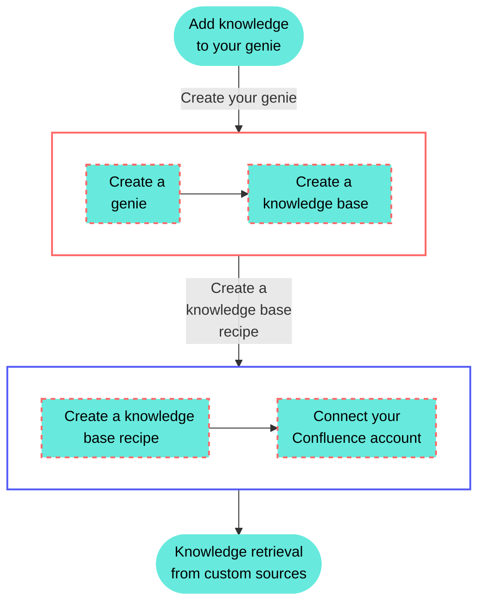

<!-- source: https://docs.workato.com/en/getting-started/use-cases/agent-studio/knowledge-bases/knowledge-base-confluence-use-case | lastmod: 2026-07-09 -->
> Connect a genie knowledge base to Confluence so it periodically scans pages and syncs updates, giving your genie company-specific knowledge.

# Connect your knowledge base to Confluence

This use case connects your Confluence account to your genie knowledge base. The knowledge base recipe scans for pages periodically and automatically syncs updates from Confluence to your knowledge base. This gives your genie contextualized information about your company’s policies, practices, and other relevant information.

## What does this knowledge base recipe do?

This knowledge base recipe enables you to connect your knowledge base to your Confluence account and empower your genie with company-specific knowledge.

## Create your knowledge base recipe

Complete the following steps to create a knowledge base recipe that scans for pages periodically and automatically syncs updates from Confluence to your knowledge base.

> **USE CASES ARE INTENDED AS EXAMPLES ONLY**
> 
> Use cases are intended to serve as examples. Knowledge base recipe modifications, such as triggers or custom actions may require adjustments for your specific setup.

1. Sign in to Workato.
   
2. Select the project where you plan to create your knowledge base recipe.
   
3. Create a Confluence connection.
   
   ### Create a Confluence connection
   
   This step creates a connection between Workato and your Confluence account.
   
   1. Click **Create > Connection** or press C twice.
      
   2. Search for and select `Confluence` on the **New connection** page.
      
   3. Provide a name for your connection in the **Connection name** field.
      
      _Confluence connection setup_
      
   4. Use the **Location** drop-down menu to select the project where you plan to store the connection.
      
   5. Use the **Connection type** drop-down menu to select the connection method you plan to use. You can select your [on-prem group](/en/on-prem/groups) name or select **Cloud** to use a direct connection.
      
   6. Use the **Auth type** drop-down menu to select your authentication method. Options include **Basic**, **API token**, and **OAuth 2.0**.
      
   7. Provide your connection information.
      
      - **If using a cloud connection**: Enter your Confluence subdomain in the **Confluence subdomain field**.
      - **If using an on-prem connection**: Enter the root URI (includes protocol, optional port, and hostname) of your Confluence host in the **Confluence root URI** field.
   8. Provide your authentication information.
      
      **If you selected Basic authentication**:
      
      1. Enter your username (not email) in the **Username** field.
         
      2. Enter your password in the **Password** field.
         
      
      **If you selected API token**:
      
      1. Enter your email in the **Email** field.
         
      2. Enter your API token in the **API token** field. You can create one by going to your Atlassian account and selecting **[Security](https://id.atlassian.com/manage/api-tokens) > API tokens > Create API token**.
         
      
      **If you selected OAuth 2.0**:
      
      1. Enter your client ID in the **Client ID** field.
         
      2. Enter your client secret in the **Client secret** field.
         
      3. Optional. Expand **Advanced settings** to select scopes to request for this connection. The following scopes are selected by default:
         
         - `read:confluence-groups`
         - `read:confluence-content.summary`
         - `write:confluence-content`
         - `search:confluence`
   9. Click **Connect**.
      
   
4. Go to **AI Hub > Agent Studio**.
   
5. Create a genie.
   
   ### Create a genie
   
   This step creates a genie where you can store your knowledge base.
   
   1. Sign in to Workato.
      
   2. Go to **AI Hub > Agent Studio** and click **\+ Create genie**. Alternatively, go to the **Projects** page and click **Create > Genie** or press C+G.
      
   3. Select **New genie** to create a blank genie.
      
   4. Use the **Location** drop-down menu to select a location for your genie.
      
   5. Enter a request or goal for your genie in the **What would you like your genie to help with?** field.
      
      _Create a genie_
      
   6. Click **Start building**. The genie **Build** page displays.
      
      > **JOB DESCRIPTIONS ARE AUTOMATICALLY GENERATED**
      > 
      > The **Job description** is automatically generated based on the input you provide to the **What would you like your genie to help with?** field during genie setup and can be edited to suit your requirements.
      
      _Genie build page_
      
   
6. Create a knowledge base.
   
   ### Create a knowledge base
   
   This step creates a knowledge base where you can store your knowledge base recipes.
   
   1. Go to the genie **Build** page.
      
   2. Go to the **Knowledge base** section and click **\+ Add > New knowledge base**.
      
   3. Provide a name for your knowledge base in the **Knowledge base name** field.
      
      _Create a knowledge base_
      
   4. Use the **Location** drop-down menu to select a location for your knowledge base.
      
   5. Optional. Enter a description for your knowledge base in the **Description** field. Genies use descriptions to understand the context and purpose of the knowledge base to determine when to use it.
      
   6. Go to the **How will you add data** section and select **Uploads and recipes**.
      
   7. Click **Create knowledge base**.
      
   
7. Create a knowledge base recipe.
   
   ### Connect your knowledge base to Confluence
   
   Knowledge base recipes function like other Workato recipes, but must contain the **Store document in a knowledge base** action. This step connects your Confluence account to your knowledge base.
   
   1. Go to the **Knowledge bases** section and select the knowledge base you created in the preceding steps.
      
   2. Click **\+ Add knowledge**.
      
   3. Select **New knowledge recipe**.
      
   4. Enter a name for your knowledge recipe in the **Recipe name** field.
      
   5. Use the **Location** drop-down menu to select a location for your knowledge recipe.
      
      _Set up your knowledge recipe_
      
   6. Click **Start building**. The recipe editor opens with the **Store knowledge in a knowledge base** action automatically selected.
      
      _Knowledge recipe with **Store knowledge in a knowledge base** action automatically selected_
      
   
8. Set up your Scheduler by Workato trigger.
   
   ### Set up your Scheduler by Workato trigger
   
   This step triggers your knowledge recipe to refresh Confluence content in your knowledge base every five minutes. This recipe uses the Scheduler by Workato trigger because the Confluence connector doesn't provide a trigger.
   
   1. Click **Select an app and trigger event**.
      
   2. Search for and select `Scheduler by Workato`.
      
   3. Use the **Time unit** drop-down menu to select **Minutes**.
      
   4. Go to the **Trigger every** field and enter **5**.
      
      _Scheduler by Workato trigger configuration_
      
   
9. Click **\+ Add step** before the Step 2 **Store knowledge in a knowledge base**. The **Store knowledge in a knowledge base** action should now be Step 3.
   
10. Select **Action in app**.
    
    _Click **Add step > Add action in app**_
    
11. Set up your Confluence Search pages action.
    
    ### Set up your Confluence Search pages action
    
    This step tells your recipe to search Confluence when the trigger activates.
    
    1. Search for and select `Confluence`.
       
    2. Select the **Search pages** action.
       
       _Select the **Search pages** action_
       
    3. Select the Confluence connection you set up in the preceding steps. No additional configuration is required for this action.
       
    
12. Click **\+ Add step** before the Step 3 **Store knowledge in a knowledge base**. The **Store knowledge in a knowledge base** action should now be Step 4.
    
13. Set up your Confluence Custom action.
    
    ### Set up your Confluence Custom action
    
    Confluence doesn't have a pre-built action that enables you to retrieve page content for all Confluence documents in a space. You must create custom HTTP request that downloads the content with the **Custom action**.
    
    1. Search for and select `Confluence`.
       
    2. Select **Custom action**.
       
    3. Select the Confluence connection you set up in the preceding steps.
       
    4. Go to the **Action name** field and enter **GET pages**.
       
       _Name your custom action **GET pages**_
       
    5. Click **Resume guided setup**.
       
    6. Use the **Method** drop-down menu to select **GET**.
       
    7. Go to the **Path** field and enter **content**.
       
       _Provide your method and path_
       
    8. Click **Next**.
       
    9. Use the **Response type** drop-down to select **JSON response**.
       
    10. Expand the **Request URL parameters** section.
        
    11. Click **Add URL parameter**.
        
        _Click **Add URL parameter**_
        
    12. Go the **Parameter name** field and enter the `spaceKey`, then enter your parameter value in the **Value** field. For example: If your Confluence URL is `https://yoursite.atlassian.net/wiki/spaces/DOCS/pages/`, your API request would look similar to this: `GET /rest/api/content?spaceKey=DOCS`, and you would enter **DOCS**.
        
        _Configure your URL parameter_
        
    13. Click **\+ Add URL parameter** to add a second parameter.
        
    14. Go the **Parameter name** field and enter the `expand`, then enter your go to the **Value** field and enter `body.view`.
        
    15. Click **Send request**. The **Review response** page displays. You should see `200 OK` followed by the response from the sample request.
        
    16. Verify that the response contains a list of pages from your Confluence space with respective content for each page in the `body.view` property.
        
    17. Click **Apply configuration**.
        
    
14. Go to the recipe builder and select Step 4 **Store knowledge in a knowledge base** action.
    
15. Set up your Store knowledge in a knowledge base action.
    
    ### Set up your Store knowledge in a knowledge base action
    
    This step adds the content pulled from your Confluence account to your knowledge base.
    
    1. Use the **Knowledge base** drop-down menu to select the knowledge base you created in the preceding steps.
       
    2. Expand the **Documents** section.
       
    3. Map the ID (Step 2) datapill to the **Document ID** field.
       
    4. Map the Title (Step 2) datapill to the **Document title** field.
       
    5. Map the Value (Step 3) datapill to the **Document body** field.
       
    6. Map the Self (Step 3) datapill to the **Document URL** field.
       
       _Set up your Store knowledge in a knowledge base action_
       
    7. Click **Save**.

---
