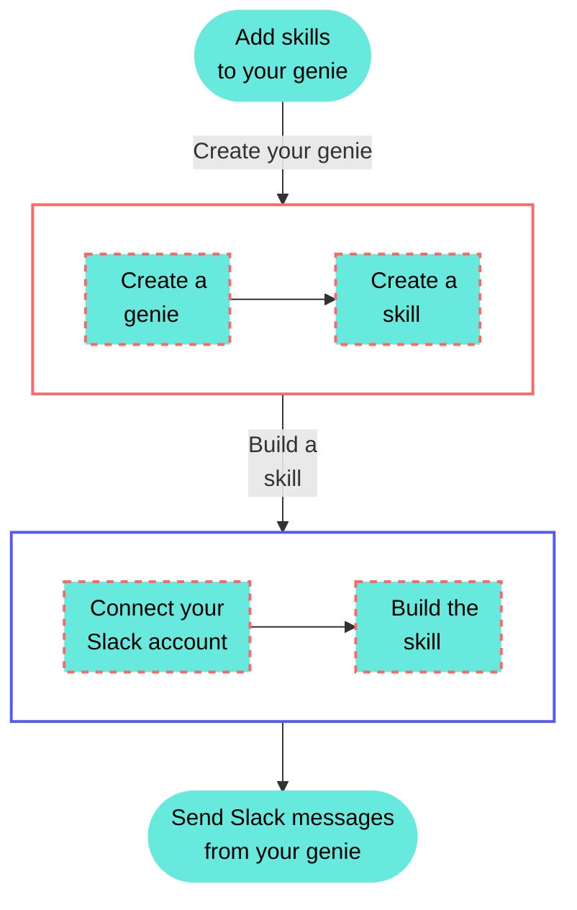

<!-- source: https://docs.workato.com/en/getting-started/use-cases/agent-studio/skills/slack-send-message-skill | lastmod: 2026-07-09 -->
> Add a Slack skill to your genie so it can send a custom message to a channel you specify directly from your genie chat.

# Send a Slack message

This use case connects your Slack account to your genie as a skill. The skill sends a message to a Slack channel you specify in your genie chat. This gives your genie the ability to push real-time notifications, updates, and alerts directly into your team's Slack workspace.

Watch a quick video guide: Create a new Slack skill in Agent Studio

[Video](https://www.youtube.com/embed/g2USuFRW1-o?rel=0&si=KRzsZFmcxt9j91OJ)

## What does this skill do?

This skill enables your genie to send a custom Slack message to a channel you specify.



## Create your skill

Complete the following steps to create a skill that sends a Slack message when triggered by your genie.

> **USE CASES ARE INTENDED AS EXAMPLES ONLY**
> 
> Use cases are intended to serve as examples. Skill modifications, such as triggers, inputs, or custom actions, may require adjustments for your specific setup.

1. Sign in to Workato.
   
2. Select the project where you plan to create your skill.
   
3. Go to **AI Hub > Agent Studio**.
   
4. Create a genie.
   
   ### Create a genie
   
   This step creates a genie where you can store your knowledge base and skills.
   
   1. Sign in to Workato.
      
   2. Go to **AI Hub > Agent Studio** and click **\+ Create genie**. Alternatively, go to the **Projects** page and click **Create > Genie** or press C+G.
      
   3. Select **New genie** to create a blank genie.
      
   4. Use the **Location** drop-down menu to select a location for your genie.
      
   5. Enter a request or goal for your genie in the **What would you like your genie to help with?** field.
      
      _Create a genie_
      
   6. Click **Start building**. The genie **Build** page displays.
      
      > **JOB DESCRIPTIONS ARE AUTOMATICALLY GENERATED**
      > 
      > The **Job description** is automatically generated based on the input you provide to the **What would you like your genie to help with?** field during genie setup and can be edited to suit your requirements.
      
      _Genie build page_
      
   
5. Create a skill.
   
   ### Create a skill
   
   This step adds a new skill to your genie where you can build your Slack messaging recipe.
   
   1. Go to the **Enterprise skills** section and click **\+ Add**.
      
   2. Select **Skill**.
      
   3. Select **New skill** and click **Create new skill**.
      
      _Create a new skill_
      
      Alternatively, you can create a skill from the **Projects** page by clicking **Create > Skill** or pressing C+S.
      
   4. Enter `Send Slack message` in the **Skill name** field. A clear, descriptive name allows you and your genie to understand what the skill does at a glance.
      
   5. Use the **Location** drop-down menu to select a location for your skill.
      
   6. Click **Start building**. The recipe editor opens with the **Start workflow** trigger and **Return response** action automatically selected.
      
   
6. Set up your skill trigger.
   
   ### Set up your skill trigger
   
   This step defines when and why the genie should run this skill, and specifies the inputs it requires from the user.
   
   1. Provide a description for your skill workflow in the **When should your genie run this skill?** field. The genie uses this description to decide when to trigger this workflow. For example:
      
      ```plaintext
      - Run this skill when the user asks to post a goal or initiative update to a Slack channel. For example: Post a message to #general letting the team know that our revenue goal for the quarter is on track and what percentage of our target we've hit.
      - Run this skill when the user asks to announce a new feature release to a Slack channel. For example: Send a message to #product-updates announcing that a new feature has just been released and is now available to all users on the platform.
      ```
      
   2. Go to the **What inputs will your genie require to run this skill?** section and click **Use JSON** or **Add fields manually** to provide a description of the schema recipe parameters. This use case adds the following two inputs:
      
      - **Channel ID** — the ID of the Slack channel the message will be sent to.
      - **Message** — the content of the message to send.
      
      The genie automatically prompts users for the missing information if the input isn't provided in their request.
      
      _Add required genie inputs_
      
   3. Go to the **Outputs** section and click **Use JSON** or **Add fields manually** to provide a description of the output. This use case adds the following output:
      
      - **Message ID** — the ID of the Slack message that was sent.
      
      _Add required genie outputs_
      
   4. Click **Save**.
      
   
7. Set up your Slack Send message action.
   
   ### Set up your Slack Send message action
   
   This step connects your Slack account and maps the user's inputs to the Slack action.
   
   1. Go to the action block in the recipe editor.
      
   2. Search for and select `Slack` as your app.
      
   3. Select the **Send message** action.
      
   4. Connect your Slack account.
      
      ### Create a Slack connection
      
      This step creates a connection between Workato and your Slack account.
      
      1. Click **Create > Connection** or press C twice.
         
      2. Search for and select `Slack` on the **New connection** page.
         
      3. Enter a name for your connection in the **Connection name** field.
         
         _Slack connection setup_
         
      4. Use the **Location** drop-down menu to select the project where you plan to store the connection.
         
      5. Optional. Configure **Advanced** and **Custom OAuth profile** settings if required for your account type.
         
      6. Click **Connect**.
         
      
   5. Map the Channel ID (Step 1) datapill to the **Channel** field.
      
   6. Map the Message (Step 1) datapill to the **Message** field. This dynamically maps the user's input to the Slack action.
      
      _Configure your Slack action_
      
   7. Click **Save**.
      
   
8. Configure the Return response action.
   
   ### Configure the Return response action
   
   This step configures the response returned to the genie after the skill executes successfully.
   
   1. Select the **Return response** action in the recipe editor.
      
      _Configure the **Return response** action_
      
   2. Map the Message ID (Step 2) datapill to the **Message ID** field. You can also include a generic confirmation with the datapill. For example: `Your Slack message has been sent successfully.`
      
      > **RETURN RESPONSE DOWNSTREAM ACTIONS**
      > 
      > The **Return response** action is where you can configure output data for use in downstream actions for other skills, such as returning a record ID or a summary from a database lookup.
      
   3. Click **Save**.
      
   
9. Test your skill.
   
   ### Test your skill
   
   This step verifies that your skill works as expected before you make it available to end users.
   
   1. Return to the Genie Build page and click **Test**.
      
   2. Chat with your genie and enter a request that asks to send a Slack message. For example:
      
      ```plaintext
      
      - Post a message to #sales-team letting the team know that our Q2 revenue goal is on track and we've hit 80% of our target ahead of schedule.
      - Send a message to #general announcing that dark mode has just been released and is now available to all users on the platform.
      ```
      
   3. Verify that the genie executes the skill, sends the message to the specified Slack channel, and returns a confirmation. Edit your recipe and test again if the results aren't correct.
      
      _Successful Slack post_

---
