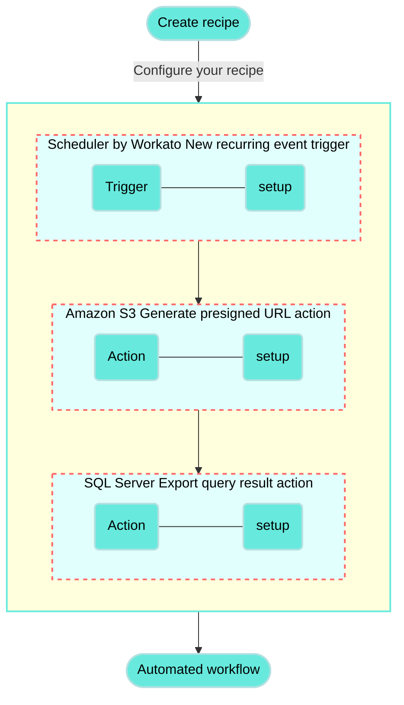

<!-- source: https://docs.workato.com/en/getting-started/use-cases/amazon-s3-sql-server | lastmod: 2026-07-07 -->
> Create a recipe that runs on a schedule to sync data between Amazon S3 and SQL Server.

# Sync data between Amazon S3 and SQL Server recipe

This use case guides you through connecting [Amazon S3](/en/connectors/s3) and [SQL Server](/en/connectors/mssql/introduction) to create a powerful automation.

## What does this recipe do?

This recipe runs on a schedule to sync data between Amazon S3 and SQL Server.



## Create your recipe

Complete the following steps to create a recipe that runs on a schedule to sync data between Amazon S3 and SQL Server:

> **USE CASES ARE INTENDED AS EXAMPLES ONLY**
> 
> This use case serves as an example. Modifications to triggers, actions, or conditional logic may be necessary to adapt this recipe to your workflow.

1. Sign in to Workato.
   
2. Select the project where you plan to create the recipe.
   
3. Create connections for Amazon S3 and SQL Server:
   
   Create an Amazon S3 connection.
   
   ### Create an Amazon S3 connection
   
   This step creates a connection between Workato and your Amazon S3 account.
   
   1. Click **Create > Connection** or press C twice.
      
   2. Search for and select `Amazon S3` on the **New connection** page.
      
   3. Enter a name for your connection in the **Connection name** field.
      
      _Connect to Amazon S3_
      
   4. Use the **Location** drop-down menu to select the project where you plan to store the connection.
      
   5. Use the **Authorization type** drop-down menu to select **IAM role**.
      
   6. Fill in the **IAM role ARN** field. Workato generates a unique external ID for every Workato user, such as `workato-user-84762`. You must provide this external ID when creating an IAM role in Amazon S3.
      
   7. Use the **Restrict to bucket** drop-down menu to select which bucket this connection is restricted to. This is required when the user has only limited [s3:ListBucket](https://docs.aws.amazon.com/AmazonS3/latest/userguide/using-with-s3-actions.html#using-with-s3-actions-related-to-buckets) access.
      
   8. Enter the region of your Amazon S3 account in the **Region** field. You can locate this value in your Amazon S3 account URL. For example, if your account URL is `https://eu-west-1.console.s3.amazon.com`, your region is `eu-west-1`.
      
   9. Specify the download threads in the **Download threads** field. This field is used to boost download speed. The default is `1`, and the maximum is `20`.
      
   10. Click **Connect**.
       
   
   Create a SQL Server connection.
   
   ### Create a SQL Server connection
   
   This step creates a connection between Workato and your SQL Server account.
   
   1. Click **Create > Connection** or press C twice.
      
   2. Search for and select `SQL Server` on the **New connection** page.
      
   3. Enter a name for your connection in the **Connection name** field.
      
      _Connect to SQL Server_
      
   4. Use the **Location** drop-down menu to select the project where you plan to store the connection.
      
   5. Use the **Connection type** drop-down menu to specify if your connection is cloud-based or uses an [on-prem group](/en/on-prem/agents/connection).
      
   6. Enter the URL of your hosted server in the **Host** field.
      
   7. Enter the port number your server runs on in the **Port** field. The default is `1433`.
      
   8. Enter the username used to connect to SQL Server in the **Username** field.
      
   9. Enter the password used to connect to SQL Server in the **Password** field.
      
   10. Enter the name of the database you plan to access in the **Database** field.
       
   11. Optional. Use the **Azure SQL** drop-down menu to specify if you're connecting to Azure SQL.
       
   12. Optional. Expand **Advanced settings** to configure additional datetime settings.
       
   13. Click **Connect**.
       
   
4. Go back to your project and click **Create > Recipe** or press C+R.
   
   _Create a new recipe_
   
5. Enter a name for your recipe in the **Name** field.
   
6. Use the **Location** drop-down menu to select the project where you plan to store the recipe.
   
7. Click **Start building**.
   
   _Start building your recipe_
   
8. Click **Pick a starting point** and select **Run on a schedule**. This creates a new recipe with the Scheduler by Workato [New recurring event trigger](/en/features/scheduler/triggers/new-recurring-event). This trigger doesn't require you to establish a connection.
   
9. Set up your Scheduler by Workato New recurring event trigger.
   
   ### Set up Scheduler by Workato New recurring event trigger
   
   This trigger sets the interval for how frequently the recipe runs.
   
   1. Click the trigger in the recipe editor.
      
      _Click the trigger_
      
   2. Use the **Time unit** drop-down menu to specify how frequently to run the recipe. This recipe selects **Minutes**.
      
      - Available options include **Minutes**, **Hours**, **Days**, **Weeks**, **Months**, or **Custom schedule**.
   3. Enter a whole number in the **Trigger every** field. This example uses `5` to run the recipe every five minutes.
      
      _Configure the New recurring event trigger_
      
   
10. Click **\+ Add step** and select **Action in app**.
    
    _Click **Add step > Add action in app**_
    
11. Set up your Amazon S3 Generate presigned URL action.
    
    ### Set up Amazon S3 Generate presigned URL action
    
    This step creates a temporary authenticated URL to an object in your Amazon S3 bucket. A third party can use this URL to upload and modify this object for the specified duration.
    
    1. Search for `Amazon S3` and select it as your app.
       
       _Choose Amazon S3_
       
    2. Select the **Generate presigned URL** action.
       
       _Select the Generate presigned URL action. [What's a presigned URL?](https://docs.aws.amazon.com/AmazonS3/latest/userguide/ShareObjectPreSignedURL.html)_
       
    3. Select the Amazon S3 connection you created in the previous steps.
       
    4. Select the bucket to monitor from the **Bucket name** drop-down menu.
       
    5. Enter the folder path of the object in the **Object name** field. For example, enter `orders.csv` if the file is located at the root of your bucket.
       
       Ensure the folder path is accurate, as object and file names are case-sensitive. Refer to the [AWS prefix documentation](https://docs.aws.amazon.com/AmazonS3/latest/userguide/using-prefixes.html) for more information.
       
    6. Use the **HTTP Method** drop-down menu to select **PUT**.
       
       _Configure the Generate presigned URL action_
       
    
12. Click **\+ Add step** and select **Action in app**.
    
13. Set up your SQL Server Export query result action.
    
    ### Set up SQL Server Export query result action
    
    This step executes the SQL query to retrieve all rows and columns from your specified table, exports the results as a CSV file, and uploads the file to your designated Amazon S3 object location.
    
    1. Search for `SQL Server` and select it as your app.
       
       _Choose SQL Server_
       
    2. Select the **Export query result** action.
       
       _Select the Export query result action_
       
    3. Select the SQL Server connection you created in the previous steps.
       
    4. Enter the following query in the **SQL** field. Replace `{YOUR_TABLE}` with the name of your table, and update the schema:
       
       ```sql
       SELECT * FROM {YOUR_SCHEMA}.{YOUR_TABLE};
       ```
       
       This query retrieves all rows and columns from the specified table. For example, if your table is named `Orders` and resides in the default schema `dbo`, your query would look as follows:
       
       ```sql
       SELECT * FROM dbo.Orders;
       ```
       
    5. Use the **Column delimiter** drop-down menu to specify the delimiter character that separates each column in the CSV file. For example, select **comma**.
       
    6. Map the Presigned object URL (Step 2) datapill to the **Upload URL** field.
       
       _Configure the Upload URL field_
       
    
14. Click **Save**.
    

Your **Sync data between Amazon S3 and SQL Server** recipe is ready to test and implement.

Example recipe configuration.

_**Sync data between Amazon S3 and SQL Server** recipe_

---
