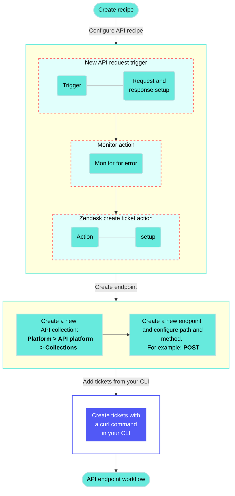

<!-- source: https://docs.workato.com/en/getting-started/use-cases/api-recipes/create-zendesk-tickets | lastmod: 2026-07-07 -->
> Create an API recipe that enables you to create Zendesk tickets programmatically.

# Create Zendesk tickets with API requests

This use case provides step-by-step instructions to build an API recipe and a custom endpoint that creates new Zendesk tickets. This allows internal teams to log support issues through CLI tools without signing in to Zendesk.

> **USE CASES ARE INTENDED AS EXAMPLES ONLY**
> 
> Use cases are intended to serve as examples. API recipe modifications such as API trigger configuration, action configuration, and conditional logic may require adjustments for your specific setup.

## What does this API recipe do?

This API recipe enables you to create new Zendesk tickets by sending API requests to a custom Workato endpoint.



## Create your API recipe

Complete the following steps to create an API recipe that creates new Zendesk tickets:

1. Sign in to Workato.
   
2. Select the project where you plan to create the recipe.
   
3. Create a Zendesk connection.
   
   ### Create a Zendesk connection
   
   The Zendesk connector uses OAuth 2.0 authentication.
   
   > **DEPRECATED AUTHENTICATION METHODS**
   > 
   > Effective March 31, 2026, you can no longer create new Zendesk connections using Basic authentication or Custom OAuth profiles. This change is required by [Zendesk Developer Terms](https://www.zendesk.com/company/agreements-and-terms/zendesk-developer-terms/).
   > 
   > Existing connections using these authentication methods will continue to work until **April 30, 2027**. On this date, Zendesk connections still using Basic authentication or a Custom OAuth profile will be terminated, and recipes relying on these connections will stop functioning.
   
   Complete the following steps to connect to Zendesk in Workato:
   
   1. Click **Create > Connection** or press C twice.
      
   2. Search for `Zendesk` and select it as your app.
      
   3. Enter a name for your connection in the **Connection name** field.
      
      _Connect to Zendesk with OAuth 2.0_
      
   4. Use the **Location** drop-down menu to select the project where you plan to store the connection.
      
   5. Enter your Zendesk subdomain in the **Subdomain** field. For example, your subdomain is `acme` if your Zendesk URL is `https://acme.zendesk.com`.
      
   6. Click **Connect**.
      
   7. Sign in to Zendesk using your credentials to authorize Workato.
      
   
4. Select the project where you plan to create the API request recipe.
   
5. Click **Create > Recipe** or press C+R.
   
   _Create a new recipe_
   
6. Enter a name for your recipe in the **Name** field.
   
7. Use the **Location** drop-down to select the project folder where you plan to store the recipe.
   
8. Click **Start building**.
   
   _Start building your recipe_
   
9. Click **Pick a starting point**, then select **Trigger from an app**.
   
10. Click **Select an app and trigger event**.
    
11. Set up your New API request trigger
    
    ### Set up your New API request trigger
    
    This step defines the request schema that your endpoint accepts.
    
    1. Search for `API platform by Workato` and select it.
       
    2. Select the **New API request** trigger.
       
       _**New API request** trigger_
       
    3. Complete the following steps to configure your request schema:
       
       1. Go to the **Request schema** section and click **add fields manually**.
          
       2. Enter `ticket` in the **Name** and **Label** fields.
          
       3. Use the **Data type** drop-down menu to select **Object**.
          
       4. Use the **Optional** drop-down menu to select **No**.
          
       5. Click **Add field**.
          
          _Ticket object_
          
       6. Return to the **Request schema** section and click **\+ Add field**.
          
       7. Enter `subject` in the **Name** and **Label** fields.
          
       8. Use the **Data type** drop-down menu to select **String**.
          
       9. Use the **Optional** drop-down menu to **No**.
          
       10. Use the **Nest under** drop-down to select `ticket`.
           
       11. Click **Add field**.
           
           _Subject request schema_
           
       12. Return to the **Request schema** section and click **\+ Add field**.
           
       13. Enter `type` in the **Name** and **Label** fields.
           
       14. Use the **Data type** drop-down menu to select **String**.
           
       15. Use the **Optional** drop-down menu to select **No**.
           
       16. Use the **Nest under** drop-down to select `ticket`.
           
       17. Click **Add field**.
           
       18. Return to the **Request schema** section and click **\+ Add field**.
           
       19. Enter `priority` in the **Name** and **Label** fields.
           
       20. Use the **Data type** drop-down menu to select **String**.
           
       21. Use the **Optional** drop-down menu to select **No**.
           
       22. Use the **Nest under** drop-down to select `ticket`.
           
       23. Click **Add field**.
           
       24. Click **Save**.
           
           _Configured request schema_
           
    4. Complete the following steps to configure your request responses:
       
       1. Go to the **Responses** section and click **Add response**.
          
          _Click **Add response**_
          
       2. Enter `Return result` in the **Name** field.
          
       3. Use the **HTTPS status code** standard response drop-down menu to select `200 - OK`.
          
       4. Go to the **Response schema** section and click **add fields manually**.
          
       5. Enter `result` in the **Name** and **Label** fields.
          
       6. Set **Data type** to **String** and **Optional** to **No**.
          
       7. Click **Add field**.
          
          _Configured `200 - OK` response_
          
       8. Click **\+ Add response** again.
          
       9. Enter `Error output` in the **Name** field.
          
       10. Use the **HTTPS status code** drop-down menu to select `400 - Bad Request`.
           
       11. Go to the **Response schema** section and click **add fields manually**.
           
       12. Enter `result` in the **Name** and **Label** fields.
           
       13. Set **Data type** to **String** and **Optional** to **No**.
           
       14. Click **Add field**.
           
           _Configured `400 - Bad Request` response_
           
       15. Click **Save**.
           
    
12. Click **\+ Add step** and select **Handle errors**.
    
    _Click **Add step > Handle errors**_
    
    How does the Handle errors control statement work?
    
    The [Handle errors control statement](/en/recipes/steps#handle-errors-step) allows you to monitor your recipe for errors in actions, similar to the try/catch concept in programming languages. You have the opportunity to perform the following actions if an error occurs:
    
    - Retry the sequence of actions again, in case it was a temporary error such as network issues.
      
    - Take remedial actions, such as notifying users of the error through email or error messages in the app, or to carry out a rollback. For example, you can reverse the job by deleting any created or half-created records.
      
    
    This control statement consists of two blocks: the **Monitor** block and the **Error** block. Place the actions that you plan to monitor for errors within the **Monitor** block. If all actions are successful, Workato ignores the **Error** block. However, if any action in the **Monitor** block results in an error, the actions within the **Error** block are executed.
    
    ```mermaid
    graph TD
        A(Monitor action for errors) ---> B((Error found?))
        B --> C{Yes}
        B --> D{No}
        C --> E(Define how to <br/> handle the error)
        D --> F(Continue processing <br/> the recipe)
       classDef default fill:#67eadd,stroke:#67eadd,stroke-width:2px,color:#000;
    ```
    
13. Set up your Zendesk create ticket action
    
    ### Set up your Zendesk create ticket action
    
    This step adds a new ticket to Zendesk using the data from your API request.
    
    1. Click **\+ Add step**.
       
    2. Search for and select **Zendesk**.
       
    3. Select **Create ticket** as the action.
       
    4. Map the subject (Step 1) datapill to the **Subject** field.
       
    5. Map the type (Step 1) datapill to the **Type** field.
       
    6. Map the Priority (Step 1) datapill to the **Priority** field.
       
    7. Click **Save**.
       
       _Create ticket action_
       
    
14. Configure your error handling
    
    ### Configure your error handling
    
    This step configures your recipe to return appropriate API responses based on whether the Zendesk ticket creation succeeds or fails.
    
    Complete the following steps to configure your **ERROR FOUND?** block:
    
    1. Go to the **ERROR FOUND?** block and confirm that the **Yes** branch shows **DO NOT RETRY**. This option is usually set by default.
       
       _**ERROR FOUND?** block_
       
    2. Go to the **Yes** branch and click **Select an app and action**.
       
    3. Search for and select **API platform by Workato** as the app.
       
    4. Select **Respond to API request** as your action.
       
    5. Use the **Response** drop-down menu to select **Error output**.
       
    6. Expand the **Response body** section.
       
    7. Map the Error message (Step 4) datapill to the **result** field.
       
       _Map the Error message (Step 4) datapill to the **result** field._
       
    8. Go to the **No** branch and click the **\+ Add step** button.
       
    9. Search for and select **API platform by Workato** as your app.
       
    10. Select **Respond to API request** as your action.
        
    11. Use the **Response** drop-down menu to select **Return result**.
        
    12. Expand the **Response body** section.
        
    13. Map the Ticket ID (Step 3), Subject (Step 3), Type (Step 3), and Priority (Step 3) datapills to the **result** field.
        
        _Map the result datapills to the **result** field._
        
    

## Create an API collection and endpoint

This section provides steps to expose your Zendesk ticket recipe as an API endpoint.

1. Create an API collection
   
   ### Create an API collection
   
   This step creates a new collection in the API platform where you can store your Zendesk ticket endpoint.
   
   1. Go to **Platform > API platform**.
      
   2. Click the **API collections** tab.
      
   3. Click **\+ Create new collection**.
      
   4. Ensure that **API recipe collection** is selected and click **Next**.
      
   5. Ensure that **Use existing recipes** is selected.
      
   6. Use the **Recipe folder** drop-down to select the folder where your Zendesk recipe is stored.
      
   7. Deselect all endpoints.
      
   8. Enter a name in the **Collection name** field. For example: `zendesk-tickets`.
      
   9. Enter a version number in the **Version** field. For example: `v1`.
      
   10. Optional. Add a description in the **Description** field.
       
   11. Click **Create collection**.
       
       _Click **Create collection**_
       
   
2. Create an endpoint
   
   ### Create an endpoint
   
   This step connects your API recipe to a new endpoint inside the API collection.
   
   1. Go to **Platform > API platform** and open the collection you created in the preceding steps.
      
   2. Click **\+ New endpoint**.
      
   3. Use the **Recipe** drop-down to select your Zendesk ticket API recipe.
      
   4. Use the **HTTP method** drop-down to select **POST**.
      
   5. Enter an endpoint name in the **Endpoint name** field. For example: `create-zendesk-ticket`.
      
   6. Enter a path in the **Endpoint path** field. For example: `create-zendesk-ticket-v1`. Don’t include a slash (`/`) in your endpoint path. This is automatically appended after you create the endpoint.
      
   7. Optional. Add a description in the **Endpoint description** field.
      
   8. Optional. Set a request timeout if needed. Default is `30` seconds.
      
   9. Click **Add endpoint**.
      
      _Create an endpoint_
      
   

## Create tickets from the CLI

You can use a `curl` command to send a POST request to your endpoint and create a Zendesk ticket.

How does the curl command work?

### details How does the curl command work?

Your curl command includes:

- `-X POST`: Sends a POST request
- `https://apim.workato.com/<your-workspace-name>/<your-endpoint-path>`: The full URL to your Workato API endpoint
- `-H "Content-Type: application/json"`: Indicates JSON format
- `-H "API-Token: <your-api-token>"`: Authenticates the request using your API token
- `-d '...'`: Contains the JSON payload

You can find your actual endpoint URL and token in **Platform > API platform > API collections**.

For example:

```shell
curl -X POST https://apim.workato.com/acme/create-zendesk-ticket-v1 \
  -H "Content-Type: application/json" \
  -H "API-Token: YOUR_API_TOKEN" \
  -d '{
    "ticket": {
      "subject": "Cannot access account",
      "type": "Incident",
      "priority": "High"
    }
  }'
```

Complete the following steps to use your API endpoint to create Zendesk tickets from your CLI:

1. Open a terminal or CLI tool such as VS Code or iTerm.
   
2. Run your customized `curl` command from the example above, replacing `<your-workspace-name>`, `<your-endpoint-path>`, and `<your-api-token>` with your actual values.
   
   _Run the command in your CLI_

---
