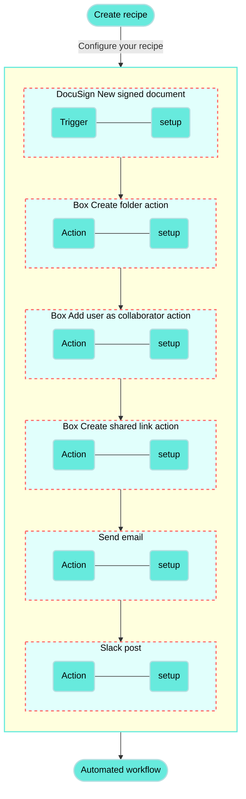

<!-- source: https://docs.workato.com/en/getting-started/use-cases/docusign-box-slack | lastmod: 2026-07-07 -->
> Build a recipe that invites DocuSign signees to collaborate in Box and notifies your team in Slack when a document is signed.

# Invite DocuSign signees to collaborate in Box and notify your team in Slack recipe

This use case guides you through connecting [DocuSign](/en/connectors/docusign), [Box](/en/connectors/box), and [Slack](/en/connectors/slack) to Workato to create a multi-application automation.

## What does this recipe do?

This recipe monitors DocuSign for newly signed documents. It checks if the email address of the individual who signed the document includes your company's email domain name, for example: `@acme.com`. If the email address does not contain your company's email domain name, the recipe creates a folder in Box, adds the user as a collaborator to the folder, and then creates a shared link to the folder. The recipe then sends an email to the user with the shared link and posts a message in Slack notifying you and your team that the user has been invited to collaborate.

## Create your recipe

Complete the following steps to create a recipe that monitors DocuSign for newly signed documents, uses conditional logic to determine if the user is an employee at your company and then creates a new folder, adds the user as a collaborator to the folder, creates a shared folder link, emails the folder link to the new user, and posts a Slack message:

> **USE CASES ARE INTENDED AS EXAMPLES ONLY**
> 
> This use case serves as an example. Modifications to triggers, actions, or conditional logic may be necessary to adapt this recipe to your workflow.

1. Sign in to Workato.
   
2. Select the project where you plan to create the recipe.
   
3. Create connections for DocuSign, Box, and Slack:
   
   Create a DocuSign connection.
   
   ### Create a DocuSign connection
   
   This step creates a connection between Workato and your DocuSign account.
   
   1. Click **Create > Connection** or press C twice.
      
   2. Search for and select `DocuSign` on the **New connection** page.
      
   3. Provide a name for your connection in the **Name** field.
      
      _Connect to DocuSign_
      
   4. Use the **Location** drop-down menu to select the project where you plan to store the connection.
      
   5. Use the **Demo** drop-down menu to select whether the account you plan to use is a demo account.
      
   6. Enter your DocuSign account ID in the **Account ID** field. To find your account ID: sign in to DocuSign > click **Settings > Apps and Keys > API Account ID**.
      
   7. Enter your connect key in the **Connect key** field.
      
   8. Click **Connect**.
      
   
   Create a Box connection.
   
   ### Create a Box connection
   
   This step creates a connection between Workato and your Box account.
   
   The Box connector supports both authorization code grant and [client credentials](/en/connectors/box#client-credentials) authentication.
   
   Complete the following steps to set up your Box connection using authorization code grant authentication:
   
   1. Click **Create > Connection** or press C twice.
      
   2. Search for and select `Box` on the **New connection** page.
      
   3. Provide a name that identifies which Box instance Workato is connected to in the **Connection name** field.
      
      _Create your connection_
      
   4. Use the **Location** drop-down menu to select the project where you plan to store this connection.
      
   5. Use the **Authentication type** drop-down menu to select **Authorization code grant**.
      
   6. Optional. Expand **Advanced settings** to select **Requested permissions (Oauth scopes)** options.
      
      You can select from the following scopes:
      
      - Read files and folders
      - Read and write files and folders
      - Manage app users
      - Manage managed users
      - Manage groups
      - Manage webhooks
      - Manage enterprise properties
      - Manage retention policies
      - Global content manager
      - Admin can make calls on behalf of users
      - Manage signature requests
      - Manage Box Relay
   7. Click **Connect**. This opens the Box sign in dialog.
      
   8. Enter your Box account email address and password.
      
      _Log in to Box_
      
   9. Click **Authorize**.
      
   10. Review the requested permissions and click **Grant access to Box**.
       
       _Grant access to Box_
       
   
   Create a Slack connection.
   
   ### Create a Slack connection
   
   This step creates a connection between Workato and your Slack account.
   
   1. Click **Create > Connection** or press C twice.
      
   2. Search for and select `Slack` on the **New connection** page.
      
   3. Enter a name for your connection in the **Connection name** field.
      
      _Slack connection setup_
      
   4. Use the **Location** drop-down menu to select the project where you plan to store the connection.
      
   5. Optional. Configure **Advanced** and **Custom OAuth profile** settings if required for your account type.
      
   6. Click **Connect**.
      
   
4. Go back to your project and click **Create > Recipe** or press C+R.
   
   _Create a new recipe_
   
5. Enter a name for your recipe in the **Name** field.
   
6. Select the project where you plan to store the recipe from the **Location** drop-down menu.
   
7. Click **Start building**.
   
   _Start building your recipe_
   
8. Click **Pick a starting point**, then select **Trigger from an app**.
   
9. Click **Select an app and trigger event**.
   
10. Set up your DocuSign New document event trigger.
    
    ### Set up DocuSign New document event trigger
    
    This step monitors your DocuSign files for newly signed documents and triggers your recipe when a new signing event is detected.
    
    1. Search for `DocuSign` and select it as your app.
       
    2. Select the **New document event in DocuSign** trigger.
       
       _Select the New document event in DocuSign trigger_
       
    3. Use the calendar modal to select the date from which your recipe should begin to monitor events in the **When first started, this recipe should pick up events from** field. The trigger checks for new events every five minutes by default. Leave this field empty to fetch events from the last hour. You can't change this value after you run or test the recipe. Refer to [Triggers](/en/recipes/triggers#since-from) to learn more about this input field.
       
    4. Use the **Event** drop-down menu to select **Signed** as the event you plan to monitor. This field defaults to **All** if you do not make a selection.
       
    5. Click **Save**.
       
    
11. Click **\+ Add step** and select **IF condition**.
    
    _Select IF condition_
    
12. Set up your doesn't contain Email IF condition.
    
    ### Set up doesn't contain Email IF condition
    
    This step creates an IF condition that instructs your recipe on how to behavior if an email address isn't found.
    
    1. Map the DocuSign Email (Step 1) datapill into the **Data field**.
       
    2. Use the **Condition** drop-down menu to select `doesn't contain`.
       
    3. Enter the value you plan to use for your IF condition in the **Value** field. For example, this use case checks if the email address in the **Data field** contains your company's email domain name in the **Value** field.
       
       _Set up IF condition_
       
    4. Click **Save**.
       
    
13. Click **\+ Add step** for the **No** condition and select **Add action in app**.
    
14. Set up your Box Create folder action.
    
    ### Set up Box Create folder action
    
    This step creates a new folder where you plan to store the signed document.
    
    1. Search for Box and select it as your app.
       
       _Choose Box as your app_
       
    2. Select the **Create folder** action.
       
       _Select the Create folder action_
       
    3. Map the DocuSign Name (Step 1) datapill into the **New folder name** field.
       
       _Set up the Create folder action_
       
    4. Select the parent folder in which you plan to add your new folder in the **Parent folder** field.
       
    5. Click **Save**.
       
    
15. Click **\+ Add step** under your first Box action and select **Add action in app**.
    
    _Click **Add step > Add action in app**_
    
16. Set up your Box Create collaboration action.
    
    ### Set up Box Create collaboration action
    
    This step configures collaborator access to the newly signed document.
    
    1. Search for Box and select it as your app.
       
    2. Select the **Create collaboration** action.
       
       _Select the Create collaboration action_
       
    3. Click the **Show** button under **Item**.
       
    4. Map the Box Type (Step 3) datapill into the **Type** field.
       
    5. Map the Box ID (Step 3) datapill into the **File or folder ID** field.
       
       _Map your datapills into the Item section_
       
    6. Expand the **Accessible by** section.
       
    7. Enter the email address of the user in the **Email ID of collaborator** field.
       
    8. Use the **Role** drop-down menu to select the role you plan to provide for the collaborator.
       
       _Select a role for the collaborator_
       
    9. Click **Save**.
       
    
17. Click **\+ Add step** under your second Box action and select **Add action in app**.
    
18. Set up your Box Create shared link action.
    
    ### Set up Box Create shared link action
    
    This step creates a shareable link that enables you to share the signed document.
    
    1. Search for Box and select it as your app.
       
    2. Select the **Create folder shared link** action.
       
    3. Map the Box ID (Step 3) datapill into the **Folder ID** field.
       
       _Map the Folder ID datapill_
       
    4. Use the **Access** drop-down menu to select **Collaborators**.
       
    5. Click **Save**.
       
    
19. Click **\+ Add step** and select **Add action in app**.
    
20. Set up your Email by Workato action.
    
    ### Set up Email by Workato action
    
    This step creates an email with a subject and message and sends it to the email addresses that you add.
    
    1. Search for Email by Workato and select it as your app. This app does not require connection configuration.
       
       _Select Email by Workato as your app_
       
    2. Select the **Send email** action.
       
    3. Map the DocuSign Email (Step 1) datapill into the **To** field. This is the email address that receives the email you send.
       
       _Map the DocuSign Email (Step 1) datapill into the To field_
       
    4. Enter a message subject in the **Subject** field. For example, `Invitation to collaborate`.
       
    5. Optional. Use the **Email type** drop-down menu to select the format of the email message. This field defaults to HTML.
       
    6. Enter a message for the body of your email in the **Message** field.
       
    7. Click **Save**.
       
    
21. Click **\+ Add step** and select **Add action in app**.
    
22. Set up your Slack Post message action.
    
    ### Set up Slack Post message action
    
    This step creates a Slack post with the text, attachment title, attachment link, and collaborator name that you provide.
    
    1. Search for Slack and select it as your app.
       
       _Select Slack as your app_
       
    2. Select the **Post message** action.
       
    3. Use the **Channel** drop-down menu to select the Slack channel in which you plan to post your message.
       
    4. Enter a message for the post in the **Basic text** field. You can also map the DocuSign Name (Step 1) datapill into this field if you plan to include the new collaborator's name in the message automatically.
       
    5. Enter an attachment title for the Slack post in the **Attachment title** field.
       
    6. Map the Box URL (Step 5) datapill into the **Attachment title link** field. Attachment titles are clickable and direct users to the URL you provide when clicked.
       
       _Map the Box URL (Step 5) datapill into the Attachment title link field_
       
    7. Enter text for the attachment in the **Attachment text** field. You can map the DocuSign Name (Step 1) and Email (Step 1) datapills into this field if you plan to include specific details about the new collaborator.
       
    8. Click **Save**.
       
    

Your **Invite DocuSign signees to collaborate in Box and notify your team in Slack** recipe is ready to test and implement.

---
