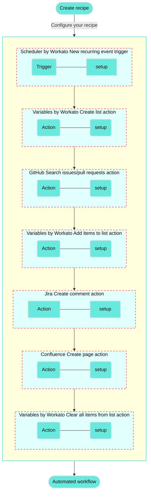

<!-- source: https://docs.workato.com/en/getting-started/use-cases/github-jira-confluence | lastmod: 2026-07-07 -->
> Build a recipe that creates weekly Confluence release notes and Jira comments from closed GitHub issues.

# Create summarized Confluence notes and Jira comments from closed GitHub PRs recipe

This use case guides you through connecting [GitHub](/en/connectors/github), [Jira](/en/connectors/jira), and [Confluence](/en/connectors/confluence) to create a powerful automation.

## What does this recipe do?

This recipe generates weekly release notes in Confluence based on closed issues from a GitHub repository.

The recipe searches for closed issues, compiles them into a list, and creates a Confluence page with the closed issues. Additionally, if a GitHub issue references a specific Jira ticket in its body, the recipe adds a comment to the corresponding Jira ticket.



## Create your recipe

Complete the following steps to create a recipe that searches for closed issues in a GitHub repository, adds them to a list, and then creates a Confluence page summarizing the issues while also adding comments to related Jira tickets.

> **USE CASES ARE INTENDED AS EXAMPLES ONLY**
> 
> This use case serves as an example. Modifications to triggers, actions, or conditional logic may be necessary to adapt this recipe to your workflow.

1. Sign in to Workato.
   
2. Select the project where you plan to create the recipe.
   
3. Create connections for GitHub, Jira, and Confluence:
   
   Create a GitHub connection.
   
   ### Create a GitHub connection
   
   This step creates a connection between Workato and your GitHub account.
   
   1. Click **Create > Connection** or press C twice.
      
   2. Search for and select `GitHub` on the **New connection** page.
      
   3. Provide a name for your connection in the **Connection name** field.
      
      _GitHub connection setup_
      
   4. Use the **Location** drop-down menu to select the project where you plan to store the connection.
      
   5. Use the **Connection type** drop-down menu to select the connection method you plan to use. You can select your [on-prem group](/en/on-prem/groups) name or select **Cloud** to use a direct connection.
      
   6. Select either [**OAuth App**](/en/connectors/github#traditional-oauth), [**GitHub App**](/en/connectors/github#github-app-authentication), or **Personal Access Token** in the **Authentication type** drop-down menu.
      
      **If you selected GitHub App**:
      
      1. Provide your app ID in the **GitHub App ID** field.
         
      2. Enter the private key in the **GitHub App Private key** field.
         
      3. Fill in the **Installation ID** field.
         
      4. Optional. Expand **Advanced configuration** to provide the **API Root URL**, which is applicable when using GitHub Enterprise Server.
         
      
      **If you selected Personal Access Token**:
      
      1. Enter your personal access token in the **Personal Access Token** field.
         
   7. Click **Connect**.
      
   
   Create a Jira connection.
   
   ### Create a Jira connection
   
   This step creates a connection between Workato and your Jira account.
   
   1. Click **Create > Connection** or press C twice.
      
   2. Search for and select `Jira` on the **New connection** page.
      
   3. Enter a name for your Jira connection in the **Connection name** field.
      
      _Jira connection setup_
      
   4. Use the **Location** drop-down menu to select the project where you plan to store the connection.
      
   5. Select your **Connection type**.
      
   6. Use the **Auth type** drop-down menu to select your authentication method. Supported options include [Basic](/en/connectors/jira#basic-authentication-with-password), [API token](/en/connectors/jira#api-tokens), [OAuth 2.0](/en/connectors/jira#oauth2-0), and [Personal access token](/en/connectors/jira#personal-access-tokens).
      
   7. Provide your **Host name**. For example, if your Jira URL is `https://acme.atlassian.net`, your host name is `acme.atlassian.net`.
      
   8. Click **Connect**.
      
   
   Create a Confluence connection.
   
   ### Create a Confluence connection
   
   This step creates a connection between Workato and your Confluence account.
   
   1. Click **Create > Connection** or press C twice.
      
   2. Search for and select `Confluence` on the **New connection** page.
      
   3. Provide a name for your connection in the **Connection name** field.
      
      _Confluence connection setup_
      
   4. Use the **Location** drop-down menu to select the project where you plan to store the connection.
      
   5. Use the **Connection type** drop-down menu to select the connection method you plan to use. You can select your [on-prem group](/en/on-prem/groups) name or select **Cloud** to use a direct connection.
      
   6. Use the **Auth type** drop-down menu to select your authentication method. Options include **Basic**, **API token**, and **OAuth 2.0**.
      
   7. Provide your connection information.
      
      - **If using a cloud connection**: Enter your Confluence subdomain in the **Confluence subdomain field**.
      - **If using an on-prem connection**: Enter the root URI (includes protocol, optional port, and hostname) of your Confluence host in the **Confluence root URI** field.
   8. Provide your authentication information.
      
      **If you selected Basic authentication**:
      
      1. Enter your username (not email) in the **Username** field.
         
      2. Enter your password in the **Password** field.
         
      
      **If you selected API token**:
      
      1. Enter your email in the **Email** field.
         
      2. Enter your API token in the **API token** field. You can create one by going to your Atlassian account and selecting **[Security](https://id.atlassian.com/manage/api-tokens) > API tokens > Create API token**.
         
      
      **If you selected OAuth 2.0**:
      
      1. Enter your client ID in the **Client ID** field.
         
      2. Enter your client secret in the **Client secret** field.
         
      3. Optional. Expand **Advanced settings** to select scopes to request for this connection. The following scopes are selected by default:
         
         - `read:confluence-groups`
         - `read:confluence-content.summary`
         - `write:confluence-content`
         - `search:confluence`
   9. Click **Connect**.
      
   
4. Go back to your project and click **Create > Recipe** or press C+R.
   
   _Create a new recipe_
   
5. Enter a name for your recipe in the **Name** field.
   
6. Select the project where you plan to store the recipe from the **Location** drop-down menu.
   
7. Click **Start building**.
   
   _Start building your recipe_
   
8. Click **Pick a starting point**, then select **Run on a schedule**. This creates a new recipe with the Scheduler by Workato [New recurring event trigger](/en/features/scheduler/triggers/new-recurring-event). This trigger doesn't require you to establish a connection.
   
9. Set up your Scheduler by Workato New recurring event trigger.
   
   ### Set up Scheduler by Workato New recurring event trigger
   
   This trigger sets the interval for how frequently the recipe runs. The Scheduler by Workato trigger doesn't require a connection.
   
   1. Click the trigger in the recipe editor.
      
      _Click the trigger_
      
   2. Select **Weeks** in the **Time unit** field.
      
      - Available options include **Minutes**, **Hours**, **Days**, **Weeks**, **Months**, or **Custom schedule**.
   3. Enter `1` in the **Trigger every** field to run the recipe weekly.
      
   4. Choose the days the recipe should run in the **Days of the week** field. For example, select **Monday**.
      
   5. Specify the time for the recipe to run in the **Trigger at** field. For example, enter `9:00 AM`.
      
   6. Optional. Select the timezone in the **Timezone** field. If left blank, the default is **America/Los\_Angeles**.
      
   7. Optional. Set the start date and time in the **Start after** field, or leave it blank to activate the trigger immediately after you start the recipe. You can't change this value after you run or test the recipe.
      
   8. Click **Save**.
      
   
10. Click **\+ Add step** and select **Action in app**.
    
    _Click **Add step > Add action in app**_
    
11. Set up your Variables by Workato Create list action.
    
    ### Set up Variables by Workato Create list action
    
    This step creates an empty list named **Releases** that captures GitHub issues closed in the past week.
    
    1. Search for `Variables by Workato` and select it as your app.
       
       _Choose Variables by Workato_
       
    2. Select the **Create list** action.
       
       _Select the Create list action_
       
    3. Type `Releases` in the **List name** field.
       
    4. Select **Add fields manually** in the **List item schema** field.
       
    5. Edit the following fields in the **Add new field** dialog:
       
       - Type `Details` in the **Name** field.
       - Ensure **String** is selected in the **Data type** field.
       - Ensure **No** is selected in the **Optional** field.
    6. Click **Add field**.
       
    7. Click **Save**.
       
    
12. Click **\+ Add step** and select **Action in app**.
    
13. Set up your GitHub Search issues/pull requests action.
    
    ### Set up GitHub Search issues/pull requests action
    
    This step searches for issues in your selected GitHub repository that were closed since the beginning of the previous week.
    
    1. Search for `GitHub` and select it as your app.
       
       _Choose GitHub_
       
    2. Select the **Search issues/pull requests** action.
       
       _Select the Search issues/pull requests action_
       
    3. Select the GitHub connection you created in the preceding steps.
       
    4. Select the **Organization** that contains the repository you plan to access.
       
    5. Select your repository in the **Repository name** field.
       
    6. Select **Issue** in the **Type** field.
       
    7. Set the **Status** to **Closed** to search for closed issues.
       
    8. Go to the **Closed after** field, switch to [formula mode](/en/formulas/formula-mode), and enter the following formula:
       
       ```ruby
       (today - 7.days).beginning_of_week
       ```
       
       This formula filters the search to retrieve only issues closed since the beginning of the previous week.
       
    9. Click **Save**.
       
    
14. Click **\+ Add step** and select **Repeat for each**.
    
    _Click **Add step > Repeat for each**_
    
    How does the Repeat for each condition work?
    
    ### GitHub Repeat for each condition example
    
    A [Repeat for each](/en/recipes/repeat-for-each) loop _repeats_ one or more actions _for each_ item in a list. The loop ends automatically when the entire list is processed.
    
    ```mermaid
    flowchart TD
      A(["Start"]) --> B("Another closed GitHub issue from the past week?")
      B -- "Yes" --> C("Add issue to Releases list") --> MoreSteps("Additional steps")
      B -- "No" --> D(["End loop"])
    classDef default fill:#67eadd,stroke:#b3e0e1,stroke-width:2px,color:#000;
    classDef WorkatoPink fill:#f3c1c2,stroke:#f3c1c2,stroke-width:1px;
    class A,D WorkatoPink
    ```
    
15. Set up your Repeat for each loop.
    
    ### Set up a Repeat for each loop
    
    This step processes each issue closed since the beginning of the past week. You can define the actions you plan for the recipe to perform for each issue after setting up the loop.
    
    1. Map the Issues (Step 3) datapill to the **Input list** field.
       
       _Map the Issues (Step 3) datapill_
       
    2. Select **One item at a time** in the **Repeat mode** field.
       
    3. Select **No** in the **Clear step output** field. Learn more about this [input field](/en/features/list-management#clear-step-output).
       
    4. Click **Save**.
       
    
16. Click **Select an app and action**.
    
17. Set up your Variables by Workato Add items to list action.
    
    ### Set up Variables by Workato Add items to list action
    
    This step appends details extracted from each issue processed in the **Repeat for each** loop to the **Releases** list, including the issue title and a hyperlink to the issue number.
    
    1. Search for `Variables by Workato` and select it as your app.
       
       _Choose Variables by Workato_
       
    2. Select the **Add items to list** action.
       
       _Select the Add items to list action_
       
    3. Select **Releases (step 2)** in the **List name** field.
       
    4. Select **End of the list** in the **Insert location** field.
       
    5. Expand the **List item** field.
       
    6. Complete the following actions in **Details** field:
       
       1. Map the Title (Step 4) datapill.
          
       2. Type `(<a href="`.
          
       3. Map the Html URL (Step 4) datapill.
          
       4. Type `">#`.
          
       5. Map the Number (Step 4) datapill.
          
       6. Type `</a>)`.
          
       
       Your configuration should look as follows:
       
       ```plaintext
       TITLE_STEP_4 (<a href="HTML_URL_STEP_4">#NUMBER_STEP_4</a>)
       ```
       
       _List item details configuration_
       
    7. Click **Save**.
       
    
18. Click **\+ Add step** and select **IF condition**.
    
    _Click **Add step > IF condition**_
    
    How do IF conditions work?
    
    ### Add issue IF condition example
    
    An [IF condition](/en/features/if-conditions) enables you to make decisions based on specific conditions. You can control your recipe workflow by executing different actions depending on whether a condition you specify is present or not present (true or false).
    
    ```mermaid
    flowchart TD
        A([Add issue to Releases list]) --> B("Does the issue body contain a string in the format <code>Jira:ABC-123</code>?")
        B -->|Yes| C(Add comment to the corresponding Jira issue)
        B ---->|No| E(Do nothing)

        classDef default fill:#67eadd,stroke:#b3e0e1,stroke-width:2px,color:#000;
        classDef WorkatoPink fill:#f3c1c2,stroke:#f3c1c2,stroke-width:1px;
        class E WorkatoPink
    ```
    
19. Set up your IF condition.
    
    ### Set up IF condition
    
    This step checks if the body of each issue contains a Jira ticket reference.
    
    1. Map the Body (Step 4) datapill to the **Data field**.
       
    2. Select **is present** in the **Condition** field.
       
       This condition checks that the issue body of the current issue being processed is neither empty nor null, preventing errors when applying formulas in the next step.
       
    3. Click `+` (plus) and select **AND** to add a second condition.
       
    4. Switch **Data field** to [formula mode](/en/formulas/formula-mode) and do the following:
       
       1. Map the Body (Step 4) datapill.
          
       2. Append the `.match?(/Jira:w+-\d+/)` formula.
          
          This formula checks if the `Body` of the GitHub issue contains a Jira ticket reference in the format `Jira:ABC-123`.
          
    5. Select **equals** in the **Condition** field.
       
    6. Go to the **Value** field, switch to [formula mode](/en/formulas/formula-mode), and type `true`.
       
       _IF condition configuration_
       
    7. Click **Save**.
       
    
20. Click **Select an app and action**.
    
21. Set up your Jira Create comment action.
    
    ### Set up Jira Create comment action
    
    This step creates a comment in the corresponding Jira ticket if the recipe detects a Jira reference in the issue body. The comment indicates that the issue was closed in GitHub, along with the issue number and a hyperlink to the issue.
    
    1. Search for `Jira` and select it as your app.
       
       _Choose Jira_
       
    2. Select the **Create comment** action.
       
       _Select the Create comment action_
       
    3. Switch the **Issue ID or key** field to formula mode.
       
    4. Complete the following actions in the **Issue ID or key** field:
       
       1. Map the Body (Step 4) datapill.
          
       2. Append the `.match?(/Jira:w+-\d+/)` formula.
          
          _Issue ID or key configuration_
          
    5. Complete the following actions in the **Comment text** field:
       
       1. Type `Closed by Github #`.
          
       2. Map the Number (Step 4) datapill next to the hash `#` symbol.
          
       3. Enter a new line and map the Html URL (Step 4) datapill.
          
          _Comment text configuration_
          
    6. Click **Save**.
       
    
22. Click **\+ Add step** and select **Action in app**.
    
23. Set up your Confluence Create page action.
    
    ### Set up your Confluence Create page action
    
    This step creates a Confluence page listing the GitHub issues that were closed since the beginning of the past week.
    
    1. Search for `Confluence` and select it as your app.
       
       _Choose Confluence_
       
    2. Select the **Create page** action.
       
       _Select the Create page action_
       
    3. Enter the Confluence space key in the **Space key** field. You can find this value in the URL of your Confluence space page.
       
    4. Switch the **Title** field to [formula mode](/en/formulas/formula-mode) and enter the following:
       
       ```ruby
       "Product release (" + today.beginning_of_week.strftime("%d %B %Y") +")"
       ```
       
       This sets the title of your Confluence release notes page. For example, `Product release (1 October 2024)`.
       
       _Title configuration_
       
    5. Switch the **Body** field to [formula mode](/en/formulas/formula-mode) and do the following:
       
       1. Type `"<p>" +`.
          
       2. Map the Releases (Step 2) datapill.
          
       3. Type the following formulas:
          
          ```ruby
          .pluck('Details').join("<br/><br/">)
          ```
          
       4. Type `+ "</p>`.
          
       
       This code constructs an HTML paragraph that contains the details from the **Releases** list, with each detail separated by two line breaks (`<br/><br/>`).
       
       _Body configuration_
       
    6. Click **Save**.
       
    
24. Click **\+ Add step** and select **Action in app**.
    
25. Set up your Variables by Workato Clear all items from list action.
    
    Set up Variables by Workato Clear all items from list action
    
    This step clears the items from the **Releases** list to ensure that closed issues that were previously included in the release notes page aren't included the next time the recipe runs.
    
    1. Search for `Variables by Workato` and select it as your app.
       
       _Choose Variables by Workato_
       
    2. Select the **Clear all items from list** action.
       
       _Select the Clear all items from list action_
       
    3. Go to the **List name** field and select **Releases (step 2)** to clear all items from this list at the end of the recipe run.
       
    4. Click **Save**.
       
    

Your **Create summarized Confluence notes and Jira comments from closed GitHub PRs** recipe is ready to test and implement.

Example recipe configuration.

_**Create summarized Confluence notes and Jira comments from closed GitHub PRs** recipe_

---
