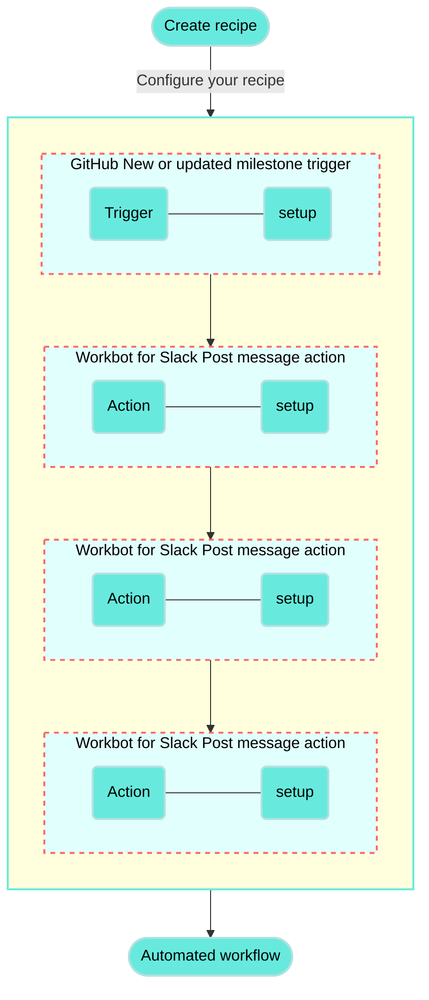

<!-- source: https://docs.workato.com/en/getting-started/use-cases/github-workbot-for-slack | lastmod: 2026-07-07 -->
> Build a recipe that monitors GitHub for new or updated milestones and posts the details to Slack using Workbot for Slack.

# Post GitHub milestones with Workbot for Slack recipe

This use case guides you through connecting [GitHub](/en/connectors/github) and [Workbot for Slack](/en/workbot/workbot#workbot-for-slack) to create a powerful automation.

## What does this recipe do?

This recipe monitors GitHub for new or updated milestones and automatically posts milestone details to Slack using Workbot for Slack.



## How can I use this recipe?

You can use this recipe to track milestones in GitHub and post updates to your Slack channel in real time. You can also modify this recipe to work with real-time triggers for GitHub issues, pull requests, or issue comments.

## Create your recipe

Complete the following steps to create a recipe that monitors GitHub for new or updated milestones and automatically posts milestone details to Slack using Workbot for Slack:

> **USE CASES ARE INTENDED AS EXAMPLES ONLY**
> 
> This use case serves as an example. Modifications to triggers, actions, or conditional logic may be necessary to adapt this recipe to your workflow.

1. Sign in to Workato.
   
2. Select the project where you plan to create the recipe.
   
3. Create connections for GitHub and Workbot for Slack:
   
   Create a GitHub connection.
   
   ### Create a GitHub connection
   
   This step creates a connection between Workato and your GitHub account.
   
   1. Click **Create > Connection** or press C twice.
      
   2. Search for and select `GitHub` on the **New connection** page.
      
   3. Provide a name for your connection in the **Connection name** field.
      
      _GitHub connection setup_
      
   4. Use the **Location** drop-down menu to select the project where you plan to store the connection.
      
   5. Use the **Connection type** drop-down menu to select the connection method you plan to use. You can select your [on-prem group](/en/on-prem/groups) name or select **Cloud** to use a direct connection.
      
   6. Select either [**OAuth App**](/en/connectors/github#traditional-oauth), [**GitHub App**](/en/connectors/github#github-app-authentication), or **Personal Access Token** in the **Authentication type** drop-down menu.
      
      **If you selected GitHub App**:
      
      1. Provide your app ID in the **GitHub App ID** field.
         
      2. Enter the private key in the **GitHub App Private key** field.
         
      3. Fill in the **Installation ID** field.
         
      4. Optional. Expand **Advanced configuration** to provide the **API Root URL**, which is applicable when using GitHub Enterprise Server.
         
      
      **If you selected Personal Access Token**:
      
      1. Enter your personal access token in the **Personal Access Token** field.
         
   7. Click **Connect**.
      
   
   Create a Workbot for Slack connection.
   
   ### Create a Workbot for Slack connection
   
   This step creates a connection between Workato and your Workbot for Slack account.
   
   1. Click **Create > Connection** or press C twice.
      
   2. Search for and select `Workbot for Slack` on the **New connection** page.
      
   3. Provide a name for your connection in the **Name** field.
      
      _Workbot for Slack connection setup_
      
   4. Use the **Location** drop-down menu to select the project where you plan to store the connection.
      
   5. Optional. Select the NLU provider you plan to use, such as DialogFlow or Amazon Lex NLU. You must connect to the NLU provider for it to appear in the drop-down menu.
      
   6. Optional. Click **Advanced** to configure **Slash commands verification tokens**, **custom help** content, your **Slack app status** (classic or not), and your **Custom OAuth profile**.
      
   7. Click **Connect**, sign in to your Slack workspace when prompted, and click **Continue** to verify the connection.
      
   
4. Go back to your project and click **Create > Recipe** or press C+R.
   
   _Create a new recipe_
   
5. Enter a name for your recipe in the **Name** field.
   
6. Select the project where you plan to store the recipe from the **Location** drop-down menu.
   
7. Click **Start building**.
   
   _Start building your recipe_
   
8. Click **Pick a starting point**, then select **Trigger from an app**.
   
9. Click **Select an app and trigger event**.
   
10. Set up your GitHub New or updated milestone trigger.
    
    ### Set up GitHub New or updated milestone trigger
    
    This trigger monitors the GitHub repository you specify for new or updated milestones in real-time.
    
    1. Search for `GitHub` and select it as your app.
       
       _Choose GitHub_
       
    2. Select the **New or updated milestone** trigger.
       
       _Select the New or updated milestone real-time trigger_
       
    3. Select the GitHub connection you created in the preceding steps.
       
    4. Select the organization that contains the repository you plan to access from the **Organization** drop-down menu.
       
    5. Select your repository in the **Repository name** field.
       
    6. Select **All** from the **Action** drop-down menu to monitor all milestone statuses. Additional options include the following statuses:
       
       - **Opened milestone**
       - **Closed milestone**
       - **Created milestone**
       - **Deleted milestone**
       - **Edited milestone**
       
       _Configure the New or updated milestone trigger_
       
    7. Click **Save**.
       
    
11. Click **\+ Add step** and select **IF condition**.
    
    _Click **Add step > IF condition**_
    
    How do IF conditions work?
    
    ### GitHub and Workbot for Slack IF condition example
    
    An [IF condition](/en/features/if-conditions) enables you to make decisions based on specific conditions. You can control your recipe workflow by executing different actions depending on whether a condition you specify is true or false.
    
    ```mermaid
    flowchart TD
        A([New/updated milestone in GitHub]) --> B(New milestone?)
        B -->|Yes| C(Post New milestone message in Slack)
        B -->|No| D(Updated milestone?)
        D -->|Yes| E(Post Updated milestone message in Slack)
        D -->|No| F(Closed milestone?)
        F -->|Yes| G(Post Closed milestone message in Slack)

        classDef default fill:#67eadd,stroke:#b3e0e1,stroke-width:2px,color:#000;
    ```
    
12. Set up your IF condition.
    
    ### Set up your IF condition
    
    This step checks if the milestone is new by comparing the **Created at** and **Updated at** timestamps. The milestone is considered new if the values are identical.
    
    1. Map the GitHub Created at (Step 1) datapill to **Data field**.
       
    2. Use the **Condition** drop-down menu to select **equals**.
       
    3. Map the GitHub Updated at (Step 1) datapill to the **Value** field.
       
       _IF condition configuration_
       
    4. Click **Save**.
       
    
13. Click **Select an app and action**.
    
14. Set up your Workbot for Slack Post message action.
    
    ### Set up Workbot for Slack Post message action
    
    This step posts a message to your specified Slack channel with details about the new GitHub milestone.
    
    1. Search for `Workbot for Slack` and select it as your app.
       
       _Choose Workbot for Slack_
       
    2. Select the **Post message** action.
       
       _Select the Post message action_
       
    3. Enter the channel name where you plan for Workbot to post milestone updates in the **Channel name/DM** field, including the `#` prefix. For example, use `#general`.
       
    4. Click **Add block to message** in the **Message** field.
       
       _Click Add block to message_
       
    5. Go to the **New block** field and use the **Type** drop-down menu to select **Section with text**.
       
    6. Type `*New milestone in GitHub*` in the **Section text** field.
       
       _Fill out the Section text field_
       
    7. Click **Add block to message**.
       
    8. Go to the second **New block** field and use the **Type** drop-down menu to select **Section with fields**.
       
    9. Go to the **Section text** field and perform the following actions:
       
       1. Type `<`.
          
       2. Map the GitHub Html URL (Step 1) datapill.
          
       3. Type `|*`.
          
       4. Map the GitHub Title (Step 1) datapill.
          
       5. Type `*>`.
          
       6. Enter a new line and map the GitHub Description (Step 1) datapill.
          
       
       _Configure the Section text field_
       
    10. Go to **Attachment fields** and click **Add field**.
        
        _Click Add field_
        
    11. Go to **Field #1** and type `*ID*:` in the **Title** field.
        
    12. Map the GitHub ID (Step 1) datapill to the **Value** field.
        
    13. Click **\+ Add field**.
        
    14. Go to **Field #2** and type `*Number*:` in the **Title** field.
        
    15. Map the GitHub Number (Step 1) datapill to the **Value** field.
        
    16. Click **\+ Add field**.
        
    17. Go to **Field #3** and type `*State*:` in the **Title** field.
        
    18. Switch the **Value** field to [formula mode](/en/formulas/formula-mode), map the GitHub State (Step 1) datapill, and append the [`.capitalize` formula](/en/formulas/string-formulas#capitalize).
        
        _Map the State (Step 1) datapill and append the capitalize formula_
        
    19. Click **\+ Add field**.
        
    20. Go to **Field #4** and type `*Created at*:` in the **Title** field.
        
    21. Switch the **Value** field to [formula mode](/en/formulas/formula-mode) and perform the following actions:
        
        1. Map the GitHub Created at (Step 1) datapill.
           
        2. Append the [`.in_time_zone` formula](/en/formulas/date-formulas#in-time-zone) and specify the timezone. For example, to view times in Pacific Standard Time, type `("America/Los Angeles")`.
           
        3. Append the [`.strftime` formula](/en/formulas/date-formulas#strftime) to format the datetime string in your preferred format. You can enter the following: `("%B%e, %Y,%l:%M %p")`
           
           _Created at value configuration_
           
    22. Click **\+ Add field**.
        
    23. Go to **Field #5** and type `*Open issues*:` in the **Title** field.
        
    24. Map the GitHub Open issues (Step 1) datapill to the **Value** field.
        
    25. Click **\+ Add field**.
        
    26. Go to **Field #6** and type `*Closed issues*:` in the **Title** field.
        
    27. Map the GitHub Closed issues (Step 1) datapill to the **Value** field.
        
    28. Click **Add block to message**.
        
    29. Expand the third **New block** field and select **Divider** from the **Type** drop-down menu.
        
    30. Click **Save**.
        
    
15. Click **\+ Add step** and select **ELSE IF condition**.
    
    _Click **Add step > ELSE IF condition**_
    
    How do ELSE IF conditions work?
    
    ### GitHub and Workbot for Slack ELSE IF condition example
    
    The ELSE IF condition is evaluated if the IF condition is false. You can chain multiple ELSE IF conditions, as demonstrated by this recipe.
    
    ```mermaid
    flowchart TD
        A([New/updated milestone in GitHub]) --> B(New milestone?)
        B -->|Yes| C(Post New milestone message in Slack)
        B -->|No| D(Updated milestone?)
        D -->|Yes| E(Post Updated milestone message in Slack)
        D -->|No| F(Closed milestone?)
        F -->|Yes| G(Post Closed milestone message in Slack)

        classDef default fill:#67eadd,stroke:#b3e0e1,stroke-width:2px,color:#000;
    ```
    
    Refer to the [IF control statement](/en/features/if-conditions) documentation to learn more.
    
16. Set up your ELSE IF condition.
    
    ### Set up your ELSE IF condition
    
    This step checks if the milestone has been updated by comparing the **Created at** and **Updated at** timestamps. This ELSE IF condition also ensures the milestone is not closed by verifying that the **Closed at** field is null.
    
    1. Map the GitHub Created at (Step 1) datapill to **Data field**.
       
    2. Use the **Condition** drop-down menu to select **does not equal**.
       
    3. Map the GitHub Updated at (Step 1) datapill to the **Value** field.
       
    4. Click **+** (plus) and select **AND** to add a second condition.
       
    5. Map the GitHub Closed at (Step 1) datapill to **Data field**.
       
    6. Use the **Condition** drop-down menu to select **is not present**.
       
       _ELSE IF condition configuration_
       
    7. Click **Save**.
       
    
17. Click the **…** (ellipsis) next to Step 3 in the recipe editor and select **Copy**, or press Command+C after you select the step.
    
    _Copy step 3_
    
18. Hover over Step 5 and click **Paste**.
    
    _Paste the Post message step_
    
19. Click the **…** (ellipsis) next to the extra step in the recipe editor and select **Delete**.
    
    _Delete the extra step_
    
20. Set up your Workbot for Slack Post message action.
    
    ### Set up Workbot for Slack Post message action
    
    This step posts a message to your specified Slack channel with details about the updated GitHub milestone.
    
    1. Click the pasted Workbot for Slack **Post message** action.
       
    2. Go to **Message > Section with text > Section text** and change `*New milestone in GitHub*` to `*Updated milestone in GitHub*`.
       
       _Updated milestone in GitHub_
       
    3. Go to **Attachment fields > Field #4 > Title** and change `*Created at*:` to `*Updated at*:`.
       
    4. Replace the Created at (Step 1) datapill with the Updated at (Step 1) datapill in the **Value** field.
       
       _Map the Updated at (Step 1) datapill_
       
    
21. Click **\+ Add step** and select **ELSE IF condition**.
    
    _Click **Add step > ELSE IF condition**_
    
22. Set up your second ELSE IF condition.
    
    ### Set up your second ELSE IF condition
    
    This step checks if the milestone is closed by checking if the **Closed at** field contains a value.
    
    1. Map the GitHub Closed at (Step 1) datapill to **Data field**.
       
    2. Use the **Condition** drop-down menu to select **is present**.
       
       _ELSE IF condition configuration_
       
    3. Click **Save**.
       
    
23. Click the **`…`** (ellipsis) next to Step 3 in the recipe editor and select **Copy**, or press Command+C after you select the step.
    
    _Copy step 3_
    
24. Hover over Step 7 and click **Paste**.
    
    _Paste the Post message step_
    
25. Click the **`…`** (ellipsis) next to the extra step in the recipe editor and select **Delete**.
    
    _Delete the extra step_
    
26. Set up your Workbot for Slack Post message action.
    
    ### Set up Workbot for Slack Post message action
    
    This step posts a message to your specified Slack channel with details about the closed GitHub milestone.
    
    1. Click the pasted Workbot for Slack **Post message** action.
       
    2. Go to **Message > Section with text > Section text** and change `*New milestone in GitHub*` to `*Closed milestone in GitHub*`. _Closed milestone in GitHub_
       
    3. Go to **Attachment fields > Field #4 > Title** and change `*Created at*:` to `*Closed at*:`.
       
    4. Replace the Created at (Step 1) datapill with the Closed at (Step 1) datapill in the **Value** field.
       
       _Map the Closed at (Step 1) datapill_
       
    

Your **Post GitHub milestones with Workbot for Slack** recipe is ready to test and implement.

Example recipe configuration.

_**Post GitHub milestones with Workbot for Slack** recipe_

---
