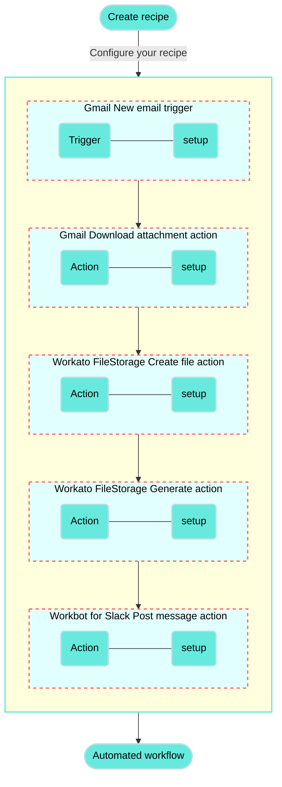

<!-- source: https://docs.workato.com/en/getting-started/use-cases/gmail-filestorage-slack | lastmod: 2026-07-07 -->
> Create a recipe that extracts image attachments from Gmail, stores them in Workato FileStorage, generates a public link, and posts it in Slack.

# Share image attachments from email in Slack using a public link recipe

This use case guides you through connecting [Gmail](/en/connectors/gmail), [Workato FileStorage](/en/features/workato-filestorage), and [Slack](/en/connectors/slack) to create a powerful automation.

## What does this recipe do?

This recipe extracts image attachments from Gmail, stores them in Workato FileStorage, generates a public link, and posts it in Slack. You can use this recipe to share submitted images, reports, or visuals without manually uploading them.

## Create your recipe

Complete the following steps to create your recipe:

> **USE CASES ARE INTENDED AS EXAMPLES ONLY**
> 
> This use case serves as an example. Modifications to triggers, actions, or conditional logic may be necessary to adapt this recipe to your workflow.

1. Sign in to Workato.
   
2. Select the project where you plan to create the recipe.
   
3. Create connections for Gmail and Slack:
   
   > **WORKATO UTILITY CONNECTORS DON'T REQUIRE SETUP**
   > 
   > The Workato FileStorage connector doesn't require connection setup.
   
   Create a Gmail connection.
   
   ### Create a Gmail connection
   
   This step creates a connection between Workato and your Gmail account.
   
   1. Click **Create > Connection** or press C twice.
      
   2. Search for and select `Gmail` on the **New connection** page.
      
   3. Enter a name for your connection in the **Connection name** field.
      
   4. Use the **Location** drop-down menu to select the project where you plan to store the connection.
      
   5. Select **OAuth 2.0** as the **Authentication type**.
      
   6. Optional. Click **Advanced settings** and select additional **OAuth 2.0 scopes**. If left blank, the following scopes are requested:
      
      - **See your primary Google Account email address**
      - **See and edit your email labels**
      - **Send email on your behalf**
      - **View your email messages and settings**
      - **Read, compose, and send emails from your Gmail account**
   7. Click **Sign in with Google** and sign in to your Google account to complete the setup.
      
   
   Create a Slack connection.
   
   ### Create a Slack connection
   
   This step creates a connection between Workato and your Slack account.
   
   1. Click **Create > Connection** or press C twice.
      
   2. Search for and select `Slack` on the **New connection** page.
      
   3. Enter a name for your connection in the **Connection name** field.
      
      _Slack connection setup_
      
   4. Use the **Location** drop-down menu to select the project where you plan to store the connection.
      
   5. Optional. Configure **Advanced** and **Custom OAuth profile** settings if required for your account type.
      
   6. Click **Connect**.
      
   
4. Go back to your project and click **Create > Recipe** or press C+R.
   
   _Create a new recipe_
   
5. Enter a name for your recipe in the **Name** field.
   
6. Select the project where you plan to store the recipe from the **Location** drop-down menu.
   
7. Click **Start building**.
   
   _Start building your recipe_
   
8. Click **Pick a starting point**, then select **Trigger from an app**.
   
9. Click **Select an app and trigger event**.
   
10. Set up your Gmail New email trigger.
    
    ### Set up Gmail New email trigger
    
    This trigger checks Gmail for new emails at an interval you specify.
    
    1. Search for `Gmail` and select it as your app. The **New email** trigger is selected automatically.
       
       _Choose Gmail_
       
    2. Optional. Configure the **Trigger poll interval** field to specify how frequently to check for new events.
       
    3. Optional. Configure the **When first started, this recipe should pick up events from** field to specify the date to retrieve emails from.
       
    
11. Click **\+ Add step** and select **IF condition**.
    
12. Set up your IF condition.
    
    ### Set up email attachments IF condition
    
    This IF condition checks if the email contains attachments.
    
    1. Switch **Data field** to [formula mode](/en/formulas/formula-mode) and map the Gmail Attachments (Step 1) datapill.
       
    2. Set **Condition** to **is present**.
       
       _Check if the email contains attachments_
       
    
13. Go to the **Yes** path and click **\+ Add step** > **Repeat for each**.
    
14. Set up your email attachments Repeat for each loop.
    
    ### Set up an email attachments Repeat for each loop
    
    This loop iterates through all the attachments in the email to ensure that all attachments are processed.
    
    1. Map the Gmail Attachments (Step 1) list datapill to the **Input list** field.
       
    2. Ensure **Repeat mode** is set to **One item at a time**.
       
       _Iterate through attachments list_
       
    
15. Click **\+ Add step** and select **IF condition**.
    
16. Set up your image attachment IF condition.
    
    ### Set up your image attachment IF condition
    
    This IF condition filters only image attachments.
    
    1. Map the Gmail Mime type (Step 1) datapill to **Data field**.
       
    2. Set **Condition** to **contains**.
       
    3. Enter `image/` in the **Value** field.
       
       _Check the image's MIME type_
       
    
17. Click **Select an app and action**.
    
18. Set up your Gmail Download attachment action.
    
    ### Set up Gmail Download attachment action
    
    This step downloads the image attachment's content.
    
    1. Search for `Gmail` and select it as your app.
       
       _Choose Gmail_
       
    2. Select the **Download attachment** action.
       
       _Select the Download attachment action_
       
    3. Map the Gmail ID (Step 1) datapill to the **Email ID** field.
       
    4. Map the Gmail Attachment ID (Step 1) datapill to the **Attachment ID** field.
       
       _Configure the Download attachment action_
       
    
19. Click **\+ Add step** and select **Action in app**.
    
20. Set up your Workato FileStorage Create file action.
    
    ### Set up your Workato FileStorage Create file action
    
    This step stores the downloaded image in Workato FileStorage.
    
    1. Search for `Workato FileStorage` and select it as your app.
       
       _Choose Workato FileStorage_
       
    2. Select the **Create file** action.
       
       _Select the Create file action_
       
    3. Map the Foreach Filename (Step 3) datapill to the **File name** field.
       
    4. Specify the location of where to create the file in the **File path** field.
       
    5. Map the Gmail Content bytes (Step 5) datapill to the **File contents** field.
       
       _Select the Create file action_
       
    
21. Click **\+ Add step** and select **Action in app**.
    
22. Set up your Workato FileStorage Generate shareable file link action.
    
    ### Set up Workato FileStorage Generate shareable file link action
    
    This step generates a public download link for the image.
    
    1. Search for `Workato FileStorage` and select it as your app.
       
       _Choose Workato FileStorage_
       
    2. Select the **Generate shareable file link** action.
       
       _Select the Generate shareable file link action_
       
    3. Set the **Scope** field to **Download**.
       
    4. Map the Workato FileStorage File path (Step 6) datapill to the **File path** field.
       
       _Configure the Generate shareable file link action_
       
    
23. Click **\+ Add step** and select **Action in app**.
    
24. Set up your Slack Post message action.
    
    ### Set up Slack Post message action
    
    This step posts the image link in Slack, which users can click to download the attachment.
    
    1. Search for `Slack` and select it as your app.
       
       _Choose Slack_
       
    2. Select the **Post message** action.
       
       _Select the Post message action_
       
    3. Use the **Channel** drop-down menu to specify where to post the message.
       
    4. Enter a message in the **Basic text** field. For example, `*New attachment*`.
       
    5. Map the Workato FileStorage File name (Step 6) datapill to the **Attachment title** field.
       
    6. Map the Workato FileStorage Shareable link (Step 7) datapill to the **Attachment title link** field.
       
    7. Optional. Enter text in the **Attachment text** field. This text appears under the attachment link.
       
       _Configure the Post message action_
       
    
    _Outcome_
    
25. Click **Save**.
    

Your **Share image attachments from email in Slack using a public link** recipe is ready to test and implement.

Example recipe configuration.

_**Share image attachments from email in Slack using a public link** recipe_

---
