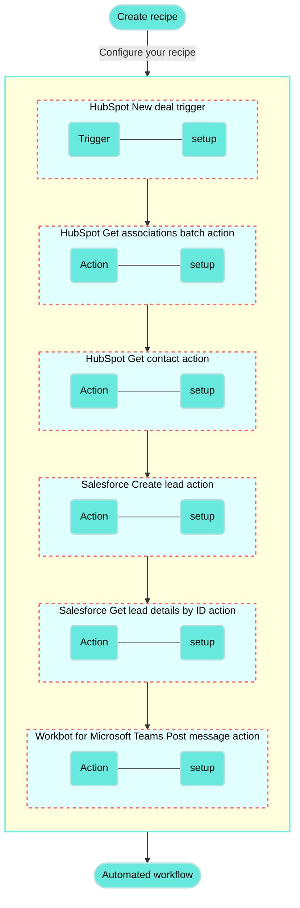

<!-- source: https://docs.workato.com/en/getting-started/use-cases/hubspot-salesforce-workbot-for-teams | lastmod: 2026-07-07 -->
> Build a recipe that creates new Salesforce leads from new HubSpot deals and posts a message in Microsoft Teams.

# Create Salesforce leads from new HubSpot deals recipe

This use case guides you through connecting [HubSpot](/en/connectors/hubspot), [Salesforce](/en/connectors/successfactors/successfactors), and [Workbot for Microsoft Teams](/en/workbot-for-teams/workbot) to create a powerful automation.

## What does this recipe do?

This recipe monitors HubSpot for new deals. If the deal is associated with a contact in HubSpot, the recipe creates a new lead in Salesforce, and Workbot for Microsoft Teams posts a message containing details about the new Salesforce lead.



## Create your recipe

Complete the following steps to build a recipe that creates Salesforce leads from new HubSpot deals:

> **USE CASES ARE INTENDED AS EXAMPLES ONLY**
> 
> This use case serves as an example. Modifications to triggers, actions, or conditional logic may be necessary to adapt this recipe to your workflow.

1. Sign in to Workato.
   
2. Select the project where you plan to create the recipe.
   
3. Create connections for HubSpot, Salesforce, and Workbot for Microsoft Teams:
   
   Create a HubSpot connection.
   
   ### Create a HubSpot connection
   
   This step creates a connection between Workato and your HubSpot account.
   
   1. Click **Create > Connection** or press C twice.
      
   2. Search for and select `HubSpot` on the **New connection** page.
      
   3. Provide a name for your connection in the **Connection name** field.
      
      _Connect to HubSpot_
      
   4. Use the **Location** drop-down menu to select the project where you plan to store the connection.
      
   5. Optional. Expand the **Advanced settings** section and use the **Scopes** drop-down menu to select permissions to request for the connection.
      
   6. Optional. Select the profile for the connection in the **Custom OAuth profile** drop-down menu. Alternatively, [create a new profile for HubSpot](/en/connectors/hubspot/custom-oauth).
      
   7. Click **Connect**.
      
   8. Select the HubSpot account where you plan to authorize Workato and click **Choose Account**.
      
      _Select an account_
      
   
   Create a Salesforce connection.
   
   ### Create a Salesforce connection
   
   This step creates a connection between Workato and your Salesforce account.
   
   1. Click **Create > Connection** or press C twice.
      
   2. Search for and select `Salesforce` on the **New connection** page.
      
   3. Provide a name for your connection in the **Connection name** field.
      
      _Salesforce connection setup_
      
   4. Use the **Location** drop-down menu to select the project where you plan to store the connection.
      
   5. Use the **Auth type** drop-down menu to select the authentication method. The default is OAuth 2.0.
      
   6. Use the **Sandbox** drop-down menu to specify whether the Salesforce account is a sandbox account.
      
   7. Optional. Expand **Advanced settings** to configure advanced connection options.
      
   8. Optional. Use the **Custom OAuth profile** drop-down menu to select a custom OAuth profile for your connection.
      
      - This custom OAuth profile ensures that the connection is restricted to the same set of scopes you selected for all users with the profile, and the authentication flow uses the client app linked to the custom profile.
   9. Click **Connect**.
      
   10. Enter your Salesforce account credentials and click **Log In**.
       
       _Log in to your Salesforce account_
       
   
   Create a Workbot for Microsoft Teams connection.
   
   ### Create a Workbot for Microsoft Teams connection
   
   This step creates a connection between Workato and your Workbot for Microsoft Teams account.
   
   **Note**: You must [add Workbot to Microsoft Teams](/en/workbot-for-teams/getting-started#add-workbot-to-microsoft-teams) before you can establish the connection in Workato.
   
   1. Click **Create > Connection** or press C twice.
      
   2. Search for and select `Workbot for Microsoft Teams` on the **New connection** page.
      
   3. Provide a name for your connection in the **Connection name** field.
      
      _Image caption_
      
   4. Use the **Location** drop-down menu to select the project where you plan to store the connection.
      
   5. Use the **Auth type** drop-down menu to select **OAuth 2.0**.
      
   6. Optional. Expand the **Advanced settings** section to select permissions to request for the connection.
      
   7. Optional. Select the custom OAuth profile for the connection in the **Custom OAuth profile** drop-down menu.
      
   8. Click **Sign in with Microsoft**.
      
   
4. Go back to your project and click **Create > Recipe** or press C+R.
   
   _Create a new recipe_
   
5. Select the project where you plan to store the recipe from the **Location** drop-down menu.
   
6. Click **Pick a starting point**, then select **Trigger from an app**.
   
7. Set up your HubSpot New record (deal) trigger.
   
   ### Set up HubSpot New record (deal) trigger
   
   This trigger monitors HubSpot for new deals and retrieves details about the amount and close date.
   
   1. Search for and select the HubSpot connector.
      
      _Choose HubSpot_
      
   2. Select the **New record** trigger.
      
      _Select the New record trigger_
      
   3. Select **Deal** from the **Object** drop-down menu.
      
   4. Select deal properties to retrieve from the **Properties** drop-down menu. This example selects **Amount** and **Close Date**.
      
      _Configure the New deal trigger_
      
   
8. Click **\+ Add step** and select **Action in app**.
   
   _Click **Add step > Action in app**_
   
9. Set up your HubSpot Get associations action (batch).
   
   ### Set up HubSpot Get associations action (batch)
   
   This step retrieves the contact associated with the deal that triggered the recipe.
   
   1. Search for and select the HubSpot connector.
      
      _Choose HubSpot_
      
   2. Select the **Get associations** batch action.
      
      _Select the Get associations batch action_
      
   3. Select **Deal** from the **From object** drop-down menu.
      
   4. Select **Contact** from the **To object** drop-down menu.
      
   5. Map the HubSpot ID (Step 1) datapill to the **From object ID** field.
      
      _Configure the Get associations action_
      
   
10. Click **\+ Add step** and select **IF condition**.
    
    _Click **Add step > IF condition**_
    
    How do IF conditions work?
    
    ### HubSpot and Salesforce IF condition example
    
    An [IF condition](/en/features/if-conditions) lets you to make decisions based on specific conditions. You can control your recipe workflow by executing different actions depending on whether a condition you specify is true or false.
    
    ```mermaid
    flowchart TD
        A([Get associations action]) --> B(Is the HubSpot deal associated with a contact?)
        B -->|Yes| C(Get HubSpot contact information and create Salesforce lead)
        B ---->|No| E(No action is required)

        classDef default fill:#67eadd,stroke:#b3e0e1,stroke-width:2px,color:#000;
    ```
    
11. Set up your HubSpot IF condition.
    
    ### Set up a HubSpot IF condition
    
    This step checks if a contact is associated with the new HubSpot deal.
    
    1. Map the HubSpot List size (Step 2) datapill (under the **Results** list) to **Data field**.
       
    2. Select **greater than** from the **Condition** drop-down menu.
       
    3. Enter `0` in the **Value** field.
       
       _Configure the IF condition_
       
    
12. Click **Select an app and action**.
    
13. Set up your HubSpot Get record (contact) action.
    
    ### Set up HubSpot Get record (contact) action
    
    This step retrieves information about the contact associated with the deal from HubSpot.
    
    1. Search for and select the HubSpot connector.
       
       _Choose HubSpot_
       
    2. Select the **Get record** action.
       
       _Select the Get record action_
       
    3. Select **Contact** from the **Object** drop-down menu.
       
    4. Map the HubSpot To object ID (Step 2) datapill to the **ID** field. This instructs the recipe to retrieve information about the contact associated with the new deal.
       
    5. Specify the fields you plan to retrieve in the **Fields to retrieve** field. This example selects the following fields:
       
       - **Company Name**
       - **Last Name**
       - **Annual Revenue**
       - **City**
       - **Country/Region**
       - **Email**
       - **First Name**
       - **Phone Number**
       - **State/Province**
       - **Job Title**
       
       You can select additional fields as required by your use case, or that you plan to sync when creating the lead in Salesforce.
       
       _Configure the Get contact action_
       
    
14. Click **\+ Add step** and select **Action in app**.
    
    _Click **Add step > Action in app**_
    
15. Set up your Salesforce Create record (lead) action.
    
    ### Set up Salesforce Create record (lead) action
    
    This step creates the lead in Salesforce using information about the contact from HubSpot.
    
    1. Search for and select the Salesforce connector.
       
       _Choose Salesforce_
       
    2. Select the **Create record** action.
       
       _Select the Create record action_
       
    3. Select **Lead** from the **Object** drop-down menu.
       
    4. Map datapills from the HubSpot **Get contact** action to the fields you plan to sync to the Salesforce lead. The **Company** and **Last Name** fields are required.
       
       For example, this recipe maps the following HubSpot datapills to their respective Salesforce fields:
       
       - Company Name (Step 4) to the **Company** field.
       - Last Name (Step 4) to the **Last Name** field.
       - Annual Revenue (Step 4) to the **Annual Revenue** field.
       - City (Step 4) to the **City** field.
       - Country/Region (Step 4) to the **Country** field.
       - Email (Step 4) to the **Email** field.
       - First Name (Step 4) to the **First Name** field.
       - Phone Number (Step 4) to the **Phone** field.
       - Company Name (Step 4) to the **Company** field.
       - State/Region (Step 4) to the **State/Province** field.
       - Job Title (Step 4) to the **Title** field.
    
16. Click **\+ Add step** and select **Action in app**.
    
17. Set up your Salesforce Get record details by ID action.
    
    ### Set up Salesforce Get record details by ID action
    
    This step retrieves details about the new lead created in Salesforce.
    
    1. Search for and select the Salesforce connector.
       
       _Choose Salesforce_
       
    2. Select the **Get record details by ID** action.
       
       _Select the Get record details by ID action_
       
    3. Select **Lead** from the **Object** drop-down menu.
       
    4. Map the Salesforce Object ID (Step 5) datapill to the **Object ID** field.
       
       _Configure the Get lead details by ID action_
       
    
18. Click **\+ Add step** and select **Action in app**.
    
19. Set up your Workbot for Microsoft Teams Post message action.
    
    ### Set up Workbot for Microsoft Teams Post message action
    
    This step posts a message in Microsoft Teams containing details about the new Salesforce lead.
    
    1. Search for and select the Workbot for Microsoft Teams connector.
       
       _Choose Workbot for Microsoft Teams_
       
    2. Select the **Post message** action.
       
       _Select the Post message action_
       
    3. Select the channel where you plan to send the message from the **Message recipient** drop-down menu.
       
    4. Locate the **Message** field and click **Add block**.
       
    5. Fill out the following fields in the first block:
       
       - **Type**: Select **Text block**.
       - **Block text**: Enter `🔔 New Salesforce Lead Created!`.
       - **Text type**: Select **Header**.
    6. Click **Add block**.
       
    7. Fill out the following fields in the second block:
       
       - **Type**: Select **Text block**.
       - **Block text**: Enter `📌 Lead Name:` and map the Salesforce Full Name (Step 6) datapill.
       - **Text type**: Select **Body text**.
    8. Click **Add block**.
       
    9. Fill out the following fields in the third block:
       
       - **Type**: Select **Text block**.
       - **Block text**: Enter `🏢 Company:` and map the Salesforce Company (Step 6) datapill.
       - **Text type**: Select **Body text**.
    10. Click **Add block**.
        
    11. Fill out the following fields in the fourth block:
        
        - **Type**: Select **Text block**.
        - **Block text**: Switch this field to [formula mode](/en/formulas/formula-mode), enter `'📞 Phone: ' +`, map the Salesforce Phone (Step 6) datapill, and append the `.to_phone(area_code: true)` formula.
        - **Text type**: Select **Body text**.
        
        _Configure the phone block_
        
    12. Click **Add block**.
        
    13. Fill out the following fields in the fifth block:
        
        - **Type**: Select **Text block**.
        - **Block text**: Enter `✉️ Email:` and map the Salesforce Email (Step 6) datapill.
        - **Text type**: Select **Body text**.
    14. Click **Add block**.
        
    15. Fill out the following fields in the sixth block:
        
        - **Type**: Select **Text block**.
        - **Block text**: Switch this field to [formula mode](/en/formulas/formula-mode), enter `'💰 Deal Amount: ' +`, map the HubSpot Amount (Step 1) datapill, and append the `.to_i.to_currency` formula.
        - **Text type**: Select **Body text**.
        
        _Configure the deal amount block_
        
    16. Click **Add block**.
        
    17. Fill out the following fields in the seventh block:
        
        - **Type**: Select **Text block**.
        - **Block text**: Switch this field to [formula mode](/en/formulas/formula-mode), enter `'📆 Close Date: ' +`, map the HubSpot Close Date (Step 1) datapill, and append the `.strftime("%m/%d/%Y")` formula.
        - **Text type**: Select **Body text**.
        
        _Configure the close date block_
        
    18. Click **Add block**.
        
    19. Fill out the following fields in the eighth and final block:
        
        - **Type**: Select **Text block**.
        - **Block text**: Enter `🎯 Lead Source: HubSpot`.
        - **Text type**: Select **Body text**.
    
    _Example message containing Salesforce lead details_
    
20. Click **Save**.
    

Your **Create Salesforce leads from new HubSpot deal** recipe is ready to test and implement.

Example recipe configuration.

_Create Salesforce leads from new HubSpot deal recipe_

---
