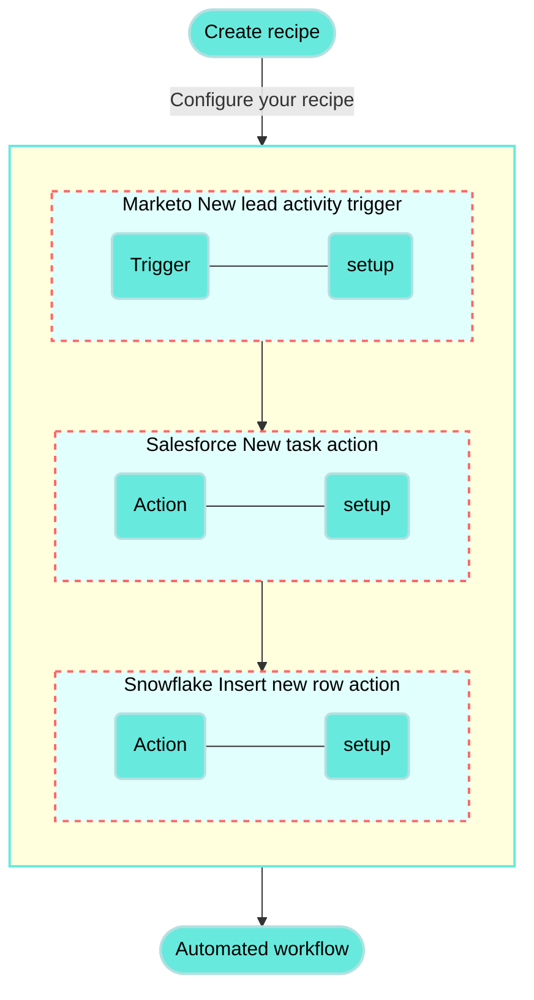

<!-- source: https://docs.workato.com/en/getting-started/use-cases/marketo-salesforce-snowflake | lastmod: 2026-07-07 -->
> Build a recipe that connects Marketo, Salesforce, and Snowflake to create tasks and insert rows when new lead activity is detected.

# Create Salesforce tasks and Snowflake rows from Marketo lead activity recipe

This use case guides you through connecting [Marketo](/en/connectors/marketo), [Salesforce](/en/connectors/salesforce), and [Snowflake](/en/connectors/snowflake) to Workato to create a powerful automation.

## What does this recipe do?

This recipe monitors Marketo for new lead activity. The recipe creates a new task in Salesforce and inserts a new row in Snowflake when new lead activity is detected in Marketo.



## Create your recipe

Complete the following steps to create a recipe that monitors Marketo for new lead activity and then creates a new task in Salesforce and inserts a new row with the lead information in Snowflake when activity is detected:

> **USE CASES ARE INTENDED AS EXAMPLES ONLY**
> 
> This use case serves as an example. Modifications to triggers, actions, or conditional logic may be necessary to adapt this recipe to your workflow.

1. Sign in to Workato.
   
2. Select the project where you plan to create the recipe.
   
3. Create connections for Marketo, Salesforce, and Snowflake:
   
   Create a Marketo connection.
   
   ### Create a Marketo connection
   
   This step creates a connection between Workato and your Marketo account.
   
   1. Click **Create > Connection** or press C twice.
      
   2. Search for and select `Marketo` on the **New connection** page.
      
   3. Provide a name for your connection in the **Connection name** field.
      
      _Marketo connection setup_
      
   4. Use the **Location** drop-down menu to select the project where you plan to store the connection.
      
   5. Enter the base URL of your Marketo instance in the **REST Endpoint** field. Refer to the [Marketo Base URL documentation](https://developers.marketo.com/rest-api/base-url/) for information on how to find your base URL.
      
   6. Enter the ID for the custom service client in the **Custom service client ID** field.
      
   7. Enter the password for the custom service client in the **Custom service client secret** field.
      
   8. Click **Connect**.
      
   
   Create a Salesforce connection.
   
   ### Create a Salesforce connection
   
   This step creates a connection between Workato and your Salesforce account.
   
   1. Click **Create > Connection** or press C twice.
      
   2. Search for and select `Salesforce` on the **New connection** page.
      
   3. Provide a name for your connection in the **Connection name** field.
      
      _Salesforce connection setup_
      
   4. Use the **Location** drop-down menu to select the project where you plan to store the connection.
      
   5. Use the **Auth type** drop-down menu to select the authentication method. The default is OAuth 2.0.
      
   6. Use the **Sandbox** drop-down menu to specify whether the Salesforce account is a sandbox account.
      
   7. Optional. Expand **Advanced settings** to configure advanced connection options.
      
   8. Optional. Use the **Custom OAuth profile** drop-down menu to select a custom OAuth profile for your connection.
      
      - This custom OAuth profile ensures that the connection is restricted to the same set of scopes you selected for all users with the profile, and the authentication flow uses the client app linked to the custom profile.
   9. Click **Connect**.
      
   10. Enter your Salesforce account credentials and click **Log In**.
       
       _Log in to your Salesforce account_
       
   
   Create a Snowflake connection.
   
   ### Create a Snowflake connection
   
   This step creates a connection between Workato and your Snowflake account.
   
   1. Click **Create > Connection** or press C twice.
      
   2. Search for and select `Snowflake` on the **New connection** page.
      
   3. Provide a name for your connection in the **Connection name** field.
      
      _Snowflake connection setup_
      
   4. Use the **Location** drop-down menu to select the project where you plan to store the connection.
      
   5. Enter your account identifier in the **Account identifier** field. Snowflake has multiple methods of identifying an account. Workato supports all methods:
      
      - Account name: `https://{org.name}-{account_name}`
      - Connection name: `https://{org.name}-{connectionname}`
      - Account locator: `https://{account.locator}.{region}.{cloud}`
      
      If you're using the account locator, note that `{region}` and `{cloud}` are only required for certain locations. For example:
      
      - If your account is hosted in AWS US West (Oregon), use `your-account-locator`.
      - If your account is hosted in AWS US East (Ohio), use `your-account-locator.us-east-2`.
      - If your account is hosted in Azure West Europe, use `your-account-locator.west-europe.azure`.
   6. Enter the full name of the warehouse where you plan to perform all operations for this connection in the **Warehouse** field. For example, `compute_wh`.
      
   7. Enter the database you plan to use in your recipe connection in the **Database name** field.
      
   8. Use the **Authentication type** drop-down menu to select your authentication type.
      
      - **Username/Password**: Enter your username and password if you select this option.
      - **OAuth 2.0**: Enter your Client ID and Client Secret if you select this option.
   9. Click **Connect**.
      
   
4. Go back to your project and click **Create > Recipe** or press C+R.
   
   _Create a new recipe_
   
5. Enter a name for your recipe in the **Name** field.
   
6. Select the project where you plan to store the recipe from the **Location** drop-down menu.
   
7. Click **Start building**.
   
   _Start building your recipe_
   
8. Click **Pick a starting point**, then select **Trigger from an app**.
   
9. Click **Select an app and trigger event**.
   
10. Set up your New lead activity in Marketo batch trigger.
    
    ### Set up New lead activity in Marketo batch trigger
    
    This trigger monitors Marketo for new lead activity.
    
    1. Search for `Marketo` and select it as your app.
       
    2. Select the **New lead activity in Marketo batch** trigger.
       
       _Select the New lead activity in Marketo batch trigger_
       
    3. Use the calendar modal to select the date from which your recipe should begin to monitor events in the **When first started, this recipe should pick up events from** field. Refer to [Triggers](/en/recipes/triggers#since-from) to learn more about this input field.
       
       _New lead activity batch trigger_
       
    4. Search for `New Lead` in the **Activity** field.
       
       _Select New lead as the activity_
       
    5. Use the **List** drop-down menu if you plan to limit lead activity monitoring to a specific list. Lead activities from all lists are included if this field is empty.
       
    6. Select an option for **Enrich lead data**:
       
       - **Yes**: The trigger output performs additional requests to supplement each activity record with the associated lead data.
         
       - **No**: Excludes lead enrichment requests to reduce the number of API requests.
         
    7. Click **Save**.
       
    
11. Click **\+ Add step** and select **Action in app**.
    
    _Select Action in app_
    
12. Set up your Salesforce Create records in batches action.
    
    ### Set up Salesforce Create records in batches action
    
    This step creates records for new lead activity.
    
    1. Search for `Salesforce` and select it as your app.
       
       _Choose Salesforce as your app_
       
    2. Select the **Create records in batches** action.
       
       _Select the Create records in batches action_
       
    3. Search for `Task` in the **Object** field.
       
    4. Go to the **Tasks** section and map the Marketo Activities (Step 1) datapill into the **Tasks source list** field.
       
       _Map the Activities (Step 1) datapill into the Tasks source list field_
       
    5. Click **Save**.
       
    
13. Click **\+ Add step** and select **Repeat for each**.
    
    _Select Repeat for each_
    
    How does the Repeat for each condition work?
    
    ### Marketo and Snowflake Repeat for each condition example
    
    A [Repeat for each](/en/recipes/repeat-for-each) loop _repeats_ one or more actions _for each_ item in a list. The loop ends automatically when the entire list is processed.
    
    ```mermaid
    flowchart TD
      A(["Start"]) --> B("New activity in Marketo?")
      B -- "Yes" --> C("Insert new row in Snowflake")
      B -- "No" --> D(["Exit loop"])
      C --> B
    classDef default fill:#67eadd,stroke:#b3e0e1,stroke-width:2px,color:#000;
    classDef WorkatoPink fill:#f3c1c2,stroke:#f3c1c2,stroke-width:1px;
    class A,D WorkatoPink

    ```
    
14. Set up your Marketo activities Repeat for each loop.
    
    ### Set up a Marketo activities Repeat for each loop
    
    This step checks each item in the Activities input list.
    
    1. Map the Marketo Activities (Step 1) datapill into the **Input list** field.
       
       _Configure Repeat for each_
       
    
15. Set up your Snowflake Insert row action.
    
    ### Set up Snowflake Insert row action
    
    This step creates a new row for the new lead activity information in the table you specify.
    
    The Snowflake action is nested within the Repeat for each condition in this use case.
    
    1. Click **Select an app and action** under the **For each** condition.
       
       _Click Select an app and action_
       
    2. Search for `Snowflake` and select it as your app.
       
       _Search for Snowflake_
       
    3. Select **Insert row** for your action.
       
       _Select Insert row_
       
    4. Use the **Table** drop-down menu to select the name of the Snowflake table in which you plan to insert rows.
       
       _Select your Snowflake table_
       
    5. Click **Save**.
       
    

Your **Create Salesforce tasks and Snowflake rows from Marketo lead activity** recipe is ready to test and implement.

---
