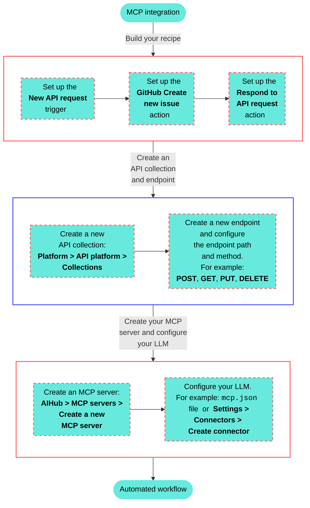

<!-- source: https://docs.workato.com/en/getting-started/use-cases/mcp/github-developer-api-llm | lastmod: 2026-10-14 -->
> Create an MCP integration that enables your LLM to create new issues in GitHub using the Workato Developer API.

# LLM, GitHub, and Workato Developer API

This use case provides step-by-step instructions to create a custom MCP integration between an LLM and GitHub using the Workato Developer API. A custom MCP connection provides the following benefits over prebuilt connectors:

- Complete control over data access, filtering, and logging.
- Ability to implement your organization's specific business rules, approval workflows, or data processing logic directly into the AI's capabilities.
- Flexibility to evolve with your needs and remain under your control rather than depend on a provider's roadmap that may not support new features you require.

## What does this MCP server integration do?

This MCP server integration enables you to create new GitHub issues using natural language commands in your LLM, such as ChatGPT, Claude, or Cursor.



## Create your MCP integration

Complete the following steps to build an integration that enables you to create new GitHub issues from your ChatGPT, Claude, or Cursor agent chat with natural language commands.

> **USE CASES ARE INTENDED AS EXAMPLES ONLY**
> 
> This use case serves as an example. Modifications to API requests, actions, API responses, or conditional logic may be necessary to adapt this recipe to your workflow. This use case has been tested with ChatGPT, Claude, and Cursor. Configuration and usage may vary with other LLMs.

1. Sign in to Workato.
   
2. Select the project where you plan to create the API request recipe.
   
3. Create a GitHub connection.
   
   ### GitHub connection setup
   
   This step connects your GitHub account to your Workato account.
   
   1. Click **Create > Connection** or press C twice.
      
   2. Search for and select `GitHub` on the **New connection** page.
      
   3. Provide a name for your connection in the **Connection name** field.
      
      _GitHub connection setup_
      
   4. Use the **Location** drop-down menu to select the project where you plan to store the connection.
      
   5. Use the **Connection type** drop-down menu to select the connection method you plan to use. You can select your [on-prem group](/en/on-prem/groups) name or select **Cloud** to use a direct connection.
      
   6. Select either [**OAuth App**](/en/connectors/github#traditional-oauth), [**GitHub App**](/en/connectors/github#github-app-authentication), or **Personal Access Token** in the **Authentication type** drop-down menu.
      
      **If you selected GitHub App**:
      
      1. Provide your app ID in the **GitHub App ID** field.
         
      2. Enter the private key in the **GitHub App Private key** field.
         
      3. Fill in the **Installation ID** field.
         
      4. Optional. Expand **Advanced configuration** to provide the **API Root URL**, which is applicable when using GitHub Enterprise Server.
         
      
      **If you selected Personal Access Token**:
      
      1. Enter your personal access token in the **Personal Access Token** field.
         
   7. Click **Connect**.
      
   
4. Go to project and click **Create > Recipe** or press C+R.
   
   _Create a new recipe_
   
5. Enter a name for your recipe in the **Name** field.
   
6. Use the **Location** drop-down menu to select the project where you plan to store the recipe.
   
7. Click **Start building**.
   
   _Start building your recipe_
   
8. Click **Pick a starting point** and select **Trigger from an app**. The trigger in this use case doesn't require you to establish a connection.
   
9. Click **Select an app and trigger event**.
   
10. Set up your New API request trigger.
    
    ### New API request trigger setup
    
    This step creates an API request and response that enables your LLM agent to process and respond to your request with the correct title and description information.
    
    1. Search for `API platform by Workato` and select it as your app.
       
    2. Select the **New API request** trigger.
       
       _**New API request** trigger_
       
    3. Complete the following steps to configure your request schema:
       
       1. Go to the **Request schema** section and click **\+ Add Field**.
          
       2. Enter `reason` in the **Name** and **Label** fields.
          
       3. Use the **Data type** drop-down menu to select **String**.
          
       4. Use the **Optional** drop-down menu to select **No**.
          
          _Reason field_
          
       5. Click **Save**.
          
       6. Return to the **Request schema** section and click **\+ Add Field**.
          
       7. Enter `payload` in the **Name** and **Label** fields.
          
       8. Use the **Data type** drop-down menu to select **Object**.
          
       9. Use the **Optional** drop-down menu to select **No**.
          
       10. Click **Save**.
           
       11. Return to the **Request schema** section and click **\+ Add Field**.
           
       12. Enter `description` in the **Name** and **Label** fields.
           
       13. Use the **Data type** drop-down menu to select **String**.
           
       14. Use the **Optional** drop-down menu to select **No**.
           
       15. Use the **Nest under** drop-down menu to select **payload**.
           
       16. Click **Save**.
           
       17. Return to the **Request schema** section and click **\+ Add Field**.
           
       18. Enter `title` in the **Name** and **Label** fields.
           
       19. Use the **Data type** drop-down menu to select **String**.
           
       20. Use the **Optional** drop-down menu to select **No**.
           
       21. Use the **Nest under** drop-down menu to select **payload**.
           
       22. Click **Save**.
           
           _Request schema_
           
    4. Complete the following steps to configure your request responses:
       
       1. Go to the **Responses** section and click **Add response**.
          
          _Click **Add response**_
          
       2. Enter `200` in the **Name** field.
          
       3. Use the **HTTPS status code standard response** drop-down menu to select `200 - OK`.
          
       4. Go to the **Response schema** section and click **add fields manually**.
          
       5. Enter `response` in the **Name** and **Label** fields.
          
       6. Use the **Data type** drop-down menu to select **String**.
          
       7. Use the **Optional** drop-down menu to select **No**.
          
       8. Click **Save**.
          
          _Response schema_
          
    
11. Click **\+ Add step** and select **Action in app**.
    
    _Click **Add step > Add action in app**_
    
12. Set up your Create issue in GitHub action.
    
    ### Create issue in GitHub action setup
    
    This step creates a new GitHub issue with the title and description you provide in your LLM agent chat.
    
    1. Search for `GitHub` and select it as your app.
       
    2. Select the **Create issue** action.
       
    3. Go to **Organization** and ensure that **Select organization** is selected.
       
    4. Use the **Select organization** drop-down menu to select the GitHub organization you plan to use.
       
    5. Go to **Repository name** and use the drop-down menu or manually enter the GitHub repository you plan to use.
       
    6. Map the title (Step 1) datapill to the **Issue title** field.
       
    7. Map the description (Step 2) datapill to the **Body** field.
       
       _Map the description (Step 2) datapill to the **Body** field_
       
    8. Click **Save**.
       
    
13. Click **\+ Add step** and select **Action in app**.
    
14. Set up your Respond to API request action.
    
    ### Respond to API request action setup
    
    This step instructs your LLM agent to respond with the **200** response you configured in the **New API request** trigger response schema. It also tells the LLM to include the newly created issue URL in the response.
    
    1. Search for `API platform by Workato` and select it as your app.
       
    2. Select the **Respond to API request** action.
       
    3. Use the **Response** drop-down menu to select **200**. This is the response you configured in the **New API request** trigger setup.
       
    4. Expand the **Response body** section.
       
    5. Map the GitHub URL (Step 2) datapill to the **Response** field. This instructs your LLM to provide the URL link to the new issue in your chat.
       
       _Respond to API request_
       
    6. Click **Save**.
       
    
15. Create an API collection.
    
    ### Create an API collection
    
    This step creates a new API collection where you can store endpoints that you plan to use as MCP tools.
    
    1. Go to **Platform > API platform**.
       
    2. Click the **API collections** tab.
       
    3. Click **\+ Create new collection**.
       
    4. Ensure that **API recipe collection** is selected and then click **Next**.
       
    5. Ensure that **Use existing recipes** is selected.
       
    6. Use the **Recipe folder** drop-down menu to select the folder where you plan to store the API collection.
       
    7. Deselect all endpoints.
       
    8. Enter a name in the **Collection name** field.
       
    9. Enter a version number for your collection. For example: `v1`.
       
    10. Optional. Provide a description for the collection in the **Description** field.
        
    11. Click **Create collection**.
        
        _Click **Create collection**_
        
    
16. Create a new endpoint.
    
    ### Create an endpoint
    
    This step creates a new endpoint based on your API request recipe and stores it in your API collection.
    
    1. Go to **Platform > API platform**.
       
    2. Click the **API collections** tab.
       
    3. Select the API collection you created in the preceding steps.
       
    4. Click **Create new endpoint**.
       
    5. Use the **Recipe** drop-down menu to select the API request recipe you created in the preceding steps.
       
    6. Use the **HTTP method** drop-down menu to select **POST**.
       
    7. Enter a name for your endpoint in the **Endpoint name** field.
       
    8. Define a path for your endpoint in the **Endpoint path** field. Your endpoint path can include parameters. This use case uses the following endpoint path and parameters: `post-github-issue/title/description`. Don't include a `\` in your endpoint path. This is automatically appended after you create the endpoint.
       
       _Define a path for your endpoint_
       
    9. Optional. Provide a description in the **Endpoint description** field.
       
    10. Optional. Set a timeout value in the **Request timeout** field. The default value is `30` seconds and the maximum value is `240` seconds.
        
    11. Click **Add endpoint**.
        
    
17. Create an MCP server.
    
    ### Create an MCP server
    
    This step creates a new MCP server and add your endpoint to it. Endpoints you add to the MCP server become tools you can use in your LLM.
    
    1. Go to **AI Hub > Enterprise MCP > Custom servers** and click **\+ Create an MCP server**. Alternatively, you can create an MCP server from the **Projects** page by clicking **Create > MCP server** or pressing C+M.
       
    2. Select **New MCP server**.
       
    3. Enter a name for your MCP server in the **Server name** field. For example: `GitHub MCP tool`.
       
    4. Optional. Provide a description of the MCP server in the **Describe how this MCP server will be used** field.
       
    5. Use the **Location** drop-down menu to select the project that contains the API recipe.
       
    6. Select **API collection** as your asset type.
       
    7. Select the API collection you created in the preceding steps.
       
    8. Click **Start building**. Your MCP server information displays in the **Details** tab.
       
    9. Click **Settings > End user access**.
       
    10. Go to the **Developer MCP Token** section and click the **Copy** button to copy your MCP server URL and token for use in later steps.
        
        _Copy the MCP URL_
        
    
18. Go to the LLM where you plan to create an MCP integration and complete the following configuration steps:
    
    > **TESTED LLMS**
    > 
    > This use case has been tested with ChatGPT, Claude, and Cursor. Configuration and usage may vary with other LLMs.
    
    Configure your MCP integration in ChatGPT.
    
    ### ChatGPT MCP configuration
    
    This step configures a new MCP server connector in your OpenAI account that enables you to use natural language commands in ChatGPT to create a new GitHub issue.
    
    1. Go to your ChatGPT account.
       
    2. Go to **Settings > Apps & Connectors > Advanced settings** and enable the **Developer mode** toggle.
       
    3. Go to **Settings > Apps & Connectors**.
       
    4. Click **Create**. This button is only visible when the **Developer mode** toggle is enabled.
       
    5. Enter a name for your MCP connector in the **Name** field.
       
       _Configure your ChatGPT MCP connector_
       
    6. Paste your MCP URL and token in the **URL field**.
       
    7. Optional. Enter a description in the **Description** field.
       
    8. Use the **Authentication** drop-down menu to select **No Auth**.
       
    9. Select the checkbox to accept the risk of adding a custom MCP server.
       
    10. Click **Create**.
        
    11. Create a new chat in ChatGPT to use your MCP tools.
        
    
    Configure your MCP integration for Claude.
    
    ### Claude MCP configuration
    
    This step configures a new MCP server connector in your Anthropic account that enables you to use natural language commands in Claude to create a new GitHub issue.
    
    1. Go to **Settings > Connectors**.
       
    2. Click **\+ Add new connector**.
       
    3. Enter a name for your MCP connector in the **Name** field.
       
       _Configure your Claude MCP connector_
       
    4. Paste your MCP URL and token into the **Remote MCP server URL** field.
       
    5. Click **Add**. The newly created MCP connector appears in the list of connectors.
       
    6. Click **Configure**.
       
    7. Use the permissions drop-down menu to select **Always ask permission** or **Allow unsupervised**. **Always ask permission** is selected by default.
       
    8. Create a new chat in Claude to use your MCP tools.
       
    
    Configure your MCP integration for Cursor.
    
    ### Cursor MCP configuration
    
    This step configures a new MCP server connector in your Cursor account that enables you to use natural language commands in your Cursor agent chat to create a new GitHub issue. This process authenticates with an MCP URL and authentication token. Refer to [Cursor MCP remote server configuration with Workato Identity authentication](/en/mcp/developer-api-mcp#cursor-mcp-remote-server-configuration-with-workato-identity-authentication) if you plan to authenticate with [Workato Identity](/en/workato-identity).
    
    1. Go to **Settings > Cursor settings**.
       
    2. Click **MCP & Integrations** in the sidebar.
       
    3. Click **\+ New MCP Server** to open the `mcp.json` file.
       
       _Click **\+ New MCP Server**_
       
    4. Update the configuration to use the MCP URL and token you copied in the preceding steps. For example:
       
       ```json
       
       {
         "mcpServers": {
           "snowflake-tools": {
             "url": "https://2255.apim.mcp.workato.com?wkt_token=YOUR_API_TOKEN"
           },
           "github-tools": {
             "url": "https://387.apim.mcp.workato.com/abc247/example-collection-name-v1?wkt_token=YOUR_API_TOKEN"
           }
         }
       }
       ```
       
    5. Save your changes.
       
    6. Create a new chat with your Cursor agent to use your MCP tools.
       
       You must start a new chat with your agent. Cursor agents only have access to the tools and capabilities available when a chat begins. Agents can't detect or use new MCP configurations, servers, or tools added after starting a chat.

---
