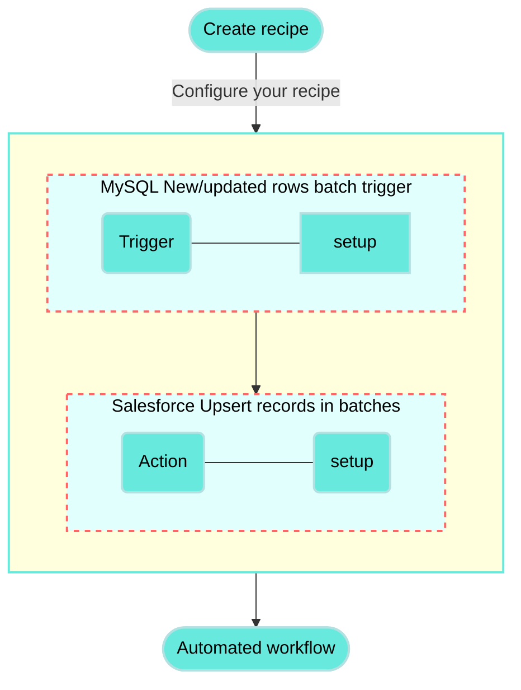

<!-- source: https://docs.workato.com/en/getting-started/use-cases/mysql-salesforce | lastmod: 2026-07-07 -->
> Build a recipe that connects MySQL and Salesforce to sync and upsert records in batches, adaptable to contacts, accounts, leads, and more.

# Sync MySQL records to Salesforce in batches recipe

This use case guides you through connecting [MySQL](/en/connectors/mysql) and [Salesforce](/en/connectors/salesforce) to Workato to create a powerful automation.

## What does this recipe do?

This recipe syncs records from MySQL to Salesforce in batches. Specifically, this recipe demonstrates how to upsert contacts from MySQL to Salesforce. You can adapt this recipe for other Salesforce objects such as accounts, leads, opportunities, and more.



## How can I use this recipe?

This recipe can be applied in various ways to automate workflows, including but not limited to the following use cases:

- **User synchronization**: Seamlessly sync user records from MySQL to Salesforce, ensuring accurate and up-to-date information for all users.
- **Account management**: Automatically transfer customer data from MySQL to Salesforce as Accounts, maintaining consistency across platforms.
- **Opportunity tracking**: Sync opportunity details from MySQL to Salesforce, enabling sales teams to have access to the latest pipeline information.

## Create your recipe

Complete the following steps to create a recipe that syncs records from MySQL to Salesforce in batches.

> **USE CASES ARE INTENDED AS EXAMPLES ONLY**
> 
> This use case serves as an example. Modifications to triggers, actions, or conditional logic may be necessary to adapt this recipe to your workflow.

1. Sign in to Workato.
   
2. Select the project where you plan to create the recipe.
   
3. Create connections for MySQL and Salesforce:
   
   Create a MySQL connection.
   
   ### Create a MySQL connection
   
   This step creates a connection between Workato and your MySQL account.
   
   1. Click **Create > Connection** or press C twice.
      
   2. Search for and select `MySQL` on the **New connection** page.
      
   3. Provide a name for your connection in the **Connection name** field.
      
      _MySQL connection setup_
      
   4. Use the **Location** drop-down menu to select the project where you plan to store the connection.
      
   5. Use the **Connection type** drop-down menu to select the connection method you plan to use. You can select your [on-prem group](/en/on-prem/groups) name or select **Cloud** to use a direct connection.
      
   6. Enter the database host address in the **Host** field.
      
   7. Enter the port number your server runs on in the **Port** field. The default port number is `3306`.
      
   8. Enter the username to connect to MySQL in the **Username** field.
      
   9. Enter the password associated with your username in the **Password** field.
      
   10. Enter the name of the MySQL database you plan to connect to in the **Database** field.
       
   11. Optional. Expand **Advanced settings** to configure the following connection settings:
       
       1. Specify whether the MySQL connection should use improved datetime handling in the **Use improved datetime handling** field. The default is **Yes** for all new connections. This setting affects all actions that **insert rows** into MySQL.
          
       2. Select the local timezone of your database in the **Database timezone** field. When you provide a timezone for datetime values, Workato converts it to the specified timezone before insertion. The default is **UTC**.
          
          Refer to the [Improved datetime handling](/en/connectors/mysql#improved-datetime-handling) section for more information.
          
   12. Optional. Expand **SSL settings** to configure the following fields:
       
       1. Provide the X509 server certificate in `.pem` format in the **Server certificate** field.
          
       2. Provide the X509 client certificate in `.pem` format in the **SSL certificate** field.
          
       3. Provide the RSA client key in `.pem` format in the **SSL certificate key** field.
          
       4. Choose whether the client should trust any certificate chain in the **Trust all** field. Self-signed server certificates are supported.
          
       5. Choose whether to match the server certificate name with the domain name in the **Verify host** field.
          
   13. Click **Connect**.
       
   
   #### Permissions required to connect
   
   Your database user account must have at least `SELECT` permission for the database you plan to access.
   
   For example, to connect to a named database (`HR_PROD`) in a MySQL instance using a new database user `workato`, you can use the following queries:
   
   1. Create a new user dedicated to integration use cases with Workato:
      
      ```sql
      CREATE USER 'workato' IDENTIFIED BY 'password';
      ```
      
      This command creates a new user with login access to the MySQL instance. However, this user won't yet have access to any tables.
      
   2. Grant the user `SELECT` permission for all tables in `HR_PROD`:
      
      ```sql
      GRANT SELECT ON `HR_PROD`.* TO 'workato';
      ```
      
   3. Verify the user's permissions by running the following query:
      
      ```sql
      SHOW GRANTS FOR 'workato';
      ```
      
      The query returns the minimum permissions required to create a MySQL connection on Workato:
      
      ```sql
      +---------------------------------------------------------------------+
      | Grants for workato@%                                                |
      +---------------------------------------------------------------------+
      | GRANT USAGE ON *.* TO 'workato'@'%' IDENTIFIED BY PASSWORD <secret> |
      | GRANT SELECT ON `HR_PROD`.* TO 'workato'@'%'                        |
      +---------------------------------------------------------------------+
      2 rows in set (0.24 sec)
      ```
      
   
   Create a Salesforce connection.
   
   ### Create a Salesforce connection
   
   This step creates a connection between Workato and your Salesforce account.
   
   1. Click **Create > Connection** or press C twice.
      
   2. Search for and select `Salesforce` on the **New connection** page.
      
   3. Provide a name for your connection in the **Connection name** field.
      
      _Salesforce connection setup_
      
   4. Use the **Location** drop-down menu to select the project where you plan to store the connection.
      
   5. Use the **Auth type** drop-down menu to select the authentication method. The default is OAuth 2.0.
      
   6. Use the **Sandbox** drop-down menu to specify whether the Salesforce account is a sandbox account.
      
   7. Optional. Expand **Advanced settings** to configure advanced connection options.
      
   8. Optional. Use the **Custom OAuth profile** drop-down menu to select a custom OAuth profile for your connection.
      
      - This custom OAuth profile ensures that the connection is restricted to the same set of scopes you selected for all users with the profile, and the authentication flow uses the client app linked to the custom profile.
   9. Click **Connect**.
      
   10. Enter your Salesforce account credentials and click **Log In**.
       
       _Log in to your Salesforce account_
       
   
4. Go back to your project and click **Create > Recipe** or press C+R.
   
   _Create a new recipe_
   
5. Enter a name for your recipe in the **Name** field.
   
6. Select the project where you plan to store the recipe from the **Location** drop-down menu.
   
7. Click **Start building**.
   
   _Start building your recipe_
   
8. Click **Pick a starting point**, then select **Trigger from an app**.
   
9. Click **Select an app and trigger event**.
   
10. Set up your MySQL New/updated rows batch trigger.
    
    ### Set up MySQL New/updated rows batch trigger
    
    This step detects new or updated rows in batches in your MySQL database.
    
    1. Search for `MySQL` and select it as your app.
       
       _Choose MySQL as your app_
       
    2. Select the **New/updated rows** batch trigger.
       
       _Select the New/updated rows batch trigger_
       
    3. Select the MySQL connection you created in the preceding steps.
       
    4. Optional. Specify how frequently this trigger should check for new events in the **Trigger poll interval** field. This field defaults to five minutes if left blank.
       
    5. Select the table you plan to monitor for new or updated rows in the **Table** drop-down menu.
       
       This example monitors a table named `contacts` for new or updated rows.
       
       _Select your MySQL table in the Table field_
       
    6. Select a unique key column to filter out duplicate rows in the **Unique key** field. This column should be unique and auto-incrementing to ensure that no trigger events are missed.
       
       This example uses a column named `id` as the unique key.
       
       _Select your unique key_
       
    7. Select a column to identify updated rows in the **Sort column**. Only timestamp columns can be used as a sort column.
       
       This example selects a column named `last_updated` for this field.
       
       _Select the sort column_
       
       This MySQL column has the `TIMESTAMP` data type and is automatically updated with the current date and time whenever the row is modified. Refer to [MySQL's documentation on `TIMESTAMP` and `DATETIME`](https://dev.mysql.com/doc/refman/8.0/en/timestamp-initialization.html) for more information.
       
    8. Select the size of the returned events batch in the **Batch size** field. The minimum is `1` and the maximum is `100`. The default is `100`.
       
    9. Optional. Choose columns to be returned from the selected table in the **Output columns** field. Leave this field blank to return all columns.
       
    10. Optional. Specify a condition to filter new rows in the **WHERE condition** field.
        
    11. Click **Save**.
        
    
11. Click **\+ Add step** and select **Action in app**.
    
    _Add action_
    
12. Set up your Salesforce Upsert records in batches action.
    
    ### Set up Salesforce Upsert records in batches action
    
    This step updates or inserts records in batches in Salesforce if there is a new or updated record in the MySQL table. This action upserts **Contact** records from MySQL into Salesforce in this use case.
    
    1. Search for `Salesforce` and select it as your app.
       
       _Choose Salesforce as your app_
       
    2. Select the **Upsert records in batches** action.
       
       _Select the Upsert records in batches action_
       
    3. Select the Salesforce connection you created in the preceding steps.
       
    4. Select the Salesforce object you plan to upsert in the **Object** field.
       
       This example uses the **Contact** object.
       
       _Select the Salesforce object to upsert_
       
    5. Optional. Enter the number of records to be processed in a batch in the **Batch size** field. The minimum is `1` and the maximum is `200`. The default is `200`.
       
    6. Select the external unique identifier to upsert your record in the **Primary key** field.
       
       This example uses a primary key named `MySQL ID`.
       
       _Select your primary key_
       
       Refer to our Salesforce connector documentation to learn how to [create a primary key](/en/connectors/salesforce/batch-operations#create-a-primary-key).
       
    7. Optional. Use the **Relationship fields** drop-down menu to select relationship fields to include in the upsert. Refer to our [Salesforce object relationships](/en/connectors/salesforce/related-objects) documentation for more information.
       
    8. Expand **Contacts** to configure additional settings. The name of this field and the following fields vary depending on your selected object.
       
    9. Map the Rows (Step 1) list datapill to the **Contacts source list**. Learn more about [list input](/en/features/list-management#list-batch-action).
       
       _Map the Rows (Step 1) datapill_
       
    10. Click **Show optional fields** to select the fields you plan to map from your MySQL table to Salesforce.
        
        _Show optional fields_
        
        This example selects fields corresponding to the records in the `contacts` MySQL table:
        
        - Business Phone
        - Email
        - First Name
        - Last Name
        - Title
    11. Map the datapills corresponding to your MySQL table to the fields in the **Contact fields** section.
        
        _Map the output datapills to the Contact fields section_
        
    12. Map the datapill associated with the MySQL column you selected as your **Unique key** (Step 1) to the field corresponding to your Salesforce **Primary key**.
        
        This example maps the id (Step 1) datapill to the **MySQL ID** field, which is the name of the primary key created in Salesforce.
        
        _Map the id (Step 1) datapill_
        
    13. Optional. Expand **Advanced configuration** to configure the following setting:
        
        - **Roll back records when errors occur?**: Choose whether the batch should roll back records if an object upsert fails. If the batch is larger than 200 records, only the affected batch is rolled back. We recommend using the default **No** setting.
    14. Click **Save**.
        
    

Your **Sync MySQL records to Salesforce in batches** recipe is ready to test and implement.

Example recipe configuration.

_**Sync MySQL records to Salesforce in batches** recipe_

---
