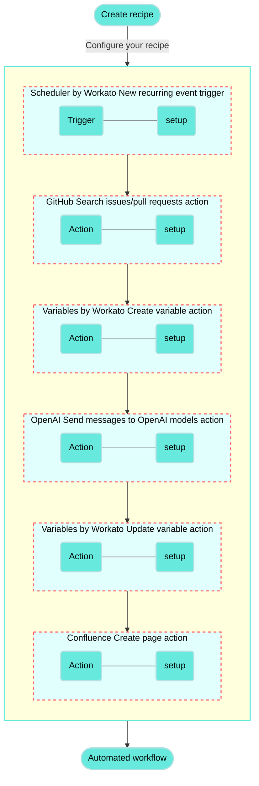

<!-- source: https://docs.workato.com/en/getting-started/use-cases/openai-github-confluence | lastmod: 2026-07-28 -->
> Build a recipe that connects OpenAI, GitHub, and Confluence to generate release notes pages from merged pull requests each week.

# Generate Confluence release notes from merged GitHub PRs recipe

This use case guides you through connecting [OpenAI](/en/connectors/openai), [GitHub](/en/connectors/github), and [Confluence](/en/connectors/confluence) to create a powerful automation.

## What does this recipe do?

This recipe retrieves merged pull requests (PRs) weekly from GitHub, iterates through each one to check for a specific Jira project key in the PR body, and, if found, sends the PR body to ChatGPT for a summary of the changes. Each summarized PR is then added to a new release notes page in Confluence.



## Create your recipe

Complete the following steps to create a recipe that creates release notes in Confluence based on merged pull requests in GitHub:

> **USE CASES ARE INTENDED AS EXAMPLES ONLY**
> 
> This use case serves as an example. Modifications to triggers, actions, or conditional logic may be necessary to adapt this recipe to your workflow.

1. Sign in to Workato.
   
2. Select the project where you plan to create the recipe.
   
3. Create connections for OpenAI, GitHub, and Confluence:
   
   Create a OpenAI connection.
   
   ### Create an OpenAI connection
   
   This step creates a connection between Workato and your OpenAI account.
   
   1. Click **Create > Connection** or press C twice.
      
   2. Search for and select `OpenAI` on the **New connection** page.
      
   3. Provide a name for your connection in the **Connection name** field.
      
      _OpenAI connection setup_
      
   4. Use the **Location** drop-down menu to select the project where you plan to store the connection.
      
   5. Enter your API key in the **API key** field. You can obtain this value from the [OpenAI API keys page](https://platform.openai.com/account/api-keys).
      
   6. Click **Connect**.
      
   
   Create a GitHub connection.
   
   ### Create a GitHub connection
   
   This step creates a connection between Workato and your GitHub account.
   
   1. Click **Create > Connection** or press C twice.
      
   2. Search for and select `GitHub` on the **New connection** page.
      
   3. Provide a name for your connection in the **Connection name** field.
      
      _GitHub connection setup_
      
   4. Use the **Location** drop-down menu to select the project where you plan to store the connection.
      
   5. Use the **Connection type** drop-down menu to select the connection method you plan to use. You can select your [on-prem group](/en/on-prem/groups) name or select **Cloud** to use a direct connection.
      
   6. Select either [**OAuth App**](/en/connectors/github#traditional-oauth), [**GitHub App**](/en/connectors/github#github-app-authentication), or **Personal Access Token** in the **Authentication type** drop-down menu.
      
      **If you selected GitHub App**:
      
      1. Provide your app ID in the **GitHub App ID** field.
         
      2. Enter the private key in the **GitHub App Private key** field.
         
      3. Fill in the **Installation ID** field.
         
      4. Optional. Expand **Advanced configuration** to provide the **API Root URL**, which is applicable when using GitHub Enterprise Server.
         
      
      **If you selected Personal Access Token**:
      
      1. Enter your personal access token in the **Personal Access Token** field.
         
   7. Click **Connect**.
      
   
   Create a Confluence connection.
   
   ### Create a Confluence connection
   
   This step creates a connection between Workato and your Confluence account.
   
   1. Click **Create > Connection** or press C twice.
      
   2. Search for and select `Confluence` on the **New connection** page.
      
   3. Provide a name for your connection in the **Connection name** field.
      
      _Confluence connection setup_
      
   4. Use the **Location** drop-down menu to select the project where you plan to store the connection.
      
   5. Use the **Connection type** drop-down menu to select the connection method you plan to use. You can select your [on-prem group](/en/on-prem/groups) name or select **Cloud** to use a direct connection.
      
   6. Use the **Auth type** drop-down menu to select your authentication method. Options include **Basic**, **API token**, and **OAuth 2.0**.
      
   7. Provide your connection information.
      
      - **If using a cloud connection**: Enter your Confluence subdomain in the **Confluence subdomain field**.
      - **If using an on-prem connection**: Enter the root URI (includes protocol, optional port, and hostname) of your Confluence host in the **Confluence root URI** field.
   8. Provide your authentication information.
      
      **If you selected Basic authentication**:
      
      1. Enter your username (not email) in the **Username** field.
         
      2. Enter your password in the **Password** field.
         
      
      **If you selected API token**:
      
      1. Enter your email in the **Email** field.
         
      2. Enter your API token in the **API token** field. You can create one by going to your Atlassian account and selecting **[Security](https://id.atlassian.com/manage/api-tokens) > API tokens > Create API token**.
         
      
      **If you selected OAuth 2.0**:
      
      1. Enter your client ID in the **Client ID** field.
         
      2. Enter your client secret in the **Client secret** field.
         
      3. Optional. Expand **Advanced settings** to select scopes to request for this connection. The following scopes are selected by default:
         
         - `read:confluence-groups`
         - `read:confluence-content.summary`
         - `write:confluence-content`
         - `search:confluence`
   9. Click **Connect**.
      
   
4. Go back to your project and click **Create > Recipe** or press C+R.
   
   _Create a new recipe_
   
5. Enter a name for your recipe in the **Name** field.
   
6. Use the **Location** drop-down menu to select the project where you plan to store the recipe.
   
7. Click **Start building**.
   
   _Start building your recipe_
   
8. Click **Pick a starting point**, then select **Run on a schedule**. This creates a new recipe with the Scheduler by Workato [New recurring event trigger](/en/features/scheduler/triggers/new-recurring-event). This trigger doesn't require a connection.
   
9. Set up your Scheduler by Workato New recurring event trigger.
   
   ### Set up Scheduler by Workato New recurring event trigger
   
   This trigger sets the interval for how frequently the recipe runs. The Scheduler by Workato trigger doesn't require connection setup.
   
   1. Click the trigger in the recipe editor.
      
      _Click the trigger_
      
   2. Use the **Time unit** drop-down menu to select **Weeks**.
      
      - Available options include **Minutes**, **Hours**, **Days**, **Weeks**, **Months**, or **Custom schedule**.
   3. Enter `1` in the **Trigger every** field to run the recipe weekly.
      
   4. Choose the days the recipe should run in the **Days of the week** field. For example, select **Monday**.
      
   5. Specify the time for the recipe to run in the **Trigger at** field. For example, enter `12:00 AM`.
      
   6. Optional. Select the timezone in the **Timezone** field. If left blank, the default is **America/Los\_Angeles**.
      
   7. Optional. Set the start date and time in the **Start after** field, or leave it blank to activate the trigger immediately after you start the recipe. You can't change this value after you run or test the recipe.
      
      _Configure the trigger_
      
   8. Click **Save**.
      
   
10. Click **\+ Add step** and select **Action in app**.
    
    _Click **Add step > Add action in app**_
    
11. Set up your GitHub Search issues/pull requests (batch) action.
    
    ### Set up GitHub Search issues/pull requests (batch) action
    
    This step searches for pull requests in your selected GitHub repository that were merged since the previous week.
    
    1. Search for `GitHub` and select it as your app.
       
       _Choose GitHub_
       
    2. Select the **Search issues/pull requests** action.
       
       _Select the Search issues/pull requests action_
       
    3. Select the GitHub connection you created in the preceding steps.
       
    4. Use the **Organization** drop-down menu to select the organization containing the repository you plan to access.
       
    5. Use the **Repository name** drop-down menu to select your repository.
       
    6. Use the **Type** drop-down menu to select **PR**.
       
    7. Use the **Status** drop-down menu to select **Merged**.
       
    8. Switch the **Closed after** field to [formula mode](/en/formulas/formula-mode).
       
    9. Map the Scheduler by Workato Scheduled time (Step 1) datapill to the **Closed after** field.
       
    10. Append `- 7.days` in the **Closed after** field.
        
        _Fill out the Closed after field_
        
        This formula filters the search to retrieve only pull requests merged since the previous week.
        
    11. Click **Save**.
        
    
12. Click **\+ Add step** and select **Action in app**.
    
13. Set up your Variables by Workato Create variable action.
    
    ### Set up Variables by Workato Create variable action
    
    This step creates an empty variable named `Content`.
    
    1. Search for `Variables by Workato` and select it as your app.
       
       _Choose Variables by Workato_
       
    2. Select the **Create variable** action.
       
       _Select the Create variable action_
       
    3. Click **Add a variable**.
       
    4. Enter `Content` in the **Label** field.
       
    5. Click **Add variable**.
       
    6. Switch the **Content** field to [formula mode](/en/formulas/formula-mode) and enter `""` to initialize the variable with an empty string.
       
       _Fill out the Content field_
       
       This initialization is necessary for a later step, as you can't append a string (the content generated from ChatGPT) to a `nil` variable.
       
    7. Click **Save**.
       
    
14. Click **\+ Add step** and select **Repeat for each**.
    
    _Click **Add step > Repeat for each**_
    
    How does the Repeat for each condition work?
    
    ### Repeat for each condition GitHub and Jira example
    
    A [Repeat for each](/en/recipes/repeat-for-each) loop _repeats_ one or more actions _for each_ item in a list. The loop ends automatically when the entire list is processed.
    
    ```mermaid
    flowchart TD
      A(["Start"]) --> B("Another merged GitHub pull request from the past week?")
      B -- "Yes" --> C("Check if PR body contains Jira project key") --> MoreSteps("Additional steps")
      B -- "No" --> D(["End loop"])
    classDef default fill:#67eadd,stroke:#b3e0e1,stroke-width:2px,color:#000;
    classDef WorkatoPink fill:#f3c1c2,stroke:#f3c1c2,stroke-width:1px;
    class A,D WorkatoPink
    ```
    
15. Set up your Repeat for each loop.
    
    ### Set up a Repeat for each loop for GitHub pull requests
    
    This step iterates through each of the pull requests that were merged in the past week.
    
    1. Map the GitHub Issues (Step 2) list datapill to the **Input list** field. This datapill contains a list of pull requests that match the search criteria specified in step 2.
       
    2. Use the **Repeat mode** drop-down menu to select **One item at a time**.
       
    3. Ensure **No** is selected in the **Clear step output** drop-down menu.
       
       _Configure the Repeat for each loop_
       
    4. Click **Save**.
       
    
16. Click the **`…`** (ellipsis) next to the placeholder step in the recipe editor and select **Delete**.
    
    _Delete the placeholder step_
    
17. Click **\+ Add step** and select **IF condition**. Ensure this step is nested within the Repeat for each loop.
    
    _Click **Add step > IF condition**_
    
    How do IF conditions work?
    
    ### Jira and GitHub IF condition example
    
    An [IF condition](/en/features/if-conditions) enables you to make decisions based on specific conditions. You can control your recipe workflow by executing different actions depending on whether a condition you specify is true or false.
    
    ```mermaid
    flowchart TD
        B(Does the PR body contain a specific Jira project key string?)
        B -->|Yes| C(Send message to OpenAI model with merged PR details)
        B ---->|No| E(No action required)

        classDef default fill:#67eadd,stroke:#b3e0e1,stroke-width:2px,color:#000;
        classDef WorkatoPink fill:#f3c1c2,stroke:#f3c1c2,stroke-width:1px;
        class E WorkatoPink
    ```
    
18. Set up your IF condition for GitHub and Jira.
    
    ### Set up an IF condition for GitHub and Jira
    
    This step verifies if the GitHub pull request includes a specific Jira project key in the title or body. This ensures that only relevant pull requests linked to the designated Jira project are included in the release notes.
    
    1. Map the Foreach Body (Step 4) datapill to **Data field**. Alternatively, you can use the Title (Step 4) datapill.
       
    2. Use the **Condition** drop-down menu to select **contains**.
       
    3. Enter the relevant Jira project key in the **Value** field. For example, to only include merged PRs with the Jira project key `CT` in release notes, enter `CT-` in this field.
       
       _Configure the IF condition_
       
    4. Click **Save**.
       
    
19. Click **Select an app and action**.
    
20. Set up your OpenAI Send messages to OpenAI models action.
    
    ### Set up OpenAI Send messages to OpenAI models action
    
    This step sends a message to ChatGPT and asks it to generate a description of the merged pull request based on the PR body.
    
    1. Search for `OpenAI` and select it as your app.
       
       _Choose OpenAI_
       
    2. Select the **Send messages to OpenAI models** action.
       
       _Select the Send messages to OpenAI models action_
       
    3. Select the OpenAI connection you created in the preceding steps.
       
    4. Use the **Message type** drop-down menu to select **Single message**.
       
    5. Enter the following prompt in the **Text to send** field:
       
       > Generate a clear, user-friendly description of the update using the details provided in the pull request description. Format each change as a standalone release note item without additional headings or introductory text. Keep it concise and use plain language.
       > 
       > Description:
       
    6. Append the Foreach Body (Step 4) datapill to the end of the message in the **Text to send** field.
       
       _Map the Body (Step 4) datapill_
       
    7. Optional. Use the **Model** drop-down menu to select the GPT model to use. For example, select **gpt-4o-mini**. Defaults to **gpt-3.5-turbo** if left blank.
       
    8. Click **Save**.
       
    
21. Click **\+ Add step** and select **Action in app**. Ensure this step is nested within the IF condition.
    
22. Set up your Variables by Workato Update variables action.
    
    ### Set up Variables by Workato Update variables action
    
    This step appends the ChatGPT response to the `Content` variable. The step links each merged PR title to the corresponding GitHub pull request and adds bullet points that summarize the changes described in the PR body.
    
    1. Search for `Variables by Workato` and select it as your app.
       
       _Choose Variables by Workato_
       
    2. Select the **Update variables** action.
       
       _Select the Update variables action_
       
    3. Use the **Variable name** drop-down menu to select **Content (step 3)**.
       
    4. Switch the **Content** field to [formula mode](/en/formulas/formula-mode) and perform the following actions:
       
       1. Map the Variables by Workato Content (Step 3) datapill.
          
       2. Enter `+ "\n" + "<a href='" +` to place the link on a new line.
          
       3. Map the Foreach Html URL (Step 4) datapill.
          
       4. Enter `+ "'>" +`.
          
       5. Map the Foreach Title (Step 4) datapill.
          
       6. Enter `+ "</a>" + "\n" +` to add the closing link tag and begin a new line.
          
       7. Map the OpenAI Best choice (Step 6) datapill.
          
       8. Enter `+ "\n"` to create a new line for details about the next merged PR.
          
          _Update the Content variable_
          
    5. Click **Save**.
       
    
23. Click **\+ Add step** and select **Action in app**. Ensure this step is placed outside of the IF condition and Repeat for each loop.
    
24. Set up your Confluence Create page action.
    
    ### Set up Confluence Create page action
    
    This step creates the Confluence page with the release notes.
    
    1. Search for `Confluence` and select it as your app.
       
       _Choose Confluence_
       
    2. Select the **Create page** action.
       
       _Select the Create page action_
       
    3. Select the Confluence connection you created in the preceding steps.
       
    4. Enter the space key in the **Space key** field. This tells Confluence in which space the page should be created.
       
    5. Switch the **Title** field to [formula mode](/en/formulas/formula-mode) and enter the following:
       
       ```ruby
       "Release Notes for: " + today.to_s
       ```
       
       This formula creates the title for the Confluence page in the following format: `Release Notes for: YYYY-MM-DD`.
       
    6. Map the Variables by Workato Content (Step 3) datapill to the **Body** field.
       
       _Example configuration of the Create page action_
       
    7. Click **Save**.
       
    

Your **Generate Confluence release notes from merged GitHub PRs** recipe is ready to test and implement.

Example recipe configuration.

_**Generate Confluence release notes from merged GitHub PRs** recipe_

---
