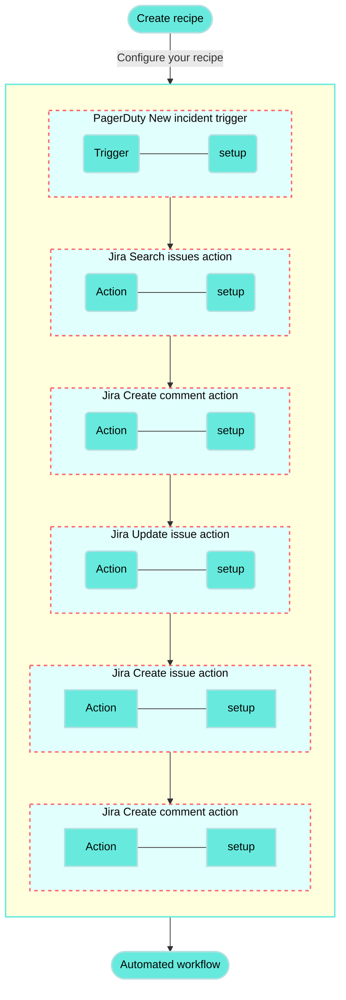

<!-- source: https://docs.workato.com/en/getting-started/use-cases/pagerduty-jira | lastmod: 2026-07-07 -->
> Build a recipe that connects PagerDuty and Jira to create or update issues automatically from new PagerDuty incidents.

# Create or update Jira issues from new PagerDuty incidents recipe

This use case guides you through connecting [PagerDuty](/en/connectors/pagerduty) and [Jira](/en/connectors/jira) to create a powerful automation.

## What does this recipe do?

This recipe synchronizes new incidents from PagerDuty to Jira. If a matching issue exists in Jira, the recipe adds a comment with details from the PagerDuty incident. If no corresponding Jira issue is found, the recipe creates a new one.



## Create your recipe

Complete the following steps to create a recipe that synchronizes new incidents from PagerDuty to Jira:

> **USE CASES ARE INTENDED AS EXAMPLES ONLY**
> 
> This use case serves as an example. Modifications to triggers, actions, or conditional logic may be necessary to adapt this recipe to your workflow.

1. Sign in to Workato.
   
2. Select the project where you plan to create the recipe.
   
3. Create connections for PagerDuty and Jira:
   
   Create a PagerDuty connection.
   
   ### Create a PagerDuty connection
   
   This step creates a connection between Workato and your PagerDuty account.
   
   1. Click **Create > Connection** or press C twice.
      
   2. Search for and select `PagerDuty` on the **New connection** page.
      
   3. Provide a name for your connection in the **Connection name** field.
      
      _PagerDuty connection setup_
      
   4. Use the **Location** drop-down menu to select the project where you plan to store the connection.
      
   5. Enter your API key in the **API key** field.
      
      To create a new API key in PagerDuty, go to **Integrations > API Access Keys** and click **\+ Create New API Key**. Don't select the **Read-only API Key** checkbox because this connector requires both read and write permissions.
      
      Alternatively, to create an API user token that provides the same permissions as your user account, go to **My Profile > User Settings** and click **Create API User Token**.
      
   6. Click **Connect**.
      
   
   Create a Jira connection.
   
   ### Create a Jira connection
   
   This step creates a connection between Workato and your Jira account.
   
   1. Click **Create > Connection** or press C twice.
      
   2. Search for and select `Jira` on the **New connection** page.
      
   3. Enter a name for your Jira connection in the **Connection name** field.
      
      _Jira connection setup_
      
   4. Use the **Location** drop-down menu to select the project where you plan to store the connection.
      
   5. Select your **Connection type**.
      
   6. Use the **Auth type** drop-down menu to select your authentication method. Supported options include [Basic](/en/connectors/jira#basic-authentication-with-password), [API token](/en/connectors/jira#api-tokens), [OAuth 2.0](/en/connectors/jira#oauth2-0), and [Personal access token](/en/connectors/jira#personal-access-tokens).
      
   7. Provide your **Host name**. For example, if your Jira URL is `https://acme.atlassian.net`, your host name is `acme.atlassian.net`.
      
   8. Click **Connect**.
      
   
4. Go back to your project and click **Create > Recipe** or press C+R.
   
   _Create a new recipe_
   
5. Enter a name for your recipe in the **Name** field.
   
6. Select the project where you plan to store the recipe from the **Location** drop-down menu.
   
7. Click **Start building**.
   
   _Start building your recipe_
   
8. Click **Pick a starting point**, then select **Trigger from an app**.
   
9. Click **Select an app and trigger event**.
   
10. Set up your PagerDuty New incident trigger.
    
    ### Set up PagerDuty New incident trigger
    
    This trigger monitors PagerDuty for new incidents. The trigger checks for new incidents at a set interval and retrieves incidents created since the recipe started or from a specified time.
    
    1. Search for `PagerDuty` and select it as your app.
       
       _Choose PagerDuty_
       
    2. Select the **New incident** trigger.
       
       _Select the New incident trigger_
       
    3. Select the PagerDuty connection you created in the preceding steps.
       
    4. Optional. Specify how frequently the recipe should check for new events in the **Trigger poll interval** field. This field defaults to five minutes if left blank.
       
    5. Optional. Use the **When first started, this recipe should pick up events from** field to specify the date and time from which the recipe should retrieve incidents. Leave this field blank to retrieve incidents created after the recipe starts. After you run or test this recipe, you can't change this value. Refer to [Triggers](/en/recipes/triggers#since-from) to learn more about this input field.
       
       _Configure the New incident trigger_
       
    6. Click **Save**.
       
    
11. Click **\+ Add step** and select **Action in app**.
    
    _Click **Add step > Add action in app**_
    
12. Set up your Jira Search issues batch action.
    
    ### Set up Jira Search issues batch action
    
    This step searches for a Jira issue with a summary that matches the PagerDuty incident's summary.
    
    1. Search for `Jira` and select it as your app.
       
       _Choose Jira_
       
    2. Select the **Search issues** action.
       
       _Select the Search issues batch action_
       
    3. Map the PagerDuty Summary (Step 1) datapill to the **Summary** field.
       
       _Map the Summary (Step 1) datapill_
       
    4. Click **Save**.
       
    
13. Click **\+ Add step** and select **IF condition**.
    
    _Click **Add step > IF condition**_
    
    How do IF conditions work?
    
    ### PagerDuty and Jira IF condition example
    
    An [IF condition](/en/features/if-conditions) enables you to make decisions based on specific conditions. You can control your recipe workflow by executing different actions depending on whether a condition you specify is present or not present (true or false).
    
    ```mermaid
    flowchart TD
        A([Search issues in Jira]) --> B(Does a Jira issue exist for the PagerDuty incident?)
        B -->|Yes| C(Add a comment to and update the corresponding Jira issue)
        B ---->|No| E(Create new Jira issue)

        classDef default fill:#67eadd,stroke:#b3e0e1,stroke-width:2px,color:#000;
        classDef WorkatoPink fill:#f3c1c2,stroke:#f3c1c2,stroke-width:1px;
        class E WorkatoPink
    ```
    
14. Set up your Jira and PagerDuty IF condition.
    
    ### Set up a Jira and PagerDuty IF condition
    
    This step checks whether the **Search issues** action found a Jira issue with a summary matching the new PagerDuty incident.
    
    1. Map the Jira Key (Step 2) datapill to **Data field**.
       
    2. Select **is present** in the **Condition** field.
       
       _Configure your IF condition_
       
    3. Click **Save**.
       
    
15. Click **Select an app and action**.
    
16. Set up your Jira Create comment action.
    
    ### Set up Jira Create comment action
    
    This step adds a comment to the matched Jira issue with the relevant details from PagerDuty.
    
    1. Search for `Jira` and select it as your app.
       
       _Choose Jira_
       
    2. Select the **Create comment** action.
       
       _Select the Create comment action_
       
    3. Map the Jira Key (Step 2) datapill to the **Issue ID or key** field.
       
       _Map the Key (Step 2) datapill_
       
    4. Add the following text to the **Comment text** field:
       
       ```plaintext
       New incident triggered in PagerDuty for this issue
       
       Summary:
       Incident number:
       Service:
       Status:
       Urgency:
       Link to PagerDuty:
       ```
       
    5. Map the relevant PagerDuty datapills to each line in the **Comment text** field:
       
       - Summary (Step 1)
       - Incident number (Step 1)
       - Summary (Step 1) (nested under the **Service** object)
       - Status (Step 1)
       - Urgency (Step 1)
       - Html URL (Step 1)
       
       _Map datapills to the Comment text field_
       
    6. Click **Save**.
       
    
17. Click **\+ Add step** and select **Action in app**.
    
18. Set up your Jira Update issue action.
    
    ### Set up Jira Update issue action
    
    This final step in the IF condition updates the Jira issue's priority to match the PagerDuty incident. You can configure additional fields in this action to further update the issue.
    
    1. Search for `Jira` and select it as your app.
       
       _Choose Jira_
       
    2. Select the **Update issue** action.
       
       _Select the Update issue action_
       
    3. Map the Jira Key (Step 2) datapill to the **Issue ID or key** field.
       
       _Map the Key (Step 2) datapill_
       
    4. Use the **Sample project issue type** drop-down menu to select the issue type in your Jira project that you plan to update. This field retrieves custom fields specific to your project and issue type.
       
       For example, in a Jira project named `Incident Management`, select the `Incident` issue type.
       
       _Select a sample project issue type_
       
    5. Switch the **Priority name** field to [formula mode](/en/formulas/formula-mode) and perform the following actions:
       
       1. Map the PagerDuty Urgency (Step 1) datapill.
          
       2. Append the [`.capitalize` formula](/en/formulas/string-formulas#capitalize).
          
       
       _Configure the Priority name field_
       
    6. Click **Save**.
       
    
19. Click **\+ Add step** and select **ELSE IF condition**.
    
    _Click **Add step > ELSE IF condition**_
    
20. Set up your Jira and PagerDuty ELSE IF condition.
    
    ### Set up a Jira and PagerDuty ELSE IF condition
    
    This step sets up an ELSE IF condition to check if there is no matching Jira issue for the PagerDuty incident and if the incident isn't resolved. The AND condition ensures that the recipe doesn't sync resolved PagerDuty incidents to Jira as new active issues.
    
    1. Map the Jira Key (Step 2) datapill to **Data field**.
       
    2. Select **is not present** in the **Condition** field.
       
    3. Click `+` (plus) and select **AND** to add a second condition.
       
    4. Map the PagerDuty Status (Step 1) datapill to **Data field**.
       
    5. Select **does not equal** in the **Condition** field.
       
    6. Type `resolved` in the **Value** field.
       
       _Configure your ELSE IF condition_
       
    7. Click **Save**.
       
    
21. Click **Select an app and action**.
    
22. Set up your Jira Create issue action.
    
    ### Set up Jira Create issue action
    
    This step creates a new Jira issue with the incident issue type and syncs details from PagerDuty if no matching Jira issue exists for the PagerDuty incident and the incident isn't resolved.
    
    1. Search for `Jira` and select it as your app.
       
       _Choose Jira_
       
    2. Select the **Create issue** action.
       
       _Select the Create issue action_
       
    3. Use the **Project issue type** drop-down menu to select the project and issue type.
       
       For example, in a Jira project named `Incident Management`, select the `Incident` issue type.
       
    4. Map the PagerDuty Summary (Step 1) datapill to the **Summary** field.
       
    5. Add the following text to the **Description** field:
       
       ```plaintext
       Incident type:
       Status:
       Urgency:
       Last status change at:
       ```
       
    6. Map the relevant PagerDuty datapills to each line in the **Description** field:
       
       - Type (Step 1)
       - Status (Step 1)
       - Urgency (Step 1)
       - Last status change at (Step 1)
    7. Switch the **Priority name** field to [formula mode](/en/formulas/formula-mode) and perform the following actions:
       
       1. Map the PagerDuty Urgency (Step 1) datapill.
          
       2. Append the [`.capitalize` formula](/en/formulas/string-formulas#capitalize).
          
       
       _Configure the Priority name field_
       
    8. Click **Save**.
       
    
23. Click **\+ Add step** and select **Action in app**.
    
24. Set up your Jira Create comment action.
    
    ### Set up Jira Create comment action
    
    This final step in the recipe adds a comment to the new Jira issue with the relevant details from PagerDuty.
    
    1. Search for `Jira` and select it as your app.
       
       _Choose Jira_
       
    2. Select the **Create comment** action.
       
       _Select the Create comment action_
       
    3. Map the Jira Key (Step 7) datapill to the **Issue ID or key** field. This field identifies the Jira issue where the new comment should be added.
       
    4. Add the following text to the **Comment text** field:
       
       ```plaintext
       New incident triggered in PagerDuty for this issue
       
       Summary:
       Incident number:
       Service:
       Status:
       Urgency:
       Link to PagerDuty:
       ```
       
    5. Map the relevant PagerDuty datapills to each line in the **Comment text** field:
       
       - Summary (Step 1)
       - Incident number (Step 1)
       - Summary (Step 1) (nested under the **Service** object)
       - Status (Step 1)
       - Urgency (Step 1)
       - Html URL (Step 1)
    6. Click **Save**.
       
    

Your **Create or update Jira issues from new PagerDuty incidents** recipe is ready to test and implement.

Example recipe configuration.

_**Create or update Jira issues from new PagerDuty incidents** recipe_

---
