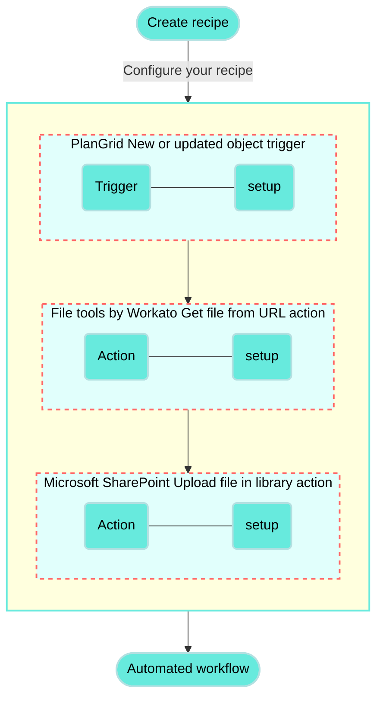

<!-- source: https://docs.workato.com/en/getting-started/use-cases/plangrid-sharepoint | lastmod: 2026-07-07 -->
> Build a recipe that connects PlanGrid and Microsoft SharePoint to sync new and updated safety inspection field reports.

# Sync PlanGrid safety reports to Microsoft SharePoint recipe

This use case guides you through connecting [PlanGrid](/en/connectors/plangrid) and [Microsoft SharePoint](/en/connectors/sharepoint) to create a powerful automation.

## What does this recipe do?

This recipe synchronizes new and updated safety inspection field reports from PlanGrid to Microsoft SharePoint.



## Create your recipe

Complete the following steps to create a recipe that synchronizes new and updated safety inspection field reports from PlanGrid to Microsoft SharePoint:

> **USE CASES ARE INTENDED AS EXAMPLES ONLY**
> 
> This use case serves as an example. Modifications to triggers, actions, or conditional logic may be necessary to adapt this recipe to your workflow.

1. Sign in to Workato.
   
2. Select the project where you plan to create the recipe.
   
3. Create connections for PlanGrid and Microsoft SharePoint:
   
   Create a PlanGrid connection.
   
   ### Create a PlanGrid connection
   
   This step creates a connection between Workato and your PlanGrid account.
   
   1. Click **Create > Connection** or press C twice.
      
   2. Search for and select `PlanGrid` on the **New connection** page.
      
   3. Provide a name for your connection in the **Connection name** field.
      
      _PlanGrid connection setup_
      
   4. Use the **Location** drop-down menu to select the project where you plan to store the connection.
      
   5. Click **Connect**. A PlanGrid OAuth dialog appears.
      
   6. Click **Give Permission** to authorize Workato to establish the connection.
      
   
   Create a Microsoft SharePoint connection.
   
   ### Create a Microsoft SharePoint connection
   
   This step creates a connection between Workato and your Microsoft SharePoint account.
   
   You must have an Azure account to connect Microsoft SharePoint to Workato. Workato supports the following authentication methods:
   
   - [Authorization code grant connection](#authentication-auth-code-grant)
   - [Client credentials grant connection](#authentication-client-cred)
   
   #### Authorization code grant connection
   
   This method requires the following fields:
   
   - **Subdomain**
   - **Client ID** (optional)
   - **Client Secret** (optional)
   
   ##### Step 1: Register the Workato app in Microsoft SharePoint and generate a client ID and secret
   
   Complete the following steps to register the Workato app and generate a client ID and secret for authorization code grant connections:
   
   1. Sign in to your [Azure Portal](https://portal.azure.com/).
      
   2. Go to **Microsoft Entra ID > Manage > App registrations** and click **New registration**.
      
   3. Enter a name for the application in the **Name** field.
      
   4. Specify who can use this application in the **Supported account type** field.
      
   5. Use the **Select a platform** drop-down menu to select **Web**.
      
   6. Enter `https://www.workato.com/oauth/callback` in the **Redirect URI** field.
      
   7. Click **Register**.
      
   8. Go to **Manage > API permissions** and click **Add a permission**.
      
   9. Select **SharePoint** as your API.
      
   10. Select the **Delegated permissions** option.
       
   11. Expand **AllSites** within the **Select permissions** field and select the **AllSites.Read (Delegated)** checkbox.
       
   12. Go to **Manage > Certificates & secrets** and click **New client secret**.
       
   13. Enter a description for the client secret in the **Description** field.
       
   14. Use the **Expires** drop-down menu to set the expiration date for the client secret.
       
   15. Click **Add** to create the client secret.
       
   16. Click **Copy to clipboard** next to the **Value** after you create the secret. This is your **Client Secret**. Save this value in a secrets vault.
       
   17. Go to **Overview** and copy the **Application (client) ID** value. This is your **Client ID**.
       
   
   You can now configure your Microsoft SharePoint connection in Workato using the API permissions you set up in the Azure Portal.
   
   #### Step 2: Complete setup in Workato
   
   1. Click **Create > Connection** or press C twice.
      
   2. Search for and select `Microsoft Sharepoint` on the **New connection** page.
      
   3. Provide a name for your connection in the **Connection name** field.
      
      _Microsoft SharePoint connection setup_
      
   4. Use the **Authentication type** drop-down menu to select **Authorization code grant**.
      
   5. Enter your SharePoint subdomain as found in your SharePoint URL in the **Subdomain** field. For example, if your SharePoint URL is `https://abc.sharepoint.com`, the subdomain is `abc`.
      
   6. Enter the client ID generated in SharePoint in the **Client ID** field.
      
   7. Enter the client secret generated in SharePoint in the **Client secret** field.
      
   8. Enter the name of the SharePoint site you plan to connect to in the **Site name** field. If left blank, Workato connects to your default home site. Use the site name as found in the URL of the site page. For example, if the URL is `https://company-name.sharepoint.com/sites/product`, the site name is `product`.
      
   9. Click **Sign in with Microsoft**.
      
   10. Enter your credentials to sign in.
       
   11. Click **Accept** to authorize the app you created in your Azure Portal.
       
   
   ### Client credentials grant connection
   
   This method requires the following values:
   
   - **Subdomain**
   - **Tenant ID**
   - **Client ID**
   - **Certificate**
   - **Private Key**
   
   #### Step 1: Register the Workato application in Microsoft SharePoint
   
   Complete the following steps to register the Workato app and obtain a client ID, secret, and private key for client credentials grant connections.
   
   1. Sign in to your [Azure Portal](https://portal.azure.com/).
      
   2. Go to **Microsoft Entra ID > Manage > App registrations** and click **New registration**.
      
   3. Enter a name for the application in the **Name** field.
      
   4. Specify who can use this application in the **Supported account type** field.
      
   5. Use the **Select a platform** drop-down menu to select **Web**.
      
   6. Enter `https://www.workato.com/oauth/callback` in the **Redirect URI** field.
      
   7. Click **Register**.
      
   8. Go to **Manage > API permissions** and click **Add a permission**.
      
   9. Select **SharePoint** as your API.
      
   10. Select the **Application permissions** option.
       
   11. Expand **Sites** in the **Select permissions** section and select the **Sites.Read.All (Application)** checkbox. Ensure that admin consent is granted in the **Status** column.
       
   12. Go to **Manage > Certificates & secrets > Certificates** and click **Upload certificate**.
       
   13. Upload a certificate if you already have one. If not, you can generate the certificate locally using tools such as OpenSSL or PowerShell.
       
   14. Go to **Overview** and copy the **Application (client) ID** value. This is your **Client ID**.
       
   15. Copy the **Directory (tenant) ID** value. This is your **Tenant ID**.
       
   
   You can now configure your Microsoft SharePoint connection in Workato using these required values.
   
   #### Step 2: Configure your Microsoft SharePoint connection in Workato
   
   1. Click **Create > Connection** or press C twice.
      
   2. Search for and select `Microsoft Sharepoint` on the **New connection** page.
      
   3. Provide a name for your connection in the **Connection name** field.
      
      _Microsoft SharePoint connection setup_
      
   4. Use the **Authentication type** drop-down menu to select **Client credentials**.
      
   5. Enter your SharePoint subdomain as found in your SharePoint URL in the **Subdomain** field. For example, if your SharePoint URL is `https://abc.sharepoint.com`, the subdomain is `abc`.
      
   6. Provide the tenant ID generated in SharePoint in the **Tenant ID** field.
      
   7. Provide the client ID generated in SharePoint in the **Client ID** field.
      
   8. Provide the certificate generated in SharePoint in the **Certificate** field.
      
   9. Provide the private key string generated in SharePoint in the **Private key** field.
      
   10. Enter the name of the SharePoint site you plan to connect to in the **Site name** field. If left blank, Workato connects to your default home site. Use the site name as found in the URL of the site page. For example, if the URL is `https://company-name.sharepoint.com/sites/product`, the site name is `product`.
       
   11. Click **Sign in with Microsoft**.
       
   
4. Go back to your project and click **Create > Recipe** or press C+R.
   
   _Create a new recipe_
   
5. Enter a name for your recipe in the **Name** field.
   
6. Select the project where you plan to store the recipe from the **Location** drop-down menu.
   
7. Click **Start building**.
   
   _Start building your recipe_
   
8. Click **Pick a starting point**, then select **Trigger from an app**.
   
9. Click **Select an app and trigger event**.
   
10. Set up your PlanGrid New or updated object trigger.
    
    ### Set up PlanGrid New or updated object trigger
    
    This trigger monitors your PlanGrid project for new or updated field reports that include the word `Safety` in the file name.
    
    1. Search for `PlanGrid` and select it as your app.
       
       _Choose PlanGrid_
       
    2. Select the **New or updated object in PlanGrid** trigger.
       
       _Select the New or updated object in PlanGrid trigger_
       
    3. Use the **Object** drop-down menu to select **Field Report**.
       
    4. Use the **Project** drop-down menu to select your project.
       
       _Configure the trigger_
       
    5. Click the **Set trigger condition** toggle.
       
       _Set trigger condition_
       
    6. Map the PlanGrid Status (Step 1) datapill to the **Trigger data** field.
       
    7. Use the **Condition** drop-down menu to select **equals**.
       
    8. Type `submitted` in the **Value** field.
       
       _Set trigger condition_
       
    9. Click `+` (plus) and select **AND** to add a second condition.
       
    10. Map the PlanGrid Name (Step 1) datapill to the **Trigger data** field.
        
    11. Use the **Condition** drop-down menu to select **contains**.
        
    12. Type `Safety` in the **Value** field.
        
        _Set trigger condition_
        
    13. Click **Save**.
        
    
11. Click **\+ Add step** and select **IF condition**.
    
    _Click **Add step > IF condition**_
    
    How do IF conditions work?
    
    ### PlanGrid and Microsoft SharePoint IF condition example
    
    An [IF condition](/en/features/if-conditions) enables you to make decisions based on specific conditions. You can control your recipe workflow by executing different actions depending on whether a condition you specify is true or false.
    
    ```mermaid
    flowchart TD
        A([New or updated field report in PlanGrid]) --> B(Is a PDF URL present?)
        B -->|Yes| C(Get the file from the URL and upload to Microsoft SharePoint)
        B ---->|No| E[Do nothing]

        classDef default fill:#67eadd,stroke:#b3e0e1,stroke-width:2px,color:#000;
        classDef WorkatoPink fill:#f3c1c2,stroke:#f3c1c2,stroke-width:1px;
        class E WorkatoPink
    ```
    
12. Set up your PlanGrid IF condition.
    
    ### Set up a PlanGrid IF condition
    
    This step checks if a PDF URL is present in the trigger output.
    
    1. Map the PlanGrid PDF URL (Step 1) datapill to **Data field**.
       
    2. Use the **Condition** drop-down menu to select **is present**.
       
       _Configure your IF condition_
       
    3. Click **Save**.
       
    
13. Click **\+ Add step** and select **Action in app**.
    
    _Click **Add step > Add action in app**_
    
14. Set up your File tools by Workato Get file from URL action.
    
    ### Set up File tools by Workato Get file from URL action
    
    This step retrieves the file contents from the PDF URL.
    
    1. Search for `File tools by Workato` and select it as your app.
       
       _Choose File tools by Workato_
       
    2. Select the **Get file from URL** action.
       
       _Select the Get file from URL action_
       
    3. Map the PlanGrid PDF URL (Step 1) datapill to the **URL** field.
       
       _Map the PDF URL (Step 1) datapill_
       
    4. Click **Save**.
       
    
15. Click **\+ Add step** and select **Action in app**.
    
16. Set up your Microsoft SharePoint Upload file in library action.
    
    ### Set up Microsoft SharePoint Upload file in library action
    
    This step uploads the PlanGrid field report PDF file to a folder you specify in Microsoft SharePoint.
    
    1. Search for `Microsoft SharePoint` and select it as your app.
       
       _Choose Microsoft SharePoint_
       
    2. Select the **Upload file in library** action.
       
       _Select the Upload file in library action_
       
    3. Enter the name of the Microsoft SharePoint site you plan to connect to in the **Site name** field. If left blank, Workato connects to the site name specified when you configured your connection.
       
    4. Select the folder where you plan to upload the field report in the **Folder** field.
       
    5. Enter a name in the **File name** field.
       
       Complete the following steps to configure this field dynamically:
       
       _Configure the file name_
       
       1. Switch the **File name** field to [formula mode](/en/formulas/formula-mode).
          
       2. Map the PlanGrid Report Date (Step 1) datapill.
          
       3. Append the [`.strftime` formula](/en/formulas/date-formulas#strftime) to format the Report Date (Step 1) datapill. Enter `"%Y-%m-%d"` as the value in the `.strftime` formula.
          
       4. Append the [`.to_s` formula](/en/formulas/string-formulas#to-s) to convert the Report Date (Step 1) datapill into a string.
          
       5. Type `+ "-" +` to insert a hyphen between the date and document title.
          
       6. Map the PlanGrid Name (Step 1) datapill.
          
       7. Append the [`.gsub` formula](/en/formulas/string-formulas#gsub) to replace spaces with hyphens in the document name. Enter `" ", "-"` as the value in the `.gsub` formula.
          
       8. Type `+ ".pdf"` to complete the file name with the `.pdf` extension.
          
       
       _File name configuration_
       
       This configuration applies the following naming convention:
       
       `YYYY-MM-DD-YOUR-SAFETY-FIELD-REPORT-TITLE.pdf`
       
       For example:
       
       `2024-10-09-Daily-Safety-Inspection.pdf`
       
    6. Map the File tools by Workato File contents (Step 3) datapill to the **File contents** field.
       
       _Map the File contents (Step 3) datapill_
       
    7. Click **Save**.
       
    

Your **Sync PlanGrid safety reports to Microsoft SharePoint** recipe is ready to test and implement.

Example recipe configuration.

_**Sync PlanGrid safety reports to Microsoft SharePoint** recipe_

---
