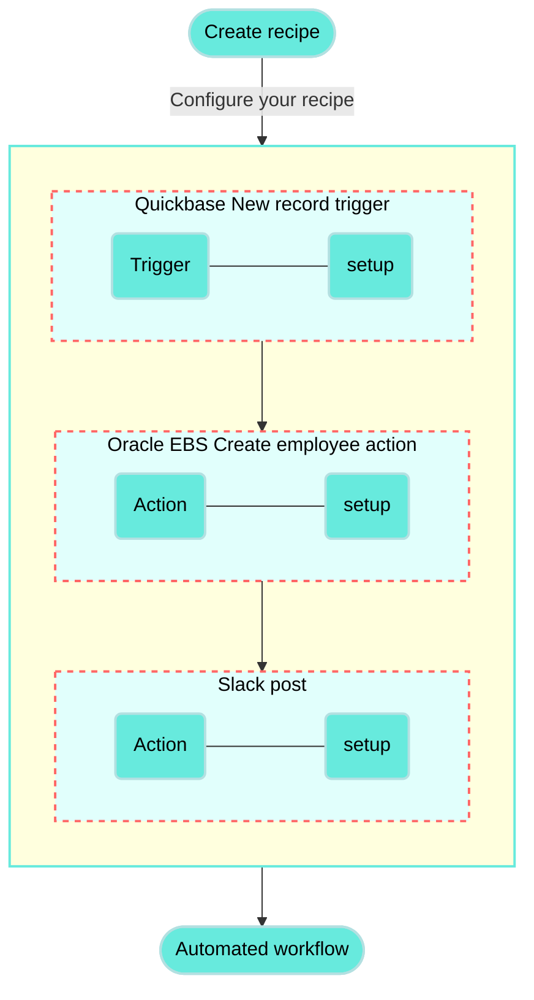

<!-- source: https://docs.workato.com/en/getting-started/use-cases/quickbase-oracle-ebs-slack | lastmod: 2026-07-07 -->
> Build a recipe that connects Quickbase, Oracle EBS, and Slack to sync employees and notify your team of each new record.

# Sync Quickbase employees to Oracle EBS and notify your team in Slack recipe

This use case guides you through connecting [Quickbase](/en/connectors/quickbase), [Oracle EBS](/en/connectors/oracle-ebs), and [Slack](/en/connectors/slack) to Workato to create a powerful automation.

## What does this recipe do?

This recipe syncs employees from Quickbase to Oracle E-Business Suite (EBS) and then posts a notification in Slack.

## Create your recipe

Complete the following steps to create a recipe that syncs employees from Quickbase to Oracle EBS and then posts a notification in Slack.

> **USE CASES ARE INTENDED AS EXAMPLES ONLY**
> 
> This use case serves as an example. Modifications to triggers, actions, or conditional logic may be necessary to adapt this recipe to your workflow.

1. Sign in to Workato.
   
2. Select the project where you plan to create the recipe.
   
3. Create connections for Quickbase, Oracle EBS, and Slack:
   
   Create a Quickbase connection.
   
   ### Create a Quickbase connection
   
   This step creates a connection between Workato and your Quickbase account.
   
   Workato supports the following authentication methods for connecting to Quickbase:
   
   - [Create a Quickbase connection](#create-a-quickbase-connection)
   - [User-token authentication](#user-token-authentication)
   - [Username and password authentication](#username-and-password-authentication)
   
   ### User-token authentication
   
   1. Click **Create > Connection** or press C twice.
      
   2. Search for and select `Quickbase` on the **New connection** page.
      
   3. Provide a unique **Connection name** that identifies the Quickbase instance to which it is connected.
      
   4. Use the **Location** drop-down menu to select the project where you plan to store the connection.
      
   5. Enter your **Quickbase subdomain**. This is most often your company name.
      
   6. Use the **User-token authentication?** drop-down menu to select **Yes**.
      
   7. Provide your **User token**. Refer to the [Generate a user token](/en/connectors/quickbase#generate-user-token) section for more information.
      
   8. Click **Connect**.
      
   
   ### Username and password authentication
   
   1. Click **Create > Connection** or press C twice.
      
   2. Search for and select `Quickbase` on the **New connection** page.
      
   3. Provide a unique **Connection name** that identifies the Quickbase instance you plan to use.
      
      _Set up your Quickbase connection with a username and password_
      
   4. Use the **Location** drop-down menu to select the project where you plan to store the connection.
      
   5. Enter your **Quickbase subdomain**. This is most often your company name.
      
   6. Use the **User-token authentication?** drop-down menu to select **No**.
      
   7. Provide your Quickbase **username** and **password**.
      
   8. Click **Connect**.
      
   
   Create an Oracle EBS connection.
   
   ### Create an Oracle EBS connection
   
   This step creates a connection between Workato and your Oracle EBS account.
   
   Ensure that you complete the [prerequisite steps](/en/connectors/oracle-ebs#prerequisites) before you begin to set up your connection.
   
   Complete the following steps to set up your connection:
   
   1. Click **Create > Connection** or press C twice.
      
   2. Search for and select `Oracle E-Business Suite` on the **New connection** page.
      
   3. Enter a name for your connection in the **Connection name** field.
      
      _Set up your Oracle E-Business Suite connection_
      
   4. Use the **Location** drop-down menu to select the project or folder where you plan to store your connection.
      
   5. Use the **Connection type** drop-down menu to specify whether this is a cloud or on-prem connection. If you're connecting to an on-premise Oracle E-Business Suite instance, select the appropriate on-prem group from the drop-down menu.
      
   6. Enter the base URL for your Oracle SOA Gateway REST services in the **Instance URL** field. For example, `https://oracleebs.mycompany.com:8000/`.
      
   7. Enter your Oracle SOA Gateway REST services username in the **Username** field.
      
   8. Enter your password in the **Password** field.
      
   9. Click **Connect**.
      
   
   Create a Slack connection.
   
   ### Create a Slack connection
   
   This step creates a connection between Workato and your Slack account.
   
   1. Click **Create > Connection** or press C twice.
      
   2. Search for and select `Slack` on the **New connection** page.
      
   3. Enter a name for your connection in the **Connection name** field.
      
      _Slack connection setup_
      
   4. Use the **Location** drop-down menu to select the project where you plan to store the connection.
      
   5. Optional. Configure **Advanced** and **Custom OAuth profile** settings if required for your account type.
      
   6. Click **Connect**.
      
   
4. Go back to your project and click **Create > Recipe** or press C+R.
   
   _Create a new recipe_
   
5. Enter a name for your recipe in the **Name** field.
   
6. Select the project where you plan to store the recipe from the **Location** drop-down menu.
   
7. Click **Start building**.
   
   _Start building your recipe_
   
8. Click **Pick a starting point**, then select **Trigger from an app**.
   
9. Click **Select an app and trigger event**.
   
10. Set up your Quickbase New record trigger.
    
    ### Set up Quickbase New record trigger
    
    This trigger monitors your Quickbase account for new records.
    
    1. Search for `Quickbase` and select it as your app.
       
       _Select Quickbase as your app_
       
    2. Select the **New record** trigger.
       
       _Select the New record trigger_
       
    3. Use the **Application** drop-down menu to select the application you plan to monitor for new records.
       
       _Set up your New record trigger_
       
    4. Use the **Table** drop-down menu to select the table item you plan to monitor. For example, `Employees`.
       
    5. Use the calendar modal to select the date from which your recipe should begin to monitor events in the **When first started, this recipe should pick up events from** field. Refer to [Triggers](/en/recipes/triggers#since-from) to learn more about this input field.
       
    6. Click **Save**.
       
    
11. Click **\+ Add step** and select **Action in app**.
    
    _Click **Add step > Add action in app**_
    
12. Set up your Oracle EBS Create employee action.
    
    ### Set up Oracle EBS Create employee action
    
    This step creates an employee record in your Oracle EBS account.
    
    1. Search for `Oracle E-Business Suite` and select it as your app.
       
       _Choose Oracle EBS as your app_
       
    2. Select the **Execute operation** action.
       
       _Select the Execute operation action_
       
    3. Provide a **Service name** for your action. For example, `employee`.
       
       _Provide a service and operation name_
       
    4. Provide an **Operation name** for your action. For example, `Create employee`.
       
    5. Expand **Operation request header** and select the language code you plan to use for your action.
       
    6. Expand **Operation input** and provide the **First name**, **Last name**, and **Email address**. _Provide values for your operation input_
       
    7. Click **Save**.
       
    
13. Click **\+ Add step** and select **Add action in app**.
    
14. Set up your Slack Post message action.
    
    ### Set up Slack Post message action
    
    This step posts a Slack message to the channel you specify with the new employee's details.
    
    1. Search for `Slack` and select it as your app.
       
       _Select Slack as your app_
       
    2. Select the **Post message** action.
       
    3. Use the **Channel** drop-down menu to select the Slack channel where you plan to post your message.
       
       _Set up your Slack action_
       
    4. Enter a message for the post in the **Basic text** field. You can also map the Quickbase Name (Step 1) datapill into this field if you plan to automatically include the new employee's name.
       
    5. Enter an attachment title for the Slack post in the **Attachment title** field.
       
    6. Map the Quickbase File URL (Step 1) datapill into the **Attachment title link** field. Attachment titles are clickable and direct users to the URL you provide when clicked.
       
    7. Enter text for the attachment in the **Attachment text** field. You can map the Quickbase Name (Step 1) and Role (Step 1) datapills into this field if you plan to include specific details about the new employee.
       
    8. Click **Save**.
       
    

Your **Sync Quickbase employees to Oracle EBS and notify your team in Slack** recipe is ready to test and implement.

---
