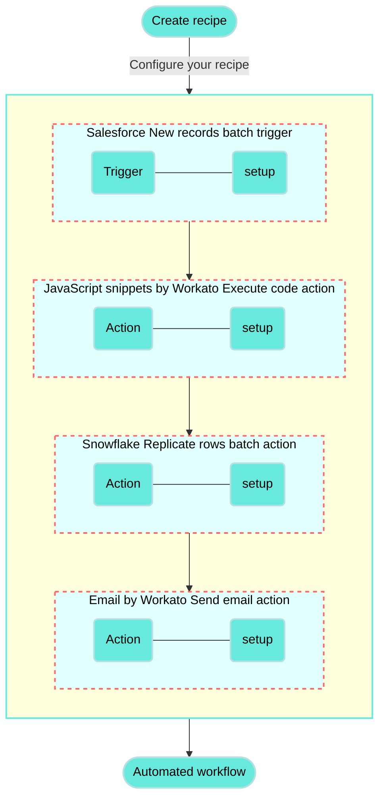

<!-- source: https://docs.workato.com/en/getting-started/use-cases/salesforce-js-snippets-snowflake-email | lastmod: 2026-07-07 -->
> Build a recipe that connects Salesforce, JavaScript snippets, Snowflake, and Email to validate contacts and upsert valid records.

# Validate Salesforce contact information with JavaScript and upsert to Snowflake recipe

This use case guides you through connecting [Salesforce](/en/connectors/salesforce), [JavaScript snippets by Workato](/en/connectors/javascript), [Snowflake](/en/connectors/snowflake), and [Email by Workato](/en/connectors/email-by-workato) to create a powerful automation.

## What does this recipe do?

This recipe retrieves new Salesforce contacts in batches, validates each phone number using JavaScript, and upserts the valid contacts into a Snowflake table. Contacts with invalid phone numbers are excluded from the upsert, and the recipe sends an email listing these invalid contacts.



## Create your recipe

Complete the following steps to create a recipe that retrieves new Salesforce contacts in batches, validates each phone number using JavaScript, and inserts or updates rows in a Snowflake table:

> **USE CASES ARE INTENDED AS EXAMPLES ONLY**
> 
> This use case serves as an example. Modifications to triggers, actions, or conditional logic may be necessary to adapt this recipe to your workflow.

1. Sign in to Workato.
   
2. Select the project where you plan to create the recipe.
   
3. Create connections for Salesforce and Snowflake:
   
   > **WORKATO UTILITY CONNECTORS DON'T REQUIRE SETUP**
   > 
   > The JavaScript snippets by Workato and Email by Workato connectors do not require connection setup.
   
   Create a Salesforce connection.
   
   ### Create a Salesforce connection
   
   This step creates a connection between Workato and your Salesforce account.
   
   1. Click **Create > Connection** or press C twice.
      
   2. Search for and select `Salesforce` on the **New connection** page.
      
   3. Provide a name for your connection in the **Connection name** field.
      
      _Salesforce connection setup_
      
   4. Use the **Location** drop-down menu to select the project where you plan to store the connection.
      
   5. Use the **Auth type** drop-down menu to select the authentication method. The default is OAuth 2.0.
      
   6. Use the **Sandbox** drop-down menu to specify whether the Salesforce account is a sandbox account.
      
   7. Optional. Expand **Advanced settings** to configure advanced connection options.
      
   8. Optional. Use the **Custom OAuth profile** drop-down menu to select a custom OAuth profile for your connection.
      
      - This custom OAuth profile ensures that the connection is restricted to the same set of scopes you selected for all users with the profile, and the authentication flow uses the client app linked to the custom profile.
   9. Click **Connect**.
      
   10. Enter your Salesforce account credentials and click **Log In**.
       
       _Log in to your Salesforce account_
       
   
   Create a Snowflake connection.
   
   ### Create a Snowflake connection
   
   This step creates a connection between Workato and your Snowflake account.
   
   1. Click **Create > Connection** or press C twice.
      
   2. Search for and select `Snowflake` on the **New connection** page.
      
   3. Provide a name for your connection in the **Connection name** field.
      
      _Snowflake connection setup_
      
   4. Use the **Location** drop-down menu to select the project where you plan to store the connection.
      
   5. Enter your account identifier in the **Account identifier** field. Snowflake has multiple methods of identifying an account. Workato supports all methods:
      
      - Account name: `https://{org.name}-{account_name}`
      - Connection name: `https://{org.name}-{connectionname}`
      - Account locator: `https://{account.locator}.{region}.{cloud}`
      
      If you're using the account locator, note that `{region}` and `{cloud}` are only required for certain locations. For example:
      
      - If your account is hosted in AWS US West (Oregon), use `your-account-locator`.
      - If your account is hosted in AWS US East (Ohio), use `your-account-locator.us-east-2`.
      - If your account is hosted in Azure West Europe, use `your-account-locator.west-europe.azure`.
   6. Enter the full name of the warehouse where you plan to perform all operations for this connection in the **Warehouse** field. For example, `compute_wh`.
      
   7. Enter the database you plan to use in your recipe connection in the **Database name** field.
      
   8. Use the **Authentication type** drop-down menu to select your authentication type.
      
      - **Username/Password**: Enter your username and password if you select this option.
      - **OAuth 2.0**: Enter your Client ID and Client Secret if you select this option.
   9. Click **Connect**.
      
   
4. Go back to your project and click **Create > Recipe** or press C+R.
   
   _Create a new recipe_
   
5. Enter a name for your recipe in the **Name** field.
   
6. Select the project where you plan to store the recipe from the **Location** drop-down menu.
   
7. Click **Start building**.
   
   _Start building your recipe_
   
8. Click **Pick a starting point**, then select **Trigger from an app**.
   
9. Click **Select an app and trigger event**.
   
10. Set up your Salesforce New records batch trigger.
    
    ### Set up Salesforce New records batch trigger
    
    This trigger monitors Salesforce daily for new contact records and retrieves specific fields when new contacts are found.
    
    1. Search for `Salesforce` and select it as your app.
       
       _Choose Salesforce_
       
    2. Select the **New records** trigger.
       
       _Select the New records batch trigger_
       
    3. Select the Salesforce connection you created in the preceding steps.
       
    4. Use the **Object** drop-down menu to select **Contact** as the Salesforce object you plan to monitor for new records.
       
    5. Optional. Use the **Fields to retrieve** drop-down menu to specify the fields you plan to retrieve. This example selects the following fields:
       
       - Contact ID
       - Account ID
       - Last Name
       - First Name
       - Business Phone
       - Email
       
       _Specify the fields you plan to retrieve_
       
    6. Enter the batch size in the **Batch size** field. The default is `100`, and the maximum is `2000` records per batch.
       
    7. Optional. Click **Show optional fields**, select **Trigger poll interval**, and click **Apply changes**.
       
       _Configure the Trigger poll interval_
       
    8. Optional. Use the **Trigger poll interval** drop-down menu to specify how frequently this recipe should check for new contacts in Salesforce. This example selects **1 day**.
       
    9. Click **Save**.
       
    
11. Click **\+ Add step** and select **Action in app**.
    
    _Click **Add step > Add action in app**_
    
12. Set up your JavaScript snippets by Workato Execute code action.
    
    ### Set up JavaScript snippets by Workato Execute code action
    
    This step validates contacts by checking if each record contains a valid phone number. This action returns the following output fields: `val_contacts` (list of valid contacts), `bad_contacts` (list of invalid contacts), and `log`. The log message varies based on whether all Salesforce contacts in the batch are valid or if any have invalid phone numbers.
    
    1. Search for `JavaScript snippets by Workato` and select it as your app.
       
       _Choose JavaScript snippets by Workato_
       
    2. Select the **Execute code** action.
       
       _Select the Execute code action_
       
    3. Enter `Validate contacts` in the **Name** field. This changes the action name in the recipe editor.
       
       _Configure the Name field_
       
    4. Go to **Input fields** and select **Add field**.
       
       1. Enter `contacts` in the **Name** field.
          
       2. Click **Add field**.
          
          _Select the Execute code action_
          
    5. Switch the **Contacts** field to [formula mode](/en/formulas/formula-mode).
       
    6. Map the Salesforce Contacts (Step 1) list datapill to the **Contacts** field. You can't map this datapill unless the **Contacts** field is switched to formula mode.
       
       _Map the Contacts (Step 1) datapill_
       
    7. Go to **Output fields** and create a placeholder field.
       
    8. Click **Edit schema**.
       
    9. Copy and paste the following JSON schema to replace the existing schema:
       
       ```json
       [
         {
           "name": "val_contacts",
           "type": "array",
           "of": "object",
           "label": "Val contacts",
           "properties": [
             {
               "properties": [
                 {
                   "control_type": "text",
                   "label": "Type",
                   "type": "string",
                   "name": "type"
                 },
                 {
                   "control_type": "text",
                   "label": "URL",
                   "type": "string",
                   "name": "url"
                 }
               ],
               "label": "Attributes",
               "type": "object",
               "name": "attributes"
             },
             {
               "control_type": "text",
               "label": "Account ID",
               "type": "string",
               "name": "AccountId"
             },
             {
               "control_type": "text",
               "label": "Phone",
               "type": "string",
               "name": "Phone"
             },
             {
               "control_type": "text",
               "label": "ID",
               "type": "string",
               "name": "Id"
             },
             {
               "control_type": "text",
               "label": "Email",
               "type": "string",
               "name": "Email"
             },
             {
               "control_type": "text",
               "label": "First name",
               "type": "string",
               "name": "FirstName"
             },
             {
               "control_type": "text",
               "label": "Last name",
               "type": "string",
               "name": "LastName"
             },
             {
               "control_type": "text",
               "label": "Valid",
               "render_input": {},
               "parse_output": {},
               "toggle_hint": "Select from option list",
               "toggle_field": {
                 "label": "Valid",
                 "control_type": "text",
                 "toggle_hint": "Use custom value",
                 "type": "boolean",
                 "name": "valid"
               },
               "type": "boolean",
               "name": "valid"
             }
           ]
         },
         {
           "name": "bad_contacts",
           "type": "array",
           "of": "object",
           "label": "Bad contacts",
           "properties": [
             {
               "properties": [
                 {
                   "control_type": "text",
                   "label": "Type",
                   "type": "string",
                   "name": "type"
                 },
                 {
                   "control_type": "text",
                   "label": "URL",
                   "type": "string",
                   "name": "url"
                 }
               ],
               "label": "Attributes",
               "type": "object",
               "name": "attributes"
             },
             {
               "control_type": "text",
               "label": "Account ID",
               "type": "string",
               "name": "AccountId"
             },
             {
               "control_type": "text",
               "label": "Phone",
               "type": "string",
               "name": "Phone"
             },
             {
               "control_type": "text",
               "label": "ID",
               "type": "string",
               "name": "Id"
             },
             {
               "control_type": "text",
               "label": "Email",
               "type": "string",
               "name": "Email"
             },
             {
               "control_type": "text",
               "label": "First name",
               "type": "string",
               "name": "FirstName"
             },
             {
               "control_type": "text",
               "label": "Last name",
               "type": "string",
               "name": "LastName"
             },
             {
               "control_type": "text",
               "label": "Valid",
               "render_input": {},
               "parse_output": {},
               "toggle_hint": "Select from option list",
               "toggle_field": {
                 "label": "Valid",
                 "control_type": "text",
                 "toggle_hint": "Use custom value",
                 "type": "boolean",
                 "name": "valid"
               },
               "type": "boolean",
               "name": "valid"
             }
           ]
         },
         {
           "control_type": "text",
           "label": "Log",
           "type": "string",
           "name": "log"
         }
       ]
       ```
       
    10. Click **Update** to apply the new JSON schema. You can scroll through the listings under **Output fields** to see the newly applied schema output:
        
        _Output fields_
        
        You can modify this schema based on the fields you plan to retrieve from Salesforce and upsert into Snowflake.
        
    11. Clear the contents of the **Code** field.
        
    12. Copy and paste the following JavaScript code into the **Code** field:
        
        ```javascript
        const _ = require("lodash");
        
        class ContactValidator {
          static validContact = (phone) => {
            return this.validPhoneNumber(phone);
          };
        
          static validPhoneNumber = (phone) => {
            let phone_regex = /^\(?\d{3}\)?[-.\s]?\d{3}[-.\s]?\d{4}$/;
            return phone ? phone_regex.test(phone) : false;
          };
        
          static validate = function(contacts) {
            const bad_contacts = [];
            const val_contacts = _.filter(contacts, (contact) => {
              let phone = _.get(contact, 'Phone');
              const isValid = this.validContact(phone);
              contact['valid'] = isValid;
        
              if (!isValid) {
                bad_contacts.push(contact); // Add invalid contact to the array
                return false;  // Don't include invalid contacts in val_contacts
              }
              return true;  // Include only valid contacts in val_contacts
            });
        
            // Create a log message based on the bad contacts
            const logMessage = bad_contacts.length > 0
              ? `The following contacts were not replicated due to invalid phone numbers: ${bad_contacts.map(c => `${c.FirstName} ${c.LastName} (${c.Phone})`).join(', ')}`
              : 'All contacts were valid and successfully replicated.';
        
            return { val_contacts, bad_contacts, log: logMessage };
          };
        }
        
        exports.main = ({ contacts }) => {
          return ContactValidator.validate(contacts);
        };
        ```
        
    13. Click **Save**.
        
    
13. Click **\+ Add step** and select **Action in app**.
    
14. Set up your Snowflake Replicate rows batch action.
    
    ### Set up Snowflake Replicate rows batch action
    
    This step inserts or updates the records from the valid contacts list into the Snowflake table.
    
    1. Search for `Snowflake` and select it as your app.
       
       _Choose Snowflake_
       
    2. Select the **Replicate rows** action.
       
       _Select the Replicate rows batch action_
       
    3. Select the Snowflake connection you created in the preceding steps.
       
    4. Use the **Table** drop-down menu to select the Snowflake table where you plan to replicate rows.
       
    5. Ensure that the **Rows** field is switched to [formula mode](/en/formulas/formula-mode) and map the JavaScript snippets by Workato Val contacts (Step 2) datapill.
       
       _Map the Val contacts (Step 2) datapill_
       
    6. Use the **Flatten columns** drop-down menu to select **Yes**.
       
    7. Enter `1` in the **Flatten level** field.
       
    8. Use the **Unique keys** drop-down menu to select one or more unique keys to identify duplicate rows. This example selects **ID** (contact ID) as the unique key.
       
       _Select the unique key_
       
    9. Optional. Use the **Exclude columns** drop-down menu to select the columns to exclude while replicating rows. This example selects **Attributes** and **Valid**.
       
       _Select the columns to exclude from the upsert_
       
    10. Click **Save**.
        
    
15. Click **\+ Add step** and select **IF condition**.
    
    _Click **Add step > IF condition**_
    
    How do IF conditions work?
    
    ### Snowflake and Salesforce IF condition example
    
    An [IF condition](/en/features/if-conditions) enables you to make decisions based on specific conditions. You can control your recipe workflow by executing different actions depending on whether a condition you specify is true or false.
    
    ```mermaid
    flowchart TD
        A([Replicate valid Salesforce contact rows to Snowflake]) --> B(Were there any invalid contacts?)
        B -->|Yes| C(Send an email detailing the contacts with invalid phone numbers)
        B ---->|No| E(No action required)

        classDef default fill:#67eadd,stroke:#b3e0e1,stroke-width:2px,color:#000;
        classDef WorkatoPink fill:#f3c1c2,stroke:#f3c1c2,stroke-width:1px;
        class E WorkatoPink
    ```
    
16. Set up your JavaScript snippets by Workato and Salesforce IF condition.
    
    ### Set up a JavaScript snippets by Workato and Salesforce IF condition
    
    This step checks if the bad contacts list size is greater than zero. This means that the batch contains one or more contacts with invalid phone numbers if this condition is true.
    
    1. Switch **Data field** to formula mode.
       
    2. Map the JavaScript snippets by Workato Bad contacts (Step 2) datapill to **Data field**.
       
    3. Append the [`.length` formula](/en/formulas/array-list-formulas#length).
       
    4. Use the **Condition** drop-down menu to select **greater than**.
       
    5. Switch the **Value** field to formula mode and enter `0`.
       
       _Configure the IF condition_
       
    6. Click **Save**.
       
    
17. Click **Select an app and action**.
    
18. Set up your Email by Workato Send email action.
    
    ### Set up Email by Workato Send email action
    
    Workato sends an email to a recipient you specify detailing which Salesforce contacts weren't replicated into Snowflake due to invalid phone numbers if the bad contacts list size is greater than zero.
    
    1. Search for `Email by Workato` and select it as your app.
       
       _Choose Email by Workato_
       
    2. Select the **Send email** action.
       
       _Select the Send email action_
       
    3. Provide the recipient's email address in the **To** field.
       
    4. Enter a subject line in the **Subject** field. For example, `Salesforce Contacts Not Replicated into Snowflake Due to Invalid Data`
       
    5. Use the **Email type** drop-down menu to select **Text**.
       
    6. Map the JavaScript snippets by Workato Log (Step 2) datapill to the **Message** field.
       
       _Configure the message_
       
    7. Click **Save**.
       
    

Your **Validate Salesforce contact information with JavaScript and upsert to Snowflake** recipe is ready to test and implement.

Example recipe configuration.

_**Validate Salesforce contact information with JavaScript and upsert to Snowflake** recipe_

---
