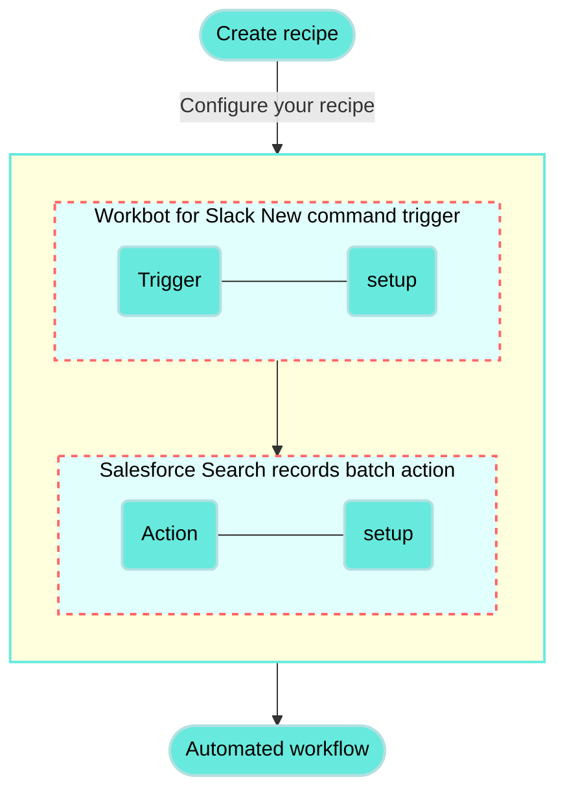

<!-- source: https://docs.workato.com/en/getting-started/use-cases/salesforce-workbot-slack | lastmod: 2026-07-07 -->
> Build a recipe that displays Salesforce account details in Slack with Workbot, surfacing customer info from a Slack command.

# Display Salesforce account details with Workbot for Slack recipe

This use case guides you through connecting [Salesforce](/en/connectors/salesforce) and [Workbot for Slack](/en/workbot/workbot#workbot-for-slack) to Workato to create a powerful automation.

## What does this recipe do?

This recipe enables Workbot for Slack to display Salesforce customer account details directly within Slack. This automation triggers when a specific command is entered into Slack, bringing critical customer information directly to where discussions are happening without the need to switch applications or disrupt your workflow.



## Create your recipe

Complete the following steps to create a recipe that displays Salesforce account details in Slack:

> **USE CASES ARE INTENDED AS EXAMPLES ONLY**
> 
> This use case serves as an example. Modifications to triggers, actions, or conditional logic may be necessary to adapt this recipe to your workflow.

1. Sign in to Workato.
   
2. Select the project where you plan to create the recipe.
   
3. Create connections for Salesforce and Workbot for Slack:
   
   Create a Salesforce connection.
   
   ### Create a Salesforce connection
   
   This step creates a connection between Workato and your Salesforce account.
   
   1. Click **Create > Connection** or press C twice.
      
   2. Search for and select `Salesforce` on the **New connection** page.
      
   3. Provide a name for your connection in the **Connection name** field.
      
      _Salesforce connection setup_
      
   4. Use the **Location** drop-down menu to select the project where you plan to store the connection.
      
   5. Use the **Auth type** drop-down menu to select the authentication method. The default is OAuth 2.0.
      
   6. Use the **Sandbox** drop-down menu to specify whether the Salesforce account is a sandbox account.
      
   7. Optional. Expand **Advanced settings** to configure advanced connection options.
      
   8. Optional. Use the **Custom OAuth profile** drop-down menu to select a custom OAuth profile for your connection.
      
      - This custom OAuth profile ensures that the connection is restricted to the same set of scopes you selected for all users with the profile, and the authentication flow uses the client app linked to the custom profile.
   9. Click **Connect**.
      
   10. Enter your Salesforce account credentials and click **Log In**.
       
       _Log in to your Salesforce account_
       
   
   Create a Workbot for Slack connection.
   
   ### Create a Workbot for Slack connection
   
   This step creates a connection between Workato and your Workbot for Slack account.
   
   1. Click **Create > Connection** or press C twice.
      
   2. Search for and select `Workbot for Slack` on the **New connection** page.
      
   3. Provide a name for your connection in the **Name** field.
      
      _Workbot for Slack connection setup_
      
   4. Use the **Location** drop-down menu to select the project where you plan to store the connection.
      
   5. Optional. Select the NLU provider you plan to use, such as DialogFlow or Amazon Lex NLU. You must connect to the NLU provider for it to appear in the drop-down menu.
      
   6. Optional. Click **Advanced** to configure **Slash commands verification tokens**, **custom help** content, your **Slack app status** (classic or not), and your **Custom OAuth profile**.
      
   7. Click **Connect**, sign in to your Slack workspace when prompted, and click **Continue** to verify the connection.
      
   
4. Go back to your project and click **Create > Recipe** or press C+R.
   
   _Create a new recipe_
   
5. Enter a name for your recipe in the **Name** field.
   
6. Select the project where you plan to store the recipe from the **Location** drop-down menu.
   
7. Click **Start building**.
   
   _Start building your recipe_
   
8. Click **Pick a starting point**, then select **Trigger from an app**.
   
9. Click **Select an app and trigger event**.
   
10. Set up your Workbot for Slack New command trigger.
    
    ### Set up Workbot for Slack New command trigger
    
    This trigger monitors Workbot for Slack for new commands.
    
    1. Search for `Workbot for Slack` and select it as your app.
       
       _Choose Workbot for Slack as your app_
       
    2. Select the **New command** trigger.
       
    3. Click **Save**.
       
    
11. Click **\+ Add step** and select **Action in app**.
    
    _Add action_
    
12. Set up your Salesforce Search records (Account) batch action.
    
    ### Set up Salesforce Search records (Account) batch action
    
    This step searches for Salesforce records by account name.
    
    1. Search for `Salesforce` and select it as your app.
       
       _Choose Salesforce_
       
    2. Select the **Search records (Account)** batch action.
       
    3. Select `Account` from the **Search for** drop-down menu and map the Workbot for Slack Name (Step 1) datapill into the **Account name** field.
       
       _Salesforce action configuration_
       
    
13. Click **\+ Add step** and select **IF condition**.
    
    How do IF conditions work?
    
    ### Salesforce and Workbot for Slack IF condition example
    
    An [IF condition](/en/features/if-conditions) enables you to make decisions based on specific conditions. You can control your recipe workflow by executing different actions depending on whether a condition you specify is present or not present (true or false).
    
    ```mermaid
    flowchart TD
        A([Search accounts in Salesforce]) --> B(Is the account present?)
        B -->|Yes| C(Return the account details in Slack.)
        B ---->|No| E(Return a message in Slack that the account is not present in Salesforce.)
        classDef default fill:#67eadd,stroke:#b3e0e1,stroke-width:2px,color:#000;
        classDef WorkatoPink fill:#f3c1c2,stroke:#f3c1c2,stroke-width:1px;
        class E WorkatoPink
    ```
    
14. Set up your Salesforce Account ID is not present IF condition.
    
    ### Set up a Salesforce Account ID is not present IF condition
    
    This step searches for Salesforce accounts by account ID and instructs the recipe on subsequent steps based on whether the account ID isn't present.
    
    1. Select **Account ID** under **Salesforce Search Accounts (Step 2 output)** to add the Account ID (Step 2) datapill to the **Data field**.
       
       _Configure IF condition is not present_
       
    2. Use the **Condition** drop-down menu to select `is not present`.
       
    3. Click **\+ Add step** in the **Yes** statement and select **Action in app**.
       
       _Select the app and action when the condition is met_
       
    4. Search for `Workbot for Slack` and select it as your app.
       
    5. Select the **Post command reply** action.
       
    6. Click **Add block to message** and select **Section with text** from the **Type** menu.
       
    7. Map the Workbot for Slack Name (Step 1) datapill to the **Section text** field.
       
    8. Map the Workbot for Slack Name (Step 1) datapill to the **Attachment text** field.
       
       _Configure your post reply message_
       
    9. Click **\+ Add step** under the **No** statement.
       
    10. Search for `Workbot for Slack` as your app.
        
    11. Select the **Post command reply** action.
        
        _Select the app and action when the condition is met_
        
    
15. Click **\+ Add step** and select **IF condition**.
    
16. Set up your Salesforce Account ID is present IF condition.
    
    This step searches for Salesforce accounts by account ID and instructs the recipe on subsequent steps based on whether the account ID is present.
    
    1. Map the Salesforce Account ID (Step 2) datapill into the **Data field** and enter `is present` in the **Condition** field.
       
       _Configure IF condition is present_
       
    2. Click **Add block to message** and select **Section with text** from the **Type** menu.
       
    3. Enter your message in the **Section text** field.
       
       _Configure the section text_
       
    4. Expand the **Divider** section and select **Divider** from the **Type** drop-down menu.
       
    5. Map the Account ID (Step 2) and Account Name (Step 2) datapills to the **Section text** field.
       
       _Configure the divider_
       
    6. Expand the **Attachment fields** section and add the account information you plan to display in your reply. For example, enter `Name` in the **Title** field and map the Account phone (Step 2) datapill into the **Value** field.
       
    7. Click **Save**.
       
    

Your **Display Salesforce account details with Workbot for Slack** recipe is ready to test and implement.

---
