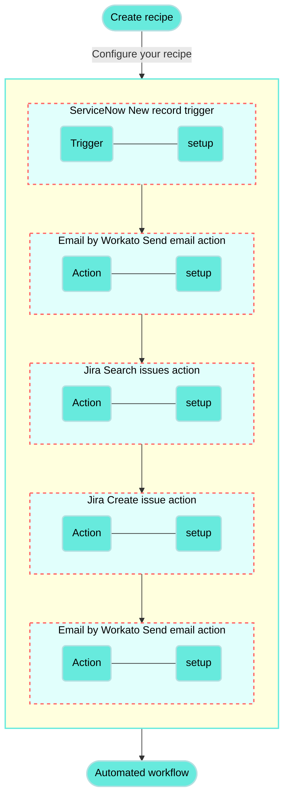
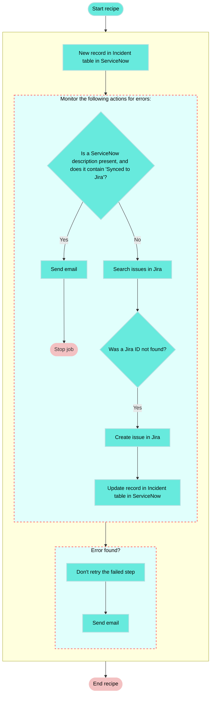

<!-- source: https://docs.workato.com/en/getting-started/use-cases/servicenow-jira | lastmod: 2026-07-07 -->
> Build a recipe that creates Jira issues from new ServiceNow incidents, checking for an existing issue before creating one.

# Create Jira issues for new ServiceNow incidents recipe

This use case guides you through connecting [ServiceNow](/en/connectors/servicenow) and [Jira](/en/connectors/jira) to create a powerful automation.

## What does this recipe do?

This recipe monitors ServiceNow for new incidents and creates a corresponding issue in Jira if an existing issue doesn't already exist.

## Recipe configuration

Recipes are automated workflows that connect your apps. Each recipe contains a trigger and one or more actions. The following diagram illustrates the trigger and action configuration required for this use case:



## Create your recipe

Complete the following steps to create a recipe that monitors ServiceNow for newly created incidents and creates a corresponding issue in Jira if an existing issue doesn't already exist:

> **USE CASES ARE INTENDED AS EXAMPLES ONLY**
> 
> This use case serves as an example. Modifications to triggers, actions, or conditional logic may be necessary to adapt this recipe to your workflow.

1. Sign in to Workato.
   
2. Select the project where you plan to create the recipe.
   
3. Create connections for ServiceNow and Jira:
   
   Create a ServiceNow connection.
   
   ### Create a ServiceNow connection
   
   This step creates a connection between Workato and your ServiceNow account.
   
   1. Click **Create > Connection** or press C twice.
      
   2. Search for and select `ServiceNow` on the **New connection** page.
      
   3. Enter a name for your ServiceNow connection in the **Connection name** field.
      
      _ServiceNow connection setup_
      
   4. Use the **Location** drop-down menu to select the project where you plan to store the connection.
      
   5. Use the **Authentication type** drop-down menu to select **Username/Password**.
      
   6. Enter your ServiceNow **Instance name**. For example, if your ServiceNow URL is `https://acme.service-now.com`, the instance name is `acme`.
      
   7. Enter your ServiceNow username in the **Username** field.
      
   8. Enter your ServiceNow password in the **Password** field.
      
   9. Click **Connect**.
      
   
   The ServiceNow connector also supports [OAuth 2.0](/en/connectors/servicenow#oauth-2-0) and [Password grant](/en/connectors/servicenow#password-grant) authentication methods.
   
   Create a Jira connection.
   
   ### Create a Jira connection
   
   This step creates a connection between Workato and your Jira account.
   
   1. Click **Create > Connection** or press C twice.
      
   2. Search for and select `Jira` on the **New connection** page.
      
   3. Enter a name for your Jira connection in the **Connection name** field.
      
      _Jira connection setup_
      
   4. Use the **Location** drop-down menu to select the project where you plan to store the connection.
      
   5. Select your **Connection type**.
      
   6. Use the **Auth type** drop-down menu to select your authentication method. Supported options include [Basic](/en/connectors/jira#basic-authentication-with-password), [API token](/en/connectors/jira#api-tokens), [OAuth 2.0](/en/connectors/jira#oauth2-0), and [Personal access token](/en/connectors/jira#personal-access-tokens).
      
   7. Provide your **Host name**. For example, if your Jira URL is `https://acme.atlassian.net`, your host name is `acme.atlassian.net`.
      
   8. Click **Connect**.
      
   
4. Go back to your project and click **Create > Recipe** or press C+R.
   
   _Create a new recipe_
   
5. Enter a name for your recipe in the **Name** field.
   
6. Select the project where you plan to store the recipe from the **Location** drop-down menu.
   
7. Click **Start building**.
   
   _Start building your recipe_
   
8. Click **Pick a starting point**, then select **Trigger from an app**.
   
9. Click **Select an app and trigger event**.
   
10. Set up your ServiceNow New record trigger.
    
    ### Set up ServiceNow New record trigger
    
    This trigger monitors ServiceNow for new incidents.
    
    1. Search for `ServiceNow` and select it as your app.
       
       _Choose ServiceNow_
       
    2. Select the **New record (real-time)** trigger.
       
       _Select the New record real-time trigger_
       
    3. Select the ServiceNow connection you created in the preceding steps.
       
    4. Use the **Table** drop-down menu to select **Incident**.
       
    5. Click **Save**.
       
    
11. Click **\+ Add step** and select **Handle errors**.
    
    _Click **Add step > Handle errors**_
    
    How does the Handle errors control statement work?
    
    The [Handle errors control statement](/en/recipes/steps#handle-errors-step) allows you to monitor your recipe for errors in actions, similar to the try/catch concept in programming languages. You have the opportunity to perform the following actions if an error occurs:
    
    - Retry the sequence of actions again, in case it was a temporary error such as network issues.
      
    - Take remedial actions, such as notifying users of the error through email or error messages in the app, or to carry out a rollback. For example, you can reverse the job by deleting any created or half-created records.
      
    
    This control statement consists of two blocks: the **Monitor** block and the **Error** block. Place the actions that you plan to monitor for errors within the **Monitor** block. If all actions are successful, Workato ignores the **Error** block. However, if any action in the **Monitor** block results in an error, the actions within the **Error** block are executed.
    
    ```mermaid
    graph TD
        A(Monitor action for errors) ---> B((Error found?))
        B --> C{Yes}
        B --> D{No}
        C --> E(Define how to <br/> handle the error)
        D --> F(Continue processing <br/> the recipe)
       classDef default fill:#67eadd,stroke:#67eadd,stroke-width:2px,color:#000;
    ```
    
12. Click the **•••** (ellipsis) next to the placeholder step (step 3) in the recipe editor and select **Delete**.
    
    _Delete the placeholder_
    
13. Click **\+ Add step** and select **IF condition**. Make sure to insert the IF condition after the **Monitor** block (step 2).
    
    _Click **Add step> IF condition**_
    
    How do IF conditions work?
    
    ### ServiceNow and Jira IF condition example
    
    An [IF condition](/en/features/if-conditions) enables you to make decisions based on specific conditions. You can control your recipe workflow by executing different actions depending on whether a condition you specify is true or false.
    
    ```mermaid
    flowchart TD
        A([New ServiceNow incident]) --> B(Does the incident description contain the string 'Synced to Jira'?)
        B -->|Yes| C(Send email stating the incident is already synced, and stop the job)
        B ---->|No| E(Search issues in Jira)

        classDef default fill:#67eadd,stroke:#b3e0e1,stroke-width:2px,color:#000;
    ```
    
14. Set up your ServiceNow description is present IF condition.
    
    ### Set up a ServiceNow description is present IF condition
    
    This step checks if the new ServiceNow incident has a description that indicates the incident has been synced to Jira.
    
    1. Map the ServiceNow Description (Step 1) datapill to **Data field**.
       
    2. Use the **Condition** drop-down menu to select **is present**.
       
    3. Click **+** (plus) and select **AND** to add a second condition.
       
    4. Map the ServiceNow Description (Step 1) datapill to **Data field**.
       
    5. Use the **Condition** drop-down menu to select **contains**.
       
    6. Enter `Synced to Jira` in the **Value** field.
       
       _Configure the IF condition_
       
    7. Click **Save**.
       
    
15. Click **Select an app and action**.
    
16. Set up your Email by Workato Send email action.
    
    ### Set up Email by Workato Send email action
    
    This step sends an email to a specified recipient communicating that this ServiceNow incident is already synced to Jira.
    
    1. Search for `Email by Workato` and select it as your app. The **Send email** action is selected automatically.
       
       _Choose Email by Workato_
       
    2. Enter the recipient's email address in the **To** field. If you’re sending the email to multiple recipients, separate their addresses with commas.
       
    3. Enter the following subject in the **Subject** field:
       
       `New incident in ServiceNow creates issue in Jira - Already synced`
       
    4. Use the **Email type** drop-down menu to select **Text**.
       
    5. Enter the following message in the **Message** field:
       
       ```plaintext
       The job is synced from Jira to ServiceNow.
       Recipe ID:
       Job ID:
       Job URL:
       ```
       
    6. Map the Recipe ID (Properties), Job ID (Properties), and Job URL (Properties) datapills to their corresponding labels in the **Message** field.
       
       _Map datapills to the Message field_
       
    7. Click **Save**.
       
    
17. Click **\+ Add step** and select **Stop job**. Place this step immediately after the **Send email via Workato** action (step 4), ensuring it is within the steps executed when the IF condition evaluates to true.
    
    _Click **Add step > Stop job**_
    
    How does the Stop control statement work?
    
    ### Stop control statement example
    
    The [Stop control statement](/en/recipes/steps#stop-step) stops a single job from being processed further. Stop control statements are usually used in cases when there is an error in the business logic and further job processing is not required.
    
    The Stop statement can be configured to mark the job as failed or successful.
    
    ```mermaid
    flowchart TD
        B(Is the statement true?)
        B -->|Yes| C(An email notification is sent, the job is stopped, and the job is marked as successful)
        B ---->|No| E(The job is stopped)
        classDef default fill:#67eadd,stroke:#b3e0e1,stroke-width:2px,color:#000;
    ```
    
18. Set up your ServiceNow and Jira Stop control statement.
    
    ### Set up a ServiceNow and Jira Stop control statement
    
    This step stops the job and marks it as successful if the ServiceNow incident has already been synced with Jira.
    
    1. Use the **In job report, mark stopped job as** drop-down menu to select **Successful**.
       
    
19. Click **\+ Add step** and select **Action in app**. Place this step within the steps executed when the IF condition evaluates to false.
    
    _Click **Add step > Action in app**_
    
20. Set up your Jira Search issues batch action.
    
    ### Set up Jira Search issues batch action
    
    This step searches for Jira issues that use the specific naming pattern corresponding to a ServiceNow incident.
    
    1. Search for `Jira` and select it as your app.
       
       _Choose Jira_
       
    2. Select the **Search issues (batch)** action.
       
       _Select the Search issues batch action_
       
    3. Switch the **Summary** field to [formula mode](/en/formulas/formula-mode).
       
    4. Map the ServiceNow Number (Step 1) datapill.
       
    5. Enter `+ " - " +` to add a hyphen.
       
    6. Map the ServiceNow Short description (Step 1) datapill.
       
       _Configure the Summary field_
       
    7. Click **Save**.
       
    
21. Click **\+ Add step** and select **IF condition**.
    
    _IF condition_
    
22. Set up your Jira ID IF condition.
    
    ### Set up a Jira ID IF condition
    
    This step checks whether the result of the search returned a matching Jira issue.
    
    1. Map the Jira ID (Step 6) datapill to **Data field**.
       
    2. Use the **Condition** drop-down menu to select **is not present**.
       
       _Configure the second IF condition_
       
    3. Click **Save**.
       
    
23. Click **Select an app and action**.
    
24. Set up your Jira Create issue action.
    
    ### Set up Jira Create issue action
    
    This step creates a Jira issue that corresponds to the ServiceNow incident.
    
    1. Search for `Jira` and select it as your app.
       
       _Choose Jira_
       
    2. Select the **Create issue** action.
       
       _Select the Create issue action_
       
    3. Use the **Project issue type** drop-down menu to specify the Jira issue type. For example, **Bug**. The options in this drop-down menu depend on the issue types configured in your Jira project.
       
    4. Switch the **Summary** field to [formula mode](/en/formulas/formula-mode).
       
    5. Map the ServiceNow Number (Step 1) datapill.
       
    6. Enter `+ " - " +` to add a hyphen.
       
    7. Map the ServiceNow Short description (Step 1) datapill.
       
       _Configure the Summary field_
       
    8. Switch the **Description** field to [formula mode](/en/formulas/formula-mode).
       
    9. Map the ServiceNow Description (Step 1) datapill.
       
    10. Enter `+ "\n" + "Synced to Jira"`.
        
        _Configure the Description field_
        
    11. Switch the **Priority name** field to [formula mode](/en/formulas/formula-mode) and enter the following:
        
        ```plaintext
        { "5" => "Lowest", "4" => "Low", "3" => "Medium", "2" => "High", "1" => "Highest" }  [ PRIORITY_DP ]
        ```
        
        Replace `PRIORITY_DP` with the ServiceNow Priority (Step 1) datapill.
        
        _Configure the Priority name field_
        
    12. Map the ServiceNow Due date (Step 1) datapill to the **Due date** field.
        
    13. Click **Save**.
        
    
25. Click **\+ Add step** and select **Action in app**. Place this step immediately after the **Create issue** action (step 8), ensuring it is within the steps executed when the IF condition evaluates to true.
    
26. Set up your ServiceNow Update record action.
    
    ### Set up ServiceNow Update record action
    
    This step updates the ServiceNow incident record to confirm that the record is synced with Jira and adds the Jira issue ID to the work notes.
    
    1. Search for `ServiceNow` and select it as your app.
       
       _Choose ServiceNow_
       
    2. Select the **Update record** action.
       
       _Select the Update record action_
       
    3. Use the **Table** drop-down menu to select **Incident**.
       
    4. Map the ServiceNow Sys ID (Step 1) datapill to the **Sys ID** field.
       
    5. Expand **Update record values** and map the ServiceNow Description (Step 1) datapill to the **Description field**.
       
    6. Switch the **Work notes** field to [formula mode](/en/formulas/formula-mode).
       
    7. Map the ServiceNow Work notes (Step 1) datapill.
       
    8. Enter `+ "\n" + " Synced to Jira" + "\n" + " Jira ID: " +`.
       
    9. Map the Jira ID (Step 8) datapill.
       
       _Configure the Update record values field_
       
    10. Click **Save**.
        
    
27. Locate the **Error found?** block, and click **Select an app and action** (step 11).
    
    _Click Select an app and action_
    
28. Set up your second Email by Workato Send email action.
    
    ### Set up a second Email by Workato Send email action
    
    This step sends a failed job notification email to a specified recipient.
    
    1. Search for `Email by Workato` and select it as your app. The **Send email** action is selected automatically.
       
       _Choose Email by Workato_
       
    2. Enter the recipient's email address in the **To** field. If you’re sending the email to multiple recipients, separate the email addresses with commas.
       
    3. Enter the following subject in the **Subject** field:
       
       `New incident in ServiceNow creates issue in Jira - Failed`
       
    4. Use the **Email type** drop-down menu to select **Text**.
       
    5. Enter the following message in the **Message** field:
       
       ```plaintext
       Recipe URL:
       Job ID:
       Job URL:
       Recipe failed:
       ```
       
    6. Map the Recipe ID (Properties), Job ID (Properties), Job URL (Properties), and Error message (Step 10) datapills to the corresponding labels in the **Message** field.
       
       _Configure the Message field_
       
    7. Click **Save**.
       
    

Your **Create Jira issues for new ServiceNow incidents** recipe is ready to test and implement.

Example recipe configuration.

_**Create Jira issues for new ServiceNow incidents** recipe_



---
