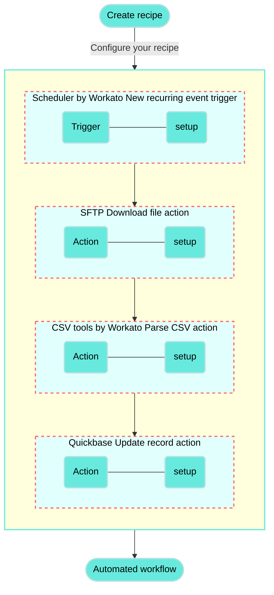

<!-- source: https://docs.workato.com/en/getting-started/use-cases/sftp-csv-by-workato-quickbase | lastmod: 2026-10-28 -->
> Build a recipe that fetches a CSV file from SFTP, parses it with CSV tools by Workato, and updates records in a Quickbase table.

# Update Quickbase records from SFTP CSV files recipe

This use case guides you through connecting [SFTP](/en/connectors/sftp), [CSV tools by Workato](/en/features/handling-csv-files#csv-by-workato), and [Quickbase](/en/connectors/quickbase) to create a powerful automation.

## What does this recipe do?

This recipe fetches a CSV file from an SFTP server, parses the file content, and updates the corresponding records in a Quickbase table.



## How can I use this recipe?

This recipe can be applied in various ways to automate workflows, including but not limited to the following use cases:

- **Inventory tracking**: Regularly fetch inventory updates from a supplier’s SFTP server, allowing you to maintain accurate stock levels in your Quickbase database.
- **Sales data management**: Automate the import of daily sales reports from an SFTP server, ensuring that your Quickbase records are automatically up to date with the latest sales figures.
- **Order processing**: Regularly download order details from an SFTP server and update your order management system in Quickbase. This helps in streamlining order fulfillment and tracking.
- **Customer information updates**: Automatically update customer records based on new data received in a CSV file, ensuring that your team has the most current information at their fingertips.

## Create your recipe

Complete the following steps to create a recipe that fetches a CSV file from an SFTP server, parses its content, and updates records in a Quickbase table:

> **USE CASES ARE INTENDED AS EXAMPLES ONLY**
> 
> This use case serves as an example. Modifications to triggers, actions, or conditional logic may be necessary to adapt this recipe to your workflow.

1. Sign in to Workato.
   
2. Select the project where you plan to create the recipe.
   
3. Create connections for SFTP and Quickbase.
   
   > **WORKATO UTILITY CONNECTORS DON'T REQUIRE SETUP**
   > 
   > The CSV tools by Workato connector doesn't require connection setup.
   
   Create a SFTP connection.
   
   ### Create a SFTP connection
   
   This step creates an SFTP connection for your recipe.
   
   #### Using SSH keys for SFTP authentication
   
   SFTP is built on the Secure Shell Protocol (SSH), which enables you to use SSH keys in your authentication flow. SSH keys can be used with a user ID and password or independently to authenticate Workato with your SFTP server. This enhances the security of your connection by using SSH encryption for your public and private keys.
   
   #### Connection setup
   
   Complete the following steps to set up your SFTP connection:
   
   1. Click **Create > Connection** or press C twice.
      
   2. Search for and select `SFTP` on the **New connection** page.
      
   3. Provide a name for your connection in the **Connection name** field.
      
      _SFTP connection setup_
      
   4. Use the **Location** drop-down menu to select the project where you plan to store the connection.
      
   5. Use the **Connection type** drop-down menu to select the connection method you plan to use. You can select your [on-prem group](/en/on-prem/groups) name or select **Cloud** to use a direct connection.
      
   6. Select the authentication method in the **Auth type** field. Available options include the following:
      
      - **Username/password**
      - **Public/private key pair**
      - **Public/private key pair and password**
   7. Enter the username for the SFTP server you plan to connect to in the **Username** field.
      
   8. Provide additional authentication information based on your selection from the **Auth type** field:
      
      - **Username/password or Public/private key pair and password authentication**: Enter the password associated with the SFTP server username in the **Password** field.
        
      - **Public/private key or Public/private key pair and password authentication**: Enter the SSH private key for the SFTP server in the **Private key** field. The private key must be in [OpenSSH format](http://www.openssh.org/). Specify `SecureShellPrivateKeyFormat.NewOpenSecureShell` as the format parameter when saving the key. Refer to the [Private key example format](/en/connectors/sftp#private-key-example-format) section for more information.
        
   9. Enter your SFTP server address in the **Hostname** field.
      
   10. Enter the port for the SFTP server in the **Port** field. The default port for SFTP is `22`.
       
   11. Optional. Enter the hash of the SSH public key in the **Host key fingerprint** field. Workato supports SHA256 and MD5 encryption. For on-premise connections, contact your SFTP server administrator to obtain the public key in Base64 format.
       
   12. Optional. Enter the size of the buffer used for file transfers in the **Transfer buffer size** field.
       
   13. Optional. Specify whether the SSH connection should be closed at the end of each transaction in the **Force close** field. Toggle this option if your SFTP server connection becomes unresponsive. Otherwise, leave it blank.
       
   14. Optional. Set the SFTP protocol version to use in the **Explicit version** field.
       
   15. Use the **Append operations supported?** drop-down menu to specify whether your SFTP provider supports append or modify operations. The default setting is **Yes**.
       
   16. Click **Connect**.
       
   
   Create a Quickbase connection.
   
   ### Create a Quickbase connection
   
   This step creates a connection between Workato and your Quickbase account.
   
   Workato supports the following authentication methods for connecting to Quickbase:
   
   - [Create a Quickbase connection](#create-a-quickbase-connection)
   - [User-token authentication](#user-token-authentication)
   - [Username and password authentication](#username-and-password-authentication)
   
   ### User-token authentication
   
   1. Click **Create > Connection** or press C twice.
      
   2. Search for and select `Quickbase` on the **New connection** page.
      
   3. Provide a unique **Connection name** that identifies the Quickbase instance to which it is connected.
      
   4. Use the **Location** drop-down menu to select the project where you plan to store the connection.
      
   5. Enter your **Quickbase subdomain**. This is most often your company name.
      
   6. Use the **User-token authentication?** drop-down menu to select **Yes**.
      
   7. Provide your **User token**. Refer to the [Generate a user token](/en/connectors/quickbase#generate-user-token) section for more information.
      
   8. Click **Connect**.
      
   
   ### Username and password authentication
   
   1. Click **Create > Connection** or press C twice.
      
   2. Search for and select `Quickbase` on the **New connection** page.
      
   3. Provide a unique **Connection name** that identifies the Quickbase instance you plan to use.
      
      _Set up your Quickbase connection with a username and password_
      
   4. Use the **Location** drop-down menu to select the project where you plan to store the connection.
      
   5. Enter your **Quickbase subdomain**. This is most often your company name.
      
   6. Use the **User-token authentication?** drop-down menu to select **No**.
      
   7. Provide your Quickbase **username** and **password**.
      
   8. Click **Connect**.
      
   
4. Go back to your project and click **Create > Recipe** or press C+R.
   
   _Create a new recipe_
   
5. Enter a name for your recipe in the **Name** field.
   
6. Use the **Location** drop-down menu to select the project where you plan to store the recipe.
   
7. Click **Start building**.
   
   _Start building your recipe_
   
8. Click **Pick a starting point**, then select **Run on a schedule**. This creates a new recipe with the Scheduler by Workato [New recurring event trigger](/en/features/scheduler/triggers/new-recurring-event). This trigger doesn't require a connection.
   
9. Set up your Scheduler by Workato New recurring event trigger.
   
   ### Set up Scheduler by Workato New recurring event trigger
   
   This step sets the interval or custom schedule for how frequently this recipe should run.
   
   1. Click the trigger in the recipe editor.
      
      _Click the trigger_
      
   2. Choose an interval or custom schedule in the **Time unit** field. Available options include **Minutes**, **Hours**, **Days**, **Weeks**, **Months**, or **Custom schedule**.
      
   3. Specify how frequently this trigger should run. The field you configure depends on your selection in the **Time unit** field:
      
      - **If Custom schedule is not selected**: Define the repeat schedule in the **Trigger every** field. Enter whole numbers only. The minimum value accepted is five minutes.
        
      - **If Custom schedule is selected**: Enter the **Cron expression** in the following format:
        
        ```text
        [minute] [hour] [day of month] [month] [day of week]
        ```
        
   4. Optional. Select the timezone in the **Timezone** field. If left blank, **America/Los\_Angeles** is used.
      
   5. Optional. Set the start date and time in the **Start after** field, or leave the field blank to activate the trigger immediately after starting the recipe. You can't change this value after you run or test the recipe.
      
   6. Click **Save**.
      
   
10. Click **\+ Add step** and select **Action in app**.
    
    _Click **Add step > Add action in app**_
    
11. Set up your SFTP Download file action.
    
    ### Set up SFTP Download file action
    
    This action retrieves the contents of a CSV file from your SFTP server.
    
    1. Search for `SFTP` and select it as your app.
       
       _Choose SFTP as your app_
       
    2. Select the **Download file** action.
       
       _Select the Download file action_
       
    3. Select the SFTP connection you created in the preceding steps.
       
    4. Enter the full path of the CSV file, including the file extension, in the **File path** field. For example, if your file is located at `/sftp/Customer_orders.csv`, enter this value in the field.
       
    5. Optional. Choose the encoding value to set it explicitly in the **Encoding** drop-down menu.
       
    6. Optional. Use the **Download file in one go** drop-down menu to determine whether the file should be downloaded in one go if your SFTP server doesn't support multi-part downloads. The maximum size supported is 200 MB. The default value is set to **No**. Don't select this option for larger file downloads.
       
    7. Click **Save**.
       
    
12. Click **\+ Add step** and select **Action in app**.
    
13. Set up your CSV tools by Workato Parse CSV action.
    
    ### Set up CSV tools by Workato Parse CSV action
    
    This action maps the file contents from the previous step (a CSV-formatted string) and parses the content into an array of lines. This action can convert up to 50,000 lines.
    
    1. Search for **CSV tools by Workato** and select it as your app.
       
       _Choose CSV tools by Workato_
       
    2. Select the **Parse CSV** action.
       
       _Select the Parse CSV action_
       
    3. Map the File contents (Step 2) datapill to the **CSV contents** field.
       
       _Map the File contents (Step 2) datapill_
       
    4. Go to the **Column delimiter** field to select a separator or enter a custom character to define how columns are separated in the CSV contents.
       
       Available options include **comma**, **space**, **tab**, **colon**, **semicolon**, and **pipe**.
       
    5. Use the **CSV contents contain header line?** drop-down menu to specify whether the CSV contains a header line that should be excluded from parsing.
       
    6. Describe the CSV columns in the **Header schema**. You can either upload a sample CSV file to input all column names at once or manually add column names by clicking **Add column name**.
       
       This example uses the following schema:
       
       ```csv
       Order ID,Customer Name,Customer Email,Product SKU,Product Name,Quantity Ordered,Order Status,Shipping Address,Order Total,Order Date
       ```
       
    7. Optional. Specify how Workato should keep track of columns in the **Keep track of columns by** field. You can select **Column order** or **Column name**. Configure this field if your expected CSV contents have varying column order or names.
       
    8. Optional. Specify the character used to quote CSV cell values in the **Quote character** field. Available options include **Double quote**, **Single quote**, and **None**. Choose **None** if no quote character is used.
       
    9. Optional. Specify the encoding of the file in the **Encoding of the file content** field. By default, encoding is set to **UTF-8**.
       
    10. Click **Save**.
        
    
14. Click **\+ Add step** and select **Repeat for each**.
    
    _Click **Add step > Repeat for each**_
    
    How does the Repeat for each condition work?
    
    ### CSV and Quickbase repeat for each condition example
    
    A [Repeat for each](/en/recipes/repeat-for-each) loop _repeats_ one or more actions _for each_ item in a list. The loop ends automatically when the entire list is processed.
    
    ```mermaid
    flowchart TD
      A(["Start"]) --> B("Is there another line from the parsed CSV to process?")
      B -- "Yes" --> C("Update record in Quickbase")
      B -- "No" --> D(["End loop"])
      C --> B

    classDef default fill:#67eadd,stroke:#b3e0e1,stroke-width:2px,color:#000;
    classDef WorkatoPink fill:#f3c1c2,stroke:#f3c1c2,stroke-width:1px;
    class A,D WorkatoPink
    ```
    
15. Set up your CSV and Quickbase repeat for each loop.
    
    ### Set up a CSV and Quickbase repeat for each loop
    
    This step processes each line in the CSV file through a **Repeat for each** loop. After configuring the loop, you will define the action to take for each line. This recipe update records in a Quickbase table.
    
    1. Map the Lines (Step 3) datapill to the **Input list** field.
       
       _Map the Lines (Step 3) datapill_
       
    2. Ensure **One item at a time** is selected in the **Repeat mode** field.
       
    3. Ensure that **No** is selected in the **Clear step output** field.
       
    4. Click **Save**.
       
    
16. Set up your Quickbase Update record action.
    
    ### Set up Quickbase Update record action
    
    This step runs inside the **Repeat for each** loop. This action updates the corresponding record in the Quickbase table for each processed line from the parsed CSV file.
    
    1. Click **Select an app and action**.
       
    2. Search for `Quickbase` and select it as your app.
       
       _Choose Quickbase as your app_
       
    3. Select the **Update record** action.
       
       _Select the Update record action_
       
    4. Select the Quickbase connection you created in the preceding steps.
       
    5. Select an application from your Quickbase account in the **Application** drop-down menu.
       
    6. Provide the **Application token** if the app is configured to require a token for data access.
       
       Refer to the [Quickbase documentation](https://helpv2.quickbase.com/hc/en-us/articles/4570313549972-App-tokens) to learn how to retrieve your app token.
       
    7. Select a table from the list or enter the table ID in the **Table/Table ID** field.
       
    8. Use the **Record ID** field to specify the identifier or primary key of the record to be modified.
       
    9. Use the **Table field list** drop-down menu to select the table fields you plan to update. Workato supports a maximum of 150 fields from a Quickbase table.
       
    10. Map the datapills from the **Foreach (Step 4 output)** datatree to their respective fields. For example, map the Customer Name (Step 4) datapill to the **Customer Name** field, and the Customer Email (Step 4) datapill to the **Customer Email** field.
        
        _Map Repeat for each loop output_
        
    11. Click **Save**.
        
    

Your **Update Quickbase records from SFTP CSV files** recipe is ready to test and implement.

---
