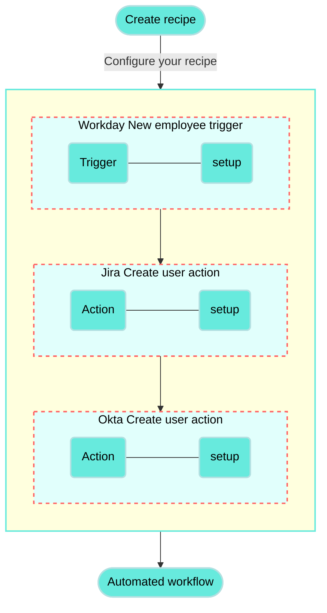

<!-- source: https://docs.workato.com/en/getting-started/use-cases/workday-jira-okta | lastmod: 2026-07-07 -->
> Build a recipe that provisions Jira and Okta users automatically when a new employee is added in Workday.

# Provision Jira and Okta users for new employees in Workday recipe

This use case guides you through connecting [Workday](/en/connectors/workday), [Jira](/en/connectors/jira), and [Okta](/en/connectors/okta) to Workato to create a multi-application automation.

## What does this recipe do?

This recipe monitors Workday for new employees. The recipe creates a new user in Jira and Okta when a new employee is detected in Workday.



## Create your recipe

Complete the following steps to create a recipe that monitors Workday for new employees. When activity is detected, it creates a new user in Jira and a new user in Okta:

> **USE CASES ARE INTENDED AS EXAMPLES ONLY**
> 
> This use case serves as an example. Modifications to triggers, actions, or conditional logic may be necessary to adapt this recipe to your workflow.

1. Sign in to Workato.
   
2. Select the project where you plan to create the recipe.
   
3. Create connections for Workday, Jira, and Okta:
   
   Create a Workday connection.
   
   ### Create a Workday connection
   
   This step creates a connection between Workato and your Workday account.
   
   #### Before connecting to Workday
   
   Before integrating with Workday using third-party services like Workato, we recommend using an [Integration System User (ISU)](/en/connectors/workday#register-integration-system-user-isu-in-workday). Using an ISU ensures that all integration operations are logged under a designated user, separate from regular workflow processes. This is essential as changes to a regular worker’s security profile or their termination could disrupt integrations reliant on their account. For enhanced security, limit each ISU to a single integration system, such as Workato.
   
   Additionally, if your integration involves **custom objects** in Workday, you must register a Workday [API client](/en/connectors/workday#register-a-new-api-client-for-integrations). This step is required as the Workday REST API requires authentication through an OAuth client setup.
   
   #### Authentication requirements
   
   The Workday connector supports both OAuth 2.0 and basic authentication methods. However, OAuth 2.0 authentication is required for working with the Workday REST API and custom objects. We recommend that you avoid using the deprecated **Hybrid** authentication method.
   
   #### Connection setup using OAuth 2.0 authentication
   
   Complete the following steps to configure your Workday connection in Workato using OAuth 2.0 authentication:
   
   1. Enter a unique **Connection name** to identify your Workday account in Workato.
      
      _Label your connection_
      
   2. Choose **OAuth 2.0** as the **Authentication type**. This method is required for working with custom objects and for querying data using Workday Query Language (WQL) with the Workday REST API.
      
   3. Select the **Workday web services version** appropriate for your Workday tenant. We recommend choosing the newest version available for access to the latest features and updates.
      
   4. Locate and enter your **Tenant ID** from the URL when logged into Workday. For example, in `https://impl.workday.com/sample_company/d/home.htmld`, the tenant ID is `sample_company`.
      
   5. Provide the **WSDL URL** associated with your Workday services.
      
   6. Enter the **Client ID** and **Client Secret** from your API client settings.
      
   7. Optional. Input your **Refresh token** if you are using an API client for integrations.
      
   8. Enter your **Authorization endpoint** and **Token endpoint** from your API Client settings to complete the OAuth flow.
      
   9. Select the **Workday tenant timezone** that matches your Workday tenant's settings. By default, Workday uses Pacific Standard Time (PST).
      
   10. Optional. Click **Advanced settings** to configure the **Advanced XML payload for multiple ID values** field.
       
       Workato wraps each value in fields with multiple values within individual containers when constructing the XML from your input by default.
       
       For example:
       
       ```xml
       <languages><language>english</language></languages><languages><language>chinese</language></languages>
       ```
       
       Set the value to **Yes** to allow Workato to unwrap and present the values in a single container:
       
       ```xml
       <languages><language>english</language><language>chinese</language></languages>
       ```
       
       Consider setting this field to **Yes** if you encounter invalid payload errors.
       
   11. Review the information you entered to ensure it's correct.
       
   12. Click **Connect** to initiate the authorization process and complete the connection setup.
       
   
   #### Connection setup using basic authentication
   
   Complete the following steps to set up your Workday connection in Workato with basic authentication:
   
   1. Enter a unique **Connection name** to identify your Workday account in Workato.
      
      _Label your connection_
      
   2. Select **Basic** as the **Authentication type**. This method uses your Workday username and password for integration.
      
   3. Select the **Workday web services version** appropriate for your Workday tenant. We recommend choosing the newest version available to access the latest features and updates.
      
   4. Locate and enter your **Tenant ID** from the URL when logged into Workday. For example, if your URL is `https://impl.workday.com/sample_company/d/home.htmld`, the tenant ID is `sample_company`.
      
   5. Provide the **WSDL URL** associated with your Workday services.
      
   6. Input your Workday **Login name** and **Password**.
      
   7. Select your **Workday tenant timezone** that matches your Workday tenant's settings. By default, Workday uses Pacific Standard Time (PST).
      
   8. Click **Advanced settings** to configure the **Advanced XML payload for multiple ID values** field. By default, fields with multiple values are wrapped within a container. Set this option to `yes` to unwrap the values.
      
   9. Review the information you entered to ensure it's correct.
      
   10. Click **Connect** to initiate the authorization process and complete the connection setup.
       
   
   Create a Jira connection.
   
   ### Create a Jira connection
   
   This step creates a connection between Workato and your Jira account.
   
   1. Click **Create > Connection** or press C twice.
      
   2. Search for and select `Jira` on the **New connection** page.
      
   3. Enter a name for your Jira connection in the **Connection name** field.
      
      _Jira connection setup_
      
   4. Use the **Location** drop-down menu to select the project where you plan to store the connection.
      
   5. Select your **Connection type**.
      
   6. Use the **Auth type** drop-down menu to select your authentication method. Supported options include [Basic](/en/connectors/jira#basic-authentication-with-password), [API token](/en/connectors/jira#api-tokens), [OAuth 2.0](/en/connectors/jira#oauth2-0), and [Personal access token](/en/connectors/jira#personal-access-tokens).
      
   7. Provide your **Host name**. For example, if your Jira URL is `https://acme.atlassian.net`, your host name is `acme.atlassian.net`.
      
   8. Click **Connect**.
      
   
   Create an Okta connection.
   
   ### Create an Okta connection
   
   This step creates a connection between Workato and your Okta account.
   
   1. Search for and select `Okta` on the **New connection** page.
      
      _Select Okta as your app_
      
   2. Provide a name for your connection in the **Connection name** field.
      
      _Okta connection setup_
      
   3. Use the **Location** drop-down menu to select the project where you plan to store the connection.
      
   4. Select the **Authentication type** you plan to use for your connection. Options are [Authorization code grant](/en/connectors/okta#authentication-auth-code), [Client credentials](/en/connectors/okta#authentication-client-credentials), and [API key](/en/connectors/okta#authentication-api-key).
      
   5. Provide your **Okta domain**. You can find it in your Okta URL (for example, `mycompany.okta.com` or `mytest.oktapreview.com`).
      
   6. Fill in other fields as required by your selected authentication method.
      
   7. Click **Connect**.
      
   
4. Go back to your project and click **Create > Recipe** or press C+R.
   
   _Create a new recipe_
   
5. Enter a name for your recipe in the **Name** field.
   
6. Select the project where you plan to store the recipe from the **Location** drop-down menu.
   
7. Click **Start building**.
   
   _Start building your recipe_
   
8. Click **Pick a starting point**, then select **Trigger from an app**.
   
9. Click **Select an app and trigger event**.
   
10. Set up your Workday New business object trigger.
    
    ### Set up Workday New business object trigger
    
    This trigger monitors your Workday account for New business objects.
    
    1. Search for `Workday` and select it as your app.
       
       _Select Workday as your app_
       
    2. Select the **New/updated business object** trigger.
       
       _Select the New/updated business object trigger_
       
    3. Use the calendar modal to select the date from which your recipe should begin to monitor events in the **When first started, this recipe should pick up events from** field. Refer to [Triggers](/en/recipes/triggers#since-from) to learn more about this input field.
       
       _Set up your trigger_
       
    4. Use the **Business object** drop-down menu to select the object you plan to monitor for changes. For example, workers or employees.
       
    5. Click **Save**.
       
    
11. Click **\+ Add step** and select **Action in app**.
    
    _Click **Add step > Add action in app**_
    
12. Set up your Jira Create user action.
    
    ### Set up Jira Create user action
    
    This step creates a new user in Jira using with the corresponding Workday email and name.
    
    1. Search for `Jira` and select it as your app.
       
       _Choose Jira as your app_
       
    2. Select the **Create user** action.
       
       _Select Create user_
       
    3. Map the Workday Email address (Step 1) datapill into the **Email address** field.
       
       _Set up Create user_
       
    4. Map the Workday Worker\_Reference(Employee ID) (Step 1) datapill into the **Display name** field.
       
    5. Use the **Products** drop-down menu to select the products for which you plan to grant access to the user.
       
    6. Click **Save**.
       
    
13. Click **\+ Add step** and select **Action in app**.
    
14. Set up your Okta Create user action.
    
    ### Set up Okta Create user action
    
    This step creates a new user in Okta using with the corresponding Workday email and name.
    
    1. Search for `Okta` and select it as your app.
       
    2. Select the **Create user** action.
       
       _Select the Create user action_
       
    3. Map the Workday First name (Step 1) datapill into the **First name** field.
       
    4. Map the Workday Last name (Step 1) datapill into the **Last name** field.
       
       _Map the datapills for your action_
       
    5. Map the Workday Email address (Step 1) datapill to the **Primary email ID** field.
       
    6. Map the Workday Email address (Step 1) datapill to the **Username** field. The **Username** field must contain an email address.
       
    7. Click **Save**.
       
    

Your **Provision Jira and Okta users for new employees in Workday** recipe is ready to test and implement.

---
