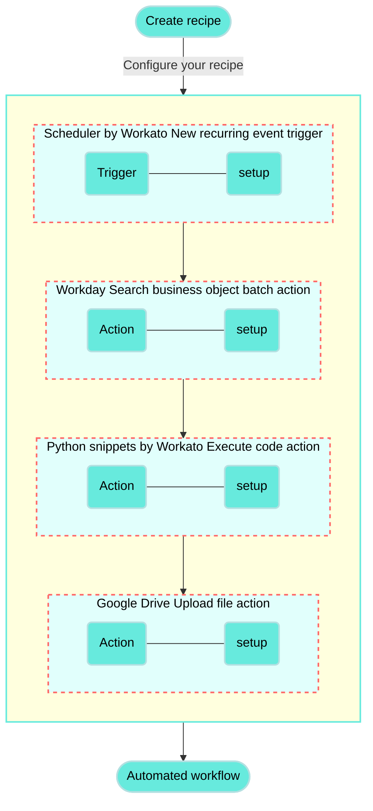

<!-- source: https://docs.workato.com/en/getting-started/use-cases/workday-python-google-drive | lastmod: 2026-07-07 -->
> Build a recipe that exports Workday workers to CSV using Python snippets by Workato and uploads the file to Google Drive.

# Export Workday workers to CSV with Python and upload to Google Drive recipe

This use case guides you through connecting [Workday](/en/connectors/workday), [Python snippets by Workato](/en/connectors/python), and [Google Drive](/en/connectors/google-drive) to create a powerful automation.

## What does this recipe do?

This recipe performs a daily search for workers in Workday, converts the output data from JSON to CSV format using Python, and uploads the resulting CSV file to Google Drive.



## Create your recipe

Complete the following steps to create a recipe that searches for workers in Workday, converts the output JSON data into CSV format using Python, and uploads the CSV file to Google Drive:

> **USE CASES ARE INTENDED AS EXAMPLES ONLY**
> 
> This use case serves as an example. Modifications to triggers, actions, or conditional logic may be necessary to adapt this recipe to your workflow.

1. Sign in to Workato.
   
2. Select the project where you plan to create the recipe.
   
3. Create connections for Workday and Google Drive:
   
   > **WORKATO UTILITY CONNECTORS DON'T REQUIRE SETUP**
   > 
   > The Python snippets by Workato connector does not require connection setup.
   
   Create a Workday connection.
   
   ### Create a Workday connection
   
   This step creates a connection between Workato and your Workday account.
   
   #### Before connecting to Workday
   
   Before integrating with Workday using third-party services like Workato, we recommend using an [Integration System User (ISU)](/en/connectors/workday#register-integration-system-user-isu-in-workday). Using an ISU ensures that all integration operations are logged under a designated user, separate from regular workflow processes. This is essential as changes to a regular worker’s security profile or their termination could disrupt integrations reliant on their account. For enhanced security, limit each ISU to a single integration system, such as Workato.
   
   Additionally, if your integration involves **custom objects** in Workday, you must register a Workday [API client](/en/connectors/workday#register-a-new-api-client-for-integrations). This step is required as the Workday REST API requires authentication through an OAuth client setup.
   
   #### Authentication requirements
   
   The Workday connector supports both OAuth 2.0 and basic authentication methods. However, OAuth 2.0 authentication is required for working with the Workday REST API and custom objects. We recommend that you avoid using the deprecated **Hybrid** authentication method.
   
   #### Connection setup using OAuth 2.0 authentication
   
   Complete the following steps to configure your Workday connection in Workato using OAuth 2.0 authentication:
   
   1. Enter a unique **Connection name** to identify your Workday account in Workato.
      
      _Label your connection_
      
   2. Choose **OAuth 2.0** as the **Authentication type**. This method is required for working with custom objects and for querying data using Workday Query Language (WQL) with the Workday REST API.
      
   3. Select the **Workday web services version** appropriate for your Workday tenant. We recommend choosing the newest version available for access to the latest features and updates.
      
   4. Locate and enter your **Tenant ID** from the URL when logged into Workday. For example, in `https://impl.workday.com/sample_company/d/home.htmld`, the tenant ID is `sample_company`.
      
   5. Provide the **WSDL URL** associated with your Workday services.
      
   6. Enter the **Client ID** and **Client Secret** from your API client settings.
      
   7. Optional. Input your **Refresh token** if you are using an API client for integrations.
      
   8. Enter your **Authorization endpoint** and **Token endpoint** from your API Client settings to complete the OAuth flow.
      
   9. Select the **Workday tenant timezone** that matches your Workday tenant's settings. By default, Workday uses Pacific Standard Time (PST).
      
   10. Optional. Click **Advanced settings** to configure the **Advanced XML payload for multiple ID values** field.
       
       Workato wraps each value in fields with multiple values within individual containers when constructing the XML from your input by default.
       
       For example:
       
       ```xml
       <languages><language>english</language></languages><languages><language>chinese</language></languages>
       ```
       
       Set the value to **Yes** to allow Workato to unwrap and present the values in a single container:
       
       ```xml
       <languages><language>english</language><language>chinese</language></languages>
       ```
       
       Consider setting this field to **Yes** if you encounter invalid payload errors.
       
   11. Review the information you entered to ensure it's correct.
       
   12. Click **Connect** to initiate the authorization process and complete the connection setup.
       
   
   #### Connection setup using basic authentication
   
   Complete the following steps to set up your Workday connection in Workato with basic authentication:
   
   1. Enter a unique **Connection name** to identify your Workday account in Workato.
      
      _Label your connection_
      
   2. Select **Basic** as the **Authentication type**. This method uses your Workday username and password for integration.
      
   3. Select the **Workday web services version** appropriate for your Workday tenant. We recommend choosing the newest version available to access the latest features and updates.
      
   4. Locate and enter your **Tenant ID** from the URL when logged into Workday. For example, if your URL is `https://impl.workday.com/sample_company/d/home.htmld`, the tenant ID is `sample_company`.
      
   5. Provide the **WSDL URL** associated with your Workday services.
      
   6. Input your Workday **Login name** and **Password**.
      
   7. Select your **Workday tenant timezone** that matches your Workday tenant's settings. By default, Workday uses Pacific Standard Time (PST).
      
   8. Click **Advanced settings** to configure the **Advanced XML payload for multiple ID values** field. By default, fields with multiple values are wrapped within a container. Set this option to `yes` to unwrap the values.
      
   9. Review the information you entered to ensure it's correct.
      
   10. Click **Connect** to initiate the authorization process and complete the connection setup.
       
   
   Create a Google Drive connection.
   
   ### Create a Google Drive connection
   
   This step creates a connection between Workato and your Google Drive account.
   
   1. Click **Create > Connection** or press C twice.
      
   2. Search for and select `Google Drive` on the **New connection** page.
      
   3. Provide a name for your connection in the **Connection name** field.
      
      _Google Drive_
      
   4. Use the **Location** drop-down menu to select the project where you plan to store the connection.
      
   5. Use the **Authentication type** drop-down menu to select your authentication method. Options include **OAuth 2.0** and **Service account**.
      
   6. Optional. Expand **Advanced settings** to select permissions to request for the connection. By default, Workato requests the following permission:
      
      - See, edit, create, and delete all of your Google Drive files
   7. Optional. Use the **Custom OAuth profile** drop-down menu to select the custom OAuth profile you plan to use for this connection.
      
   8. Click **Sign in with Google**.
      
   9. Select the account you plan to use to connect to Workato.
      
   10. Review the requested permissions and click **Allow**.
       
   
4. Go back to your project and click **Create > Recipe** or press C+R.
   
   _Create a new recipe_
   
5. Enter a name for your recipe in the **Name** field.
   
6. Select the project where you plan to store the recipe from the **Location** drop-down menu.
   
7. Click **Start building**.
   
   _Start building your recipe_
   
8. Click **Pick a starting point**, then select **Run on a schedule**. This creates a new recipe with the Scheduler by Workato [New recurring event trigger](/en/features/scheduler/triggers/new-recurring-event). This trigger doesn't require a connection.
   
9. Set up your Scheduler by Workato New recurring event trigger.
   
   ### Set up Scheduler by Workato New recurring event trigger
   
   This trigger sets the interval for how frequently the recipe runs. The Scheduler by Workato trigger doesn't require connection setup.
   
   1. Click the trigger in the recipe editor.
      
      _Click the trigger_
      
   2. Use the **Time unit** drop-down menu to select **Days**.
      
      - Available options include **Minutes**, **Hours**, **Days**, **Weeks**, **Months**, or **Custom schedule**.
   3. Enter `1` in the **Trigger every** field to run the recipe daily.
      
   4. Specify the time for the recipe to run in the **Trigger at** field. For example, enter `12:00 AM`.
      
   5. Optional. Select the timezone in the **Timezone** field. If left blank, the default is **America/Los\_Angeles**.
      
   6. Optional. Set the start date and time in the **Start after** field, or leave it blank to activate the trigger immediately after you start the recipe. You can't change this value after you run or test the recipe.
      
      _Configure the trigger_
      
   7. Click **Save**.
      
   
10. Click **\+ Add step** and select **Action in app**.
    
    _Click **Add step > Add action in app**_
    
11. Set up your Workday Search business object batch action.
    
    ### Set up Workday Search business object batch action
    
    This step searches for workers in batches in Workday.
    
    1. Search for `Workday` and select it as your app.
       
       _Choose Workday_
       
    2. Select the **Search business object (batch)** action.
       
       _Select the Search business object action_
       
    3. Select the Workday connection you created in the preceding steps.
       
    4. Use the **Business object** drop-down menu to select **Workers**.
       
       _Search for workers in Workday_
       
    5. Click **Save**.
       
    
12. Click **\+ Add step** and select **Action in app**.
    
13. Set up your Python snippets by Workato Execute code action.
    
    ### Set up Python snippets by Workato Execute code action
    
    This step takes the Search workers in Workday step output, which is in JSON format, and converts the output to CSV format using Python.
    
    1. Search for `Python snippets by Workato` and select it as your app. The **Execute code** action is selected automatically, as it is the only available action for this connector.
       
       _Choose Python_
       
    2. Enter `Convert JSON to CSV` in the **Name** field to specify what this step does. This updates the action title in the recipe editor.
       
       _Specify the step purpose_
       
    3. Go to **Input fields** and click **Add field** to open the **Add new field** dialog.
       
       _Add input field_
       
    4. Enter `JSON` in the **Label** field.
       
    5. Click **Add field**.
       
    6. Switch the **JSON** field to [formula mode](/en/formulas/formula-mode) and map the Workday Data (Step 2) list datapill. Mapping this list datapill requires the field to be in formula mode.
       
    7. Go to **Output fields** and click **Add field** to open the **Add new field** dialog.
       
    8. Enter `csv` in the **Label** field.
       
    9. Click **Add field**. This adds the **csv** field to the output schema:
       
       _Add the CSV output field_
       
    10. Clear the content in the **Code** field.
        
    11. Copy and paste the following Python code into the **Code** field:
        
        ```python
        # Import required libraries
        import pandas as pd
        import base64
        import io
        
        def main(input):
          # Normalize the JSON data to flatten nested structures into a flat table format
          normalized_json = pd.json_normalize(input['JSON'])
        
          # Remove the 'Worker_' prefix from all column names for cleaner headers
          normalized_json.columns = normalized_json.columns.str.replace('Worker_', '')
        
          # Drop any columns that contain 'Compensation_' in their name to exclude compensation data
          normalized_json = normalized_json[normalized_json.columns.drop(list(normalized_json.filter(regex='Compensation_')))]
        
          # Convert the modified DataFrame to CSV format as a string without the index column
          csv = normalized_json.to_csv(path_or_buf=None, index=False)
        
          # Return the CSV data as a dictionary output
          return { 'csv': csv }
        ```
        
        This code takes a JSON input, normalizes it into a flat table format, removes `Worker_` from the column names, excludes any columns containing `Compensation_`, and converts the resulting data into a CSV format. The code then returns the CSV content as a string.
        
    12. Click **Save**.
        
    
14. Click **\+ Add step** and select **Action in app**.
    
15. Set up your Google Drive Upload file action.
    
    ### Set up Google Drive Upload file action
    
    This step uploads the CSV output from the previous step to a folder you specify in Google Drive.
    
    1. Search for `Google Drive` and select it as your app.
       
       _Choose Google Drive_
       
    2. Select the **Upload file** action.
       
       _Select the Upload file action_
       
    3. Map the Python snippets by Workato Csv (Step 3) datapill to the **File contents** field.
       
       _Map the Csv (Step 3) datapill_
       
    4. Switch the **File name** field to [formula mode](/en/formulas/formula-mode) and enter the following:
       
       ```plaintext
       "Workday-flattened-#{today}.csv"
       ```
       
       This formula creates the name for the CSV file in the following format: `Workday-flattened-YYYY-MM-DD`.
       
       _Configure the file name_
       
    5. Use the **Parent folder** drop-down menu to select the folder where you plan to upload this file. This example selects a folder named **Workday-workers-flattened** as the parent folder.
       
    6. Click **Show optional fields** and select **Upload file MIME type**.
       
    7. Click **Apply changes** to show this field.
       
    8. Enter `text/csv` in the **Upload file MIME type** field.
       
       _Specify the file type_
       
    9. Click **Save**.
       
    

Your **Export Workday workers to CSV with Python and upload to Google Drive** recipe is ready to test and implement.

Example recipe configuration.

_**Export Workday workers to CSV with Python and upload to Google Drive** recipe_

---
