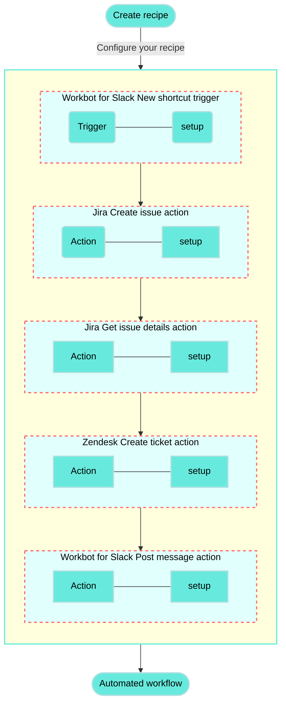

<!-- source: https://docs.workato.com/en/getting-started/use-cases/zendesk-jira-workbot-slack | lastmod: 2026-07-07 -->
> Build a recipe that creates Zendesk tickets and Jira issues from a Workbot for Slack action and posts the details in Slack.

# Create Zendesk and Jira issues with Workbot for Slack recipe

This use case guides you through connecting [Zendesk](/en/connectors/zendesk), [Jira](/en/connectors/jira), and [Workbot for Slack](/en/workbot/workbot#workbot-for-slack) to Workato to create a powerful automation.

## What does this recipe do?

This recipe enables you to execute a message action in Workbot for Slack, which creates a Zendesk ticket and a Jira issue using the input fields from the trigger's command. After creating these tickets, the details are posted in Slack to a channel or direct message of your choice.



## Create your recipe

Complete the following steps to design a recipe that creates a Zendesk ticket and a Jira issue when you run an action command in Workbot for Slack.

> **USE CASES ARE INTENDED AS EXAMPLES ONLY**
> 
> This use case serves as an example. Modifications to triggers, actions, or conditional logic may be necessary to adapt this recipe to your workflow.

1. Sign in to Workato.
   
2. Select the project where you plan to create the recipe.
   
3. Create connections for Zendesk, Jira, and Workbot for Slack:
   
   Create a Zendesk connection.
   
   ### Create a Zendesk connection
   
   This step creates a connection between Workato and your Zendesk account. The Zendesk connector supports OAuth 2.0 authentication.
   
   > **DEPRECATED AUTHENTICATION METHODS**
   > 
   > Effective March 31, 2026, you can no longer create new Zendesk connections using Basic authentication or Custom OAuth profiles. This change is required by [Zendesk's updated Developer Terms](https://www.zendesk.com/company/agreements-and-terms/zendesk-developer-terms/).
   > 
   > Existing connections using these authentication methods will continue to work until **April 30, 2027**. On this date, Zendesk connections still using Basic authentication or a Custom OAuth profile will be terminated, and recipes relying on these connections will stop functioning.
   
   1. Click **Create > Connection** or press C twice.
      
   2. Search for and select `Zendesk` on the **New connection** page.
      
   3. Provide a name for your connection in the **Connection name** field.
      
      _Zendesk connection setup_
      
   4. Use the **Location** drop-down menu to select the project where you plan to store the connection.
      
   5. Enter the **Subdomain** for your Zendesk URL. For example, if your Zendesk URL is `https://acme.zendesk.com`, your subdomain is `acme`.
      
   6. Click **Connect**.
      
   
   Create a Jira connection.
   
   ### Create a Jira connection
   
   This step creates a connection between Workato and your Jira account.
   
   1. Click **Create > Connection** or press C twice.
      
   2. Search for and select `Jira` on the **New connection** page.
      
   3. Enter a name for your Jira connection in the **Connection name** field.
      
      _Jira connection setup_
      
   4. Use the **Location** drop-down menu to select the project where you plan to store the connection.
      
   5. Select your **Connection type**.
      
   6. Use the **Auth type** drop-down menu to select your authentication method. Supported options include [Basic](/en/connectors/jira#basic-authentication-with-password), [API token](/en/connectors/jira#api-tokens), [OAuth 2.0](/en/connectors/jira#oauth2-0), and [Personal access token](/en/connectors/jira#personal-access-tokens).
      
   7. Provide your **Host name**. For example, if your Jira URL is `https://acme.atlassian.net`, your host name is `acme.atlassian.net`.
      
   8. Click **Connect**.
      
   
   Create a Workbot for Slack connection.
   
   ### Create a Workbot for Slack connection
   
   This step creates a connection between Workato and your Workbot for Slack account.
   
   1. Click **Create > Connection** or press C twice.
      
   2. Search for and select `Workbot for Slack` on the **New connection** page.
      
   3. Provide a name for your connection in the **Name** field.
      
      _Workbot for Slack connection setup_
      
   4. Use the **Location** drop-down menu to select the project where you plan to store the connection.
      
   5. Optional. Select the NLU provider you plan to use, such as DialogFlow or Amazon Lex NLU. You must connect to the NLU provider for it to appear in the drop-down menu.
      
   6. Optional. Click **Advanced** to configure **Slash commands verification tokens**, **custom help** content, your **Slack app status** (classic or not), and your **Custom OAuth profile**.
      
   7. Click **Connect**, sign in to your Slack workspace when prompted, and click **Continue** to verify the connection.
      
   
4. Go back to your project and click **Create > Recipe** or press C+R.
   
   _Create a new recipe_
   
5. Enter a name for your recipe in the **Name** field.
   
6. Select the project where you plan to store the recipe from the **Location** drop-down menu.
   
7. Click **Start building**.
   
   _Start building your recipe_
   
8. Click **Pick a starting point**, then select **Trigger from an app**.
   
9. Click **Select an app and trigger event**.
   
10. Set up your Workbot for Slack New shortcut trigger.
    
    ### Set up Workbot for Slack New shortcut trigger
    
    This trigger monitors Workbot for Slack for new shortcuts.
    
    1. Search for `Workbot for Slack` and select it as your app.
       
       _Choose Workbot for Slack as your app_
       
    2. Select the **New Shortcut** trigger.
       
       _New Shortcut trigger_
       
    3. Use the **Shortcut type** drop-down menu to select **Message**.
       
       _Set up your Shortcut trigger_
       
    4. Enter a name in the **Shortcut name** field. For example, `Create issue & ticket`.
       
    5. Click **Add field** in the **Parameters** section.
       
    6. Enter `Summary` in the **Name** field.
       
    7. Enter a label in the **Label** field.
       
    8. Select **String** from the **Data type** drop-down menu.
       
    9. Select **No** from the **Optional?** drop-down menu.
       
    10. Enter additional help text in the **Hint** field.
        
    11. Select **Text** from the **Dialog control type** drop-down menu.
        
        _`Summary` input field_
        
    12. Click **Add field** under **Parameters** to add a second input field.
        
    13. Enter `Description` in the **Name** field.
        
    14. Enter a label in the **Label** field.
        
    15. Select **String** from the **Data type** drop-down menu.
        
    16. Select **No** from the **Optional?** drop-down menu.
        
    17. Enter additional help text in the **Hint** field.
        
    18. Select **Textarea** from the **Dialog control type** drop-down menu.
        
        _`Description` input field_
        
    19. Click **Add field** under **Parameters** to add a third input field.
        
    20. Enter `Priority` in the **Name** field.
        
    21. Enter a label in the **Label** field.
        
    22. Select **String** from the **Data type** drop-down menu.
        
    23. Select **No** from the **Optional?** drop-down menu.
        
    24. Enter additional help text in the **Hint** drop-down menu.
        
    25. Select **Static** from the **Menu options** drop-down menu.
        
    26. Enter a list of comma-separated priority levels in the **Options** field.
        
        _`Priority` input field_
        
    27. Click the **Add field** button under **Parameters** to add a fourth input field.
        
    28. **Name** your input field `notify-user` > add a **Label** > set **Data type** to `String` > set **Optional?** to `No` > provide a **Hint** for your input field > set **Menu options** to `Conversations` > and then click **Save**.
        
        _`notify_user` input field_
        
    29. Use the **Copy original text into dialog field** drop-down menu to select **Description**.
        
        _Select Description_
        
    30. Click **Save**.
        
    
11. Click **\+ Add step** and select **Action in app**.
    
    _Click **Add step > Add action in app**_
    
12. Set up your Jira Create issue action.
    
    ### Set up Jira Create issue action
    
    This step creates a new issue in Jira and uses the description from Workbot for Slack.
    
    1. Search for `Jira` and select it as your app.
       
       _Choose Jira as your app_
       
    2. Select the **Create issue** action.
       
    3. Use the **Project issue type** drop-down menu to select the issue type you plan to create. For example: task, bug fix, or onboarding.
       
       _Select your issue type_
       
    4. Map the Workbot for Slack Summary (Step 1) datapill to the **Summary** field.
       
    5. Map the Workbot for Slack Description (Step 1) datapill to the **Description** field.
       
    6. Map the Workbot for Slack Priority (Step 1) datapill to the **Priority name** field.
       
    7. Click **Save**.
       
    
13. Click **\+ Add step** and select **Action in app**.
    
14. Set up your Jira Get issue action.
    
    ### Set up Jira Get issue action
    
    This steps retrieves Jira issues by ID.
    
    1. Search for `Jira` and select it as your app.
       
       _Choose Jira as your app_
       
    2. Select the **Get issue** action.
       
       _Select the Get issue action_
       
    3. Map the Jira ID (Step 2) datapill to the **Issue ID or key** field.
       
       _Configure the Issue ID or key field_
       
    4. Click **Save**.
       
    
15. Click **\+ Add step** and select **Action in app**.
    
16. Set up your Zendesk Create ticket action.
    
    ### Set up Zendesk Create ticket action
    
    This step creates a Zendesk ticket with information from Jira and Workbot for Slack.
    
    1. Search for `Zendesk` and select it as your app.
       
       _Choose Zendesk as your app_
       
    2. Select the **Create ticket** action.
       
       _Select the Create ticket action_
       
    3. Map the Jira Summary (Step 3) datapill to the **Subject** field.
       
    4. Use the **Priority** drop-down menu to select **Enter custom value** and then click **Formula**.
       
       _Set the Priority field to Formula_
       
    5. Copy and paste the following formula into the **Priority** field:
       
       ```
       =["Higher", "Highest"].include?(_dp('{"pill_type":"output","provider":"jira","line":"9e7af602","path":["fields","priority","name"]}')) ? "urgent" :  "Medium" == _dp('{"pill_type":"output","provider":"jira","line":"9e7af602","path":["fields","priority","name"]}') ?  "normal" : _dp('{"pill_type":"output","provider":"jira","line":"9e7af602","path":["fields","priority","name"]}') == "High" ?  "high" : "low"
       ```
       
       _Priority formula_
       
    6. Use the **Status** drop-down menu to select **Open**.
       
    7. Map the Jira Due date (Step 3) datapill to the **Due at** field.
       
       _Configure the Due at field_
       
    8. Map the Workbot for Slack Description (Step 1) datapill to the **Text comment** field.
       
       _Configure the Text comment field_
       
    9. Click **Save**.
       
    
17. Click **\+ Add step** and select **Action in app**.
    
18. Set up your Workbot for Slack Post message action.
    
    ### Set up Workbot for Slack Post message action
    
    This step posts a Slack message notify the users and channels you specify about the new Zendesk ticket.
    
    1. Search for `Workbot for Slack` and select it as your app.
       
    2. Select the **Post message** action.
       
    3. Map the Workbot for Slack Notify user (Step 1) datapill to the **Channel name/DM** field.
       
       _Configure the Channel name/DM field_
       
    4. Click **Add block to message** and use the **Type** drop-down menu to select **Section with text**.
       
       _Click the **Add block to message** button_
       
    5. Map the Zendesk Subject (Step 4) datapill, the Zendesk Ticket ID (Step 4) datapill, and the Workbot for Slack User ID (Step 1) datapill to the **Section text** field.
       
       _Map the **Section text** field_
       
    6. Click **Add block to message** and use the **Type** drop-down menu to **Section with fields**.
       
       _Section with fields_
       
    7. Locate the **Attachment fields** section and click **Add field**.
       
       _Click the **Add field** button_
       
    8. Enter `Subject` in the **Title** field.
       
    9. Map the Zendesk Subject (Step 4) datapill to the **Value** field.
       
       _Add a Subject field_
       
    10. Click **Add field** to add a second field.
        
    11. Enter `Priority` in the **Title** field.
        
    12. Map the Zendesk Priority (Step 4) datapill to the **Value** field.
        
    13. Click **Add field** to add a third field.
        
    14. Enter `Description` in the **Title** field.
        
    15. Switch the **Value** field to [formula mode](/en/formulas/formula-mode) and copy and paste the following formula:
        
        ```
        ="\n"+_dp('{"pill_type":"output","provider":"zendesk","line":"create_ticket","path":["description"]}')[0...65]+"..."
        ```
        
        _Add a Description field_
        
    16. Click **Add field** to add a fourth field.
        
    17. Enter `Status` in the **Title** field.
        
    18. Map the Zendesk Status (Step 4) datapill to the **Value** field.
        
    19. Expand the **Divider** section and use the **Type** drop-down menu to select **Divider**.
        
        _Select Divider_
        
    20. Click **Save**.
        
    
19. Click **\+ Add step** and select **Action in app**.
    
20. Set up your second Workbot for Slack Post message action.
    
    ### Set up a second Workbot for Slack Post message action
    
    This step posts a Slack message notify the users and channels you specify about the new Jira issue.
    
    1. Search for `Workbot for Slack` and select it as your app.
       
    2. Map the Workbot for Slack Notify user (Step 1) datapill into the **Channel name/DM** field.
       
       _Configure the Channel name/DM field_
       
    3. Click **Add block to message** and use the **Type** menu to select **Section with text**.
       
       _Click the **Add block to message** button_
       
    4. Map the Jira Key (Step 3) datapill and the Workbot for Slack User ID (Step 1) datapill to the **Section text** field.
       
       _Map the **Section with text** field_
       
    5. Click **Add block to message** and use the **Type** drop-down menu to select **Section with fields**.
       
    6. Locate the **Attachment fields** section and click **Add field**.
       
       _Click the **Add field** button_
       
    7. Enter `Summary` in the **Title** field.
       
    8. Map the Jira Summary (Step 3) datapill to the **Value** field.
       
       _Add a Summary field_
       
    9. Click **Add field** to add a second field.
       
    10. Enter `Priority` in the **Title** field,
        
    11. Map the Jira Name (Step 3) datapill to the **Value** field.
        
    12. Click **Add field** to add a third field.
        
    13. Enter `Description` in the **Title** field.
        
    14. Switch the **Value** field to [formula mode](/en/formulas/formula-mode) and copy and paste the following formula:
        
        ```
        ="\n"+ _dp('{"pill_type":"output","provider":"jira","line":"9e7af602","path":["fields","description"]}')[0...65]+"..."
        ```
        
        _Add a Description field_
        
    15. Click **Add field** to add a fourth field.
        
    16. Enter `Status` in the **Title** field.
        
    17. Map the Jira Name (Step 3) datapill to the **Value** field.
        
    18. Click **Save**.
        
    

Your **Create Zendesk and Jira issues with Workbot for Slack** recipe is ready to test and implement.

---
