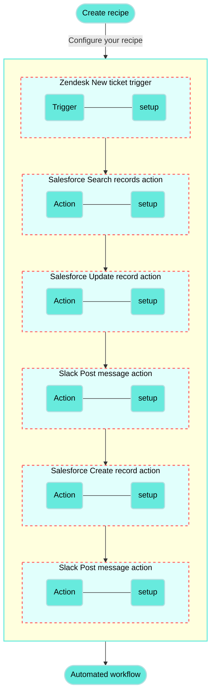

<!-- source: https://docs.workato.com/en/getting-started/use-cases/zendesk-salesforce-slack | lastmod: 2026-07-07 -->
> Build a recipe that syncs new Zendesk tickets to Salesforce cases and notifies your team in Slack with the case details.

# Sync Zendesk tickets to Salesforce and notify your team in Slack

This use case guides you through connecting [Zendesk](/en/connectors/zendesk), [Salesforce](/en/connectors/salesforce), and [Slack](/en/connectors/slack) to create a powerful automation.

## What does this recipe do?

This recipe checks Zendesk for new tickets at an interval you specify. When a new ticket is found, the recipe checks if there is an existing Salesforce case. The recipe either updates the existing case or creates a new one, then posts the case details in Slack to a channel or direct message of your choice.



## Create your recipe

1. Sign in to Workato.
   
2. Select the project where you plan to create the recipe.
   
3. Create connections for Zendesk, Salesforce, and Slack using the following steps:
   
   Create a Zendesk connection.
   
   ### Create a Zendesk connection
   
   This step creates a connection between Workato and your Zendesk account. The Zendesk connector supports OAuth 2.0 authentication.
   
   > **DEPRECATED AUTHENTICATION METHODS**
   > 
   > Effective March 31, 2026, you can no longer create new Zendesk connections using Basic authentication or Custom OAuth profiles. This change is required by [Zendesk's updated Developer Terms](https://www.zendesk.com/company/agreements-and-terms/zendesk-developer-terms/).
   > 
   > Existing connections using these authentication methods will continue to work until **April 30, 2027**. On this date, Zendesk connections still using Basic authentication or a Custom OAuth profile will be terminated, and recipes relying on these connections will stop functioning.
   
   1. Click **Create > Connection** or press C twice.
      
   2. Search for and select `Zendesk` on the **New connection** page.
      
   3. Provide a name for your connection in the **Connection name** field.
      
      _Zendesk connection setup_
      
   4. Use the **Location** drop-down menu to select the project where you plan to store the connection.
      
   5. Enter the **Subdomain** for your Zendesk URL. For example, if your Zendesk URL is `https://acme.zendesk.com`, your subdomain is `acme`.
      
   6. Click **Connect**.
      
   
   Create a Salesforce connection.
   
   ### Create a Salesforce connection
   
   This step creates a connection between Workato and your Salesforce account.
   
   1. Click **Create > Connection** or press C twice.
      
   2. Search for and select `Salesforce` on the **New connection** page.
      
   3. Provide a name for your connection in the **Connection name** field.
      
      _Salesforce connection setup_
      
   4. Use the **Location** drop-down menu to select the project where you plan to store the connection.
      
   5. Use the **Auth type** drop-down menu to select the authentication method. The default is OAuth 2.0.
      
   6. Use the **Sandbox** drop-down menu to specify whether the Salesforce account is a sandbox account.
      
   7. Optional. Expand **Advanced settings** to configure advanced connection options.
      
   8. Optional. Use the **Custom OAuth profile** drop-down menu to select a custom OAuth profile for your connection.
      
      - This custom OAuth profile ensures that the connection is restricted to the same set of scopes you selected for all users with the profile, and the authentication flow uses the client app linked to the custom profile.
   9. Click **Connect**.
      
   10. Enter your Salesforce account credentials and click **Log In**.
       
       _Log in to your Salesforce account_
       
   
   Create a Slack connection.
   
   ### Create a Slack connection
   
   This step creates a connection between Workato and your Slack account.
   
   1. Click **Create > Connection** or press C twice.
      
   2. Search for and select `Slack` on the **New connection** page.
      
   3. Enter a name for your connection in the **Connection name** field.
      
      _Slack connection setup_
      
   4. Use the **Location** drop-down menu to select the project where you plan to store the connection.
      
   5. Optional. Configure **Advanced** and **Custom OAuth profile** settings if required for your account type.
      
   6. Click **Connect**.
      
   
4. Go back to your project and click **Create > Recipe** or press C+R.
   
   _Create a new recipe_
   
5. Enter a name for your recipe in the **Name** field.
   
6. Use the **Location** drop-down menu to select the project where you plan to store the recipe.
   
7. Click **Start building**.
   
   _Start building your recipe_
   
8. Click **Pick a starting point > Trigger from an app**.
   
9. Click **Select an app and trigger event**.
   
10. Set up your Zendesk New ticket trigger.
    
    ### Set up Zendesk New ticket trigger
    
    This step checks Zendesk for new tickets at an interval you specify.
    
    1. Search for `Zendesk` and select it as your app.
       
       _Search for and select `Zendesk`_
       
    2. Select the **New ticket** trigger.
       
       _Select the **New ticket** trigger_
       
    3. Select the Zendesk connection you created in the preceding steps.
       
    4. Optional. Specify how frequently the trigger checks for new events in the **Trigger poll interval** field. This field defaults to five minutes if left blank.
       
       _Configure the **Trigger poll interval**_
       
    5. Optional. Set the date and time to start picking up trigger events from in the **When first started, this recipe should pick up events from** field. This enables your recipe to capture past events. Leave this field empty to fetch events from the last hour. You can't change this value after you run or test the recipe. Refer to [Triggers](/en/recipes/triggers#since-from) to learn more about this input field.
       
    6. Click **Save**.
       
    
    _**New ticket** trigger_
    
11. Click **\+ Add step > Action in app**.
    
    _Click **\+ Add step > Add action in app**_
    
12. Set up your Salesforce Search records batch action.
    
    ### Set up Salesforce Search records batch action
    
    This step searches Salesforce for cases matching the `Salesforce Case ID` attached to the new Zendesk ticket. The action retrieves details from matching cases for each **Fields to retrieve** selection.
    
    1. Search for `Salesforce` and select it as your app.
       
       _Search for and select `Salesforce`_
       
    2. Select the **Search records** batch action.
       
       _Select the **Search records** batch action_
       
    3. Select the Salesforce connection you created in the preceding steps.
       
    4. Go to the **Search for** field and search for `Case`.
       
    5. Optional. Go to the **Related objects** field and search for `Contact` and `Account`.
       
    6. Go to the **Fields to retrieve** field and search for `Case ID` and `Content URL`.
       
    7. Optional. Use the **Limit** field to specify the maximum number of records to retrieve with each search. This field defaults to `150` and has a maximum of `2,000`.
       
    8. Map the Salesforce Case ID (Step 1) datapill to the **Case ID** field.
       
    9. Click **Save**.
       
    
    _**Search records** action_
    
13. Click **\+ Add step > IF condition**.
    
    _Click **\+ Add step > IF condition**_
    
    How do IF conditions work?
    
    ### Salesforce and Zendesk IF condition example
    
    An [IF condition](/en/features/if-conditions) enables you to make decisions based on specific conditions. You can control your recipe workflow by executing different actions depending on whether a condition you specify is present or not present (true or false).
    
    ```mermaid
    flowchart TD
        A([Search records in Salesforce]) --> B(Is there a Salesforce case matching the new Zendesk ticket?)
        B -->|IF Yes| C(Update the existing case in Salesforce.)
        B ---->|ELSE No| E(Create a new record in Salesforce)
        C ----> F(Send a Slack detailing the updated Salesforce case.)
        E ---> G(Send a Slack detailing the new Salesforce case.)

        classDef default fill:#67eadd,stroke:#b3e0e1,stroke-width:2px,color:#000;
    ```
    
14. Set up your Salesforce and Zendesk IF condition.
    
    ### Set up a Salesforce and Zendesk IF condition
    
    This step checks if the Salesforce **Search records** action found a Case ID (Step 2) that matches the Salesforce Case ID (Step 1) attached to the new Zendesk ticket.
    
    1. Map the Case ID (Step 2) datapill to the **Data field** field.
       
    2. Select **is present** in the **Condition** field to specify that the IF condition runs only when Case ID (Step 2) is not null or an empty string.
       
    3. Click **Save**.
       
    
    _IF condition_
    
15. Go to the **Yes** branch of the IF condition and click **\+ Add step > Action in app**.
    
16. Set up your Salesforce Update record action.
    
    ### Set up Salesforce Update record action
    
    This step updates the contents of the existing Salesforce ticket to match the new Zendesk ticket.
    
    1. Search for `Salesforce` and select it as your app.
       
       _Search for and select `Salesforce`_
       
    2. Select the **Update record** action.
       
       _Select the **Update record** action_
       
    3. Go to the **Object** field and search for `Case`.
       
    4. Map the Case ID (Step 2) datapill to the **Case ID** field.
       
    5. Map the Rule ID (Step 1) datapill to the **Assignment rule ID** field.
       
    6. Map the Account Name (Step 1) datapill to the **Account ID** field.
       
    7. Map the Order ID (Step 1) datapill to the **Asset ID** field.
       
    8. Map the Type (Step 1) datapill to the **Case Type** field.
       
    9. Map the Description (Step 1) datapill to the **Description** field.
       
    10. Map the Priority (Step 1) datapill to the **Priority** field.
        
    11. Map the Status (Step 1) datapill to the **Status** field.
        
    12. Map the Subject (Step 1) datapill to the **Subject** field.
        
    13. Click **Save**.
        
    
    _**Update record** action_
    
17. Click **\+ Add step > Action in app**.
    
18. Set up your Slack Post message action.
    
    ### Set up Slack Post message action
    
    This step posts a message in Slack with information about the updated Salesforce ticket.
    
    1. Search for `Slack` and select it as your app.
       
       _Search for and select `Slack`_
       
    2. Select the **Post message** action.
       
       _Select the **Post message** action_
       
    3. Go to the **Channel** field and select the channel where you plan to post the message. Alternatively, you can switch the field to **Enter channel ID/name** and specify a channel to post in with the `#` prefix or a user to direct message with the `@` prefix, for example: `#support-ticket-101` or `@johndoe`.
       
    4. Go to the **Basic text** field and enter the body text of the message, for example: `Case updated:` Salesforce Case ID (Step 1)`-`Subject (Step 1).
       
    5. Go to the **Attachment message fields** field and enter additional details you plan to share as name-value pairs, for example:
       
       `Subject:` Subject (Step 1)
       
       `Status:` Status (Step 1)
       
       `Priority:` Priority (Step 1)
       
       `Description:` Description (Step 1)
       
    6. Go to the **Attachment color** field and select **Good**.
       
    7. Map the Content URL (Step 2) datapill to the **Thumb URL** field.
       
    8. Map the Content URL (Step 2) datapill to the **Image URL** field.
       
    9. Click **Save**.
       
    
    _**Post message** action_
    
19. Go to the **No** branch of the IF condition and click **\+ Add step > ELSE**. The **Choose an app** search box opens automatically.
    
    _Click **\+ Add step > ELSE** in the **No** branch_
    
    How do ELSE conditions work?
    
    ### Salesforce and Zendesk ELSE condition example
    
    The actions in an ELSE branch run if the IF conditions are not met. The ELSE branch in this recipe runs if the Salesforce **Search records** action didn't find a Case ID (Step 2) matching the Salesforce Case ID (Step 1) from the new Zendesk ticket.
    
    ```mermaid
    flowchart TD
        A([Search records in Salesforce]) --> B(Is there a Salesforce case matching the new Zendesk ticket?)
        B -->|IF Yes| C(Update the existing case in Salesforce.)
        B ---->|ELSE No| E(Create a new record in Salesforce)
        C ----> F(Send a Slack detailing the updated Salesforce case.)
        E ---> G(Send a Slack detailing the new Salesforce case.)

        classDef default fill:#67eadd,stroke:#b3e0e1,stroke-width:2px,color:#000;
    ```
    
    Refer to the [IF control statement](/en/features/if-conditions) documentation for more information.
    
20. Set up your Salesforce Create record action.
    
    ### Set up Salesforce Create record action
    
    This step creates a new ticket in Salesforce with the contents of the new Zendesk ticket.
    
    1. Search for `Salesforce` and select it as your app.
       
       _Search for and select `Salesforce`_
       
    2. Select the **Create record** action.
       
       _Select the **Create record** action_
       
    3. Go to the **Object** field and search for `Case`.
       
    4. Map the Rule ID (Step 1) datapill to the **Assignment rule ID** field.
       
    5. Map the Account Name (Step 1) datapill to the **Account ID** field.
       
    6. Map the Order ID (Step 1) datapill to the **Asset ID** field.
       
    7. Map the Type (Step 1) datapill to the **Case Type** field.
       
    8. Map the Description (Step 1) datapill to the **Description** field.
       
    9. Map the Priority (Step 1) datapill to the **Priority** field.
       
    10. Map the Status (Step 1) datapill to the **Status** field.
        
    11. Map the Subject (Step 1) datapill to the **Subject** field.
        
    12. Click **Save**.
        
    
    _**Create record** action_
    
21. Click **\+ Add step > Action in app**.
    
22. Set up your Slack Post message action.
    
    ### Set up Slack Post message action
    
    This step posts a message in Slack with information about the new Salesforce ticket.
    
    1. Search for `Slack` and select it as your app.
       
       _Search for and select `Slack`_
       
    2. Select the **Post message** action.
       
       _Select the **Post message** action_
       
    3. Go to the **Channel** field and select the channel where you plan to post the message. Alternatively, you can switch the field to **Enter channel ID/name** and specify a channel to post in with the `#` prefix or a user to direct message with the `@` prefix, for example: `#support-ticket-101` or `@johndoe`.
       
    4. Go to the **Basic text** field and enter the body text of the message, for example: `Case updated:` Salesforce Case ID (Step 1)`-`Subject (Step 1).
       
    5. Go to the **Attachment message fields** field and enter additional details you plan to share as name-value pairs, for example:
       
       `Subject:` Subject (Step 1)
       
       `Status:` Status (Step 1)
       
       `Priority:` Priority (Step 1)
       
       `Description:` Description (Step 1)
       
    6. Go to the **Attachment color** field and select **Good**.
       
    7. Click **Save**.
       
    
    _**Post message** action_
    

Your **Sync Zendesk tickets to Salesforce and notify your team in Slack** recipe is ready to test and implement.

Example recipe configuration.

_**Sync Zendesk tickets to Salesforce and notify your team in Slack** recipe_

---
