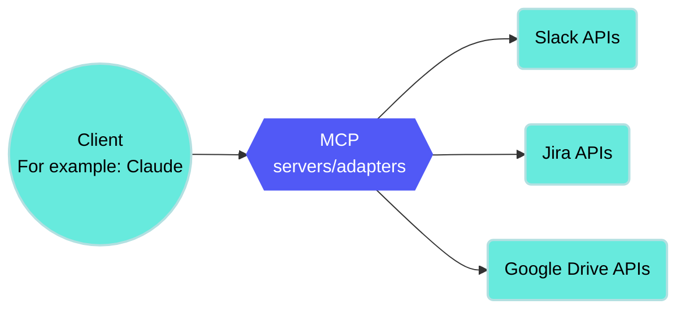

<!-- source: https://docs.workato.com/en/mcp | lastmod: 2026-11-03 -->
> Learn how Model Context Protocol (MCP) connects AI agents to business tools and data, and how to build and use Workato MCP servers in AI Hub.

# MCP

[Model Context Protocol](https://modelcontextprotocol.io/introduction) (MCP) is an open standard that connects AI models to external tools and data sources. It enables AI agents to access databases, APIs, and business applications through a common protocol. This eliminates the need for custom integrations each time you connect a new system. Get started with Workato MCP servers in [AI Hub > Enterprise MCP > Custom servers](https://app.workato.com/mcp/custom).

> **FEATURE AVAILABILITY**
> 
> MCP is available to all users in the US, EU, AU, JP, SG, IL, KR, and UK data centers. MCP servers are hosted in the US, EU, and APAC regions and respect data residency requirements where possible. MCP isn't available to workspaces in the CN data center. This reflects local regulatory requirements and Workato's commitment to data sovereignty and applies to our multi-tenant and [Virtual Private Workato (VPW)](/en/cloud-hosting-editions/hosting-editions#virtual-private-workato) offerings.
> 
> Contact your Customer Success representative if you're interested in using MCP or require additional information.

## How MCP works

MCP follows a client-server architecture where AI agents act as clients and connect to MCP servers that expose business tools. The protocol enables dynamic discovery, which means agents can find and use new tools without requiring code changes. This flexibility allows MCP servers to evolve over time while maintaining compatibility with existing clients.

MCP consists of the following key components:

- **MCP servers**: An MCP server exposes tools or skills to AI agents. Each server represents one or more business applications and contains a curated set of tools or skills, implements authentication, and enforces access control.
  
- **Skills**: [Skills](/en/agentic/skills) or tools are individual capabilities that an MCP server provides. Each skill represents a specific action like search, create, update, or analyze. Skills include input schemas, output schemas, and descriptions that AI agents can understand.
  
- **Dynamic discovery**: AI agents discover available skills or tools at runtime. The agent connects to an MCP server, requests the list of available tools, and receives the current tool inventory with schemas. The agent then determines which tools to use based on the user's goal.
  
- **Identity-aware execution**: Workato's MCP enforces permissions based on the authenticated user or agent. Actions respect user permissions (if implemented), follow organization-defined policies, and create audit trails with identity information.
  

## Security and governance

MCP provides the following security and governance features:

- **Authentication and access control**: Workato MCP uses OAuth-based [authentication](/en/mcp/mcp-authentication) flows to verify user identity. [MCP verified user access](/en/mcp/verified-user-access) enables your MCP servers to use authenticated end-user credentials for external API calls instead of static tokens.
- **Rate limiting**: You can configure [rate limits](/en/mcp/mcp-server-access-and-configuration#limits) at the server level to control usage. These quotas are shared across all skills or tools within a server to ensure fair resource allocation. Rate limiting protects your downstream applications from excessive requests. It also prevents abuse and ensures that all users have fair access to MCP resources.
- **Audit and compliance**: Workato [logs](/en/mcp/mcp-server-access-and-configuration#view-mcp-server-logs) all actions performed through MCP servers. Every operation includes identity tracking so you know exactly who performed each action. The system integrates with your enterprise audit systems for centralized compliance monitoring. You can generate compliance reports that show all MCP activity across your organization.

## MCP server types

MCP servers work with [Agent Studio](/en/agentic/agent-studio), [Claude](/en/mcp/remote-mcp-servers#claude-mcp-configuration), [ChatGPT](/en/mcp/remote-mcp-servers#chatgpt-mcp-configuration), or any MCP-compatible client. You can start with individual MCP servers for each application or create composable servers that combine multiple systems into unified business-centric interfaces.

Choose the implementation that suits your use case:

- **[MCP servers](/en/mcp/mcp-servers)**: Connect your [API collections](/en/mcp/mcp-servers#create-an-mcp-server-with-an-api-collection), [project assets](/en/mcp/mcp-servers#create-an-mcp-server-with-project-assets), or [external proxy MCP servers](/en/mcp/mcp-servers#create-a-proxy-mcp-server) to Workato-hosted MCP servers. This is the recommended way to get started with MCP.
- **[MCP local servers](/en/mcp/mcp-local-servers)**: Run MCP servers on your local infrastructure to access local tools and data sources.
- **[Workato Developer API and Embedded API MCP server](/en/mcp/developer-api-mcp)**: Connect AI-powered developer tools like Claude Desktop, Cursor, or ChatGPT to your Workato workspace.

## Get started with MCP server key components

MCP servers consist of the following key components:

| MCP component | Function | Description | Get started |
| --- | --- | --- | --- |
| [Dashboard](/en/mcp/dashboard) | Filter MCP server metrics by period, server, client, and user to spot degraded health, track adoption, and find where token costs concentrate. | Monitor server status, tool call volume, success rate, response time, errors by type, and estimated token usage across your MCP servers. | [Get started with the MCP servers dashboard](/en/mcp/dashboard#access-the-mcp-servers-dashboard) |
| [Tools](/en/mcp/manage-tools#add-tools) | Enables AI agents to take action, such as the ability to search, create, update, or analyze records in an app. | Each tool includes an input schema, an output schema, and a description that agents use to decide when to call it. Agents discover tools dynamically at runtime. | [Get started with tools](/en/mcp/manage-tools#add-tools) |
| [Tool annotations](/en/mcp/manage-tools#manage-tool-annotation) | Guides how AI agents treat each tool on your MCP server before running a specific tool. | Settings for read-only, destructive, safe to retry, and open world allow agents to decide whether to ask for confirmation, show a warning, retry a call, or treat returned data as untrusted. | [Get started with tool annotations](/en/mcp/manage-tools#manage-tool-annotation) |
| [MCP client connection](/en/mcp/remote-mcp-servers) | Connects your MCP server to the AI client your team uses. | Client-specific configuration for Claude, ChatGPT, Cursor, and other MCP-compatible clients. | [Get started with remote MCP servers](/en/mcp/remote-mcp-servers#add-a-remote-mcp-server-to-an-ai-model) |

## Enhance your MCP server

Add the following additional components to further customize your MCP server for specific use cases:

| MCP component | Description | Get started |
| --- | --- | --- |
| [Verified user access](/en/mcp/verified-user-access) | Enable each end user to authenticate to external systems, such as Salesforce or Snowflake, with their own credentials so actions run with that user's permissions. | [Get started with verified user access](/en/mcp/verified-user-access-configuration) |
| [MCP Apps](/en/mcp/mcp-apps) | Render an interactive HTML interface in the chat so users can view, filter, and act on data without additional LLM turns. | [Get started with MCP Apps](/en/mcp/mcp-apps#create-an-mcp-app-from-scratch) |
| [Genies as MCP clients](/en/mcp/genies-as-mcp-clients) | Add MCP server tools to an Agent Studio genie. | [Get started with Genies as MCP clients](/en/mcp/genies-as-mcp-clients#add-mcp-server-tools-to-an-agent-studio-genie) |
| [Enterprise Context MCP](/en/mcp/enterprise-context-mcp) | Give AI clients governed, permission-aware search across your connected data sources and knowledge bases through a single native server. | [Get started with Enterprise Context MCP](/en/mcp/enterprise-context-mcp#enable-enterprise-context-mcp) |
| [Knowledge Graph](/en/mcp/knowledge-graph) | Resolve entities and relationships across connected systems so agents can traverse all systems in a single call. | [Get started with Knowledge Graph](/en/mcp/knowledge-graph#enable-knowledge-graph) |
| [MCP local servers](/en/mcp/mcp-local-servers) | Run an MCP server on your own machine to access local tools and data sources. | [Get started with MCP local servers](/en/mcp/mcp-local-servers#install-a-local-mcp-server) |
| [Developer API and Embedded API MCP server](/en/mcp/developer-api-mcp) | Connect tools like Claude Desktop or Cursor to your Workato workspace to manage assets and projects. | [Get started with the Developer API MCP server](/en/mcp/developer-api-mcp#configure-developer-apis-as-an-mcp-server) |

---
