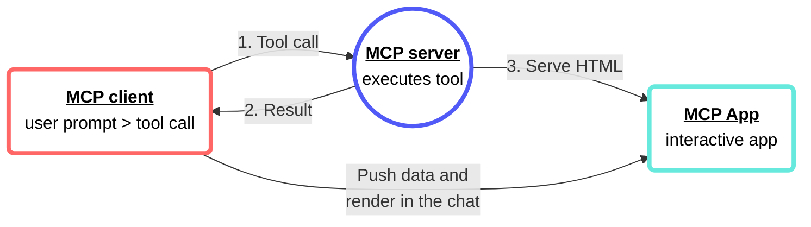

<!-- source: https://docs.workato.com/en/mcp/mcp-apps | lastmod: 2026-10-14 -->
> MCP Apps lets tools return interactive tables, forms, and dashboards inside the LLM chat so users view, sort, and act on data without leaving the conversation.

# MCP Apps

MCP Apps is an open standard that enables tools to return interactive elements, such as tables, forms, images, buttons, or dashboards directly inside the LLM chat as an embedded application. The embedded application functions as a web page directly within the end-user's conversation.

Workato MCP Apps lets end users view, sort, filter, and interact with real data without leaving the chat. For example, a tool that queries SAP, Salesforce, and ServiceNow can show the combined results as a sortable table with approve and reject buttons rather than a text summary.

  

> **NEED AN EXAMPLE?**
> 
> Refer to the [GitHub interactive images MCP app](/en/getting-started/use-cases/mcp/github-mcp-app) use case for a step-by-step guide on how to create an MCP app that enables you to view, pan, and zoom your GitHub repo images directly in your LLM, such as ChatGPT, Claude, or Cursor.

## When to use MCP Apps

Use MCP Apps in the following scenarios:

- **Complex data**: Data from multiple sources is easier to interpret when you can filter and sort the data.
  
- **Rich media**: An MCP App embeds a viewer that enables users to zoom and pan generated images or PDFs rather than relying on text descriptions that fail to fully capture the information users need.
  
- **[Multi-step workflows](/en/agentic/agent-studio/design-workflows-with-multiple-steps#design-genie-workflows-with-multiple-steps)**: An MCP App can add approve and reject buttons when using workflows with items that require individual review, such as expense reports, time off requests, or issue escalation.
  

## Add an MCP app

You can create an MCP app from scratch or use a template:

### Create an MCP app from scratch

Complete the following steps to create an MCP app from scratch:

1. Sign in to your Workato account.
   
2. Go to **AI Hub > Enterprise MCP > Custom servers**.
   
3. Select the MCP server where you plan to add an MCP app.
   
4. Go to the **Server capabilities** section and select the **Apps** tab.
   
   _Select the **Apps** tab_
   
5. Click **\+ Add App**.
   
6. Enter a name for the MCP app in the **Name** field.
   
   _Configure the MCP app_
   
7. Use the **Linked tool** drop-down menu to select the tool you plan to add the MCP app to.
   
8. Optional. Expand the **Content security policy** section to select the external content and resources the MCP app is allowed to access.
   
9. Optional. Expand the **Permissions** section to select permissions to allow the MCP app to request access to your camera, microphone, location, and clipboard.
   
10. Select **Start from scratch**.
    
    _Select **Start from scratch**_
    
11. Manually add your application logic to the code editor.
    
    _Add your application logic to the code editor_
    
12. Click **Save**.
    

### Create an MCP app with a template

The **Submission form** template is the default MCP app template.

#### Submission form template

Complete the following steps to create an MCP app using the **Submission form** template:

1. Sign in to your Workato account.
   
2. Go to **AI Hub > Enterprise MCP > Custom servers**.
   
3. Select the MCP server where you plan to add an MCP app.
   
4. Go to the **Server capabilities** section and select the **Apps** tab.
   
5. Click **\+ Add App**.
   
6. Enter a name for the app in the **Name** field.
   
7. Use the **Linked tool** drop-down menu to select the tool you plan to add the MCP app to.
   
8. Optional. Expand the **Content security policy** section to select the external content and resources the MCP app is allowed to access.
   
9. Optional. Expand the **Permissions** section to select permissions to allow the MCP app to request access to your camera, microphone, location, and clipboard.
   
10. Select the **Submission form** template.
    
    _Select the **Submission form** template_
    
11. Review and edit the generated code in the **Code editor** section.
    
12. Click **Save**.
    

## Edit an MCP app

You can edit an MCP app to update your MCP app name, linked tool, content security policy, permissions, or code.

Complete the following steps to edit an MCP app:

1. Sign in to your Workato account.
   
2. Go to **AI Hub > Enterprise MCP > Custom servers**.
   
3. Select the MCP server where the MCP app is stored.
   
4. Go to the **Server capabilities** section and select the **Apps** tab.
   
5. Click the MCP app name you plan to edit.
   
6. Edit the MCP app.
   
   _Make edits to your MCP app_
   
7. Click **Save**.
   

## Unlink an MCP app

You can unlink an MCP app from a tool without deleting it.

Complete the following steps to unlink an MCP app from a tool:

1. Sign in to your Workato account.
   
2. Go to **AI Hub > Enterprise MCP > Custom servers**.
   
3. Select the MCP server where the MCP app is stored.
   
4. Go to the **Server capabilities** section and select the **Apps** tab.
   
5. Click the edit menu (...) icon of the MCP app and click **Unlink App**.
   
   _Click **Unlink App**_
   
6. Click **Unlink app** in the **Unlink app?** confirmation modal.
   

## Delete an MCP app

You can delete an MCP app to completely remove it from **MCP servers**.

Complete the following steps to delete an MCP app:

1. Sign in to your Workato account.
   
2. Go to **AI Hub > Enterprise MCP > Custom servers**.
   
3. Select the MCP server where the MCP app is stored.
   
4. Go to the **Server capabilities** section and select the **Apps** tab.
   
5. Click the edit menu (...) icon of the MCP app and click **Delete app**.
   
6. Click **Delete** in the **Delete app?** confirmation modal.
   
   _Click **Delete**_

---
